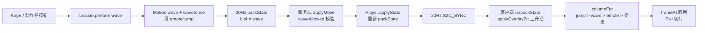

## 用户需求

为牛马角色新增「打招呼」动作：抬前蹄挥一下，与叫唤、跳跃同级的独立动作，可通过按键与底部动作栏按钮触发；站姿、坐姿、躺姿各有一套对应动画。

## 产品概览

园区里角色原本只会走、坐、躺、叫唤、跳。新增打招呼后，玩家靠近同事时可以抬手示意，坐下或躺平也能抬手回应。动画表现是「抬前蹄 → 挥出 → 收回」三段，身体与头部保持不动，与只动嘴的叫唤、全身位移的跳跃在观感上互不混淆；远端玩家同步看到同一套动作。

## 核心功能

- 新增打招呼动作：3 帧一次性动画，站立、坐下、躺平三套姿态各一段，播完自然回到原姿态，不需要回滚状态
- 触发方式：键盘 E 键与底部动作栏「打招呼」按钮，两者等价
- 动作互斥：打招呼与叫唤、跳跃后按的打断先按的；连按从第 0 帧重播
- 移动约束：行走中忽略该动作（无行走挥手帧），不打断行走；开始移动或切换坐躺会立即清掉该动作
- 多人同步：远端玩家通过同步包看到挥手，丢包最多漏一次，不会卡在抬手姿态
- 视觉一致性：牛与马共用同一套动作节奏，侧视抬近侧前蹄，正视与背视抬起一侧前蹄，躺姿从头侧露出抬起的前蹄


## 技术栈

沿用现有 Monorepo 技术栈，不引入任何新依赖：

- 语言与构建：TypeScript 5（strict）· pnpm 10 · Turborepo 2
- 渲染：PixiJS 8 + bitecs 0.4（SoA + TypedArray，帧循环零分配）
- 服务：Bun.serve WebSocket · 20Hz 固定 Tick
- 美术：`packages/pixel-assets` 程序化像素图集生成器（零外部美术工具）
- 测试：bun:test（协议 / 图集 / 渲染纯模块）+ vitest（协议包）

## 实现方案

### 核心策略：第三个叠加动作位，不改包长

ADR-0018 已把「叫唤 / 跳」建成叠加动作位（bit6 / bit7），并明确「后续再加表情（挥手、鼓掌）只需加列 + 复用同一对标志位的模式」。但 state 字节 8 位已全部占用，唯一可行的空闲位是 **pose 字段的 bit4**：`POSE` 实际只有 0-3 四个值，`(pose & 0b111) << 2` 的高位恒为 0。

- `packState(direction, pose, moving, emote = false, jump = false, wave = false)`，wave 写 bit4（`0b10000`）
- `unpackState` 的 pose 掩码从 `0b111` 收紧到 `0b11`，新增返回 `wave`
- 包长、opcode、sync entry 全部不变（move 14B / sync entry 7B），无额外带宽

**混布降级**：旧客户端把 bit4 读进 pose 得到 4 → 回落 idle（看到对方站着）；旧服务端 `sanitizePose` 归 Idle 并丢位 → 远端看不到挥手。项目本来就是双端同批发布，属可接受降级。

**被否掉的方案**（写入 ADR-0019）：

| 方案 | 不选的理由 |
|---|---|
| state 扩成 2 字节 | move 14→15、sync entry 7→8，双端所有解析器、限速校验、压测脚本全部要改，只为 1 个位付 1 字节/实体/Tick 的带宽 |
| 把 wave 挤进 pose 枚举 | 重演 ADR-0018 已否定的错误：姿态同时承担「身体形态」和「正在播什么」，坐姿挥手结束会站起 |
| 只改客户端 | 远端看不到挥手，多人场景直接失真 |

### 图集扩列：25 → 34

`packages/pixel-assets/src/layout.ts` 是唯一真相，改一处、重跑 `pnpm assets` 即可：

```
idle 0-2 / walk 3-8 / sit 9-10 / lie 11-12 / jump 13-15
emote 16-18 / sitEmote 19-21 / lieEmote 22-24
wave 25-27 / sitWave 28-30 / lieWave 31-33     ← 新增
```

- 每段 `frames: [n, n+1, n+2]`、`frameMs: [220, 220, 220]`、`loop: false`、`loopFrom: 0`，合计 660ms
- 660ms 而非常规 440ms：抬蹄到最高点后需要一拍「挥出」，再用一拍收回；440ms 三帧会让挥手读成抽搐
- `COLUMN_POSES` 同步补 9 项，模块加载时的长度断言会立刻抓漏
- `generate.ts` 里 `writeLayoutModule()` 与 manifest 的 `version` 同时 6 → 7，否则 `apps/web/lib/game/atlas.ts` 的版本校验会抛错

### 像素绘制：新增「举前腿」分支

现有 `quadruped.ts` 的腿只有 `swing`（横向偏移）与 `lift`（抬脚），正视/背视更只有 `legLift: [number, number]`，画不出「举起一条前腿」。三套姿态分别处理：

- **侧视（left/right）**：近侧前腿 `frontNear` 走 `{ swing: +4 → +6 → +4, lift: 11 → 12 → 11 }`，腿从肩部斜向外下，蹄块落在胸口高度；远侧腿、后腿、躯干、尾巴全部 `STILL`
- **正视 / 背视（down/up）**：新增 `waveLeg: 'near' | null` 绘制分支——近侧前腿不再画到脚底线，改画一节从肩点向外下方伸出的短腿 + 蹄块，第二拍外摆 1px 作为「挥」的读点；背视同样处理（看不到脸也能看懂）
- **坐姿（sitWave）**：沿用 `sit` 基座（`bodyCY + 5.5`、`haunch: true`），只把前腿换成举手分支，身体不抬
- **躺姿（lieWave）**：`lie` 基座保持贴地，在头侧额外画一截抬起的前腿 + 蹄块，躯干与头不动
- 三套都不参与呼吸（`breatheOffset` 只认 idle/sit/lie），不张嘴，避免与叫唤表情混淆
- 验收：`pnpm assets` 会重写 `packages/pixel-assets/.proof/sheet-cow.png` 与 `sheet-horse.png`，四向 × 34 列人工过一遍，重点看蹄块是否被 64 帧裁切、牛角是否与抬起的前蹄打架

### 客户端：复用现有叠加轨模式

- `ecs.ts` 的 `Motion` 增加 `wave` / `waveSince`，`spawn()` 里初始化
- `clip.ts` 的 `OverlayTracks` 增加 `waveByPose`（Idle/Sit/Lie 三条轨，Walk 为 null）与 `waveMs = max(440, 图集实际长度)`；`overlayTrackFor(overlays, pose, emoting, jumping, waving)` 优先级 **jump > wave > emote**，返回 null 时回落姿态轨
- `session.ts` 复用 `startOverlay` 的三态互斥（新动作置位时清另外两个）、`expireOverlays` 按各自窗口清位、`columnFor` 按 `waveSince` 求帧；`handleSpawn` / `handleSync` 走同一个 `applyOverlayBit` 上升沿逻辑；20Hz 发送处给 `packState` 补第 6 个参数
- 行走中忽略：与叫唤同一条守卫（`pose === Walk || moving === 1` 直接 return），图集没有行走挥手帧
- 键盘：`ActionKey` 增 `'wave'`，绑 `KeyE`（Z/X/C/Space 已占用，E 贴着 WASD 且不进 `BLOCKED`）；`ActionBar.tsx` 的 `ACTIONS` 增加「打招呼 [E]」，图标用 lucide `Hand`，完全复用现有按钮样式类

### 服务端：只存与回传

- `Player` 增 `wave` 字段，`reset()` / `spawn()` 归零，`applyState(..., wave = false)` 内部重新 `packState`
- `movement.ts` 增 `waveAllowed = pose !== POSE.Walk && !state.moving`（与叫唤同规则，跳仍放行）
- `server.ts` 切坐躺时 `applyState(dir, pose, false, false, false)` 补第 6 个 false，避免残留抬手帧
- 不新增计时器：到期由客户端清位，服务端只回传（沿用 ADR-0018 结论）

## 实现要点

### 性能

- 渲染帧循环仍只做一次数组下标 + 一次顺序查表：`waveByPose` 是预编译的定长数组，不新增分配
- 图集从 1600×256 扩到 2176×256，每层切片 100 → 136；所有层共享同一批 `TextureSource`，显存不变，只多切片对象
- 协议零成本：bit4 复用，字节数、opcode、20Hz 发送频率都不变

### 回归风险控制

- `layout.test.ts` 现有断言「jump/emote/sitEmote/lieEmote 合计 440ms」必须改成按动作断言（wave 系 660），否则扩列后直接红
- `overlay-frames.test.ts` 新增一条「挥手差异只落在前腿区域」的断言：差异像素下限 > 0、且中心点落在躯干前下方，避免以后把挥手画成整体位移
- `clip.test.ts` 的 `overlayTrackFor` 调用都要补第 5 个参数；新增「walk 中不接挥手」「jump 优先于 wave」两条矩阵
- 版本号两处（manifest 与 `sprite-layout.generated.ts`）必须同批改，否则 `atlas.ts` 校验报错——这是最容易被漏掉的一步
- 不改历史 ADR（0006/0010/0018 里的旧列数保持原样），只新增 ADR-0019

### 可扩展性

本次把「叠加动作」从 2 个位扩到 3 个位后，state 字节再无空闲位。若后续还要加鼓掌/点头，正确路径是改成「动作种类 3 位 + 独立 opcode」的旁路包，而不是继续往 state 里挤——这条边界写进 ADR-0019 的「后果」章节。

## 架构设计



## 目录结构

```
niuma/
├── packages/shared-types/src/
│   ├── quantize.ts                    # [MODIFY] packState 追加 wave 参数写 bit4；unpackState 返回 wave，pose 掩码收紧为 0b11；补注释说明混布降级
│   └── __tests__/protocol.test.ts     # [MODIFY] 全组合往返加入 wave；新增「wave 占 bit4、不与 pose/moving/emote/jump 互吃」断言
├── packages/pixel-assets/
│   ├── src/layout.ts                  # [MODIFY] COLUMNS 25→34；PoseName 加 wave/sitWave/lieWave；CLIPS 新增三段 220/220/220；COLUMN_POSES 补 9 项
│   ├── src/quadruped.ts               # [MODIFY] 三套挥手帧几何：侧视 frontNear 抬腿外摆、正视/背视新增举腿分支、躺姿头侧露蹄；全部不参与呼吸、不张嘴
│   ├── src/__tests__/layout.test.ts   # [MODIFY] 一次性动作时长按动作断言（wave 660，其余 440）；列覆盖断言自动适配 34 列
│   ├── src/__tests__/overlay-frames.test.ts  # [MODIFY] 新增挥手回归：差异集中在躯干前下方；三套姿态各一条
│   └── scripts/generate.ts            # [MODIFY] manifest 与 sprite-layout 的 version 6→7，注释补 v7 变更说明
├── apps/web/
│   ├── lib/game/ecs.ts                # [MODIFY] Motion 增 wave / waveSince，spawn 初始化
│   ├── lib/game/clip.ts               # [MODIFY] OverlayTracks 增 waveByPose / waveMs；overlayTrackFor 增 waving 参数与 jump>wave>emote 优先级
│   ├── lib/game/session.ts            # [MODIFY] perform 处理 wave（Walk/moving 忽略）；startOverlay 三态互斥；expireOverlays/columnFor/handleSpawn/handleSync/packState 全链路接线
│   ├── lib/game/__tests__/clip.test.ts        # [MODIFY] 补 wave 轨选择矩阵、walk 不接挥手、jump 优先级、播放窗口覆盖 660ms
│   ├── lib/game/input.ts              # [MODIFY] ActionKey 增 'wave'，KeyE 绑定
│   ├── components/game/ActionBar.tsx  # [MODIFY] ACTIONS 增加「打招呼 [E]」，Hand 图标，沿用现有按钮样式
│   ├── lib/game/sprite-layout.generated.ts    # [MODIFY] 由 pnpm assets 重写（version 7、34 列、新增三段 clip）
│   └── public/sprites/**              # [MODIFY] 由 pnpm assets 重写：牛马各层 png 扩到 2176×256，manifest.json 升 v7
├── apps/game-server/src/
│   ├── sim/world.ts                   # [MODIFY] Player 增 wave，reset/spawn 归零，applyState 增第 6 参数并重新 packState
│   ├── sim/movement.ts                # [MODIFY] waveAllowed = pose !== Walk && !moving，透传给 applyState
│   ├── sim/movement.test.ts           # [MODIFY] 行走中丢 wave 位、坐姿挥手回传字节带 bit4
│   └── server.ts                      # [MODIFY] 切坐躺清叠加位处补第 6 个 false
├── docs/adr/0019-greet-overlay.md     # [NEW] 记录 bit4 复用、34 列预算、备选方案、混布降级、回滚路径与「叠加位已用尽」的后续边界
└── README.md                          # [MODIFY] 技术栈表 25→34 列；角色与动画章节补 wave 列区间与交互规则
```

## 关键代码结构

```ts
// packages/shared-types/src/quantize.ts
export function packState(
  direction: Direction,
  pose: Pose,
  moving: boolean,
  emote = false,
  jump = false,
  wave = false,
): number;

export function unpackState(state: number): {
  direction: Direction;
  pose: Pose;
  moving: boolean;
  emote: boolean;
  jump: boolean;
  wave: boolean;
};

// apps/web/lib/game/clip.ts
export interface OverlayTracks {
  readonly emoteByPose: ReadonlyArray<ClipTrack | null>;
  readonly waveByPose: ReadonlyArray<ClipTrack | null>; // Idle/Sit/Lie，Walk 为 null
  readonly jump: ClipTrack | null;
  readonly emoteMs: number;
  readonly waveMs: number;
  readonly jumpMs: number;
}

export function overlayTrackFor(
  overlays: OverlayTracks,
  pose: Pose,
  emoting: boolean,
  jumping: boolean,
  waving: boolean,
): ClipTrack | null;
```


## Agent Extensions

### Skill

- **layer-pixel-art**
  - Purpose: 指导 `quadruped.ts` 中三套挥手帧的像素几何（侧视抬前蹄、正视/背视新增举腿分支、躺姿头侧露蹄），确保 64×64 网格内轮廓可读、蹄块与描边不被裁切
  - Expected outcome: 34 列图集生成成功，`.proof/sheet-cow.png` 与 `sheet-horse.png` 上四向三套挥手帧目视可辨，且不破坏牛/马剪影差异

- **principal-software-architect**
  - Purpose: 为「state 字节 bit4 复用 vs 扩展 2 字节」的协议取舍产出证据化结论与 ADR-0019，明确混布降级、回滚路径与「叠加位用尽后的演进边界」
  - Expected outcome: `docs/adr/0019-greet-overlay.md` 含备选方案对比表、代价与不可逆性、30 天回滚路径，代码改动落在最低可行层（协议位 → 服务端回传 → 渲染选帧）
