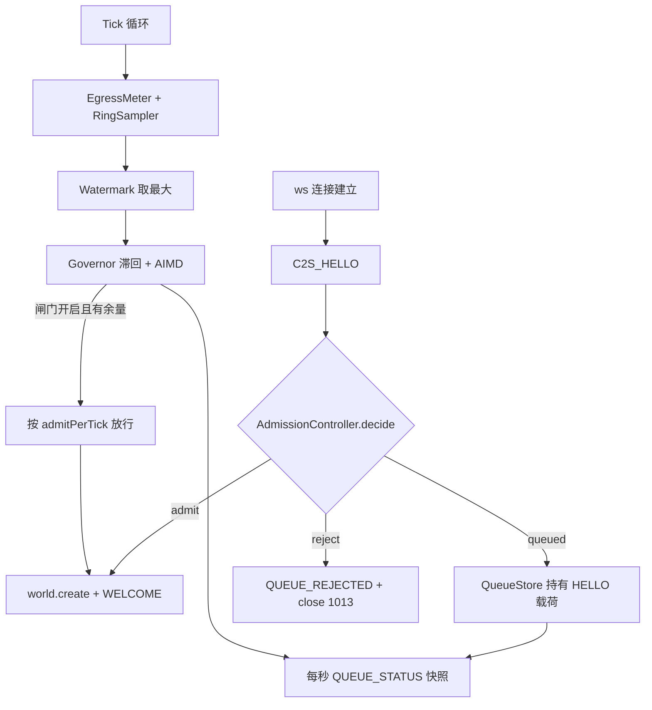

## 产品概述
为「牛马园区」增加一层**自适应准入与排队系统**：当服务器（2C2G/3M 单机）的实测出口流量、在线人数或 Tick 负载逼近上限时，自动收紧入场、把新到访者排进先来先到的队列，并在容量释放后按限速逐个放行。用户看到的不再是「连接失败」或莫名卡顿，而是一块符合园区风格的排队屏。

## 核心功能
- **自动判定**：以实测出口字节速率、在线人数、Tick p95 三项水位取最大值，任一越线即开始排队；判定带滞回，水位在临界点附近来回波动时不会反复开关闸门。
- **容量自适应**：稳定期缓慢扩容，越界时按比例收缩，容量随真实负载变化，而不是写死的固定人数。
- **FIFO 排队**：先到先入队，位次稳定；排队者不进入游戏世界，不产生任何广播流量。
- **限速放行**：闸门打开时按固定节奏分批放人，避免几十人同时涌入造成首次视野结算卡顿。
- **完整排队屏**：显示「前面还有几人」、预计等待、当前队列长度、触发原因（带宽/人数/负载）、容量水位；被放行后自动进入园区，无需刷新。
- **快速拒绝**：队列到达动态上限（由当前容量推导并设上下限）时直接拒绝并提示稍后再来，不让请求无限堆积。
- **掉线即释放**：排队中刷新或断网立即释放位次，不做保位。
- **可观测**：健康检查接口暴露当前水位、主导维度、容量、队列长度、出口速率与放行速率，便于压测与线上排障。
- **一键回退**：关闭开关即回到「满了才拒绝」的原有行为。

## 视觉与交互效果
沿用园区既有的像素终端语言：深墨绿底、2px 硬边框、等宽大写小标签、薄荷绿强调色。排队屏以「考勤排队机」为隐喻——顶部一行状态条（`// 准入控制 · GATE CLOSED`），中央是巨大的等宽位次数字，下方一条带阈值刻度的水位条实时显示当前利用率，再下方是三行数据（队列长度、预计等待、放行速率），底部一行说明触发原因。位次每秒刷新一次并带轻微数值滚动，放行成功时整块面板向上淡出、直接进入园区。面板使用既有扫描线质感，无圆角、无渐变滥用、无异形阴影；尊重 `prefers-reduced-motion`。


## 技术栈
全部沿用现有栈，零新增运行时依赖：

| 层 | 现有选型 | 本需求用法 |
|---|---|---|
| 协议 | `packages/shared-types` 手写定长二进制（`ByteWriter`/`ByteReader`） | 追加两个下行包，双端共用一份编解码 |
| 服务端 | Bun `Bun.serve` WebSocket · 20Hz 固定 Tick · 进程内存 | 新增纯策略模块 `admission/`，`server.ts` 只做协议映射 |
| 客户端 | Next.js 15 · React 19 · Zustand 5 · Tailwind v4 | 连接状态机 + 排队屏组件 |
| 测试 | vitest（协议）+ `bun:test`（服务端） | 新增策略单测与协议往返测试 |
| 部署 | pm2 + nginx 同源 `/ws` 反代 | 仅调整 Web 进程堆上限 |

## 实现策略

**采用方案 A：同连接进程内排队。**

握手后不立即入世界，而是先向准入控制器询问；控制器返回三种决策之一，`server.ts` 只负责把它映射成包：

- `admit` → 照旧 `world.create` + `S2C_WELCOME`，客户端进入园区。
- `queued` → 连接保留在服务端，HELLO 载荷（昵称 + 20 字节外观）暂存进队列条目，**不创建 Player、不进 `world`、不进 AOI**，因此零广播、零同步带宽；每 1 秒推一次 16 字节位次快照。
- `reject` → 先发 2 字节拒绝包再 `close(1013)`。

闸门打开时每 Tick 最多放行 `admitPerTick` 人（默认 2，即 40 人/秒），放行时直接完成入场，不需要二次握手——这是把「排队」和「握手」解耦的关键，避免放行瞬间又打一轮协议往返。

### 被否决的替代方案

| 方案 | 收益 | 代价 | 为何不选 |
|---|---|---|---|
| B HTTP 票据 + 网关准入 | 可跨实例统一排队 | 需 Redis/网关状态，破坏「零持久化单进程」边界，多一个故障点 | 当前单实例，收益为零 |
| C nginx `limit_conn` / 维护页 | 一行配置 | 无位次、无 ETA、非 FIFO、用户只看到 503 白屏 | 体验不成立 |

协议里保留 `ticket` 字段（u32）但客户端不回传（按用户选择「掉线立即释放」），它只用于日志串联与未来分片时替换 `AdmissionStore` 实现——这是一条**预埋但不投机**的接缝。

### 为什么第一维必须是实测带宽

3M 带宽的成本不是「人数」，而是「观察者 × 移动者」的对数：同屏走动 50 人就打满，分散挂机 150 人才打满，人数相同、带宽差 10 倍。因此出口字节必须在 `Transport.send` 唯一收口处实测累计，而不是用人数估算。

### 性能与复杂度

| 路径 | 复杂度 | 说明 |
|---|---|---|
| `EgressMeter.record()` | O(1)，零分配 | 50ms × 24 环形桶，`Float64Array`，处于每 Tick 数千次发送的热路径上，禁止 new 对象 |
| `QueueStore.enqueue/dequeue/remove` | O(1) | 数组 + head 指针；按 `wsId` 索引存下标，删除用惰性标记 |
| 位次计算 | 摊还 O(1) | 惰性删除占比超过 25% 时原地压缩一次，保证位次精确、内存有界 |
| 水位判定 | O(1) | 三个比值取最大 + 主导维度 |
| Tick p95 采样 | O(n log n)，n=1200，1Hz | 复用现有 `RingSampler.percentile`，不在 20Hz 路径上调用 |
| 队列快照 | ≤ 1 包/秒/人 | 仅位次变化或 1 秒心跳时发送，队列上限 1000 时也只有约 16 KB/s |

## 架构设计



分层落点（由内到外）：

- **策略层**（新增 `apps/game-server/src/admission/`，无 Bun/WebSocket 依赖，可纯函数测试）：`watermark.ts`（水位）、`governor.ts`（滞回 + AIMD 状态机）、`queue.ts`（FIFO）、`controller.ts`（编排，唯一对外接口）。
- **适配层**：`server.ts` 只做「协议 → 决策 → 包」的映射与装配；`metrics.ts` 增加出口计量原语。
- **契约层**：`shared-types` 新增包与常量，双端共用。
- **表现层**：`client.ts` 收事件、`session.ts` 管状态机、`game-ui.ts` 存快照、`QueueGate.tsx` 渲染。

依赖方向严格向内：`admission/` 不 import `server.ts`、不 import `bun:*`，也不认识 `Player`；它只接收 `LoadSample` 与 `wsId`，吐纳 `AdmissionDecision`。这样策略可以脱离网络单测，未来换网关实现也只需替换适配器。

## 关键协议

| 包 | OpCode | 布局 | 长度 |
|---|---|---|---|
| `S2C_QUEUE_STATUS` | `0x17` | `op u8 · ticket u32 · position u16 · length u16 · etaSec u16 · capacity u16 · dominant u8 · utilizationPermille u16` | 16B |
| `S2C_QUEUE_REJECTED` | `0x18` | `op u8 · reason u8`（1 队列已满 / 2 等待超时） | 2B |

`dominant`：0 正常、1 带宽、2 人数、3 Tick 负载；`position` 为 1 起的前方人数，`0` 不出现（入场由 `WELCOME` 表达）。

## 关键接口

```ts
export type LimitKind = 'bandwidth' | 'players' | 'tick';

export interface LoadSample {
  egressKbps: number;
  online: number;
  tickP95Ms: number;
}

export type AdmissionDecision =
  | { kind: 'admit'; source: 'direct' | 'queue' }
  | { kind: 'queued'; ticket: number; position: number; length: number; etaSec: number; capacity: number; dominant: LimitKind; utilizationPermille: number }
  | { kind: 'reject'; reason: 'queue-full' | 'wait-timeout' };
```

## 实现要点（防回归）

1. **`helloTimeoutMs` 会误杀排队者**：现有定时器把 `playerId === 0` 且超过 5 秒的连接关掉，排队者恰好满足该条件。必须改成「未入场且不在队列中」才超时关闭，否则每个人排队 5 秒就会被踢。
2. **重复 HELLO 会重复入队**：现有 `handleHello` 只在 `playerId !== 0` 时早退；排队者的 `playerId` 仍为 0。需追加 `admission.isQueued(wsId)` 判断，否则客户端重发 HELLO 会占两个位次。
3. **`handleClose` 必须先出队**：现在它在 `world.get(playerId)` 为空时直接返回，排队者断线将永久占位。出队必须发生在世界清理之前，且 O(1)。
4. **拒绝后必须停止自动重连**：`client.ts` 的 `scheduleReconnect` 会在 close 后自动重连（上限 8s）。队列满时这等于自造重连风暴，会吃掉本就紧张的 3M 带宽。拒绝后进入终止态，交由用户点「重试」。
5. **`onOpen` 不再等于在线**：`session.ts` 目前在 `onOpen` 就 `onStatus('online')`。改为 `connecting → queued → online`，只有 `WELCOME` 才置在线；`OnlineBadge`/`ConnectionBanner` 需识别 `queued`。
6. **日志只记状态跃迁**：闸门开合、容量调整、熔断、队列打满各打一行，带 `utilization/dominant/capacity`；禁止每 Tick 打印。
7. **熔断不踢人**：高水位只暂停放行；只有 Tick p95 连续 3 次超过 2 倍预算才降容量并关闸，主动踢人不在本方案内。
8. **回退开关**：`GAME_QUEUE_ENABLED=0` 时跳过控制器，行为回到现状（满员直接 close），用于 30 天内快速回滚。

## 目录结构

```text
niuma/
├── packages/shared-types/src/
│   ├── types.ts                                   # [MODIFY] 追加 0x17/0x18 与 QueueStatusPacket、QueueRejectReason、LimitKind 类型
│   ├── constants.ts                               # [MODIFY] QUEUE_STATUS_BYTES、QUEUE_REJECT_BYTES、QUEUE_TICKET 上限
│   ├── protocol.ts                                # [MODIFY] encode/decode QueueStatus 与 QueueRejected，沿用 ByteWriter/ByteReader 风格
│   └── __tests__/protocol.test.ts                 # [MODIFY] 新增两个包的字节长度断言与往返测试、reason 钳制
├── apps/game-server/src/
│   ├── config.ts                                  # [MODIFY] 新增 queueEnabled/maxOnline/maxEgressKbps/tickP95BudgetMs/水位线/admitPerTick/queueRatio/queueMin/queueMax/queueMaxWaitMs，补 readBool、readFloat，沿用 readInt 风格
│   ├── metrics.ts                                 # [MODIFY] 新增 EgressMeter（50ms 环形桶，零分配），保留 RingSampler 不变
│   ├── admission/
│   │   ├── watermark.ts                           # [NEW] 纯函数：三比值取最大 + 主导维度 + 利用率千分比
│   │   ├── governor.ts                            # [NEW] 滞回状态机（0.85 闭合 / 0.65 重开）+ AIMD 容量（稳定 30s +2，越界 -25%，下限 10，上限 maxOnline）+ 熔断
│   │   ├── queue.ts                               # [NEW] FIFO：数组 + head + wsId 下标索引，惰性删除与 25% 阈值压缩，位次精确
│   │   ├── controller.ts                          # [NEW] 唯一对外接口：decide / tick / drop / isQueued / snapshot；持有 HELLO 载荷与排队上限动态推导
│   │   ├── watermark.test.ts                      # [NEW] 三窗口越线、主导维度、边界值
│   │   ├── governor.test.ts                       # [NEW] 滞回不抖动、AIMD 上下限、熔断、放行速率
│   │   ├── queue.test.ts                          # [NEW] FIFO 顺序、按 wsId 删除、位次精确性、压缩后顺序不变、上限推导
│   │   └── controller.test.ts                     # [NEW] 假时钟下的完整放行序列、队列满快速拒绝、等待超时
│   ├── server.ts                                  # [MODIFY] 出口计量接入 Transport、hello 走准入、Tick 放行循环、排队快照推送、健康接口扩展、修正三处超时/重复入队/出队顺序
│   └── bench/bots.ts                              # [MODIFY] 新增 BENCH_QUEUE_PROBE 模式：统计排队人数、首个放行时延、位次分布
├── apps/web/
│   ├── lib/net/client.ts                          # [MODIFY] onQueueStatus/onRejected 回调，拒绝后终止自动重连，导出 retry()
│   ├── lib/game/session.ts                        # [MODIFY] 状态机 connecting→queued→online；onOpen 不再置在线；新增 retry()
│   ├── lib/game-ui.ts                             # [MODIFY] ConnectionStatus 增加 queued；新增 queue 快照与 setQueue/clearQueue
│   ├── components/game/QueueGate.tsx              # [NEW] 排队屏：位次大数字、水位条与阈值刻度、ETA/队列长度/放行速率、触发原因、拒绝态与重试
│   ├── components/game/GameViewport.tsx           # [MODIFY] 在 JoinGate 之后挂载 QueueGate
│   └── components/game/Hud.tsx                    # [MODIFY] ConnectionBanner 增加排队/拒绝分支文案，OnlineBadge 状态点区分 queued
├── deploy/jenkins-deploy.sh                       # [MODIFY] WEB_HEAP_MB 默认 1024 改为 512，并注明 2G 机型内存预算
├── docs/adr/0009-admission-queue.md               # [NEW] 记录决策、被拒方案、后果与复核信号
└── README.md                                      # [MODIFY] 新增「排队与准入」章节，补 3M 实测口径与已知边界
```

## 验证策略

- `pnpm typecheck`、`pnpm test`（协议 vitest + 服务端 bun:test）全绿。
- 单测覆盖：滞回不抖动（0.84 与 0.86 之间来回不产生开合抖动）、AIMD 上下限与调整间隔、FIFO 顺序与压缩后位次不变、队列上限动态推导的钳制、容量耗尽快速拒绝、等待超时、两个新包的字节长度与往返。
- 压测：`BENCH_BOTS=120 BENCH_QUEUE_PROBE=1 pnpm bench` 验证第 61 人开始排队、放行速率约 40/s、排队者下行仅约 16 B/s。
- 观测：`/health` 增加 `admission: { mode, utilization, dominant, capacity, queueLength, queueCapacity, egressKbps, admitPerSec }`。
- 回滚演练：`GAME_QUEUE_ENABLED=0` 启动，确认行为与改动前一致。


## 设计定位
不新建页面，只在 `/play` 之上增加一块全屏遮罩式排队屏，视觉语言与 `JoinGate` 同源：像素终端、硬边框、扫描线、等宽大写标签。组件完全不引入第三方 UI 库，复用 `panel`、`panel-scan`、`grid-bg`、`btn-ghost`、`tag` 与 `--color-*` 令牌。

## 布局分块（自上而下）
1. 状态条：`// 准入控制 · GATE CLOSED`，右侧一个薄荷绿呼吸点，标明闸门状态。
2. 主数字区：巨大等宽位次（如 `37`），下方一行小字「前面还有 37 人」，数字变化时做 180ms 的纵向滚动。
3. 水位仪表：横向分段条，0-100% 填充，85% 处画一条信号红刻度线，当前主导维度用对应色块标注（带宽=薄荷、人数=天蓝、负载=琥珀）。
4. 数据行：队列长度 / 预计等待 / 放行速率，三列等宽对齐，硬分隔线。
5. 底部说明：一句原因解释（如「出口带宽已达 92%，系统正在限速放行」）与等待超时后的「重新排队」按钮。

## 交互与状态
- 位次每秒更新一次，数值变化时只做数字滚动，不做整块重绘。
- 被放行时整块面板向上淡出 260ms 后卸载，直接进入园区，不出现闪白。
- 拒绝态：主数字替换为 `QUEUE FULL`，原因行改为「园区已满，请稍后再来」，按钮变为可用。
- 断线：面板不消失，顶部状态条转为琥珀并显示「连接中断，正在重连」。
- 动效统一 `cubic-bezier(0.2, 0.8, 0.2, 1)`，无弹跳；`prefers-reduced-motion` 下关闭滚动与呼吸动画。
- 可访问性：容器 `role="status"` + `aria-live="polite"`，位次更新节流到 1 秒；焦点自动落在面板标题，Tab 不穿透到游戏视口。

## 响应式
- 桌面：面板最大宽 520px 居中，两侧保留扫描线与网格。
- 移动：面板贴底变为全宽，字号从 72px 降到 48px，数据行改为两列。

## Agent Extensions
### Skill
- **principal-software-architect**
  - Purpose: 产出 `docs/adr/0009-admission-queue.md` 的决策记录，按 ADR 结构写清背景、被否决方案（HTTP 票据 / nginx 限流）、后果与复核信号，并复核分层落点是否符合依赖方向。
  - Expected outcome: 一份可长期留档的 ADR，含可回滚路径与触发重新评估的指标（如队列长期超过阈值、需要多实例）。
- **impeccable**
  - Purpose: 在实现 `QueueGate.tsx` 前先按 `shape` 明确信息层级与水位的视觉编码，完成后按 `polish` 收尾，确保排队屏不是通用卡片而符合园区像素终端语言。
  - Expected outcome: 通过对比度、焦点顺序与减弱动效检查的排队屏，位次/水位/原因三块信息在主次上无歧义，且无第三方设计体系混入。
