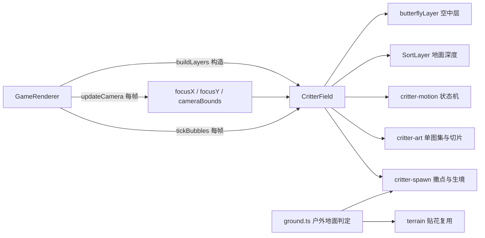

## Product Overview
在现有像素园区地图上增加一层「野趣生态」：小兔子、小猫、小狗在草地、林地边缘与花海附近闲逛、低头吃草，玩家靠近时受惊跑开；蝴蝶在花丛上方起伏飞舞。整体不改变任何联网规则与既有玩法，玩家一进服就能感到园区更热闹、更有生气。

## Core Features
- **四种小动物**：兔、猫、狗各 3 种配色变体，蝴蝶 3 种配色，共 12 套外观，与现有硬像素画风一致。
- **全岛稀疏散布**：按草地、林地、花海、园路做生境偏好撒点，每次进服重新随机，不会全挤在办公区。
- **自然行为**：原地发呆与低头吃草交替；短距离游走；玩家进入约 90 至 105 像素范围时受惊逃跑一小段，随后进入冷却，避免反复抽搐。
- **蝴蝶飞舞**：在花海与草地上方沿椭圆轨迹缓慢盘旋，翅膀两帧交替扇动，带轻微上下浮动。
- **性能优先**：同屏通常只有 3 至 8 只动物参与更新与绘制，屏外动物既不更新也不绘制；可用 `?critters=0` 一键关闭做对比。
- **零联网改动**：不进协议、不改服务端、不写存档，断线重连或换设备不影响其它系统。

## Visual Effect
小动物约 13 至 17 纹素高，约为玩家身高的三分之一；统一 1px 深靛描边、本体色加一档压暗边、脚下带 1 至 2px 接触阴影。兔子竖耳团身、猫低伏翘尾、狗垂耳短腿；蝴蝶为四片小翅的剪影。地面动物按脚底 y 与树、桌椅、角色正确遮挡，蝴蝶始终飞在景物之上、昵称之下。


## 技术栈
- 沿用现有客户端栈：TypeScript 5 strict、Next.js 15 客户端模块（`'use client'`）、PixiJS 8（WebGPU 优先、回落 WebGL2）。
- 无新增依赖；不改 `apps/game-server`、`packages/shared-types`、`packages/pixel-assets` 的图集管线。
- 复用 `@niuma/shared-types` 的 `isBlocked`、`isWadingAt`、`WORLD_LAYOUT`、`ISLAND` 与 `apps/web/lib/game/seeded.ts` 的 `seeded`。
- 单测跑 `bun test lib`，新测试从 `bun:test` 导入（与现有 `__tests__` 一致）。

## 实现策略
**一句话**：一张烘焙图集、一份固定人口、一层视口内的按需模拟。

1. **单图集烘焙**：构造期用一个 `Graphics` 画出全部帧，只调用一次 `generateTexture`（复用 `terrain-textures.ts` 的 `bake`），得到 12 列 × 10 行、格 32×32、尺寸 384×320 的图集；再用 `new Texture({ source, frame: new Rectangle(...) })` 切片（与 `atlas.ts` 同一手法）。所有地面动物与蝴蝶共享同一个 `TextureSource`，稳定合批。
   - 地面：3 物种 × 3 配色 × 3 视图（正面/侧面/背面）× 4 帧（站立、吃草、走 A、走 B）= 108 格。
   - 蝴蝶：3 配色 × 2 帧（翅开、翅合）= 6 格。
   - 32px 格内脚底线固定在 y=29，精灵锚点 `(0.5, 29/32)`；接触阴影直接烘进每一帧，零额外精灵。
2. **固定人口**：地面 72 只（兔 26 / 猫 24 / 狗 22，三配色均分）+ 蝴蝶 18 只，共 90 个 `Sprite`，构造期一次性建好并 `SortLayer.add()`，运行期不增删对象。
3. **视口内才模拟**：每帧对 90 只做一次矩形判断；屏外 `renderable = false` 且跳过状态机。同屏通常 3 至 8 只，因此每帧实际只跑几只的状态机。
4. **帧内零分配**：每只动物是长生命周期对象（与 `fx.ts` 的 `Particle` 同形态），状态机只写标量；不建数组、不建闭包、不 `new` 任何对象。
5. **深度与图层**：地面动物进 `SortLayer`（脚底 y），移动后只在真的位移时调 `sortLayer.update()`（band 内只写 zIndex，跨 band 才换父容器）；蝴蝶放独立 `butterflyLayer`，插在 `sortLayer.container` 之后、`labels` 之前。
6. **碰撞与水**：移动前用 10px 前瞻点做「可站立」判定：`!isBlocked(p, 4) && !isWadingAt(p)`（`isBlocked` 只拦海与障碍，湖河可涉水，所以必须补 `isWadingAt`）；每只每 100ms 最多探测一次，被挡时沿切线换向一次，再挡就停下吃草。

## 关键决策与取舍
| 决策 | 选择 | 理由 | 代价 |
|---|---|---|---|
| 同步方式 | 纯客户端本地 | 带宽 0、服务端 0、与 AOI/协议完全解耦，性能最优 | 不同玩家看到的个体与位置不同（已确认接受） |
| 美术管线 | Web 侧 `Graphics` 烘焙单图集 | 与地形/道具/贴花同一套纪律；不碰 9 层 tint + 34 列 + manifest 版本号的角色管线 | 动物不具备玩家那种换色/换配件能力（本就不需要） |
| 图集组织 | 全部帧挤进一张 384×320 | 一次 generateTexture、切片零 GPU 成本、天然合批 | 单张纹理约 480KB 显存（远小于角色图集） |
| 模拟范围 | 视口内 + 96px 余量 | 90 只里绝大多数屏外，模拟它们纯属浪费 | 屏外动物会「冻结」，回到视野时从原状态继续（不可见，无观感损失） |
| 遮挡 | 不喂 `syncOccluders` | 让树冠为一只兔子变透明会干扰玩家判断，收益为负 | 动物走到树后会被树冠完全挡住（本就该如此） |

## 性能预算（验收口径）
| 项 | 预算 | 手段 |
|---|---|---|
| 纹理 | 1 张 384×320、1 次 `generateTexture` | 烘焙期一次完成，运行期零生成 |
| 精灵 | ≤ 90，视口内通常 3 至 8 | 固定人口，不增删 |
| 每帧 CPU | ≤ 90 次包围盒判断 + ≤ 15 只状态机 | 屏外直接 continue；无分配 |
| 绘制批次 | +1（地面动物）、+1（蝴蝶） | 共享同一 `TextureSource` |
| 初始化 | ≤ 8ms（烘焙 + 撒点），一次性 | 有限次拒绝采样 |
| 关闭开关 | `?critters=0` 时完全不构造 | 与 `?flat` / `?light` / `?bands` 同一套灰度惯例 |

复杂度：构造期 O(候选格数 × 重试次数) ≈ 1000 次判定；每帧 O(N) 判断 + O(V) 模拟（N=90，V≈3 至 8）。瓶颈是多边形水面判定，用 100ms 节流加 10px 前瞻压到每只每秒最多 10 次。

## 行为与数值
| 物种 | 体型（纹素） | 游走 | 逃跑 | 受惊半径 | 配色 |
|---|---|---|---|---|---|
| 兔 | 14×13 | 42 px/s | 120 px/s | 96 | 奶油白 / 燕麦灰 / 焦糖棕 |
| 猫 | 15×10 | 38 px/s | 110 px/s | 88 | 橘虎斑 / 灰狸花 / 墨靛 |
| 狗 | 17×12 | 54 px/s | 130 px/s | 104 | 柴黄 / 奶白 / 深棕 |
| 蝴蝶 | 9×8 | 轨道 rx 26 至 64、ry 18 至 40 | 不逃跑 | — | 鹅黄 / 樱粉 / 天蓝 |

状态机：`idle`（吃草/发呆 0.8 至 3.0s）→ `wander`（0.9 至 2.2s）→ `idle`；受惊进 `flee`（0.45 至 0.7s）后回 `idle`，冷却 1.8s。离巢超 220px 时朝巢偏转。朝向取主轴：`|dx| ≥ |dy|` 用侧视并 `scale.x` 镜像，否则用背视/正视。蝴蝶不做逃跑，只按相位盘旋，振翅 90ms 一帧。

## 撒点策略
- 岛包围盒按 320px 网格切分（约 12×14 格），每格最多 1 只地面动物，保证「稀疏且均匀」。
- 采样点须同时满足：`isOutdoorGround(x, y)`、`!isBlocked(x, y, 6)`、`!isWadingAt(x, y)`。
- 与已有点最小间距 80px；每格最多 12 次尝试，总尝试上限 1200 次，找不到就跳到下一格（不无限重试）。
- 生境权重：距花海小于 240px 或林地小于 180px 时兔权重 ×3；距园路/广场小于 200px 时猫权重 ×3；开阔草地狗权重 ×2。
- 蝴蝶：70% 落在花海包围盒内缩 24px，30% 落在随机草地点；每只带自己的巢点与相位。
- 随机源统一 `seeded(Date.now() >>> 0)`，每局不同；不使用 `Math.random`，便于复现问题（把种子打进 URL 的调试开关可后续再加）。

## 架构设计


## 目录结构
```
d:/other/project/niuma/
├── apps/web/lib/game/
│   ├── ground.ts                  # [NEW] 「户外可行走地面」的唯一判定：岛内 + 非道路/桥/码头/铺装/建筑 + 非水面。从 terrain.ts 的 grassDecorAllowed 抽出，供贴花与撒点共用，避免两份规则漂移。
│   ├── critter-art.ts             # [NEW] 单图集烘焙与切片。定义 32px 格、12 列 × 10 行、地面 108 格 + 蝴蝶 6 格；按物种/配色/视图/帧索引 Texture；提供 destroy() 并校验所有格不越界。
│   ├── critter-spawn.ts           # [NEW] 纯函数撒点：320px 网格、生境权重、80px 间距、有界重试；导出 planGroundCritters(seed) 与 planButterflies(seed)，不依赖 Pixi。
│   ├── critter-motion.ts          # [NEW] 纯函数状态机：idle/wander/flee 转移、受惊方向、10px 前瞻碰撞、离巢牵引、视图与帧选择、蝴蝶轨道位移；不依赖 Pixi，可单测。
│   ├── critters.ts                # [NEW] CritterField 门面：固定 90 个 Sprite、SoA 式状态数组、视口裁剪、SortLayer 更新、butterflyLayer、零分配帧更新、destroy。
│   ├── terrain.ts                 # [MODIFY] grassDecorAllowed 改为调用 ground.ts 的 isOutdoorGround，行为逐字不变。
│   ├── renderer.ts                # [MODIFY] buildLayers 里按 ?critters=0 决定是否构造、把 butterflyLayer 插到 sortLayer 与 labels 之间；updateCamera 记录 focus；tickBubbles 驱动 update；destroy 按「先精灵后纹理」销毁。
│   └── __tests__/
│       ├── critter-spawn.test.ts  # [NEW] 断言同种子可复现、数量正确、每个落点都合法、间距 ≥ 80px、蝴蝶多数贴近花海。
│       └── critter-motion.test.ts # [NEW] 断言 idle→wander、受惊方向背离玩家、被挡会停下或换向、离巢会回拉、蝴蝶始终在轨道内且高度为正。
└── docs/adr/
    └── 0042-ambient-critters.md   # [NEW] 记录「纯客户端氛围 + 零协议 + 单图集合批」的决策、备选方案、性能预算与回退开关。
```

## 关键代码结构
```ts
// critter-motion.ts —— 纯逻辑，可直接 bun:test
export interface GroundCritter {
  x: number; y: number;
  homeX: number; homeY: number;
  dirX: number; dirY: number;
  species: 0 | 1 | 2;      // rabbit / cat / dog
  variant: number;
  view: 0 | 1 | 2;         // down / side / up
  state: 0 | 1 | 2;        // idle / wander / flee
  stateLeftMs: number;
  cooldownMs: number;
  frame: number;
  frameLeftMs: number;
  probeMs: number;
}

/** 返回本帧是否发生位移；canStand 为稳定引用，不在帧内创建闭包 */
export function stepGroundCritter(
  c: GroundCritter,
  dtMs: number,
  playerX: number,
  playerY: number,
  rng: () => number,
  canStand: (x: number, y: number) => boolean,
): boolean;
```

```ts
// critters.ts —— 渲染门面，对外只暴露三个方法
export class CritterField {
  readonly butterflyLayer: Container;
  constructor(depth: DepthSink, art: CritterArt, seed: number);
  update(dtMs: number, focusX: number, focusY: number, bounds: CameraBounds | null): void;
  destroy(): void;
  get visibleCount(): number; // 仅验收/调试读取，不参与帧循环
}
```

## 实施要点
- **帧顺序已确认**：`session.ts` 每帧先 `renderer.updateCamera(...)`（第 1203 行）再 `renderer.tickBubbles(dtMs)`（第 1213 行），所以 focus 与 `cameraBounds` 在同一帧内对动物有效，无需改 `session.ts`。
- **不要每帧全量碰撞**：`isBlocked` 会走 128px 障碍网格，`isWadingAt` 要跑 6 个水域多边形（河 48 顶点）；只用 10px 前瞻 + 100ms 节流，且仅对可见且正在移动的动物调用。
- **不要给动物加浮点缩放/旋转**：蝴蝶高度用整数纹素台阶，翅膀用换帧，不用 `scale` 做扇动（亚像素会让硬像素边发糊，违反 ADR-0005）。
- **不要改 `syncOccluders`**：遮挡输入保持只含玩家，避免树冠因小动物闪透明。
- **销毁顺序**：先销毁 90 个 `Sprite` 与 `butterflyLayer` 子节点，再销毁图集源纹理；`?critters=0` 时 `this.critters` 保持 `undefined`，所有调用点用可选链，保证关闭路径零开销。
- **日志纪律**：不新增常驻 `console`；如需排查，只在 `?critters=debug` 时于构造期打印一次人口、图集尺寸与烘焙耗时，不打印逐帧数据。
- **不改动范围**：`apps/game-server`、二进制协议、AOI、`packages/pixel-assets` 与 `pnpm assets` 流程全部零改动；`ground.ts` 抽取仅移动 8 行判定，`terrain.ts` 行为逐字保持，靠现有观感回归确认。

## 验证方式
1. `pnpm typecheck` 与 `pnpm test` 全绿（新增 2 个测试文件）。
2. 本地 `pnpm dev` 进入 `/play`：在广场、花海、林地各停 30 秒，确认能看到 2 至 5 只地面动物与 1 至 3 只蝴蝶，走近兔子会跑开、停下后会继续吃草。
3. 同一位置对比 `?critters=0` 与默认的 FPS 统计，差值应在 1 帧以内；用 `?flat=1`、`?bands=0` 复核动物遮挡与排序不串层。
4. 走到海边、河边、建筑门口各观察 30 秒，确认动物不会走进水面或穿墙，也不会卡在门框里抖动。


## Agent Extensions
### Skill
- **principal-software-architect**
  - Purpose: 按项目规则对「纯客户端氛围 vs 服务端同步」「Web 侧烘焙 vs 角色图集管线」做约束、非目标与反向成本分析，并落成 ADR-0042。
  - Expected outcome: 一份含备选方案、性能预算、回退路径的决策记录，且结论明确改动只落在 `apps/web/lib/game` 呈现层。
- **layer-pixel-art**
  - Purpose: 约束小动物与蝴蝶的像素网格、调色板、走/吃/振翅帧与图集切分方式，避免糊边与亚像素缩放。
  - Expected outcome: 一致的 32px 格图集规范与 4 帧循环节奏，可直接用于 `critter-art.ts`。
- **test-driven-development**
  - Purpose: 对 `critter-spawn.ts` 与 `critter-motion.ts` 两个纯逻辑模块先写失败测试再实现。
  - Expected outcome: 撒点合法性、间距、可复现性与状态机转移都有自动化覆盖，后续调参不回归。
- **verification-before-completion**
  - Purpose: 收尾阶段跑 typecheck、test 与 `?critters=0` 的 FPS A/B，拿到证据再宣告完成。
  - Expected outcome: 一份可复核的验证结论，而不是「看起来没问题」。
