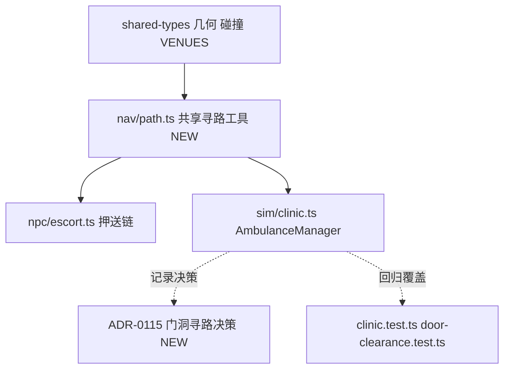

## 用户原始需求
用户原话：「救护车会出任务时会卡墙  比如进入了别的场所就会卡住」。即救护车出任务途中会卡在墙上，尤其当目标（伤员）位于其它场所时就会卡住。期望：救护车能正常前往任意场所接伤员并送回急救站，不再被围墙/门洞卡住。

## 产品概述
救护车出任务是一条完整链路：玩家被创飞昏迷 → 派空闲救护车 → 车从车位出发绕行抵达伤员 → 装人 → 沿路送回急救站落点 → 护士接手治疗 → 空车返航归位。整段过程需途中可见、连贯，不能出现顶墙抖动或凭空瞬移。

## 核心功能
- 前往接人：伤员在非急救站的围合场所（小黑屋、卫生间、别墅、擂台等）时，救护车仍能穿过门洞抵达并完成装载。
- 送回不二次卡住：载着伤员返程时沿可通行路线回到急救站落点，不在中段或场所出口再次卡墙。
- 安全脱困：任何一段无法前进时，落点必须是不在墙内、不与障碍来回弹开的合法位置，避免抖动式卡死。
- 全程可见：伤员始终以拖拽姿态跟随车尾，不直接传送；车不穿墙、不挤进门洞。
- 返航可靠：空车回位同样走可通行路线，超时也不能停在墙里。


## Tech Stack Selection
沿用现有技术栈，不引入新依赖：
- 服务端：Node.js + TypeScript（`apps/game-server`），模拟层 `sim/`、NPC 层 `npc/`。
- 共享包：`packages/shared-types`（世界几何、碰撞 `isBlocked`/`findFreePoint`、`VENUES` 场所表、常量）。
- 测试：项目既有测试框架（`clinic.test.ts`、`clinic-layout.test.ts`、`door-clearance.test.ts` 的 mock 时钟与 world 构造方式）。
- 决策记录：新增 ADR，遵循 `docs/adr/` 现有格式；玩家可见改动记入 `apps/web/data/release-notes.json`。

## Implementation Approach

策略：先给出三个可选方案（含收益/代价/不可逆性/回滚），推荐 A+C 组合；把押送链已有的 BFS 寻路抽取为工具层共享能力，让救护车复用，从而覆盖所有场所并避免 sim→npc 反向依赖；同时把 8 秒盲瞬移替换为碰撞安全落点作为兜底。

### 方案对比

**方案 A（推荐）：抽取共享寻路工具，救护车按路径点行驶**
- 做法：把 `npc/escort-path.ts` 的 24px 网格 BFS + 视线简化抽取到 `apps/game-server/src/nav/path.ts`，导出可指定"车身净空半径"的 `findPath`；救护车在 leg2 接人、送回、返航三段按返回路径逐点行驶。押送链改为引用同一工具，消除逻辑重复。
- 收益：覆盖所有围合场所及未来新增场所，彻底消除顶墙；与押送链共用一份寻路（DRY）；依赖方向干净（sim 与 npc 都依赖 nav 工具层）。
- 代价：跨多个模块改动；需为车身半径单独建一张可走网格并验证门洞净宽；伤员昏迷后位置固定，路径只需算一次，但去程/回程各算一次，需缓存避免每 Tick 重算。
- 不可逆性：低—中；可加 feature flag 在异常时切回旧两航点直线逻辑。
- 30 天回滚：关闭 flag 即回到 ADR-0084 旧行为；保留 `nav/path.ts` 不影响押送链。

**方案 B：泛化入口航点**
- 做法：仿 `CLINIC_VEHICLE_ENTRY`，为 jail/restroom/villa/ring 等在 `shared-types/world` 各配一个车辆入口点，按 `venueAt(patient.x, patient.y)` 选点，走"主路→场所入口→直线追人"。
- 收益：改动小、可预测、无寻路开销，风格与现有固定航点一致。
- 代价：每个新场所都要手工配点、易遗漏；场所内部有院墙/多房间时最后一段直线仍会卡；扩展性差。
- 不可逆性：低；删除配置与分支即可回滚。

**方案 C：仅碰撞安全脱困（兜底）**
- 做法：把 8 秒盲瞬移 `patient.x+36, dirX=-1` 换成 `findFreePoint`/`nearestCell` 求合法落点，卡住时重试而非瞬移。
- 收益：改动最小，消除"瞬移进墙又被弹出"的抖动。
- 代价：治标——车仍会顶墙抖动满 8 秒才脱困，观感差；深处伤员依旧无法真正抵达；不满足"看得见地开过来"。
- 不可逆性：低；单文件回退。

**推荐：A 为主 + C 的碰撞安全落点作兜底。** 前提假设：①伤员昏迷后位置固定（代码 L645 已确认），路径每次任务只需计算 1–2 次；②门洞净宽在车身半径下可通行（需先实测，见 Implementation Notes），若不足则采用"车到场所可达点 + 伤员沿路径拖至车尾"的可见折中，而非硬挤门洞。不选 B 的原因：ADR-0103 后围合场所内部布局各异，单入口无法保证最后一段可达。不选 C 单独使用的原因：纯治标。

### 性能与可靠性
- BFS 单次约 2.8 万格、静态障碍网格 `buildGrid()` 只在启动时算一次并缓存（Uint8Array 约 28KB）；车身网格同法缓存一份。
- 救护车每秒最多派 2 辆，每次任务路径重算 1–2 次，非热路径；避免每 Tick 重算。
- `nearestCell`/`simplify` 保证终点在墙边时落到最近可走格；无路返回 null，调用方中止该段而非直线穿墙。

### 避免技术债
复用 `escort-path.ts` 已验证的 BFS 与视线简化，不新写寻路算法；寻路下沉到 `nav/` 工具层解决 sim→npc 反向依赖，而非在 `clinic.ts` 内复制一份。

## Implementation Notes

### 关键改动单元基线证据行
- `BASELINE | AmbulanceManager.advanceCar leg2 | expected: 伤员在非急救站场所时能抵达并装人 | observed: 直线追点顶墙、8s 盲瞬移落墙内反复弹 | fit: drift | 缺场所门洞路由`
- `BASELINE | escort-path.findEscortPath | expected: 可被 sim 层直接复用 | observed: 位于 npc 层且押送私有，sim 直连形成反向依赖 | fit: partial | 需抽取到 nav 工具层`
- `BASELINE | resolveMotionInto | expected: 单轴滑行足以让车脱困 | observed: 无寻路，顶墙滑行找不到门洞 | fit: drift | 需上层提供路径点`
- `BASELINE | clinic-gate.resolveWalkInto | expected: 救护车走步行门禁 | observed: ADR-0107 明确救护车继续用 resolveMotionInto | fit: align | 保持不动`

### 执行要点
- **车身净宽风险**：先依据 `door-clearance.test.ts` 的 `WORLD_LAYOUT.solids` 几何核对各围合场所门洞净宽与车身宽度。净宽不足时不要让车挤门洞穿墙，改为"车停在场所最近可达点 + 伤员沿路径可见地拖至车尾"，仍不瞬移。
- **路径缓存**：在 `Ambulance` 结构增加路径点队列与路径目标快照；仅当目标/阶段变化时重算，逐 Tick 只推进下一个路径点，命中 `PICKUP_RADIUS`(48)/`DROP_RADIUS`(64) 即切换状态。
- **盲瞬移替换**：`UNSTUCK_MS` 触发时改用 `findFreePoint`/`nearestCell(clearance=车身半径)` 求合法点；仍失败则放空返航，绝不写入墙内坐标。
- **attachPatient**：车尾 26px 落点先用 `isBlocked` 校验，落在障碍里则沿车头反方向就近找可走点，避免伤员被塞进墙。
- **时间口径**：沿用注入的 `clock.now()`/`now`，禁止 `Date.now()`/`new Date()` 判定任务超时。
- **落盘范围**：本修复全在进程内存，不写 `world-state.json`（ADR-0081）。
- **兼容与回滚**：保留旧两航点逻辑作为 feature flag 分支；不动 `resolveWalkInto` 门禁语义，不影响押送链既有契约。
- **版本工报（提交前执行，plan mode 下不做）**：在 `release-notes.json` 的 `entries` 最前追加一条 `kind=fix` 的玩家可感知记录（如"救护车不再卡在场所门口，能正常接人送回"），运行 `pnpm changelog:check` 后再提交。

## Architecture Design

分层：共享几何/碰撞（shared-types）→ 共享导航工具（game-server/nav）→ 上层消费者（sim 救护车、npc 押送）。寻路工具为纯函数、无副作用，位于"工具层最低可行点"，避免把算法塞进类型包，也避免 sim 反向依赖 npc。



数据流：伤员倒地 `downPlayer` → `tryDispatch` → `advanceCar` 在接人/送回/返航段向 `nav/path` 请求路径 → 逐点 `moveCar` → 到半径内 `attachPatient`/`beginHandover`。工具层不感知救护车状态，只做坐标到路径的纯计算。

## Directory Structure Summary
本次改动新增一个共享寻路工具与一份 ADR，改造救护车模拟、押送链薄封装、两类回归测试及版本工报。

```
project-root/
├── apps/game-server/src/nav/
│   └── path.ts  # [NEW] 共享寻路工具。从 npc/escort-path.ts 抽取 24px 网格 BFS + 4px 视线简化，新增可按车身净空半径膨胀障碍的可走网格（缓存一次）。导出 findPath(from,to,opts) 返回路径点数组或 null（无路不返回穿墙直线）、warmNavGrid(clearance)、nearestFreePoint。供 sim 与 npc 共用，依赖 shared-types 的 isBlocked，无副作用。
├── apps/game-server/src/npc/
│   └── escort-path.ts  # [MODIFY] 算法迁移后改为对 nav/path.ts 的薄封装/重导出，保留 findEscortPath、warmEscortGrid 既有签名与语义，使调用方 npc/escort.ts:78 零改动；押送链行为不变。
├── apps/game-server/src/sim/
│   └── clinic.ts  # [MODIFY] 主改。Ambulance 增加路径队列/目标快照字段；leg2 接人、Transporting 送回、Returning 返航改为按 findPath 路径逐点行驶并缓存；UNSTUCK_MS 盲瞬移替换为 nearestFreePoint 安全落点（失败则放空返航）；attachPatient 校验车尾落点不进墙；保留旧两航点逻辑作 flag 分支以便回滚；时间仍用注入 now。
├── apps/game-server/src/sim/
│   └── clinic.test.ts  # [MODIFY] 新增跨场所（小黑屋/卫生间/别墅/擂台）出警+送回用例；断言路径经门洞可达、无穿墙、脱困落点不在墙内且不反复弹、伤员未被塞进墙；沿用现有 mock 时钟与 world 构造。保留站内 CLINIC_VEHICLE_ENTRY 断言。
├── packages/shared-types/src/__tests__/
│   └── clinic-layout.test.ts  # [MODIFY] 若新增车辆净空常量，补车身半径下两条出车线与各围合场所门洞的 clearLine 可达断言；不改历史几何结论。
├── apps/web/lib/game/__tests__/
│   └── door-clearance.test.ts  # [MODIFY] 从 WORLD_LAYOUT.solids 反推门洞净宽，新增"净宽 >= 车身宽度"回归断言，确保车辆可通过保留的围合场所门洞；若净宽不足则标记为需走拖行折中。
├── docs/adr/
│   └── 0115-ambulance-venue-aware-routing.md  # [NEW] 记录"救护车按场所门洞寻路 + 安全脱困"决策：约束、非目标、A/B/C 方案权衡、推荐与 30 天回滚；补充 ADR-0084 §3"不做寻路"口径（不改写历史 ADR）。
└── apps/web/data/
    └── release-notes.json  # [MODIFY] 提交前在 entries 最前追加一条玩家可感知 fix 记录并跑 pnpm changelog:check；plan mode 下不执行。
```

## Key Code Structures
共享寻路工具接口（供 sim 与 npc 共同依赖，接口级定义；实现细节按 escort-path 现有算法迁移）：

```ts
// apps/game-server/src/nav/path.ts
export interface NavPoint { x: number; y: number }
/** 按 clearance 膨胀障碍求可走路线；无路返回 null，绝不返回穿墙直线 */
export function findPath(from: NavPoint, to: NavPoint, clearance?: number): NavPoint[] | null;
/** 启动时预热网格，避免首帧现算 */
export function warmNavGrid(clearance?: number): void;
/** 在障碍中/out-of-bounds 时求最近合法落点，供脱困兜底 */
export function nearestFreePoint(x: number, y: number, clearance?: number): NavPoint | null;
```


## Agent Extensions
### Skill
- **principal-software-architect**
  - Purpose: 对 A/B/C 三个修复方案做轻量权衡（收益/代价/不可逆性/回滚），确定寻路能力在 nav 工具层的落点与依赖方向，并输出证据行与分层结论（按用户规则轻量流程，不生成全基线矩阵）。
  - Expected outcome: 一份明确的方案裁决与"改动应发生在哪一层"的结论，写明前提假设与 30 天回滚路径。
- **test-driven-development**
  - Purpose: 以红—绿—重构方式补跨场所出警/送回回归测试，先固化"卡墙/瞬移落墙内"失败用例，再驱动 `clinic.ts` 与 `nav/path.ts` 的实现。
  - Expected outcome: 新增测试在未修复时失败、修复后通过，覆盖小黑屋/卫生间/别墅/擂台与安全脱困断言。
- **domain-modeling**
  - Purpose: 按 `docs/adr/` 现有格式新增 ADR-0115，规范记录"场所门洞寻路 + 安全脱困"决策与对 ADR-0084 §3 的补充。
  - Expected outcome: 生成一份可追溯的决策记录，不改写历史 ADR，含权衡、前提与回滚。
