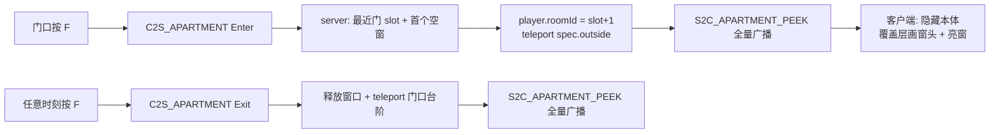

## Product Overview
牛马公寓从「进屋换频道、铺室内地板摆家具」的复杂玩法，砍成一句最简单的表现：在楼门口按 F，人就不见了，改从这栋楼某个空闲窗口探出头来；按 F 出去，人重新出现在门口台阶上，可以正常走动。

## Core Features
- **门口按 F 进楼**：站在任意一栋楼的门口感应区内按 F，角色从园区消失，改在这栋楼的一个「空闲窗口」探出头（面朝屋外，只露头，身体被窗口框裁掉）。
- **探头全园区可见**：其他玩家走近这栋楼时，也能看到窗口里探出的头（含对方的外观、发色、帽子等），不是只有自己看得见的本地特效。
- **空闲窗口分配**：每栋楼 4 层 × 5 列共 20 个窗口，按顺序占第一个空窗，一个窗口只站一个人；同一栋楼可以同时有多人在不同窗口探头；20 个窗都有人时提示「这栋楼的窗口都住满了」并不进屋。
- **按 F 出门**：人在窗口时，任意位置按 F 立刻回到这栋楼门口的台阶上，之后就是普通园区玩家，可以自由走动。
- **窗口亮起**：有人探头的窗口点亮，头一离开就恢复原样，远处一眼能看出哪栋楼「有人在家」。
- **删除复杂逻辑**：户型升级（纸箱→隔断→一居室→大平层、扣币）、家具购买与摆放、串门邀请、公寓面板、门牌显示房主名、房间频道隔离与室内地板全部移除。门牌只保留楼栋号 301–306。


## Tech Stack
沿用现有仓库栈，不引入新依赖：
- 共享真相层：`packages/shared-types`（TypeScript，坐标系/协议/文案的唯一来源）
- 服务端：Bun + WebSocket 二进制协议（`apps/game-server`），进程内临时态，不落盘
- 渲染：Pixi.js 运行在 OffscreenCanvas Worker（`apps/web/lib/game`），React 仅负责面板层

## Implementation Approach

### 1. 共享层：把「窗口」变成唯一真相
`packages/shared-types/src/world/apartment.ts` 重写为「楼体几何 + 门 + 窗口表」：
- 保留 `APARTMENT_RECTS`/`APARTMENT_SPECS`（`slot`、`doorNo`、`rect`、`door`、`doorRange`、`outside`）、`APARTMENT_ROOM_COUNT`、`APARTMENT_DOOR_BASE`、`apartmentBySlot/ByDoorNo`、`doorNoOf`、`APARTMENT_WALL_SOLIDS`。
- 楼体碰撞从「四面各 8px 的墙」合并成**每栋一个整块实心矩形**（`APARTMENT_WALL_SOLIDS` 从 24 条降到 6 条）。不再有人进楼，内圈可走毫无意义。
- 删除 `interior`/`spawn`/`exit`/`exitRange`/`wallSolids`/`gridOrigin`、`ROOM_GRID_*`/`ROOM_CELL`/`cellCenter`、`HOUSE_TIERS`/`houseTierSpec`/`MAX_APARTMENT_TIER`、`FURNITURE_SKUS`/`furnitureById`/`FurniturePlacement`/`sanitizePlacements`。
- **新增窗口表**，把现在写死在 `apartment-view.ts` `drawFacade()` 里的公式（`FACADE_FLOORS=4`、`FACADE_COLUMNS=5`、`bandStep=round((h-56)/4)`、`windowStep=round((w-34)/5)`、`windowW=max(16,windowStep-30)`、窗框 `x=16+col*step+2`、`y=-h+8+floor*bandStep+10`、尺寸 `windowW×22`）搬到共享层，并按楼体原点换算成世界坐标。客户端画窗、服务端分配窗口、探头定位从此读同一张表，改一个数不会三方不一致。

### 2. 协议：极简化的两个动作 + 一条快照
- `C2S_APARTMENT`（0x4c）保留，`APARTMENT_ACTION` 只留 `Enter: 0` / `Exit: 1`（`Upgrade: 2` 停用，编号不复用）。
- **新增** `S2C_APARTMENT_PEEK = 0x59`（现有最大 0x58，追加在末尾）：`[op][count u8] + count × [playerId u16][slot u8][window u8]`，是一条**全量快照**（6 栋 × 20 窗 = 上限 120 条，u8 装得下）。进楼、出楼、断线各广播一次，新人入场补发一次；无变化时零流量。
- 删除 `C2S_APARTMENT_INVITE`(0x4d)、`C2S_ROOM_LAYOUT`(0x4e)、`S2C_ROOM_STATE`(0x4f)、`S2C_ROOM_INVITE`(0x50) 的编解码、`RoomStatePacket`/`RoomInvitePacket`/`FurniturePlacement` 类型，以及 `net/guard.ts` 对应两条入站长度声明。opcode 编号沿用 `S2C_ITEM_EFFECT` 的先例标注「永久留空不复用」。
- 满窗提示复用现有系统提示通道：`notice.ts` 加一个 `SYSTEM_NOTICE_KIND.ApartmentFull` 与文案模板，**只发给本人**（与 `detention.ts:525-531` 同一写法），协议不动。
- `economy.ts` 的 `WALLET_REASON.HouseUpgrade/Furniture` 与 `SHOP_KIND.Furniture` 保留编号并标注停用（编号是线协议，不能回收复用）。

### 3. 服务端：窗口分配代替房间频道
`apps/game-server/src/sim/apartment.ts` 重写成一个小运行时：
- 房间表 `Map<slot, Array<playerId | 0>>`（每栋 20 格）或等价的 `Map<playerId, {slot, window}>` 双向索引；`enter(player, slot)` 取该栋第一个空窗，占满返回 `null`；`exit(player)` 释放；`leave(playerId)` 断线释放；`snapshot()` 给出全量占用。
- `Player.roomId` 字段继续复用（`0 = 园区`，`1..6 = 在某栋窗口`），但语义从「房间频道」改成「人在窗里」，这样移动/动作/免疫/断线的门禁只需一个判断。
- 进楼：`player.roomId = slot+1`，`teleport(player, spec.outside)`（停在门口台阶，坐标确定）；不再传送进楼内。
- 出楼：`roomId = 0`，`teleport(player, spec.outside)`。
- `server.ts`：`nearAnyApartmentDoor` 换成「返回离玩家最近的门口热区 slot」（离所有门都太远则丢弃），Exit 不再需要 `nearOwnApartmentExit`；删掉 `broadcastRoom`/`refreshRoomPairing`；`admit()` 里补发一次 peek 快照；`handleClose` 里 `apartment.leave()` 后广播。
- 门禁（必须做，否则人会「隐身走位」）：`sim/movement.ts` 的 `applyMove` 顶部对 `roomId !== 0` 直接拒绝并复位姿态；`C2S_ACTION`（坐/躺）同样丢弃；`sim/vent.ts:124` 的「入座免伤」分支把 `target.roomId !== 0` 一并算进去（窗里的人是免伤挡板，按空放处理）。
- `sim/view.ts:86` 删掉 `other.roomId !== player.roomId` 频道过滤：探头玩家的实体必须留在 AOI 里，客户端才有他的外观可用来画头；本体由客户端按 peek 快照隐藏。

### 4. 客户端：会话只管两个动作，渲染加一层「窗头」
- `session.ts`：`interact()` 开头判断 `if (this.inRoom) { this.exitApartment(); return; }`（在冷却检查之后、红包/擂台判定之前），门口热区则 `enterApartment()`；`stepLocal()` 的 `frozen` 加上 `this.inRoom`；`handleApartmentPeek(packet)` 收下快照、从自己的 `playerId` 反推 `inRoom`/`roomSlot`、转发给渲染层；删除 `handleRoomState`/`setInsideRoom`/`upgradeApartment`/`inviteRoom`/`saveRoomLayout` 与 `onApartmentOpen/onRoomState/onRoomInvite` 回调。
- `interactions.ts`：`roomId !== 0` 时直接返回 `HINT.apartmentExit`（人在门口台阶上，不能再去匹配门口热区）；删掉 `apartmentExit` 热区过滤分支。
- 渲染（`apps/web/lib/game/window-peek.ts` 新文件）：一个盖在 `sortLayer` **之后**的覆盖层，为每个占用窗口建一个 `PonyRenderer`（同一份 `atlas` + 实体外观，`setPose(DIRECTION.Down, 0)` 待机帧），用窗口矩形做 `mask` 裁掉身体只留脑袋，容器 y 按图集头锚点（`headTopYOf` ≈ -46）对齐到窗口中心；同时给占用的窗口补一块亮窗矩形做「有人在家」。外观从 `renderer.views.get(id).body.appearance` 取；实体还没进视野（建筑在 AOI 外）就先跳过，等 `addEntity` 时补画。
- `EntityView` 加 `setPeeked(boolean)`：与既有 `setShown` 合成 `root.renderable/labels.renderable`，探头玩家的本体与昵称整体不画（本地自己同理）。
- `apartment-view.ts`：删掉 `interiorLayer`/`floor`/`furniture`/`drawFloor`/`setRoomState`/门牌房主名逻辑；`drawFacade` 改为遍历 `APARTMENT_WINDOWS[slot]` 画窗框与亮窗，保证与服务端分配逐像素一致。

### 5. 性能与边界
- peek 快照只在进/出/断线/入场时各发一次，`O(players)` 次发送，不在 20Hz Tick 里；稳态零额外流量。
- 头部渲染按「屏内占用窗口数」建对象，每个 ≤ 十余个 sprite，且只在占用变化时 diff；无逐帧分配。
- 断线/重连：`handleClose` 释放窗口并广播；客户端 `resetForReconnect` 清 `inRoom`/`roomSlot` 与 peek 层。
- 旧存档兼容：`unlockedCosmetics` 里的 `furn:<id>` 历史记录原样保留但无人读取；`EconomyProfile.houseTier` 移除后，旧存档多出的字段被 `sanitizeEconomyProfile` 忽略即可，不做迁移。

## Architecture Design


## Directory Structure Summary
本次是一次「减法 + 一层新表现」的改造：共享层重写公寓模型并新增窗口表与 peek 协议；服务端把房间频道换成窗口分配；客户端会话只留进/出，渲染新增窗头覆盖层；同时整条面板/家具/邀请/户型链路删除。

```
packages/shared-types/src/
├── world/apartment.ts        [MODIFY] 重写：保留楼体/门/outside，整块实心碰撞；新增 APARTMENT_WINDOW_COLS/ROWS/COUNT 与 APARTMENT_WINDOWS（世界坐标窗口矩形，由原 drawFacade 公式派生）；删除 interior/spawn/exit/gridOrigin/户型/家具/网格
├── world/hotspots.ts         [MODIFY] 只留 apartmentDoor 热区（HotspotDef 增加 slot），删 apartmentExit 热区与 apartmentExitHotspotId；HOTSPOT_PRIORITY 不变
├── world/layout.ts           [MODIFY] 适配整块实心碰撞与新的 APARTMENT_WALL_SOLIDS（铺装/地板/树带/指路牌保持原样）
├── types.ts                  [MODIFY] APARTMENT_ACTION 只留 Enter/Exit；新增 ApartmentPeekPacket；删除 RoomStatePacket/RoomInvitePacket/FurniturePlacement；ShopKind.Furniture 标注停用
├── protocol.ts               [MODIFY] 新增 S2C_APARTMENT_PEEK=0x59 的 encode/decode；删除 invite/layout/roomState/roomInvite 四组编解码
├── notice.ts                 [MODIFY] 新增 SYSTEM_NOTICE_KIND.ApartmentFull 与「这栋楼的窗口都住满了」文案模板
├── economy.ts                [MODIFY] EconomyProfile 去掉 houseTier；HouseUpgrade/Furniture 两个 reason 保留编号标注停用
├── challenge.ts              [MODIFY] SHOP_KIND.Furniture 保留编号，注释改为停用
└── __tests__/apartment-layout.test.ts [MODIFY] 改写断言：6 栋不重叠、门口台阶可站、20 个窗口落在楼体内且互不重叠、整块实心不挡门

apps/game-server/src/
├── sim/apartment.ts          [MODIFY] 重写为窗口分配运行时：enter(player, slot)/exit/leave/snapshot，占满返回 null
├── sim/apartment.test.ts     [NEW] 单元测试：按顺序占空窗、满窗拒绝、释放后可复用、断线释放
├── server.ts                 [MODIFY] Enter 用最近门 slot；Exit 任意时刻；broadcastPeek 在进/出/断线/入场各一次；删 broadcastRoom/refreshRoomPairing/nearOwnApartmentExit/invite/layout/upgrade 分支
├── sim/view.ts               [MODIFY] 删掉 roomId 频道过滤（探头玩家必须留在 AOI 里传外观）
├── sim/movement.ts           [MODIFY] applyMove 顶部对 roomId!==0 直接拒绝并复位站姿
├── sim/vent.ts               [MODIFY] 「入座免伤」分支并入 roomId!==0，窗里的人是免伤挡板
├── sim/world.ts              [MODIFY] 删 houseTier 字段与复位；roomId 注释改为「在窗口探头」
├── economy/service.ts        [MODIFY] 删 upgradeHouseTier/buyFurniture 与 wallet 里的 houseTier
└── net/guard.ts              [MODIFY] 删 C2S_APARTMENT_INVITE / C2S_ROOM_LAYOUT 的长度声明

apps/web/
├── lib/game/window-peek.ts   [NEW] WindowPeekView：按 peek 快照维护窗口头精灵（PonyRenderer + 窗口 mask）、点亮占用窗口、DPR 缩放、diff 增删
├── lib/game/renderer.ts      [MODIFY] 构建 WindowPeekView 并挂在 sortLayer 之后；setApartmentPeek(entries) 解析外观并驱动 EntityView.setPeeked；addEntity/removeEntity 时补画与清理；删 setRoomState 与 interiorLayer 挂载
├── lib/game/apartment-view.ts[MODIFY] 删室内层/地板/家具/房主名；drawFacade 改读 APARTMENT_WINDOWS 画窗框与亮窗
├── lib/game/session.ts       [MODIFY] F 键进/出、frozen 纳入 inRoom、handleApartmentPeek、删 upgrade/invite/layout/handleRoomState/setInsideRoom 及相关回调
├── lib/game/interactions.ts  [MODIFY] roomId!==0 直接给「出门」提示；删 apartmentExit 热区过滤
├── lib/game/hint-copy.ts     [MODIFY] 保留「[F] 进入牛马公寓」，出门文案改「[F] 出门」，同步 HINT_BUTTONS/TOUCH_HINTS
├── lib/game/client/worker-client.ts   [MODIFY] 删 room/roomInvite/apartmentOpen 转发，新增 peek 转发
├── lib/game/client/game-client.ts     [MODIFY] 回调类型同步（删 onApartmentOpen/onRoomState/onRoomInvite）
├── lib/game/client/main-thread-client.ts [MODIFY] 同上（若暴露回调）
├── lib/game/runtime/worker-protocol.ts[MODIFY] 删 apartmentOpen/room/roomInvite 消息，新增 peek 消息
├── lib/game/runtime/worker-host.ts    [MODIFY] 同上接线
├── lib/net/client.ts         [MODIFY] 删 S2C_ROOM_STATE/ROOM_INVITE 分发与三组发包，新增 peek 分发
├── lib/game-ui.ts            [MODIFY] 删 apartmentOpen/room/roomInvite 三个 store 与其 setter
├── components/game/ApartmentDialog.tsx [DELETE] 面板整体移除
├── components/game/EconomyLayer.tsx    [MODIFY] 删 ApartmentDialog 挂载、串门提示块与三个 onApartment*/onInviteRoom/onSaveRoomLayout 回调
├── components/game/GameViewport.tsx    [MODIFY] 删 onApartment/onInviteRoom/onSaveRoomLayout 接线与 furnitureById 的 furn: 记账分支
├── lib/__tests__/economy-storage.test.ts [MODIFY] 去掉 houseTier 断言
└── data/release-notes.json   [MODIFY] 在最前面追加一条玩家可感知的版本记录（2026-11-15-19）

docs/adr/0098-apartment-window-peek.md [NEW] 记录「公寓从房间频道改为窗口探头」的决策与代价（不落盘、全园区广播、20 窗/栋）
```

## Key Code Structures

```ts
// packages/shared-types/src/world/apartment.ts —— 窗口表是客户端画窗、服务端分配、探头定位的共同真相
export const APARTMENT_WINDOW_COLS = 5;
export const APARTMENT_WINDOW_ROWS = 4;
export const APARTMENT_WINDOW_COUNT = APARTMENT_WINDOW_COLS * APARTMENT_WINDOW_ROWS;

export interface ApartmentWindow {
  readonly index: number; // 0..19，协议里的 window 字段
  readonly floor: number;
  readonly column: number;
  /** 世界坐标矩形：亮窗、mask、探头落点共用这一份，禁止各处再算一遍 */
  readonly x: number;
  readonly y: number;
  readonly w: number;
  readonly h: number;
}

/** slot → 该栋 20 个窗口（floor 从下往上、column 从左往右） */
export const APARTMENT_WINDOWS: ReadonlyArray<ReadonlyArray<ApartmentWindow>>;
```

```ts
// packages/shared-types/src/protocol.ts —— 全量占用快照，最多 120 条
export const S2C_APARTMENT_PEEK = 0x59; // [op][count u8] + count × [playerId u16][slot u8][window u8]
export interface ApartmentPeekPacket {
  entries: ReadonlyArray<{ id: number; slot: number; window: number }>;
}
```


# Agent Extensions
- **pixel-venue-polish**
  - Purpose: 让「窗口探头」符合全站像素画风与光照预算：头部落进 23×22 的窗框内、占用窗口的亮窗色温与门廊暖光协调、夜间可读。
  - Expected outcome: `window-peek.ts` 的遮罩尺寸、亮窗配色与亮度落在既有 `venue-palette`/`venue-lights` 规范内，评审时能对照技能里的场所美化清单逐条核过。
- **code-explorer**
  - Purpose: 实施阶段核对被删协议与回调的全部引用点（`net/client.ts`、worker 三件套、`game-ui.ts`、`EconomyLayer`），避免删一半留下编译错误或死代码。
  - Expected outcome: 全仓 `grep` 不到 `RoomStatePacket`/`RoomInvite`/`houseTier`/`Furniture`/`apartmentExit` 的残留引用，`pnpm typecheck` 全绿。
