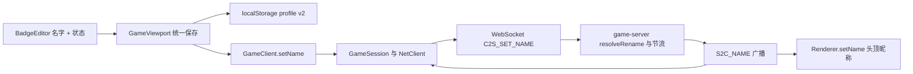

## 用户需求
左上角工牌点击后展开的编辑区，在现有「常驻状态」之外增加「工牌名」修改能力，名字与状态可在同一次编辑中一起保存。修改后的名字立即对当前园区内视野中的其他玩家生效，头顶昵称、他人工牌与牛马榜同步更新。

## 产品概述
工牌是园区里唯一的身份入口。改动后它从「只能改状态」变成「能改名字和状态」，不新增页面、不新增弹窗，交互路径保持不变：点工牌 → 表单从卡片下方展开 → 改完保存 → 收回常驻卡。

## 核心功能
- 工牌展开区新增「工牌名」输入行，位于状态输入上方
- 一次保存同时提交名字与状态，未变化的字段不重复广播
- 名字校验：空名与政治敏感内容就地拦截并提示；不文明用词按打码结果保存；超出显示宽提示保存时截断
- 保存后立即同步到当前园区，其他玩家看到头顶昵称更新，本人档案中的名字同步更新
- 名字写入本地存档，重进园区、断线重连后仍使用新名字
- 改名会改变工号与部门，编辑区给出一句提示
- 清除按钮仍只清状态，不影响名字

视觉上沿用现有 ink/mint 像素风工牌卡，仅多一行名字输入与一行提示，不改变卡片宽度与展开位置。


## 技术栈
- 前端：Next.js 15 + React 19 + TypeScript、Tailwind CSS v4、Zustand
- 渲染：PixiJS 8，Worker 渲染线程与主线程会话双通道
- 协议：`@niuma/shared-types` 手写二进制协议（OpCode + ByteWriter/ByteReader）
- 服务端：Node.js + WebSocket（`apps/game-server`），进程内存为唯一状态
- 测试：`bun:test`；组件断言沿用 `react-dom/server` 静态渲染
- 构建：pnpm workspace + turbo

## 实现方案
核心策略：把「改名」做成与「改状态」同构的一条低频事件通道，协议纯追加，不改既有包布局。

### 方案取舍
- 复用重连：零协议改动，但会打断在岗计时、落点与常驻聊天面板，且 `GameViewport` 的启动 effect 只依赖 `entering`，需要额外改造；不选。
- 复用聊天通道：会污染聊天记录、受聊天限速影响，新入场者拿不到名字；不选。
- 新增独立 OpCode：上行 2 字节加名字、一条广播，成本最低且语义清晰；选此方案。

### 分层落地
1. **协议层**：OpCode 追加 `C2S_SET_NAME: 0x28`、`S2C_NAME: 0x29`；上行 `[op][len u16][utf8]`，下行 `[op][entityId u16][len u16][utf8]`，与状态包同构。旧客户端 `default` 丢弃未知 opcode（ADR-0039 先例），无需版本协商。
2. **服务端**：新增 `sim/name.ts` 的 `resolveRename(current, raw)` 纯函数，空输入与政治敏感都保留原名，脏话取打码结果；仅在名字真正变化时写字段并 `markSpawnDirty()`。广播复用状态通道模式：先回执本人，再遍历 `player.known` 发给视野内玩家，沿用同一节流常量。
3. **客户端**：`NetClient` 记住最新名字供重连 HELLO 使用；`S2C_NAME` 经 `GameSession` 更新名字表与本人名字缓存，再调 `Renderer.setName` 更新头顶 Text。worker 通道新增 `{ t: 'name'; text }`，Worker 与主线程两种实现保持同一接口。
4. **UI**：`StatusEditor` 变为 `BadgeEditor`（唯一调用方是 `BadgeCard`），一份表单同时编辑名字与状态。名字行复用 `checkProfileName` / `describeProfileName`：空名与政治敏感就地拦截，脏话按打码文本保存，超宽提示截断。

### 性能与可靠性
- 改名是用户主动的低频动作，服务端 O(视野内人数) 广播，与状态同一量级，不进入 Tick 循环。
- `setName` 只改 Text 内容，仅当名字行高变化时才重排状态行与气泡，避免无意义的布局计算。
- 协议长度字段先校验再读取，坏包静默丢弃，绝不越界读取缓冲。
- 表单层拦截与协议层兜底共用 `truncateName` / `inspectText`，两端结论一致。

## 实现要点
- 不回溯聊天历史里的昵称快照（ADR-0039 既有语义）。
- 改名会改变工号、部门、班次（昵称 djb2 派生，ADR-0052），编辑区给一句常驻提示。
- 空名字不能提交：表单层阻止；服务端收到空名保持原名，不替换成兜底名。
- 只有名字真的变化才发送并 `markSpawnDirty`，避免无意义广播与入场缓存重建。
- compact 工牌宽 200px：名字输入独占一行，操作按钮收在底部一行，保证不横向溢出。
- 保留 Enter 提交、Esc 关闭、中文输入法 `isComposing` 保护；焦点仍默认落在状态输入框，维持「点工牌改状态」的既有习惯。
- `statusOpen` 复用为「工牌编辑区展开」，同步更新 `game-ui.ts` 注释；不重命名该 store 字段，避免波及工具栏与触控层。
- 不新增依赖、不改部署配置、不改服务端持久化边界。

## 架构设计
改名数据流：



## 目录结构
```
niuma/
├── packages/shared-types/src/
│   ├── types.ts                      # [MODIFY] OpCode 追加 C2S_SET_NAME / S2C_NAME，附注释说明包布局
│   ├── protocol.ts                   # [MODIFY] encodeSetName / decodeSetName / encodeNameBroadcast / decodeNameBroadcast，长度字段边界校验
│   └── __tests__/protocol.test.ts    # [MODIFY] 补 round-trip、截断包、空名字、超长名字用例
├── apps/game-server/src/
│   ├── server.ts                     # [MODIFY] 处理 C2S_SET_NAME：节流、resolveRename、变化时 markSpawnDirty、回执本人并广播 known
│   └── sim/
│       ├── name.ts                   # [NEW] resolveRename 纯函数：空输入与政治敏感保留原名，脏话取打码结果
│       └── name.test.ts              # [NEW] 覆盖保留原名、打码、空输入、超长截断
├── apps/web/
│   ├── components/
│   │   ├── BadgeCard.tsx             # [MODIFY] 改为 onBadgeSave(name, status)，更新 aria-label/title/aria-controls，渲染 BadgeEditor
│   │   └── game/
│   │       ├── BadgeEditor.tsx       # [NEW] 名字行 + 状态行 + 表情快捷键 + 统一保存/清除；名字校验、计数与提示
│   │       ├── StatusEditor.tsx      # [DELETE] 职责并入 BadgeEditor，唯一调用方同步切换
│   │       └── GameViewport.tsx      # [MODIFY] handleBadgeSave：resolve 双字段、仅变化字段写档与广播；保留 handleStatusChange 语义
│   ├── lib/
│   │   ├── game-ui.ts                # [MODIFY] statusOpen 注释更新为「工牌编辑区」
│   │   ├── net/client.ts             # [MODIFY] 新增 name 字段、sendName、S2C_NAME 分发、NetHandlers.onName
│   │   └── game/
│   │       ├── client/game-client.ts          # [MODIFY] 接口新增 setName
│   │       ├── client/worker-client.ts        # [MODIFY] post 与 delegate 两条 setName 路径
│   │       ├── client/main-thread-client.ts   # [MODIFY] 转调 session.setName
│   │       ├── runtime/worker-protocol.ts     # [MODIFY] 新增 { t: 'name'; text: string }
│   │       ├── runtime/worker-host.ts         # [MODIFY] case 'name' 转调 session.setName
│   │       ├── session.ts                     # [MODIFY] onName 更新名字表与本人缓存、setName 乐观上屏并发送
│   │       └── renderer.ts                    # [MODIFY] CharacterView.setName 与 Renderer.setName，行高变化时重排状态与气泡
│   └── data/release-notes.json       # [MODIFY] 追加一条玩家可感知的版本记录
```

## 关键接口
```ts
// packages/shared-types/src/protocol.ts
export function encodeSetName(name: string): Uint8Array;
export function decodeSetName(data: Uint8Array): string;
export function encodeNameBroadcast(entityId: number, name: string): Uint8Array;
export function decodeNameBroadcast(data: Uint8Array): { entityId: number; name: string };

// apps/game-server/src/sim/name.ts
export function resolveRename(current: string, raw: string): string;

// apps/web/components/game/BadgeEditor.tsx
export interface BadgeSavePayload { name: string; status: string }
```


## Agent Extensions
### Skill
- **impeccable**
  - Purpose: 对工牌编辑区做收尾检查，沿用项目既有 ink/mint 像素风，覆盖 200px 移动端不溢出、焦点顺序与读屏文案
  - Expected outcome: 桌面与移动端编辑区无横向溢出，键盘与读屏路径完整，改动文件无主要视觉与可访问性问题
