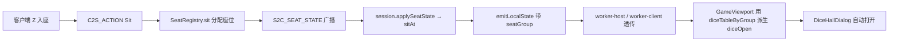
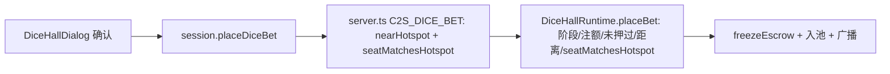

## Product Overview

摸鱼大赌场的两张骰宝桌目前「站在桌边按 F 就能押注」，与八角笼长椅、工位搬砖等玩法的入座规则不统一。本次改动统一为一条规则：**入座类玩法必须先坐在对应座位上才能参与**；赌场进一步做到**坐下即自动加入本桌赌局**，站着只能看到「先坐本桌凳子」的提示。

## Core Features

- **赌桌入座门槛**：必须先坐在本桌（翡翠桌 / 鎏金桌）自己的圆凳上，才能押大 / 小 / 豹子；坐在另一桌的凳子或站在桌边都不可押。
- **未入座反馈**：站在赌桌热区内按 F，或点击提示按钮，只弹出「先坐到本桌凳子上再押注」，不打开下注面板，也不发下注包；服务端同样拒收伪造包。
- **坐下即入局**：坐进本桌圆凳后，下注面板自动打开、直接跟随本桌公共局（阶段、倒计时、公共池、骰子、我的注），无需再按 F；起身或走开后面板自动收起。
- **坐下时的提示**：坐在赌桌凳子上时提示条显示「[F] 押一把（大 / 小 / 豹子）」（面板被手动关掉后可再按 F 打开），不再是「移动即可起身」。
- **规则统一**：八角笼观战长椅押注、工位搬砖改为同一套「坐在对应座位组 / 对应工位」判定与同类文案（先坐到观战长椅上再押注、先坐到工位上再搬砖），不再各处硬编码。
- **视觉与文案**：提示条、点击按钮与面板出现时机保持一致；未入座不出现可点击的「押一把」按钮，避免按了没反应。


## Tech Stack

沿用现有 pnpm + Turborepo monorepo（Node ≥ 20.11）：

- `packages/shared-types`：共享类型与玩法常量（TypeScript，无运行时依赖），已有 `world/hotspots.ts` 热区表、`world/layout.ts` 座位表、`world/dice-hall.ts`、`world/ring.ts`。
- `apps/game-server`：WebSocket 二进制协议服务端，权威判定。
- `apps/web`：Next.js + Zustand + React，游戏循环跑在 Web Worker（`lib/game/session.ts`），主线程只做 UI。
- 校验：`pnpm typecheck`、`pnpm test`（vitest 风格 `describe/it`）、`pnpm changelog:check`。

## Implementation Approach

**核心策略：把「坐在对应座位上」做成共享层的单一判定函数，服务端与客户端共用；赌局面板可见性由「当前座位组」派生，而不是由按 F 事件驱动。**

1. **共享判定（唯一事实源）**：新增 `packages/shared-types/src/world/seat-gate.ts`，导出 `seatMatchesHotspot(def, seatId)`——按 `HotspotDef.seatGroupId` 比对 `seatById(seatId)?.group`，`workDesk` 走已有的 `workDeskIndexOfSeat` 与 `deskIndex`；无座位门槛的热区恒为 `true`。`hotspots.ts` 早已给赌桌写了 `seatGroupId: table.group`（`hotspots.ts:163`）却无人读取，本次正式启用；同时把三处硬编码 `'arena-bench'` 收敛为 `ring.ts` 的 `RING_BENCH_SEAT_GROUP` 常量。
2. **服务端权威 + 双层校验**：主判定放在 `DiceHallRuntime.placeBet()`（`sim/dice-hall.ts:80-95`）热区距离门之后，新增一行座位组校验，任何入口绕过 handler 也拦得住；`server.ts:1136-1144` 收包处再前置一次（与 `server.ts:1146-1152` 八角笼现有风格一致，廉价早退）。距离门保持不动，继续防离桌伪造包。`sim/work.ts:36-44` 改用同一助手，语义不变。
3. **客户端统一提示**：`interactions.ts` 的 `ContextHintOptions` 把 `seatedGroup` + `seatDeskIndex` 两个旁路输入替换为单一 `seatId`，`selectContextHint` 对 `diceTable` / `arenaSeat` / `workDesk` 走同一条「坐对 → 动作文案；坐错 → 先入座文案」分支；`session.ts:1684-1692` 的 `interact()` 过滤器与 `switch` 同步改造，未入座只 `showHint(先入座文案)` 不发包、不开面板。
4. **坐下即入局**：`session.ts` 的 `emitLocalState()`（每帧调用、按变化去重）补上 `seatGroup` 字段 → Worker 通道三段透传（`worker-protocol.ts` 的 `localState` 消息、`worker-host.ts:116`、`worker-client.ts:612-614`）→ `GameViewport.tsx` 的 `onLocalState` 用 `diceTableByGroup(seatGroup)?.id ?? null` 更新 `setDiceOpen`，仅在值变化时写 store。离座 / 走开 / 换到非赌桌座位 → 写 `null`，面板自动收起。F 保留为「重新打开面板」入口；赌桌凳最远距桌心 66px < 热区 96px，坐着仍按得到 F、服务端距离门也过。
5. **不做的事**：不新增协议、不改 `S2C_DICE_STATE` 结构、不改下注金额与彩池结算、不撤销「已下注后起身」的注（注已冻结、按局结算，写进 ADR 说明）。

**性能与可靠性**：座位判定是 `seatById` 的 O(1) 数组索引 + 一次字符串比较，提示每 150ms 一次、循环每帧一次，均在既有开销噪声内；面板开关复用已有 `SeatState` 广播，不新增任何网络包，也不引入每帧 store 写入（先比对再 set）。服务端拒绝路径保持静默（沿用现有风格），不新增日志刷屏。

**技术债控制**：以「消除硬编码 + 复用既有 `group` / `deskIndex` 基础设施」为主，不引入新框架模式；赌桌 `seatGroupId` 本就是 ADR-0087 预留的字段，本次只是补上读取方。

## Architecture Design

数据流（入座 → 面板）：



下注链路（三道门，均读同一判定）：



## Key Code Structures

```ts
// packages/shared-types/src/world/seat-gate.ts
/** 热区声明的座位门槛是否被当前座位满足；无门槛（未声明 seatGroupId / deskIndex）恒为 true */
export function seatMatchesHotspot(def: HotspotDef, seatId: number): boolean;

/** 座位是否属于某个座位组；seatId 为 0 或越界返回 false */
export function seatInGroup(seatId: number, group: string): boolean;
```

```ts
// apps/web/lib/game/session.ts —— 回调载荷扩展（新增 seatGroup，其余不变）
onLocalState(state: {
  pose: Pose;
  seated: boolean;
  seatKind: SeatKind | null;
  /** 当前座位组（如 'dice-a' / 'arena-bench'），未入座或该座位无组时为 null */
  seatGroup: string | null;
}): void;
```

## Directory Structure

```
niuma/
├── packages/shared-types/src/
│   ├── world/seat-gate.ts                     # [NEW] 座位门槛共享判定：seatMatchesHotspot / seatInGroup。按 HotspotDef.seatGroupId 与 seatById(...).group 比对，workDesk 走 workDeskIndexOfSeat 与 deskIndex；seatId 为 0 一律 false（无门槛热区 true）。注释写清「服务端 player.seat 与客户端 localSeat 用同一把尺」。
│   ├── world/ring.ts                          # [MODIFY] 新增导出 RING_BENCH_SEAT_GROUP = 'arena-bench'，作为长椅座位组唯一常量。
│   ├── world/hotspots.ts                      # [MODIFY] 长椅 seatGroupId 改用 RING_BENCH_SEAT_GROUP；补 seatGroupId 字段注释（谁读它：seat-gate 与服务端下注门）。
│   ├── index.ts                               # [MODIFY] 导出 ./world/seat-gate。
│   └── __tests__/seat-gate.test.ts            # [NEW] 单测：赌桌凳子匹配本桌组、坐另一桌被拒、seatId 为 0 被拒、工位下标匹配/不匹配、无门槛热区返回 true、越界 seatId 不抛错。
├── apps/game-server/src/
│   ├── sim/dice-hall.ts                       # [MODIFY] placeBet 在距离门后新增 if (!seatMatchesHotspot(hotspot, player.seat)) return false；同步更新方法头注释（六道门变七道）。
│   ├── server.ts                              # [MODIFY] C2S_DICE_BET 分支在 nearHotspot 后加座位判定（取 hotspotById 后调 seatMatchesHotspot）；C2S_ARENA_BET 的 'arena-bench' 字面量换成 RING_BENCH_SEAT_GROUP（逻辑不变）。
│   ├── sim/work.ts                            # [MODIFY] 用 seatMatchesHotspot(workDeskHotspot, player.seat) 替代 isWorkDeskSeat 的裸判断（行为不变，仅统一写法）。
│   └── sim/dice-hall.test.ts                  # [NEW] 用 new Player() 夹具：站桌边下注被拒、坐本桌凳下注成功并冻结、坐另一桌凳被拒、下注窗口外被拒；参考 ring.test.ts / seats.test.ts 的夹具与断言风格。
├── apps/web/lib/game/
│   ├── hint-copy.ts                           # [MODIFY] HINT.dice 注释去掉「站着也能在桌边下注」，改为「坐上本桌凳子即自动入局，F 可再开面板」；新增 diceNeedSeat「先坐到本桌凳子上再押注」、arenaNeedSeat「先坐到观战长椅上再押注」，并在 HINT_BUTTONS 里登记为 null（不可点击）；workNeedSeat 文案保持。
│   ├── interactions.ts                        # [MODIFY] ContextHintOptions 去 seatedGroup/seatDeskIndex，改 seatId；selectContextHint 对 diceTable/arenaSeat/workDesk 统一「seatMatchesHotspot → 动作文案，否则先入座文案」，并移除长椅的硬编码过滤。
│   ├── __tests__/interactions.test.ts         # [MODIFY] 补/改用例：站着在赌桌热区拿不到 [F] 押一把、只拿到先入座文案；坐本桌凳拿到 HINT.dice；坐另一桌凳拿先入座文案；长椅同理。
│   ├── __tests__/hint-copy.test.ts            # [MODIFY] 新提示必须无按钮（null）；HINT.dice 仍映射 interact/押一把/F。
│   ├── session.ts                             # [MODIFY] interact() 的 diceTable/arenaSeat/workDesk 三分支改用 seatMatchesHotspot，未坐对 showHint(先入座文案) 后返回；updateSeatHint 增加「座位组属于某张赌桌 → HINT.dice」分支；emitLocalState 增 seatGroup 并纳入去重键；SessionCallbacks.onLocalState 类型扩展。
│   ├── runtime/worker-protocol.ts             # [MODIFY] localState 消息增 seatGroup: string | null。
│   ├── runtime/worker-host.ts                 # [MODIFY] onLocalState 解构补 seatGroup 并随 post 透传。
│   └── client/worker-client.ts                # [MODIFY] 收 localState 时把 seatGroup 传给 callbacks.onLocalState。
├── apps/web/components/game/GameViewport.tsx  # [MODIFY] onLocalState 内用 diceTableByGroup(state.seatGroup)?.id ?? null 与 store 当前 diceOpen 比对后 setDiceOpen（同值不写）；其余逻辑（如厕计时、摸鱼统计）保持不变。
├── docs/adr/0091-seat-gated-gameplay.md       # [NEW] 记录决策：入座类玩法统一「坐在对应座位组」；赌场坐下即自动入局、未入座只提示不弹面板；服务端双层校验；已下注后起身的注仍按局结算；不改历史 ADR。
└── apps/web/data/release-notes.json           # [MODIFY] 按 AGENTS.md 在 entries 最前插入一条当日记录（feat/ui 各一句面向玩家），id 用 2026-11-15-N，随后跑 pnpm changelog:check。
```

## Implementation Notes

- **坐标系与门限不要动**：赌桌热区半径 96、`HOTSPOT_SERVER_SLACK = 240`、凳子锚点（桌心 ±66 / ±30±58）都保证「坐着仍在热区内」，改座位判定时不要顺手改这些常量，否则 F 与距离门会互相打架。
- **两层判定必须同源**：客户端 `localSeat`（预测 + 服务端广播校正）与服务端 `player.seat` 可能短暂不一致（入座瞬间），因此服务端拒绝必须是静默的、客户端不得依赖「发了就一定成功」；面板不要乐观展示「已押注」，仍以下行快照 `myBet` 为准。
- **面板开关的写入口只能有一处**：`diceOpen` 由 F 打开、由座位组派生关闭/打开；派生前先读当前值比对，避免每帧触发 React 重渲染。手动关掉面板后不要因为「仍坐着」而反复弹回。
- **去重键要一起扩**：`emitLocalState` 若只加字段不加去重比较，会在每帧都发一条 worker 消息；`seatKind` / `seated` / `pose` / `seatGroup` 四个都要参与比较。
- **影响面**：`seatedGroup` / `seatDeskIndex` 仅被 `interactions.ts` 与 `session.ts` 使用，替换为 `seatId` 时同步改 `context-hint.test.tsx`、`interactions.test.ts` 的调用点；`Record<HintCopy, HintButton | null>` 会强制补齐新提示的映射，漏写即编译报错。
- **验签清单**：`pnpm typecheck` → `pnpm test`（shared-types / game-server / web 三个包）→ 改完必须 `pnpm changelog:check` 再提交；提交时版本工报与代码进同一次提交。

