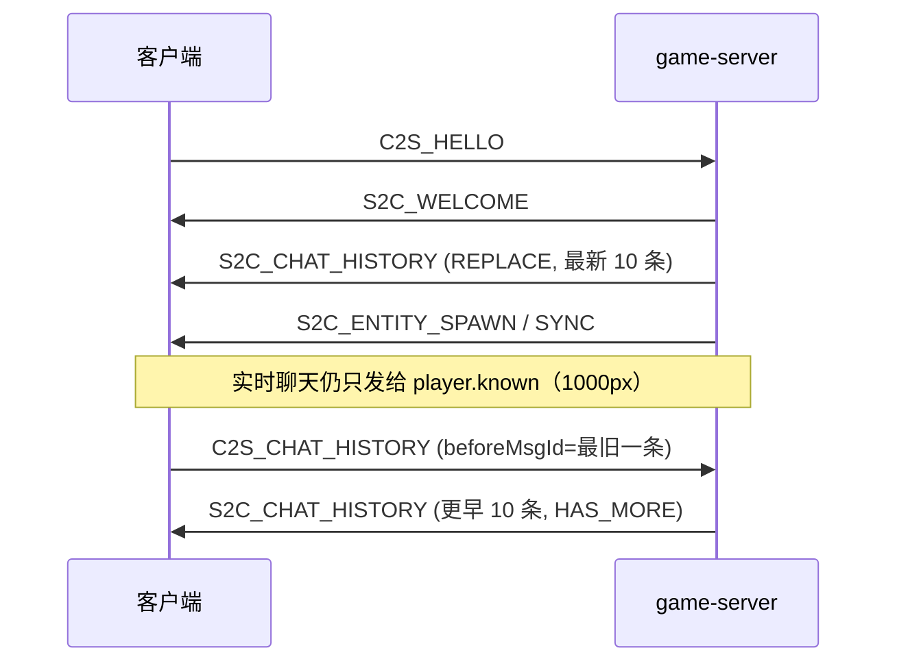

## 产品概述
园区频道（聊天）目前只能看到自己在线期间收到的最多 40 条消息，刚进园面板是空的，无从判断园里有没有人、在聊什么。本次在不引入数据库、不破坏“关掉即清空”这一产品前提的情况下，让频道具备“进园就能看到前文、能继续往上翻”的连续感。

## 核心功能
- **进园补发**：进入园区后立即收到最近 10 条聊天，面板不再是空的；刷新、断线重连同样生效。
- **上翻加载**：在面板内滚到顶部时自动请求更早的消息，每次 10 条，最多回溯最近 200 条；加载中显示“正在加载更早的消息…”，到顶后显示“没有更早的消息了”。
- **历史与实时区分**：补发消息与进园后的实时发言之间显示一条分隔线“以上为进入园区前的消息”，不让人误以为能一直收到全园消息。
- **面板加长**：桌面端与手机端消息区都加高，一屏能看到更多上下文；手机端仍为浮层，不得顶掉底部操作区。
- **滚动跟随修正**：只有停在底部时才自动跟随新消息；用户正在往上翻时，新消息不打断阅读，改为出现“↓ 新消息”按钮，点击回到底部并清空未读。
- **未读提示**：面板收起时来了新消息，标题栏显示未读数，不再显示没有信息量的总条数。
- **保留原行为**：发送成功后收起面板并释放输入焦点；手机端不常驻键盘；历史消息不弹头顶气泡。

## 边界
- 只补发玩家发言，不补发“进园 / 离园”系统播报（那类播报按视野逐个裁剪，全局回放会泄露看不见的人的行踪）。
- 不做独立历史面板、不做搜索、不做落盘持久化；服务端重启后历史清空，回到现有空态。


## 技术栈
沿用现有栈，不新增依赖：
- 协议层：`@niuma/shared-types`，手写 `ByteWriter/ByteReader` 二进制编解码 + `bun:test`
- 服务端：Bun WebSocket（`apps/game-server`），进程内 `World`，零数据库零磁盘（ADR-0004）
- 客户端：Next.js + React + zustand（`lib/game-ui.ts`）+ Tailwind v4 主题令牌
- 编排：pnpm + turbo（`pnpm typecheck` / `pnpm test`；game-server 用 `bun test`）

## 实现方案

### 核心决策：进程内环形缓冲 + 纯新增协议包
| 方案 | 收益 | 代价 / 不可逆性 |
|---|---|---|
| A. 服务端 `ChatHistory` 环形缓冲 + 新 opcode（采用） | 刷新/重连也能看到前文；零持久化不变；协议纯新增，旧客户端 `default: break` 自动忽略 | 需双端同版本发布；重启清空 |
| B. 仅客户端 localStorage 保存自己看过的 | 零服务端改动 | 刚进园仍空白，解决不了本次痛点；换设备丢失 |
| C. 落盘 / 接数据库 | 跨重启保留 | 违背 ADR-0004，部署与合规成本跳变 |

选 A。改动落在最低可行层：协议新增包 → 服务端新增一个内存模块 → 客户端一个数据管道 + 一个面板。

### 协议设计（0x1e / 0x1f，均为空闲编号）
- `C2S_CHAT_HISTORY = 0x1e`：`[op][beforeMsgId u16][limit u8]`；`beforeMsgId = 0` 表示要最新一页。
- `S2C_CHAT_HISTORY = 0x1f`：`[op][flags u8][count u8]` + `count × [msgId u16][entityId u16][ageSec u32][nameLen u8][name][textLen u16][text]`
- `flags`：bit0 `REPLACE`（首屏快照，客户端整表替换），bit1 `HAS_MORE`（还有更早的）。
- **时间用 `ageSec`（距今秒数）而不是服务端时间戳**：客户端按 `Date.now() - ageSec*1000` 还原，与实时消息统一走浏览器时钟，避免服务端与用户设备时钟不一致导致时间倒流。
- **条目自带 `name`**：发送者可能已离场，客户端 `names` Map 里查不到，不能只靠 `entityId`。
- **一页一包，按字节兜底**：默认 10 条；编码时累计超过 `2048B` 就停止追加剩余条目并置 `HAS_MORE = true`，既不需要分包协议，也不会让单包无限膨胀（最坏约 5.4KB，实际典型 < 500B）。
- 解码容错对齐 `S2C_SYSTEM_NOTICE`：`nameLen/textLen` 越界回空串，不抛错；错误 opcode 抛错。

### 服务端
- 新建 `ChatHistory`：预分配定长环形数组，容量 200、TTL 60 分钟；`add` 覆盖最旧格，`latest` / `before` 只读扫描（O(容量) ≤ 200），不进入 20Hz tick。
- `handleChat` 在广播成功后写入历史（打码后的文本照写，被拒的不写），**绝不缓存编码后的 `Uint8Array`**（`transport.send` 依赖同步拷贝约定）。
- `admit()` 顺序改为：`WELCOME` → 历史首屏 → `refreshView()` → `announceEnter()`。历史必须早于 `refreshView`，因为 `known` 一旦建立实时聊天才可能到达本 socket，先发快照才能保证“快照不会被实时消息抢先、REPLACE 也不会抹掉刚到的新消息”。
- **即使历史为空也发一包 `count = 0`**：客户端靠它清掉上一个会话残留的旧消息。
- 分页请求：`limit` 钳到 `MAX_PAGE`；同一玩家 500ms 内重复请求直接忽略（防抖动刷包）；响应只发本人。
- 补发与分页都**不走 `handleChat`**：不占 5s/3 条限速窗口、不触发词表审核（内容已审核过）、不弹气泡。
- 新增配置走 `config.ts` 既有的 `readInt`：`GAME_CHAT_HISTORY_CAPACITY` / `GAME_CHAT_HISTORY_TTL_MS` / `GAME_CHAT_HISTORY_PAGE`。

### 客户端
- `net/client.ts` 增加 `S2C_CHAT_HISTORY` 分支与 `sendChatHistory(beforeMsgId, limit)`。
- `session.ts` 新增 `handleChatHistory`：转 `ChatEntry`（`at = Date.now() - ageSec*1000`、`self = entityId === localId`、`history: true`），**不调用 `renderer.showBubble`**；新增 `requestHistory(beforeMsgId)`。
- `game-ui.ts`：`MAX_MESSAGES` 40 → 200；新增 `history: { loading, hasMore, cursor }` 与 `applyHistory(entries, { replace, hasMore })`——`replace` 时整表替换（且**不增加未读**，否则一进园就显示“10 条未读”），否则整页前插；按 `entityId:msgId` 去重、按 `at` 兜底排序、裁剪到 200 条；`cursor` 取“最旧的一条聊天消息 id”，不能用负数系统消息 id。
- `ChatDock.tsx`：消息区桌面 340px / 手机 `min(38dvh, 220px)`；滚动逻辑改为“贴底才跟随”；滚到顶部（`scrollTop < 16`）触发 `onLoadHistory(cursor)`；前插后按 `scrollHeight` 差值回填 `scrollTop`，阅读位置不跳；新增“↓ 新消息”按钮、历史分隔线、顶部加载状态行、折叠态未读徽标。
- 交互再设计的细节与视觉规范见 `<design>`，实现前按用户规则加载 `impeccable`。

### 性能与可靠性
- 历史写入 O(1)，读取 O(200)；客户端每次仅一次 React 状态更新（一页一包），不产生逐条渲染。
- 内存上限 ≈ 200 × 540B ≈ 108KB，恒定，不随在线人数增长。
- 进园额外下行 ≤ 5.4KB（典型 < 500B），走 `transport.send` 唯一收口，会计入 `egress.record`，需在 ADR 中标注对 admission 带宽水位的可接受影响。
- 断线重连由 `REPLACE` 幂等覆盖，不需要客户端持久化，也不会出现重复消息。

## 架构设计

数据流：`handleChat` → 广播 + `ChatHistory.add` → `admit`/分页请求 → `encodeChatHistory` → `net.handle` → `session.handleChatHistory` → `game-ui.applyHistory` → `ChatDock`。

## 实现注意事项
- 严格遵守 ADR-0033：手机端聊天是浮层，**不得**放回 HUD 纵向 flex；发送成功后仍 `blur()` + 收起。
- 不修改 `S2C_CHAT_BROADCAST` 与 `S2C_SYSTEM_NOTICE` 的既有语义；系统播报不进历史。
- 服务端热路径零分配约束不变：历史只在 `admit` 与显式请求路径执行，编码复用缓冲。
- 日志沿用现有 `[game]` / `[moderation]` 前缀与中文措辞；历史相关日志只记条数与耗时，不打消息原文。
- 不改写既有 ADR，只新增 `0039` 并在其中引用 0004 / 0028 / 0033 / 0038。

## 目录结构
```
niuma/
├── packages/shared-types/src/
│   ├── types.ts                     # [MODIFY] 新增 C2S_CHAT_HISTORY/S2C_CHAT_HISTORY 与 ChatHistoryEntry/ChatHistoryPacket/请求类型
│   ├── constants.ts                 # [MODIFY] 新增 CHAT_HISTORY_MAX_PAGE/MAX_ENTRIES/TTL_MS/PACKET_BUDGET 与 flags 常量
│   ├── protocol.ts                  # [MODIFY] 新增 encodeChatHistoryInto / encodeChatHistoryRequest / decodeChatHistoryRequest / decodeChatHistory；长度越界回空串
│   ├── index.ts                     # [MODIFY] 导出新增类型与函数
│   └── __tests__/protocol.test.ts   # [MODIFY] 历史包往返、多字节、flags、越界容错、空页、错误 opcode
├── apps/game-server/src/
│   ├── sim/history.ts               # [NEW] ChatHistory 环形缓冲：容量/TTL 注入、add/latest/before、过期过滤
│   ├── sim/history.test.ts          # [NEW] 容量淘汰、latest 顺序、before 分页与 hasMore、TTL、msgId 回绕
│   ├── sim/chat.ts                  # [MODIFY] handleChat 增加 history 参数，广播成功后写入（打码照写、拒绝不写）
│   ├── sim/chat.test.ts             # [MODIFY] 补历史写入用例，保持既有 7 例不变
│   ├── sim/world.ts                 # [MODIFY] Player 增加 lastHistoryAt，reset() 归零
│   ├── server.ts                    # [MODIFY] 创建 ChatHistory；admit 发首屏；dispatch 处理 C2S_CHAT_HISTORY；500ms 请求节流
│   └── config.ts                    # [MODIFY] 新增 chatHistory 配置与三个环境变量
├── apps/web/
│   ├── lib/net/client.ts            # [MODIFY] NetHandlers.onChatHistory、S2C_CHAT_HISTORY 分支、sendChatHistory
│   ├── lib/game/session.ts          # [MODIFY] ChatEntry.history、handleChatHistory（不弹气泡）、requestHistory、回调类型
│   ├── lib/game-ui.ts               # [MODIFY] MAX_MESSAGES=200、history 分页状态、applyHistory 去重合并、unread
│   ├── lib/__tests__/game-ui-history.test.ts  # [NEW] replace/prepend/去重/裁剪/未读不自增
│   ├── components/game/ChatDock.tsx # [MODIFY] 面板加长、贴底跟随、上翻加载、分隔线、新消息按钮、未读徽标
│   └── components/game/GameViewport.tsx       # [MODIFY] 接 onChatHistory 与 onLoadHistory
└── docs/adr/0039-chat-history-backfill.md     # [NEW] 内存缓冲/全园回放 vs AOI/新 opcode/分页与字节预算/系统播报不进历史/后果与复核信号
```

## 关键代码结构
```ts
// packages/shared-types/src/types.ts
export const OpCode = {
  // …既有 0x01–0x1d
  /** 拉取更早的聊天：[op][beforeMsgId u16][limit u8] */
  C2S_CHAT_HISTORY: 0x1e,
  /** 历史聊天页：[op][flags u8][count u8] + count × entry */
  S2C_CHAT_HISTORY: 0x1f,
} as const;

export interface ChatHistoryEntry {
  msgId: number;
  entityId: number;
  /** 距今秒数；客户端用 Date.now() - ageSec*1000 还原，避免两端时钟不一致 */
  ageSec: number;
  /** 发送时的昵称快照：发送者可能已离场，不能靠名字表回查 */
  name: string;
  text: string;
}

export interface ChatHistoryPacket {
  /** bit0 REPLACE：首屏快照，整表替换；bit1 HAS_MORE：还有更早的 */
  flags: number;
  entries: ChatHistoryEntry[];
}
```
```ts
// apps/game-server/src/sim/history.ts
export interface ChatLine {
  msgId: number;
  entityId: number;
  name: string;
  text: string;
  /** 服务端毫秒时间戳；编码时换算成 ageSec */
  at: number;
}

export class ChatHistory {
  constructor(capacity: number, ttlMs: number);
  /** 广播成功后写入；容量满覆盖最旧格 */
  add(line: ChatLine): void;
  /** 最新 limit 条，按时间从旧到新，已过滤过期 */
  latest(limit: number, now: number): ChatLine[];
  /** msgId 之前的 limit 条，从旧到新；游标找不到时返回空页 */
  before(msgId: number, limit: number, now: number): { lines: ChatLine[]; hasMore: boolean };
}
```


## 设计方向
沿用现有「像素终端 HUD」语言：暖褐墨底、薄荷冷光单一强调色、2px 硬边、等宽字、无圆角无阴影无渐变。本次只把频道从「一条窄消息条」改造成「可回看的频道窗口」，不换肤、不引入新字体。

## 结构（自上而下）
1. **折叠头**：左侧 `MessageSquare` 图标 + `园区频道` + `/local` 次级标签；右侧未读徽标（薄荷底、墨色数字）与旋转箭头。整行可点，键盘可聚焦。
2. **消息区**：滚动容器，`role="log" aria-live="polite"`。顶部依次是「正在加载更早的消息…」/「没有更早的消息了」状态行（mono 9px、mist-500、`role="status"`），再往下是历史消息（略降透明度，`mist-100/85` 文本 + 薄荷名字），历史与实时之间一条 `— 以上为进入园区前的消息 —` 细分隔线。
3. **新消息浮标**：消息区右下角悬浮按钮「↓ 新消息」，mint-400 描边、ink-950 底，仅在用户离开底部且有新消息时出现。
4. **输入区**：保持现有输入框 + 发送按钮 + 提示/字数行；聚焦时 2px mint-400 边框。
5. **收起态提示条**：沿用现有打码提示，不新增高度。

## 布局与响应式
- 桌面：面板宽 340px，消息区 `max-h-[340px]`，展开后从底部操作行向上生长。
- 手机（compact）：宽 250px、消息区 `max-h-[min(38dvh,220px)]`，仍是工牌下方 `absolute z-30` 浮层，绝不进入 HUD 纵向 flex，不把底部操作区顶出屏幕。
- 消息行保持「时间 → 名字 → 正文」单行流式排布，正文 `12px`，时间与名字 `9–10px`。

## 交互与动效
- 贴底时新消息平滑跟随（`scrollTo({ behavior: 'smooth' })`，尊重 `prefers-reduced-motion` 时改为瞬时）。
- 上翻到顶自动加载；前插后按 `scrollHeight` 差值回填 `scrollTop`，阅读位置零跳动。
- 加载态用 2px mint 竖条呼吸（`opacity` 0.4→1，1.2s，`ease-out-expo`），不使用 bounce/elastic。
- 未读徽标出现时 `120ms` 缩放淡入；数字超过 99 显示 `99+`。
- 键盘：Enter 发送、Escape 收起、PageUp/PageDown 与方向键可滚动消息区（容器 `tabIndex=0`）。

## 可访问性
- 对比度：正文 `mist-100` on `ink-900` ≥ 12:1；次要用 `mist-400`（6.2:1），不用 `mist-500` 承载正文。
- 滚动容器可聚焦并有 `aria-label="园区频道消息"`；加载与“没有更早”用 `role="status"`。
- 折叠头 `aria-expanded`，未读通过 `aria-label="园区频道，N 条未读"` 表达，不只靠颜色。

## Agent Extensions
### Skill
- **impeccable**
  - Purpose：改造 `ChatDock` 时先 `/impeccable shape` 明确历史面板的层级与状态，再实现，最后 `/impeccable polish` 收口；用 `npx impeccable detect apps/web/components/game/ChatDock.tsx` 做确定性自检。
  - Expected outcome：面板加长与新交互不破坏既有像素 HUD 语言，无对比度、焦点、动效反模式。
- **principal-software-architect**
  - Purpose：为「内存缓冲 / 全园回放 vs AOI / 新 opcode / 分页字节预算」产出 ADR-0039，含备选对比、反向成本、后果与复核信号。
  - Expected outcome：`docs/adr/0039-chat-history-backfill.md` 落档，决策可回溯，不改写历史 ADR。
