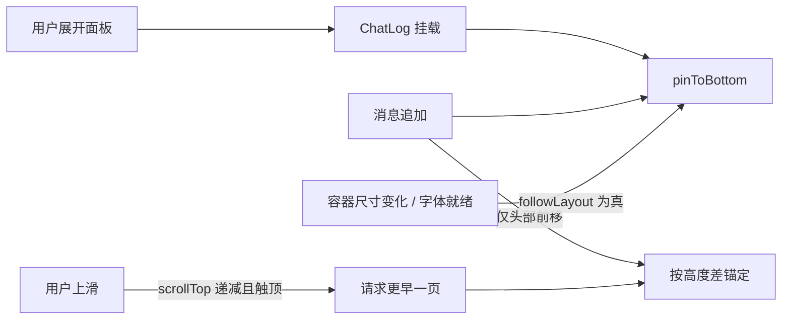

## 用户需求
修复聊天面板（园区频道）展开后没有停在消息列表最底部的问题：当前每次打开都要手动下滑一段距离才看到最新一条。

## 产品概述
游戏内常驻的园区聊天面板，展开即应从最新一条消息开始阅读，并在阅读过程中持续保持贴底；向上翻历史时保持当前阅读位置不跳动。

## 核心功能
- 打开面板、刷新后恢复展开状态、断线重连整表替换时，列表必须直接落在最底部，视觉上无残留距离。
- 面板展开后若发生不影响消息内容的布局变化（字体切换、视口或地址栏变化、键盘弹起、滚动条出现或消失），视图仍应保持贴底，不得出现可继续下滑的空隙。
- 新消息（含列表达到 200 条上限后的追加）到达时立即跟到最底部，即使打断上翻。
- 向上翻历史时按分页前插，只做位置锚定，不因高度变化被拉回底部；上翻返回空页或重复页时不产生任何滚动跳动。
- 打开面板时的程序化贴底不得被误判为「用户上翻」而发起历史请求；消息不足一屏时也不应自动请求更早消息。
- 外观、常驻行为、Esc 收起、发送后不收起、未读徽标等既有行为保持不变。
- 边界场景：0 至 3 条短消息、刚好一屏、200 条满列表；桌面窗口缩放、手机竖屏与横屏、手机键盘弹起。


## 技术栈
沿用现有栈，不引入新依赖：Next.js 15（App Router）+ React 19 + TypeScript + Tailwind CSS v4 + zustand 5；逻辑测试用 `bun test lib`（`apps/web` 已有 36 个纯逻辑测试文件）。

## 实现方案
根因：`ChatLog` 的贴底是「一次性快照」——仅在 `[open]` 和 `messages` 变化时写 `scrollTop = scrollHeight`，外加一次 rAF 兜底。任何晚于快照发生的高度增长都不会被跟随，用户就会看到「离底部一段距离」：字体 `font-display: swap` 晚到导致行高变化、滚动条出现改变宽度引发中文重排、`max-h` 使用 `dvh` 随视口/键盘变化，以及 `applyHistory` 空页返回新数组引用导致的无效重渲染。

做法：把「贴底」从一次赋值升级为「贴底意图 + 有条件跟随」，仍集中在 `ChatLog.tsx` 一处：

1. 单一入口 `pinToBottom()`：读 `scrollHeight` 写 `scrollTop`，并同步高度基准；所有贴底路径统一调用。
2. 消息变化的判定改为三分支（复用现有 `entryKey` 首尾身份，O(1)）：尾部变化 → 无条件贴底（保持 ADR-0041「任何新消息立即贴底」）；仅头部变化 → 按高度差回填锚定（保持 ADR-0039 前插语义）；首尾都未变化 → 不移动滚动、不刷新高度基准（修掉当前 `else` 分支把上翻用户拉回底部的问题）。
3. `ResizeObserver` 只观察滚动容器自身尺寸（content-box）：容器变矮、宽度变化（滚动条出现）、`dvh` 变化时按需重新贴底。这里修正 ADR-0041 拒绝 ResizeObserver 的理由——因为内容超出 `max-h` 后内容增长不改变容器尺寸，观察容器而非内容就不会与历史前插抢滚动；仅在 `followLayoutRef` 为真时跟随。回调内用 rAF 合并，避免同一帧多次写入。
4. `document.fonts.ready` 挂载后补一次贴底，覆盖 `swap` 字体晚于首帧就绪这一唯一「内容高度增长但容器尺寸不变」的来源；仅在节点仍挂载且贴底意图为真时执行。
5. 上翻触发改为「`scrollTop` 递减」判定：记录上一次 `scrollTop`，只有减小（用户向上拖、滚轮上滑、PageUp/Home）才检查 `TOP_TRIGGER = 16` 并请求；程序化贴底和前插回填都是增大，天然不会误触发。同时要求 `scrollHeight > clientHeight`，避免不足一屏时自动请求历史。
6. `game-ui.applyHistory` 在非 replace 且去重后 `fresh.length === 0` 时只更新 `history`，不替换 `messages` 引用，既消除误贴底也省掉一次 200 条列表重渲染。
7. 保持 `open` prop 与 `ChatDock` 的挂载方式不变（收起即卸载、展开即重挂载），避免扩大改动面。

## 实现要点
- 关键 ref 语义：`scrollHeightRef` 只作为前插回填基准；`lastScrollTopRef` 记录上一次滚动位置用于方向判定；`followLayoutRef` 表示当前视图是否应该跟随布局变化；`frameRef` 合并 RO 回调。
- 所有浏览器 API 只在 `useLayoutEffect`/`useEffect` 内使用，SSR 安全；卸载时 `disconnect()` 并 `cancelAnimationFrame`。
- 不使用轮询、不给滚动容器加 `scroll-behavior: smooth`、不做每帧读取，性能开销由布局变化驱动，保持 O(1) 判定。
- 不改 `MAX_MESSAGES = 200` 与服务端环形缓冲的容量对齐策略，不动 `applyHistory` 的满页裁剪行为。
- 改动半径限定为 2 个源文件 + 1 个测试文件 + 1 份 ADR，不触碰聊天外观、输入、鉴权与会话协议。

## 架构设计
UI 层：`ChatLog` 独占滚动策略（贴底、锚定、上翻触发）。
状态层：`game-ui` 负责消息合并且避免无效引用变化。
两者仍通过既有 props 通信，不新增 Context、不新增全局状态、不引入第三方滚动库。



## 目录结构

```
niuma/
├── apps/web/components/game/
│   └── ChatLog.tsx                # [MODIFY] 滚动策略核心：抽出 pinToBottom；消息三分支判定；新增 ResizeObserver + document.fonts.ready 跟随（仅 followLayout 为真时）；handleScroll 改为 scrollTop 递减判定并补「内容确实可滚」前置条件；保留 TOP_TRIGGER=16、entryKey、HistoryDivider 与所有渲染结构不变
├── apps/web/lib/
│   ├── game-ui.ts                 # [MODIFY] applyHistory 非 replace 且 fresh 为空时只更新 history（loading/hasMore/cursor 保持），返回原 messages 引用，避免无内容的引用变化触发重渲染与误贴底
│   └── __tests__/
│       └── game-ui-history.test.ts # [MODIFY] 新增用例：上翻返回空页/全为重复条目时 messages 引用不变、cursor 不前移、loading 被清掉；沿用现有 bun:test + reset() 写法
└── docs/adr/
    └── 0047-chat-log-sticky-bottom-follow.md  # [NEW] 记录本次决策：一次性快照的失效场景、改为「有条件跟随」的 ResizeObserver + fonts.ready 方案、与 ADR-0041 方案 C 的区别（观察容器而非内容，故不与前插锚定冲突）、备选方案与反向成本、回滚路径、复核信号；不改写 ADR-0041
```

## 验证方式
- `cd apps/web && bun run typecheck`。
- `cd apps/web && bun test lib`（覆盖新增的空页用例与既有历史合并用例）。
- 浏览器回归（桌面 1440 宽 + 手机 390 宽触屏模拟）：刷新恢复展开、收起再展开、发送后连续追加、上翻 3 页、上翻返回空页、窗口缩放、手机键盘弹起、200 条满列表追加，逐项确认首屏即在最底部且无可见底部空隙。


## Agent Extensions
### Skill
- **systematic-debugging**
  - Purpose: 在改动前用探针复现「打开后距底部差值」，记录 `scrollTop`/`scrollHeight`/`clientHeight` 与每次高度变化的触发时机，确认差值来自字体、容器尺寸还是无效引用更新，避免拍脑袋改代码。
  - Expected outcome: 得到一份可复现的差值来源结论；若结论与本方案假设不同，按结论调整跟随对象与判定条件。
- **principal-software-architect**
  - Purpose: 输出 ADR-0047，对「有条件跟随 vs 无条件 ResizeObserver vs 固定高度容器」做权衡分析，说明为何修正 ADR-0041 方案 C 的结论，并给出 30 天回滚路径。
  - Expected outcome: 一份可被后续维护者直接执行的决策记录，含备选方案表、反向成本与复核信号。
- **impeccable**
  - Purpose: 对聊天面板做一次交互与可访问性收尾检查（`/impeccable audit`），确认滚动容器仍可键盘翻页、焦点环、`role="log"` 与 `aria-live` 未受改动影响。
  - Expected outcome: 审计无 primary findings，或发现的滚动/焦点问题被一并修掉。
