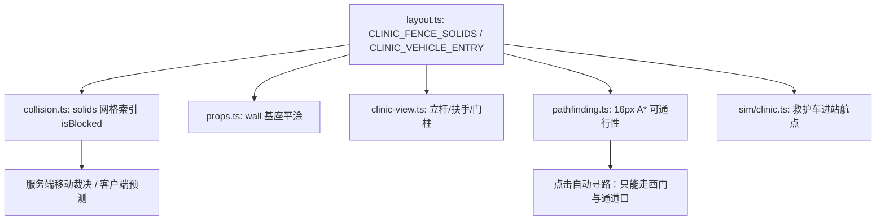

## 用户需求

护士站（园区东侧的护士急救站）目前四周完全敞开，玩家可以从任意方向走进站内、绕到导医柜台后面的护士身边，也能直接从站台上穿过。用户要求给护士站加围挡，让这块地方看起来是个有边界的「站」。

## 产品概述

护士急救站被一圈浅色医疗栏杆围起来，成为一个有明确边界的场所：正门在西侧，接进站铺装；南侧是救护车通道，供两辆救护车进出与伤员交接。

## 核心功能

- 北、东、西三面加围挡，只在西侧留一处人行门，门的宽度与现有进站铺装对齐。
- 南侧留出救护车通道：两辆车的车位、站内落点与出车路线都保持畅通，车辆照旧出警、回站。
- 玩家只能从西门或南侧通道口进出站内，不能再贴着站台任意穿行，也不会再绕过柜台贴到护士背后。
- 栏杆与地面铺装、柜台、病床、车位、落点互不干涉；站内原有的坐下、治疗、下床、护士回位等行为不受影响。
- 视觉上是一圈白色/钢灰色医疗栏杆（立杆 + 扶手，门口有立柱标记），与站台的地砖、柜台、红十字标识属于同一套配色，冬天不出现明显穿帮。

## 边界与例外

- 救护车通道口保持敞开，玩家也能从通道口进出（这是救护车出入口，不额外加门）。
- 站内的柜台、病床、落点、护士站位坐标全部不变。


## 技术栈

沿用现有仓库技术栈，不引入任何新依赖：

- 语言/工程：TypeScript + pnpm workspace + turbo（`pnpm typecheck` / `pnpm test`）
- 世界数据与碰撞：`packages/shared-types`（纯 TS 常量 + 纯函数，服务端权威与客户端预测共用同一份）
- 客户端渲染：PixiJS（`apps/web/lib/game/clinic-view.ts`，构造期烘焙/Graphics，静态物体按 y 进排序层）
- 服务端模拟：`apps/game-server`（`sim/clinic.ts` 的 `AmbulanceManager`）
- 测试：shared-types 用 vitest，game-server 用 bun:test

## 实现方案

**核心策略：几何单一来源。** 围挡矩形只在 `packages/shared-types/src/world/layout.ts` 定义一次并导出，碰撞索引（`collision.ts` 遍历 `WORLD_LAYOUT.solids`）、客户端栏杆美术、布局测试、服务端救护车进站判断全部读这一份，沿用 `RING_FENCE_SOLIDS` + `ring-art.ts` 已有的「碰撞在共享层、贴图按同一份几何画」的成熟做法，杜绝第二份坐标漂移。

**1. 围挡几何（贴 `CLINIC_REGION_RECT`，比铺装大一圈，栏杆站在铺装外沿）**

厚度 10，与擂台围栏同口径：

| 段 | 矩形 | 说明 |
|---|---|---|
| 北 | `{4990, 4250, 260, 10}` | 整段封闭，护士站位 4272 与围挡之间仍留 12px |
| 东 | `{5240, 4250, 10, 230}` | 整段封闭 |
| 西上 | `{4990, 4250, 10, 72}` | 到人行门洞上沿 4322 |
| 西下 | `{4990, 4378, 10, 102}` | 从门洞下沿 4378 到底边 4480 |
| 南东段 | `{5170, 4470, 80, 10}` | 只封东南角；x 4990–5170 敞开作救护车通道 |

- 人行门洞 = y 4322–4378（56px），与擂台 56px 门洞同口径；扣掉两侧 9px 玩家半径仍有 38px 净空，`NAV_CELL = 16` 的 A* 网格至少 2 列可走。
- 同步把 `CLINIC_ACCESS_PAVING` 从 `{4660, 4328, 340, 44}` 改成 `{4660, 4322, 340, 56}`，让门洞与铺装等高一米不差（该常量只被 `isPlantable` 与 `paved` 使用，无测试断言）。
- `kind: 'wall'`：与 `RING_FENCE_SOLIDS` 一致，`props.ts` 的 `fillSolidFlat` 会自动在地面层画出 `COLOR.wall(#dfe6ee)` 浅色基座带（正好是医疗白），客户端再在其上叠立杆与扶手；副作用是 `winter-art` 会给横向段挂冰棱——擂台绳栏已有同样表现，作为已知小项写进 ADR。
- `CLINIC_SIGN` 从 y 4254 上移到 4236，避免立牌插进北栏（该常量只在 `clinic-view.ts` 使用，无测试引用）。

**2. 救护车进站航点（避免围挡把出警变成「绕楼 8 秒再瞬移」）**

出警最后一段是从 `AMBULANCE_ROAD_GATE(4096,4755)` 直奔伤员。站内北半区（柜台背后，正是打护士后昏迷的高频点）的直线会在 y≈4304 处撞西栏，单轴滑行会朝北绕过西北角，8 秒后走 `UNSTUCK_MS` 瞬移进站，观感很差。因此在 layout 里新增并导出 `CLINIC_VEHICLE_ENTRY = { x: 5080, y: 4502 }`（救护车通道正中，通道下沿 4480 以南 22px，树带避让范围内）：

- `advanceCar` 的 `Dispatched` 分支：当 `car.leg === 2` 且伤员落在 `CLINIC_REGION_RECT` 内时，先用 `advanceLeg` 走到 `CLINIC_VEHICLE_ENTRY`（next = 3），再从通道口直插伤员；伤员在站外时行为完全不变。
- 从 (4096,4755) 到 (5080,4502) 的直线全程 y ≥ 4502，不碰任何围挡；从通道口向北的直线穿过敞开段（y=4480 处 x≈5078），柜台挡路时靠既有单轴滑行绕柜角，亚秒级。
- 送回方向无需改：从站内出发去 `AMBULANCE_ROAD_GATE` 时 `dy > 0`，被西栏挡住后滑行方向天然朝向门洞，能自己穿出；东侧站外伤员靠滑行绕过东北角即可。

**3. 客户端美术**

`ClinicView.build()` 新增 `paintFence(depth, base)`，遍历 `CLINIC_FENCE_SOLIDS` 画栏杆（基座由 `props.ts` 自动铺，尺寸线、立杆、扶手、门口立柱、扶手小段红十字）。北栏与南东段按 `rect.y + rect.h` 进 `depth`（角色在站内画在其前、站外画在其后）；东西两段进 `base`。纯 Graphics、构造期一次性生成，不进帧循环，帧开销为 0。

**4. 验证与文档**

- 新增 `clinic-layout.test.ts`：门洞可通行、三面挡人、通道口敞通、救护车出车走廊不被拦、围挡不与柜台/病床/车位/落点/床位 seat 坐标重叠。
- `clinic.test.ts` 增一条：柜台背后（如 5060,4268）昏迷的伤员能在 2 秒内被接起（`carriedBy !== 0`），即没有掉进 8 秒瞬移兜底。
- 新增 `docs/adr/0091-*.md`（不改历史 ADR），并在 `release-notes.json` 最前面补一条玩家口吻的版本工报（当前最新是 `2026-11-15-11`，新增 `2026-11-15-12`），最后跑 `pnpm changelog:check`。

**性能**：新增 6 个轴对齐矩形（碰撞网格索引多 6 项，单次查询候选 +0～2），A* 的可通行性缓存自然会覆盖新栏杆；客户端无逐帧成本。瓶颈与风险只在救护车几何，已用进站航点消除。

## 实施要点

- 工作区已有未提交的 ADR-0090 改动（`sim/clinic.ts`、`sim/detention.ts`、`generate` 的 `clinic.test.ts`、`release-notes.json` 里 `2026-11-15-11`）——只做增量，不覆盖、不回滚。
- 座位 id 体系绝对不能动：围挡不加 seat，`CLINIC_BED_SEAT_IDS` 保持原值。
- 不改 `CLINIC_RECT`（铺装）与 `CLINIC_REGION_RECT`（区域名，`REGIONS` 里还有一份同值字面量，改动会牵连区域标签），围挡贴区域矩形。
- 栏杆美术只读导出的 `CLINIC_FENCE_SOLIDS`，禁止在 `clinic-view.ts` 手写坐标。
- 测试如出现「装饰物不陷进碰撞体」「贴墙彩旗不挂进墙里」一类既有断言，先跑 `pnpm test` 确认是否被新矩形波及，再决定是收紧围挡还是调整测试前置条件（优先改围挡，不动别人的断言口径）。

## 架构与数据流



## 目录结构

```
packages/shared-types/src/
├── world/layout.ts                      # [MODIFY] 新增 CLINIC_FENCE_SOLIDS（北/东/西上下/南东段）、CLINIC_VEHICLE_ENTRY；
│                                        #          CLINIC_ACCESS_PAVING 加高到 56 与西门洞对齐；CLINIC_SIGN 上移到 4236；
│                                        #          WORLD_LAYOUT.solids 追加 ...CLINIC_FENCE_SOLIDS（沿用 kind 'wall'）
└── __tests__/clinic-layout.test.ts      # [NEW] 门洞通行 / 三面挡人 / 救护车通道畅通 / 不与柜台·病床·车位·落点重叠
apps/web/lib/game/
└── clinic-view.ts                       # [MODIFY] build() 新增 paintFence：按共享矩形画基座压线、立杆、扶手、
                                         #          门口立柱与红十字；北栏与南东段进 depth，东西两段进 base
apps/game-server/src/sim/
├── clinic.ts                            # [MODIFY] Dispatched leg 2 增「站内伤员先进 CLINIC_VEHICLE_ENTRY」分支
└── clinic.test.ts                       # [MODIFY] 增「柜台背后昏迷 2 秒内被接起」用例，验证不走 8 秒兜底
docs/adr/
└── 0091-clinic-fence-and-vehicle-gate.md # [NEW] 围挡几何、门洞/通道取舍、kind 选择与冰棱副作用、进站航点与备选方案
apps/web/data/
└── release-notes.json                   # [MODIFY] 追加 id 2026-11-15-12 一条玩家可感知工报
```

## 关键结构

```ts
// packages/shared-types/src/world/layout.ts
/** 护士站围挡：贴 CLINIC_REGION_RECT，西侧留 56px 人行门，南侧留救护车通道（ADR-0091） */
export const CLINIC_FENCE_SOLIDS: ReadonlyArray<SolidRect>;
/** 救护车进站航点：站内伤员先停这里再插进站心，避免撞西栏绕楼（ADR-0091） */
export const CLINIC_VEHICLE_ENTRY: { readonly x: number; readonly y: number };
```

