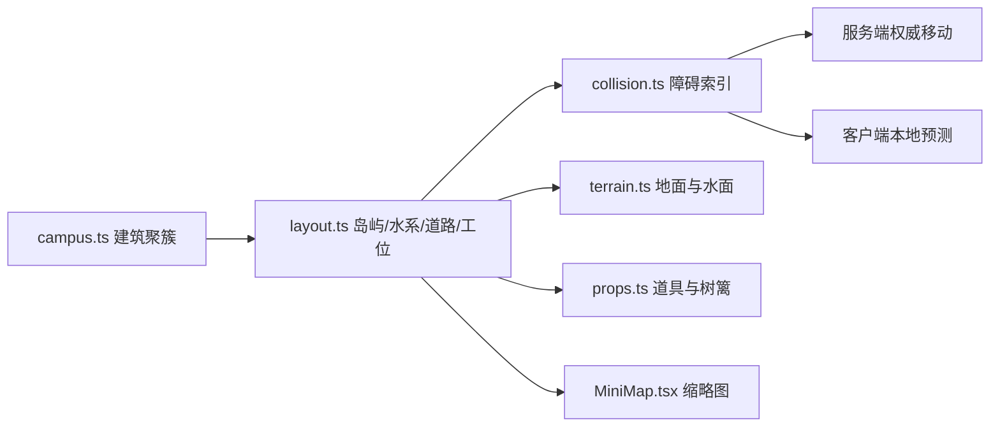

## 产品概述
对现有手写海岛地图做一次整体重制：岛屿缩小约 30%，删除办公区围栏，把工位区改为开放式，同时提高河流、桥梁、水塘、林地、花海与道路道具的密度，消除大片空草地。

## 核心功能
- 岛屿以世界中心 (4096,4096) 为原点等比收缩到约 3806×4212，保留北、东、南中、西南四个海湾；世界画布仍为 8192×8192，广场与出生点仍在岛心。
- 删除围栏的布局字段、碰撞、渲染与小地图描边；办公区保留约 34 个工位，改为无围墙的开放式布局，用树篱、花箱、绿植、长椅做软分区，四个方向留出入口。
- 水系加密：主河改到岛西侧纵贯南北，新增一条从东侧湖流向西南湾的支流，配置 3 座桥与 2 座码头，湖缩小保留，另布 5 口水塘。
- 陆地加密：林地增到 5 片并提高树密度，花海增到 5 至 6 片，孤树密度上调，沿路补成组的长椅、路灯、垃圾桶、告示牌、野餐桌、单车与码头设施。
- 五处功能建筑（会议室、卫生间、工作区、休息室、研发园庭院）全部保留，内部尺寸与陈设不变，仅整体平移并重新接路。
- 视觉结果：一屏可同时看到广场、道路、水面与林地；任意 512×512 的陆地范围内不再出现大面积纯草地。


## 技术栈
- 语言与构建：TypeScript、pnpm workspace、Turbo
- 共享数据层：`packages/shared-types`，纯几何与布局，不依赖 Pixi、Bun 或 DOM
- 服务端：`apps/game-server`（Bun，权威碰撞）
- 客户端：`apps/web`（Next.js + PixiJS 8）
- 测试：Vitest 与 Bun test
- 不改协议、不改定点坐标、不改 AOI 与视野半径

## 实施方案
核心策略：地图继续作为一份手写常量数据，只重写 `layout.ts` 与 `campus.ts`；碰撞、渲染、小地图、测试全部从同一份数据派生，不引入第二套地图描述。

关键决策与权衡：
1. 只缩岛，不动 `WORLD_WIDTH/HEIGHT`。世界常量同时被定点坐标、AOI 网格、海面平铺、相机夹取引用，改它会扩散到协议与网络层，收益只是少铺几块海面。岛屿按 0.7 等比收缩，面积约减半。
2. 删除 `fence` 字段而不是留空数组。留空会留下永远不命中的碰撞与渲染分支；直接删字段能让编译器把所有消费方找出来。办公区改用无碰撞的 `OFFICE_RECT`，仅用于区域名、工位排布与撒树留白。
3. `campus.ts` 的五个建筑聚簇改成「原点常量 + 内部相对偏移」。五处建筑要整体平移 30 多个绝对坐标，逐字面量加减极易漏改；抽出原点后重排只改一处，床、桌、马桶、绿植自动跟随。仍然全部手写，不引入运行时缩放、不引入 `Math.sin/cos/random`。
4. 软分区新增 `hedge` 道具，不新增碰撞体。树篱走现有 props 管线（按 kind 缓存贴图、按脚底 y 进深度层），不增加 blocker；花箱继续用 planter 的碰撞，两类交替摆放，既分隔空间又不封死办公区。
5. 码头单独列为 `docks`，不塞进 `bridges`。桥要求两端都在陆地，码头要求一端接岸、一端伸进水面；分开建模能保住既有的「桥两端在陆地」断言，代价只是多一个数组与一次循环。
6. 加密用参数而不是堆特例。树、花、孤树密度统一调 `TREE_CHANCE`、`TREE_CELL`、`WILD_TREE_*`；新增林地、花海、水塘仍走既有数组，自动接入碰撞、撒树留白、芦苇碎石、小地图与测试。

密度与性能：
- 岛屿面积约减半，但树量目标不降：5 片林地合计约 360 万平方像素，`TREE_CELL` 112、`TREE_CHANCE` 0.85 时约 240 棵；孤树约 70 棵，总量约 310 棵，比现状 425 棵少，绘制成本反而下降。
- 树、花箱、孤树仍是 circle blocker；水塘、湖、河是 polygon blocker；按 128px 网格索引，单次查询只遍历邻近桶，复杂度与物件数近似无关。
- 道具按 kind 缓存纹理；新增 `hedge` 只有一张 64×20 贴图，近百个实例共用，不增加显存压力。
- 禁止 `Math.random / Math.sin / Math.cos`，新坐标全部手写取整，保证 Bun(JSC) 与 V8 一致。

## 实施要点
- 坐标纪律：海岸线、河、湖、水塘、林地、道路、房间、工位全部写死整数；派生值只允许加减乘除与 `Math.sqrt`（河道仍用 `buildRiver`）。
- 双端同版本：`WORLD_LAYOUT` 是服务端权威碰撞与客户端预测共用的常量，本次必须双端一起发布，旧客户端会被持续拉回。
- 删除围栏时同步清理四处：`collision.ts` 的 segment blocker、`terrain.ts` 的 `addFence`/`drawFenceSpan`/`FENCE_POST_GAP`、`MiniMap.tsx` 的 fence 描边、`addPlaza` 注释里的「围栏与花箱继续承担办公区辨识」。
- `addBridges` 目前写死了东西向桥：木板缝竖排、栏杆压上下沿。新增的过溪桥是南北向，必须按 `w` 与 `h` 比例切换木板缝方向与栏杆边，否则栏杆会横在通行方向上。
- 更新硬编码坐标断言：`collision.test.ts` 的门洞、栏板、贴墙、水体与海岸采样；`river.test.ts` 的 fence 引用、桥面水覆盖扫描、`regionAt` 采样；`seats.test.ts` 的休息室与工作区门洞坐标、南北通道 lane。
- 新增布局密度测试：以 64px 栅格采样岛屿，统计「纯空草地」占比，并检查任意 512×512 陆地窗口；初始阈值取总体 20%、窗口 45%，实测后只允许下调一次并记录在 ADR。
- README「地图与地形」章节同步改写；新增 `docs/adr/0028`，记录缩岛、删围栏、软分区、码头独立建模的取舍与回滚路径。

## 架构设计


新增内容不新建模块，全部落在既有数组与既有渲染分支上；唯一新增类型是 `PropKind` 的 `hedge` 与 `WorldLayout` 的 `docks`。

## 目录结构
```
niuma/
├── packages/shared-types/src/world/
│   ├── layout.ts        # [MODIFY] 重写海岸线、广场、开放式办公区、道路、工位、区域表、水域、林地与密度参数；删除 fence 与 FenceSegment；新增 docks
│   ├── campus.ts        # [MODIFY] 五处建筑改为原点常量加相对偏移，整体平移；门洞、铺装、桌椅、床、马桶、绿植全部跟随
│   └── collision.ts     # [MODIFY] 删除 fence blocker 构建，其余障碍与网格索引不变
├── apps/web/
│   ├── lib/game/terrain.ts        # [MODIFY] 删除 addFence/drawFenceSpan/FENCE_POST_GAP 与 FenceSegment 导入；addBridges 支持南北向桥与码头；更新 addPlaza 注释
│   ├── lib/game/props.ts          # [MODIFY] 新增 hedge 的尺寸与像素画，加入现有贴图缓存与深度排序
│   └── components/game/MiniMap.tsx # [MODIFY] 删除围栏描边，补充 docks 绘制
├── packages/shared-types/src/__tests__/
│   ├── collision.test.ts  # [MODIFY] 删除围栏用例，改为开放式办公区可穿行、工位桌挡人、树篱不挡人；重取水体与海岸采样点
│   ├── river.test.ts      # [MODIFY] 删除 fence 引用；桥面水覆盖支持纵横两种朝向；更新周报河区域采样
│   ├── seats.test.ts      # [MODIFY] 更新休息室与工作区门洞坐标、南北通道 lane，保持座位与碰撞体不重叠
│   └── layout-density.test.ts # [NEW] 栅格化岛屿，断言纯空草地占比、任意窗口空地占比与林地花海水塘桥码头数量
├── README.md            # [MODIFY] 改写「地图与地形」章节：岛屿尺寸、开放式办公区、水系与建筑位置
└── docs/adr/0028-compact-open-island.md # [NEW] 记录缩岛 30%、删围栏、软分区、码头独立建模的备选、代价与回滚路径
```

## 关键代码结构
```ts
export interface WorldLayout {
  plaza: WorldRect;
  /** 开放式办公区：只用于区域名、工位排布与撒树留白，不参与碰撞 */
  office: WorldRect;
  paths: WorldRect[];
  lakes: LakeShape[];
  rivers: RiverShape[];
  bridges: WorldRect[];
  /** 码头木栈道：一端接岸、一端伸进水面，与 bridges 共用 isOnBridge 放行 */
  docks: WorldRect[];
  ...
}
```


## Agent Extensions
### Skill
- **principal-software-architect**
  - Purpose: 复核缩岛、删围栏、软分区与码头独立建模的取舍，按项目既有 ADR 结构产出决策记录
  - Expected outcome: `docs/adr/0028-compact-open-island.md`，包含至少两个备选方案、代价、不可逆性与 30 天回滚路径

- **verification-before-completion**
  - Purpose: 在收尾阶段用真实命令验证类型检查、构建与全部布局测试，避免只凭推断宣布完成
  - Expected outcome: typecheck、build、test 的实际输出，以及密度测试通过证据

### SubAgent
- **code-explorer**
  - Purpose: 全面枚举测试与渲染代码中硬编码的地图坐标、围栏引用与桥面假设，避免漏改断言
  - Expected outcome: 一份按文件列出的待改坐标与断言清单，用于更新三份布局测试
