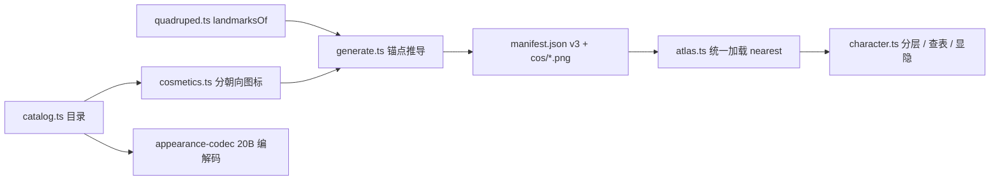

## Product Overview
把角色配件从「工牌 / 领带 / 嘴里叼着」整体换成「头饰 / 眼镜 / 颈饰」，让配件在 48×48 的大头小身比例下真正可读，并在四个朝向与站立、走动、坐下、躺平、叫唤全部姿势下贴住头颈。

## Core Features
- 头饰：学士帽、鸭舌帽、贝雷帽、安全帽、礼帽，锚定头顶，帽檐按朝向变化。
- 眼镜：圆框眼镜、墨镜、单眼镜，锚定眼线；朝上时隐藏，不把正脸眼镜画到后脑勺。
- 颈饰：围巾、项圈、挂脖耳机，锚定颈线，朝上时正好是后颈结。
- 背上（电脑包 / 公文包）美术不变，锚点并入新体系。
- 配件随呼吸、走路起伏、蹦跳、坐下、躺平逐帧跟随，切换姿势不悬空、不出框。
- 牛角与马鬃压在帽子之上，保住物种剪影；同类配件使用统一构图基准，帽檐永远压在同一条线上。
- 捏人面板的分组标题与选项文案同步改为头饰 / 眼镜 / 颈饰；玩家名字卡仍叫「工牌」。


## 技术选型
- 沿用现有栈：TypeScript 5.7 monorepo（pnpm 10 + turbo）、`@niuma/shared-types` 协议包、Bun 程序化像素生成器、PixiJS 8 客户端。
- 不引入任何新依赖；图标仍是 16×16、1:1 叠加、nearest 采样。

## 实现策略
分四步走，每步都可独立验证：

1. **协议层换语义不换长度**：把 `cosmetics` 的 `badge / tie / mouthItem` 改为 `headwear / eyewear / neckwear`，字节槽位仍是 `[15][16][17][18]`，`[19]` 继续保留，`APPEARANCE_BYTES` 仍为 20。`encodeSpawn / encodeHello / encodeSetAppearance` 一行都不用改，包体大小不变。
2. **几何单一真相**：从 `quadruped.ts` 的 `drawSide / drawFacing` 里把姿态计算抽成导出的 `landmarksOf(species, direction, column)`，返回头心、头半径、眼线、吻心、颈点、躯干心。绘图与锚点生成共用这一份，锚点不会再和美术漂移。
3. **manifest 升 v3，锚点按帧列**：生成器对 2 物种 × 4 朝向 × 16 列逐一调用 `landmarksOf`，加每类固定构图偏移后写成 `cosmeticAnchors[species][direction][column][kind] = [x,y] | null`。512 组、约 15KB JSON，直接覆盖呼吸、走路起伏、蹦跳与坐躺过渡帧，客户端不需要知道任何姿势常量。同时 `cosmeticFiles[kind][id][direction]`，每个图标出 down / left / right / up 四份，左向由生成器镜像右向。
4. **客户端只做查表**：`layoutCosmetics` 用 `frameIndex % columns` 取列号、按 `directionOf(frameIndex)` 取朝向，O(1) 拿到锚点；`null` 直接 `visible = false`。四向纹理在 `build()` 里一次加载进 entry，切朝向只换 texture 引用，不触发加载、不重建精灵。

### 关键取舍
- **为什么换语义而不是加槽位**：只剩 `[19]` 一个保留字节，加三个类目必须扩包长，会牵动所有编解码与同步包；而档案只写 sessionStorage（ADR-0004），旧字段改名后 `sanitizeAppearance` 自动回落默认值，等于免费迁移。
- **为什么锚点按列而不是按姿态**：按姿态（4 种）省数据，但呼吸 / 蹦跳 / 坐躺过渡帧仍会差 1~3px；按列只多 4 倍数据，逻辑更简单且没有特例。
- **为什么图标分朝向**：帽子一旦搬到头上，单张图无法同时表达帽檐朝前、朝侧、朝后；这是本次改造的必要成本，52 张 16×16 PNG 合计不到 60KB。
- **性能**：锚点查表 O(1)，`setPose` 帧号不变时提前返回，`layoutCosmetics` 只在换帧时跑（10~20Hz），不是每渲染帧；图标显存增量可忽略。

## 架构设计



### 叠层顺序（重要）
`back`（身后）→ body → pattern → bodyLight → **headwear** → hoof → extra（角 / 鬃压在帽子上）→ eyes → eyeLight → **eyewear** → snout → **neckwear**。
帽子排在 `extra` 之前，牛角与莫西干会从帽子上方穿出，避免戴帽即失去物种特征。

## 实施要点
- **版本强校验**：manifest 的 `version` 与 `sprite-layout.generated.ts` 同步升到 3；`atlas.ts` 现有校验会在漏跑 `pnpm assets` 时直接抛错，不要退化成静默兼容。
- **图标构图约定**：同类配件以图标中心 (8,8) 为统一基准构图（帽檐压同一条 y、镜片压同一条眼线），锚点只加类别固定偏移，禁止逐个 id 手调坐标。
- **可读性**：配件是固定配色，必须带 1px INK 描边或暗边，保证在奶白牛身与深色马身上都能读出来。
- **朝上规则**：眼镜锚点置 `null`；头饰、颈饰、背包正常显示。
- **不动的地方**：`backItem` 美术与「朝上时仍画在身体之后」的叠层顺序、`snoutId` 目前不参与绘制的问题，均不在本次范围。
- **校验**：更新 `protocol.test.ts` 的字段名；新增 `cosmetics.test.ts` 断言「`COSMETIC_CATALOG` 与 catalog.ts 顺序一致」「每个非 none 的 id 在四个朝向都有非空像素」「idle 下 head / neck / back 锚点非空、eyes 在 up 为 null」。
- **回滚**：改回旧目录与旧 `cosmetics.ts`、把 manifest 降回 v2 即可；协议长度未变，服务端无需回滚。

## 目录结构

```
niuma/
├── packages/shared-types/src/
│   ├── types.ts                         # [MODIFY] cosmetics 字段改名 headwear/eyewear/neckwear，更新注释与 DEFAULT_APPEARANCE
│   ├── catalog.ts                       # [MODIFY] HEADWEAR_IDS / EYEWEAR_IDS / NECKWEAR_IDS 替换旧三个目录，类型导出同步
│   ├── appearance-codec.ts              # [MODIFY] sanitize/encode/decode/appearanceKey 改用新字段，字节槽位 15/16/17/18 不变
│   └── __tests__/protocol.test.ts       # [MODIFY] 脏值测试改用新字段，补一条「槽位越界回落 none」
├── packages/pixel-assets/src/
│   ├── quadruped.ts                     # [MODIFY] 抽取并导出 landmarksOf；drawSide/drawFacing 改为消费它，画面像素不得变化
│   ├── cosmetics.ts                     # [MODIFY] 目录换新；新增 drawHeadwear/drawEyewear/drawNeckwear（按朝向作画），保留 drawBack
│   └── __tests__/cosmetics.test.ts      # [NEW] 目录一致性、四向像素非空、锚点覆盖断言
├── packages/pixel-assets/scripts/
│   └── generate.ts                      # [MODIFY] manifest 升 v3；逐物种/朝向/列输出锚点；图标按四向写文件；cosmeticSize 保持 16
├── apps/web/lib/game/
│   ├── character.ts                     # [MODIFY] CosmeticKind 换新；四向纹理入 entry；按帧列查锚点；null 隐藏；调整叠层顺序
│   ├── atlas.ts                         # [MODIFY] SpriteManifest 的 cosmeticFiles / cosmeticAnchors 类型改为 v3 嵌套结构
│   └── sprite-layout.generated.ts       # [MODIFY] 由生成器重写，version 3
├── apps/web/lib/
│   └── creator-store.ts                 # [MODIFY] CosmeticKind 字段改名
├── apps/web/components/
│   ├── creator/PartRail.tsx             # [MODIFY] 三组标题与标签改为头饰/眼镜/颈饰，空选项文案统一「不戴」
│   ├── creator/CreatorShell.tsx         # [MODIFY] 宣传语「工牌领带」改为「头饰眼镜颈饰」
│   └── site/Sections.tsx                # [MODIFY] 同句文案同步
├── apps/web/public/sprites/
│   ├── manifest.json                    # [MODIFY] 生成产物，v3
│   └── cos/*.png                        # [MODIFY] 52 张 16×16 分朝向图标，旧 14 张删除
└── docs/adr/
    └── 0007-cosmetic-slots.md           # [NEW] 记录部位迁移、锚点按列、字节换语义不换长度与回滚路径
```

## 关键结构（接口级）
```
export interface FrameLandmarks {
  head: [number, number];
  headRadius: number;
  eye: [number, number] | null;
  muzzle: [number, number];
  neck: [number, number];
  torso: [number, number];
}
export function landmarksOf(species: SpeciesName, direction: number, column: number): FrameLandmarks;
```
manifest v3 形状：`cosmeticAnchors[species][direction][column][kind]` 为 `[x, y]` 或 `null`；`cosmeticFiles[kind][id][direction]` 为路径或 `null`。


## Agent Extensions

### Skill
- **layer-pixel-art**
  - Purpose: 设计 16×16 的分朝向像素图标（帽檐、镜片、围巾垂坠），并按图集规则出图与校验可读性。
  - Expected outcome: 每类每个 id 四向图标在 8 倍放大核对图下轮廓清楚、无错格、无插值糊边。

- **principal-software-architect**
  - Purpose: 评审「20 字节外观槽位换语义」与「manifest v3 锚点结构」的契约影响、版本与回滚策略。
  - Expected outcome: 产出 `docs/adr/0007-cosmetic-slots.md`，含约束、备选方案、取舍与 30 天回滚路径。

- **verification-before-completion**
  - Purpose: 收尾时以命令输出与核对图为证据，不凭主观判断宣称完成。
  - Expected outcome: `pnpm assets`、`pnpm typecheck`、`pnpm test` 输出全绿，并附 2×4×5 放大核对图结论。
