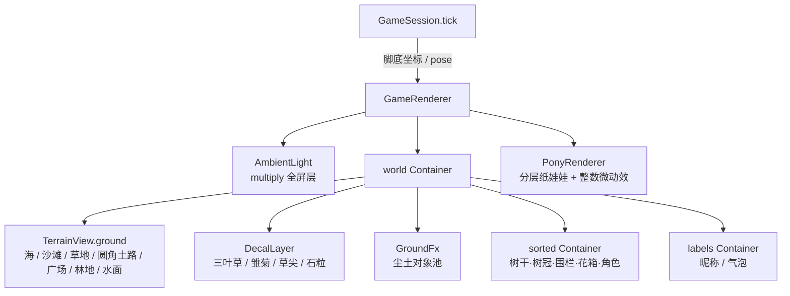

## 用户需求

把现有 2D 园区地图从「矩形贴图硬拼」重构为 Pony Town 质感的 cozy 渲染：地面交界圆润、草地不空、物体与角色共用一套按脚底 y 的遮挡顺序、整张地图笼罩一层暖色柔光层；小马与小牛的渲染器重构成分层纸娃娃，并补上贴地椭圆阴影与微呼吸动效。

四条硬规则贯穿全程：
- 不出现纯黑描边，所有描边都是本体色的深色混合态（深苔绿、深栗棕、深紫）；
- 地面交界必须是圆弧过渡，不得出现 90° 直角拼接；
- 每个动态对象都有独立的半透明椭圆落影，并严格按脚底 y 排序；
- 一切缩放为 32×32 栅格上的整数倍，不出现像素拉伸抖动。

## 产品概览

走进园区后，画面从「深绿方格纸」变成一片有层次的暖色草地：土路与广场的边界是圆角加一圈探出来的细草，草地上随机散布三叶草、雏菊、草尖与小石粒，树影与角色在同一套深度里前后分明，走到树干后方时树冠会淡到 0.85 让出角色。整幅画面再压一层清晨的浅暖金或黄昏的暖橙。捏人台与站点首页同步换成同一套暖色，不再出现「亮世界配暗界面」的割裂感。

## 核心功能

- **圆角地面过渡**：土路、广场、林地边缘全部改为圆角轮廓，边界外侧长出 1–3 像素的锯齿细草，内侧压一条 1 像素的土色暗边，彻底消除方块分界。
- **贴花层**：草地上按确定性哈希以 8%–15% 的概率撒四类贴花，水位、广场、土路上不生成；贴花独立成层，位于地面之上、角色之下。
- **深度遮挡**：树干与树冠拆成两层，与围栏、花箱、角色一起按脚底 y 进入同一排序队列；角色被树冠覆盖时树冠降到 0.85，离开即恢复。
- **柔光氛围**：地图绘制完成后覆盖一层混色层，清晨浅暖金、白日中性、黄昏暖橙、夜间冷蓝，随时间自动切换。
- **角色分层与微动效**：纸娃娃按尾巴、身体、斑纹、蹄、鬃毛/角、眼睛、口鼻、配饰的顺序叠放；待机与行走有整数纹素的起伏，每 35 秒自动眨一次眼。
- **贴地阴影**：统一的半透明椭圆，颜色为冷调靛蓝而非炭黑，随起伏做三档弹性变化。
- **全域暖色**：地形、水面、植被、界面、小地图、落地页使用同一套暖色低饱和色板。

## 边界

本次只改客户端渲染与配色，不动服务端、协议、世界坐标与碰撞；不重写角色解剖与图集帧预算；不引入外部美术资源，全部程序化生成；不重排界面布局，只换色板。


## 技术栈

沿用现状，不引入新框架：

| 层 | 选型 |
|---|---|
| Web | Next.js 15 App Router · React 19 · TypeScript strict · Tailwind CSS v4（`@theme` 令牌） |
| 渲染 | PixiJS 8（WebGPU 优先，回落 WebGL2）· `Graphics` / `TilingSprite` / `RenderTexture` |
| 像素纪律 | `pixel-scale.ts` 的 `devicePxPerTexel = round(base × dpr)`、`snapTexel` / `snapCss` |
| 资产 | `packages/pixel-assets` 程序化生成（零外部美术） |
| 测试 | `bun:test`（工作区已有 `bun` 依赖，`turbo run test` 会自动纳入新增 test 脚本） |

## 实现策略

### 1. 地面过渡改成「圆角轮廓 + 遮罩平铺」
`terrain.ts:206-212` 的 `addPaths()` 直接铺矩形 `TilingSprite`，是 90° 直角的根因。改为三段式：

1. **轮廓**：新增纯几何模块生成边界折线。
   - 矩形区域（4 条土路、广场）：解析圆角矩形，转角用二次贝塞尔倒角，半径 = `TILE_SIZE / 2` = 16。
   - 不规则区域（3 片林地）：32px 采样格 + 抖动 `inside()` 谓词做 marching-squares，得到有机边界。
2. **填充**：`TilingSprite` + 由轮廓生成的 `Graphics` 遮罩（复用现有 `grass.mask = mask` 模式）。`tilePosition` 按 `rect.x % 材质尺寸` 对齐世界相位，四条土路之间不再错纹。
3. **草缘**：沿轮廓按 6px 弧长采样，向草地一侧撒 1–3 根 1×2~1×4 的细草，颜色分三档；内侧沿同一轮廓画 `alignment: 0` 的 1px 土色暗边。

**关键取舍（要写进 ADR）**：没有采用「16 张 autotile 拼贴」。纯矩形区域的 dual-grid 结果与解析圆角矩形在数学上等价，但采样栅格会把边界量化到 32px 格点，导致土路末端与 120px 门洞最多错位 16px；且拼贴块内部材质相位与外围 `TilingSprite` 相位无法对齐，接缝处会出现半块砖。改用「轮廓 + 遮罩」后，一片区域只有 1 个 TilingSprite + 1 个 mask + 1 个草缘 Graphics，既零误差也零接缝。dual-grid 的采样思想保留在不规则区域（林地）上。

**备选被否**：`Graphics.fill({ texture, matrix })` 图案填充。v8 的 UV 矩阵语义随形状包围盒变化，跨区域相位难保证；遮罩方案确定性更高。

### 2. 贴花层
- 纯函数模块 `decals.ts`：64px 栅格，每格用 `Math.imul` 哈希（复用 `seeded()` 的同款算法，禁用 `Math.random`），命中概率 0.12，落在 8%–15% 带内；`inside` 谓词由调用方注入（岛内、非水面、非广场、非土路）。
- 四种贴花画进一张 32×32 图集（各 8×8 单元），`anchor(0.5, 1)`，进 `ground` 之上的独立 container。
- 全岛约 1000–1200 个精灵，随视口翻 `renderable`，与树共用同一套裁剪入口。

### 3. 树拆层与遮挡
- `makeTreeTextures()` 改为返回 `{ trunk, canopy }[]`：同一 108 高画布、同一 `(0.5, 1)` 锚点，树干一张、树冠一张。
- `terrain.ts` 各建一个 `Sprite`，`zIndex` 同为 `tree.y`，先加 trunk 后加 canopy。角色在树前（`y > tree.y`）时 `zIndex` 更大自然压住整棵；在树后则两层都在其上。
- 遮挡判定：初始化时建 128px 树冠网格索引；每帧由 `GameRenderer` 传入复用数组（脚底坐标），命中「角色包围盒 ∩ 树冠盒 且 角色 y < tree.y」则 `canopy.alpha = 0.85`。用两个复用 `Set` 做进入/离开，避免全量遍历与每帧分配。

### 4. 柔光层
- 新增 `ambient-light.ts`：全屏 `Sprite`（`Texture.WHITE`）+ `blendMode = 'multiply'`，加在 `app.stage` 上、`world` 之后，屏幕空间（不随相机缩放）。
- 按本地时间每 30s 重算：05–10 浅暖金 `0xFFE6C8` α0.15、10–16 中性 α0、16–20 暖橙 `0xFFB877` α0.18、20–05 冷蓝 `0x9FB6D9` α0.12。
- **风险与降级**：WebGPU 下 advanced blend 由 Pixi 走扩展路径，若 `multiply` 未生效则降级为同色 normal 叠加（α 降到 0.08），观感量级一致，不阻断主流程。尺寸随 `resizeTo` 同步。

### 5. PonyRenderer
- `character.ts` → `pony.ts`，类名 `CharacterSprite` → `PonyRenderer`，同步 `renderer.ts` 与 `preview.ts` 两个引用点。
- 分层顺序收敛为 `PONY_LAYER_ORDER` 常量一处定义：tail → body → pattern → bodyLight → hoof → extra → eyes → eyeLight → snout → hairstyle → headwear → eyewear → neckwear。
- **与需求文本的唯一偏离**：鬃毛排在眼睛之前。理由：鬃毛压住眼睛会吃掉表情，读脸优先级更高。写进 ADR。
- 微动效抽成纯函数 `ponyMotion(pose, elapsedMs, netId) → { bobTexels, shadow, blinking }`：
  - 待机 `bobTexels ∈ {0,-1}`，周期 3.4s；行走 `{0,-1}`，每步幅两次；只允许抬高不允许下沉，避免脚陷进地面。
  - `shadow ∈ {0,1,2}` 对应三张预烘焙椭圆（宽扁 26×8 / 常态 22×10 / 窄高 18×12），**不做浮点缩放**，否则破坏整数栅格。
  - `blinking` 每 35s ±5s 抖动，相位由 `netId` 哈希错开，避免同屏集体眨眼。
- 阴影色改 `0x191E3C`（冷靛蓝），两档 alpha 的手画椭圆，彻底去掉 `0x040807 @0.55` 的炭黑影子。

### 6. 眨眼调度
`packages/pixel-assets/src/__tests__/layout.test.ts:6-20` 规定「每一列必须被恰好一个动作覆盖，且 `poseOfColumn` 必须等于该动作名」。因此**不能把眨眼列 2 从 `CLIPS.idle` 里删掉**，否则列 2 变成孤儿列，测试直接挂。

做法：
- `layout.ts` 增 `export const BLINK_COLUMN = 2`，`generate.ts` 写进 `sprite-layout.generated.ts`（图集版本仍为 5，`manifest.json` 不变）。
- `clip.ts` 的 `buildClipTracks()` 对 idle 做后处理：播放序列剔除 `BLINK_COLUMN`，呼吸时长重新归一；`CLIPS` 本身不动，列归属契约保持绿。
- `session.columnFor()` 在 idle 下按 35s 调度把列号临时替换为 `BLINK_COLUMN`，持续 140ms。

## 性能

| 路径 | 复杂度 | 说明 |
|---|---|---|
| 轮廓生成 | O(周长 / 6) | 仅 init 一次，之后每帧零几何计算 |
| 贴花撒点 | O(格数) 一次 | ~16000 格 → ~1200 精灵，帧循环只翻 `renderable` |
| 树遮挡 | O(角色数 × 邻近树) ≈ 60×8 | 128px 索引 + 复用数组，零分配 |
| 柔光 | 1 个全屏 quad，1 次 blend | 与场景复杂度无关 |
| 阴影 squash | 换 `texture` 引用 | 无缩放矩阵，保持合批 |

帧循环仍然不 `new` 任何对象：贴花、树、角色只改 `renderable` / `alpha` / `zIndex` / `texture`。

## 架构



模块切分原则：几何与放置（`autotile` / `decals` / `pony-motion`）是不依赖 Pixi 的纯函数，可被 `bun:test` 直接覆盖；视图层（`terrain-textures` / `terrain` / `ambient-light` / `pony`）只负责把纯函数结果翻译成 Pixi 对象。

## 目录结构

```
packages/pixel-assets/src/
├── layout.ts                       # [MODIFY] 新增 BLINK_COLUMN 导出，注释说明列 2 由客户端调度而非循环播放
└── scripts/generate.ts             # [MODIFY] 把 blinkColumn 写进 sprite-layout.generated.ts

apps/web/lib/game/
├── terrain-palette.ts              # [MODIFY] TERRAIN_COLORS 全量转暖（草地/土路/沙滩/水面/海/树冠/树干/围栏/广场/桥）；MINIMAP_COLORS 同步；
│                                   #          新增 EDGE_TINT 表：每种材质的描边取本体色相压暗 40%，禁止纯黑
├── terrain-textures.ts             # [MODIFY] 暖色材质重画；makeTreeTextures 返回 {trunk, canopy}；新增 makeDecalAtlas（四类贴花）、
│                                   #          makeGrassFringeTextures；makeRock/Reed/Planter 同步换色
├── autotile.ts                     # [NEW] 纯几何：roundedRectContour / organicContour（32px marching-squares）/ flattenContour /
│                                   #       fringeBlades。无 Pixi 依赖，可单测
├── decals.ts                       # [NEW] 纯放置：64px 栅格 + imul 哈希，12% 命中，输出 {kind,x,y,flip}；inside 谓词注入
├── pony-motion.ts                  # [NEW] 纯函数：ponyMotion(pose, elapsedMs, netId) → {bobTexels, shadow, blinking}
├── ambient-light.ts                # [NEW] 屏幕空间 multiply 层 + 本地时间取色 + 降级分支
├── pony.ts                         # [NEW，由 character.ts 重命名] PonyRenderer；PONY_LAYER_ORDER 常量；setMotion() 应用整数偏移与阴影换图
├── character.ts                    # [DELETE，改名到 pony.ts]
├── terrain.ts                      # [MODIFY] addPaths/addPlaza/addForestFloor 改轮廓+遮罩；新增 addDecals；树拆双精灵；
│                                   #          cull 统一收口；新增 occlude(entities, count)
├── renderer.ts                     # [MODIFY] background 换暖色；NAME_STYLE 描边换暖深色；buildLayers 插入柔光层与贴花层；
│                                   #          每帧把可见角色坐标喂给 terrain.occlude；setPose 透传 pose 与 elapsed
├── fx.ts                           # [MODIFY] shadowTexture → shadowTextures（3 张，冷靛蓝 0x191E3C）；尘土颜色换暖色
├── clip.ts                         # [MODIFY] buildClipTracks 对 idle 剔除 BLINK_COLUMN 并重算时长
├── session.ts                      # [MODIFY] columnFor 注入 35s 眨眼；把 pose/elapsed 传给 renderer.setPose
├── preview.ts                      # [MODIFY] 引用 PonyRenderer；取中性阴影；平台三层 ellipse 换暖色
├── __tests__/autotile.test.ts      # [NEW] 圆角轮廓闭合、转角无 90°、草缘不侵入内侧、轮廓顶点全在栅格上
├── __tests__/decals.test.ts        # [NEW] 同种子结果一致、命中率落在 8%–15%、不落在水面/广场/土路
└── __tests__/pony-motion.test.ts   # [NEW] bob 只取整数且不为正、眨眼周期≈35s、同 netId 相位稳定

apps/web/
├── package.json                    # [MODIFY] 新增 "test": "bun test lib/game/__tests__"
├── app/globals.css                 # [MODIFY] --color-ink-* 转暖褐、--color-mist-* 转暖白；.panel/.panel-scan/.grid-bg 的绿色调 rgba 换暖色
├── components/game/MiniMap.tsx     # [MODIFY] 自身定位色 #070a08 换暖深色
├── components/site/Hero.tsx        # [MODIFY] #4fe3c1 光晕与图集预览色换暖色（mint 保留为强调色）
├── components/site/Sections.tsx    # [MODIFY] #f3efe4 / #a96c3c 换新色板
├── components/creator/PreviewStage.tsx # [MODIFY] 选中态硬编码 #4fe3c1 换成令牌引用
└── components/creator/ColorConsole.tsx # [MODIFY] 色带渐变两端换暖色

docs/adr/0013-cozy-terrain-render.md  # [NEW] 记录轮廓 vs 拼贴、树拆层、multiply 降级、暖色与 mint 保留、鬃毛在眼睛之前的偏离
README.md                             # [MODIFY] 更新「地图与地形」「角色与动画」两节
```

## 关键结构

```ts
// pony-motion.ts：三处调用点共用的唯一动效契约
export interface PonyMotion {
  /** 只允许 0 或 -1：抬高，永不下沉，避免脚陷进地面 */
  bobTexels: 0 | -1;
  /** 阴影形态：0 宽扁 / 1 常态 / 2 窄高 */
  shadow: 0 | 1 | 2;
  blinking: boolean;
}
export function ponyMotion(pose: Pose, elapsedMs: number, netId: number): PonyMotion;
```

## 执行注意

- **配色纪律**：新调色板最深的槽位必须带色相（深苔绿 `#3D5C33`、深栗棕 `#5C4128`、深紫 `#4A3A5C`），不得出现 `#000000` / `#0A0A0A`；`.panel` 的 `rgba(28,37,32,…)` 这类写死值要一起换，否则面板还是冷绿。
- **必须保留 mint-400 `#4FE3C1`** 作为唯一冷色强调：焦点环、选中态、主按钮全靠它，整体改橙会让站点失去可辨识度与可访问性对比。
- **不要动 `CLIPS` 的列归属**：`layout.test.ts` 会红。眨眼只在客户端调度层解决。
- **不要给贴花/阴影做浮点缩放**：`roundPixels` 只吸附顶点不吸附宽度，亚像素缩放会立刻发糊。
- **`terrain.cull` 与遮挡判定共用同一套索引**，避免两处各建一份网格。
- **回滚开关**：为自动拼接加 `?flat=1`（关闭圆角轮廓，退回矩形 TilingSprite），为柔光加 `?light=0`，两处都是一行判断，便于线上快速定位观感回归。
- 视觉终验需要本地 `pnpm dev` 打开 `/play` 与 `/create` 人工确认，仓库内没有浏览器截图工具。


## 设计方向

不新建页面、不重排布局，只把既有的深苔绿暗调系统换成 Pony Town 式的暖色低饱和 pastel，并让画布内的地形与界面共用同一套色温。

**画布内**：草地是奶油质感的暖绿，土路与广场是带沙感的暖米，水面从青蓝过渡到浅湖绿，树冠从深苔绿到亮苔绿三档。所有边界靠「本体色压暗 40%」的描边分层，不出现纯黑。柔光层按时段叠加，清晨偏金、黄昏偏橙。

**界面层**：暗界面从冷灰绿转暖褐，正文从冷白转暖白。保留 mint 作为唯一冷色强调，形成「暖底 + 一点冷光」的对比，按钮、焦点环、选中态继续用它。

**动效层**：全部走整数纹素步进，不做补间插值；阴影用三档形态切换而不是缩放，观感是「像素动画」而不是「矢量缓动」。

## Agent Extensions

### Skill
- **impeccable**
  - Purpose: 把控界面层从深苔绿到暖褐的色板迁移，检查对比度、焦点态与硬编码色的收敛
  - Expected outcome: `globals.css` 令牌与 5 处硬编码色统一为暖色系统，焦点环与正文对比度不降级
- **layer-pixel-art**
  - Purpose: 约束 32×32 autotile 轮廓、草缘细草与四类贴花的像素画法
  - Expected outcome: 生成结果无抗锯齿、无半像素错位，描边全部为本体色压暗而非纯黑
- **verification-before-completion**
  - Purpose: 收尾前跑通类型检查、单测与构建，并逐条核对四条硬规则
  - Expected outcome: `pnpm typecheck` / `pnpm test` / `pnpm build` 全绿，四条硬规则各有可指认的证据
