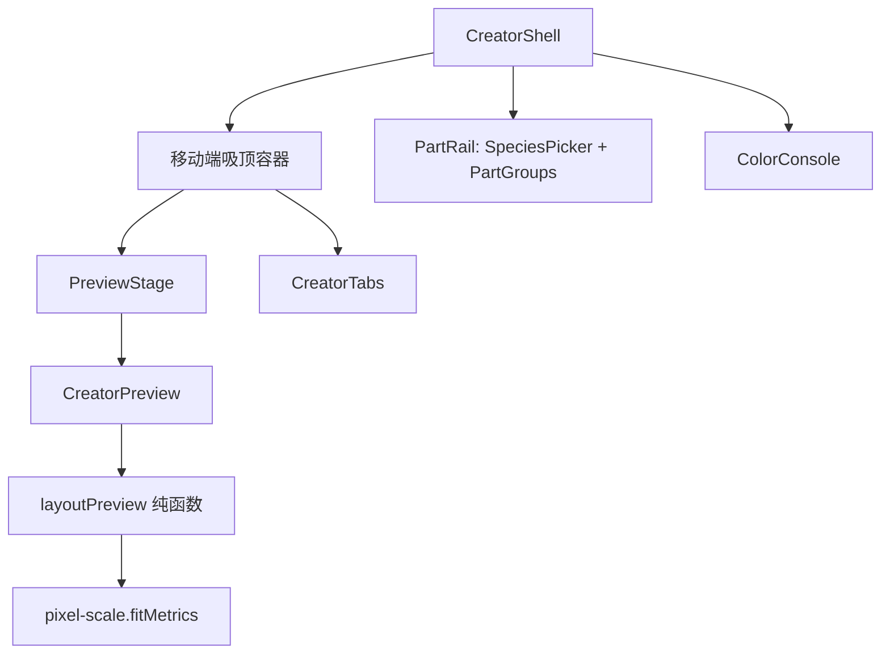

## 用户需求
优化捏人页 `/create` 在手机端的整体使用体验，并修复角色在预览区不居中、头顶被裁等问题。桌面三栏工作台保持不变。

## 产品概览
捏人页是玩家进入园区前的角色定制工作台：可切换牛/马，调整斑纹、口鼻、角/鬃、尾巴与头饰、眼镜、颈饰、发型，并对 11 个色槽实时调色。改造后，手机端变成「角色常驻上方、选项按需切换」的工作台式体验，改任何一项都能立刻看到角色变化。

## 核心功能
- **预览常驻**：手机端预览台固定在顶部约 42dvh，向下浏览选项时角色始终可见，不再需要反复滚回页首确认效果。
- **标签切换**：预览台下方提供「工种 / 配件 / 调色」三段切换，一次只展示当前面板，页面由超长单列变为三个短面板；切换标签不重建预览、不丢失滚动位置。
- **角色自适应居中**：按预览区实际可用高度计算整数像素倍率（如 5 → 3.67 css/纹素），让角色连同地面完整落在画布中央、上下留白均匀，矮屏不再裁头；窗口旋转、地址栏收展、横竖屏切换后自动重新对齐。
- **单行预览工具栏**：姿态（站立/走动/坐下/躺平）与朝向（下/左/右/上）合并为一行图标按钮，触屏点击区域不小于 44px。
- **触屏友好**：选项按钮、滑轨、标签、保存按钮的点击区域加高；滑轨拖动不被页面滚动抢走。
- **安全区与遮挡修复**：适配刘海屏与底部手势区，顶部导航不被状态栏覆盖；底部保存栏压缩为单行，页面预留空间足够，最后一块面板内容不被遮住。
- **保持现有视觉**：暖褐暗底、薄荷冷绿强调、方角描边、等宽小字标签与像素画整数倍放大不变；桌面端在尺寸不变的前提下也会把角色摆正。


## 技术选型
- 框架：Next.js 15（App Router）+ React 19 + TypeScript
- 样式：Tailwind CSS v4（`@theme` 令牌已在 `apps/web/app/globals.css`）
- 渲染：pixi.js v8（WebGPU 优先，`nearest` + `roundPixels`），预览逻辑在 `apps/web/lib/game/preview.ts`
- 状态：Zustand（`apps/web/lib/creator-store.ts`，`subscribeWithSelector`）
- 测试：bun test（`apps/web/lib/game/__tests__`），类型检查 `tsc --noEmit`

## 实现方案
核心是两件事：**把"人物在哪、多大"从硬编码比例改为由容器尺寸推导**，以及**把手机端从长列表改为工作台外壳**。

1. **布局数学抽成纯函数**：新建 `apps/web/lib/game/preview-layout.ts`，输入容器宽高、基准 css/纹素、DPR，输出整数设备像素倍率与脚底锚点坐标。垂直边界取 `SPRITE_LAYOUT.origin.y`（59 纹素，保守覆盖头饰）与帧底余量 + 地面厚度，令视觉盒中心等于容器中心。该函数无副作用，可单测。
2. **整数像素档位**：在 `pixel-scale.ts` 增加 `fitMetrics(maxCssPerTexel, dpr)`，对 `maxCssPerTexel * dpr` **向下取整**后夹在 `MIN_DEVICE_PX/MAX_DEVICE_PX`，保证 `devicePxPerTexel` 为整数且不超过可用空间。`BASE_CSS_PER_TEXEL = 5` 作为上限，桌面足够高时仍精确得到 5 css/纹素，尺寸与今天一致。
3. **ResizeObserver 驱动**：在 `CreatorPreview` 中观察 host，去掉对 window resize 的依赖（window resize 仅用于 DPR 变化的兜底）。回调用 rAF 合并，尺寸小于 2px 直接忽略；显式 `renderer.resize(w, h)` 并同步 `renderer.resolution`，再更新 stage 位置与角色/平台/阴影缩放。避免移动端地址栏收展导致 canvas 与角色错位。
4. **手机端工作台外壳**：`CreatorShell` 用 CSS 变量 `--creator-top` 统一"fixed header 高度 + 安全区"；移动端把 `PreviewStage + CreatorTabs` 放进 `sticky top-[var(--creator-top)] self-start` 的容器，面板区在其下滚动；xl 断点恢复原有三栏 grid。
5. **标签只切显隐、不卸载**：三个面板用 `hidden xl:block` 控制，`PreviewStage` 始终挂载，避免 Pixi 重初始化和 store 重订阅；`PartRail` 拆出 `SpeciesPicker` / `PartGroups` 两个子块供「工种 / 配件」分开展示，桌面仍组合成同一侧栏。

## 架构设计


职责边界：
- `preview-layout.ts`：只做几何与倍率计算，不认识 Pixi。
- `pixel-scale.ts`：只负责"1 纹素 = 整数设备像素"的换算，游戏渲染器与预览共用。
- `CreatorPreview`：持有 Pixi 生命周期、观察尺寸、把计算结果落到 stage/scale。
- `PreviewStage` / `CreatorTabs`：只负责外壳、控件与无障碍，不碰渲染细节。
- `CreatorShell`：负责移动/桌面两套栅格与标签状态。

## 性能与可靠性
- 布局计算为 O(1)，每次 resize 只做一次取整与两次赋值；rAF 合并避免地址栏收展时连续重排。
- 调色仍只走 GPU tint，不重建纹理；切标签不触发 React 重挂载，也不触发 Pixi 重建。
- 尺寸为 0、DPR 异常、`ResizeObserver` 不可用时均有安全回落（退回 window resize + 基准倍率）。
- 组件卸载时断开 observer、移除监听，防 StrictMode 双挂载泄漏。

## 关键实现说明
- 吸顶要求 grid item `self-start`；祖先链不能出现 `overflow: hidden/auto`，否则 sticky 失效。`PreviewStage` 自身的 `overflow-hidden` 只作用于画布，无影响。
- 移动端 section 用 `h-[42dvh] min-h-[240px] max-h-[420px]`，画布容器改 `min-h-0 flex-1`，避免旧 `min-h-[300px]` 把 section 撑破。
- 平台与接触阴影按 `cssScale / BASE_CSS_PER_TEXEL` 同步缩放，否则角色变小后台座比例失衡。
- 预览区装饰头（spotlight / 60fps）在手机端隐藏，把高度让给画布；loading 态保留并加 `aria-busy`。
- 底部 SaveBar 手机端压成一行（输入框 flex-1 + 44px 随机按钮 + 上岗按钮），页面底部留白随之改为 `calc(6.5rem + env(safe-area-inset-bottom))`。
- 触摸目标：Chip `h-11 sm:h-8`、姿态/朝向 `h-11 w-11 sm:h-8 sm:w-9`、滑轨命中区 `h-11 sm:h-6`、标签 `h-11`。
- 无障碍：标签用 `aria-pressed` 分段控件语义（桌面同时可见，不适合 tabpanel），保留 `focus-visible`、滑轨 `aria-valuetext`、`prefers-reduced-motion`。
- 改动全部以 `max-xl` / `sm:` 分层，桌面三栏与其间距不动；仅预览居中算法对桌面生效，视觉上会把角色摆正（这是修复目标）。

## 目录结构
```
apps/web/
├── components/creator/
│   ├── CreatorShell.tsx        # [MODIFY] 安全区 header、--creator-top、移动吸顶容器、标签状态、三栏→单列栅格与底部留白
│   ├── CreatorTabs.tsx         # [NEW] 工种/配件/调色三段控件：44px 命中、aria-pressed、mono 提示、仅 xl 以下显示
│   ├── PreviewStage.tsx        # [MODIFY] 手机端 42dvh 定高、隐藏装饰头、单行姿态+朝向工具栏、画布 min-h-0、loading 态
│   ├── PartRail.tsx            # [MODIFY] 拆出 SpeciesPicker / PartGroups 并导出，支持 mobileBlock 控制分组显隐；Chip 触屏 44px
│   ├── ColorConsole.tsx        # [MODIFY] 移动端内边距与滑轨命中区、xl 以下不参与 sticky、标题层级保持
│   └── SaveBar.tsx             # [MODIFY] 手机端单行布局（输入 + 随机 + 上岗），保留安全区与已有文案
├── lib/game/
│   ├── preview-layout.ts       # [NEW] 纯函数：容器尺寸 + DPR → 整数设备像素倍率、脚底坐标；含安全边界与最小倍率
│   ├── preview.ts              # [MODIFY] ResizeObserver + rAF 合并、显式 renderer.resize、视觉居中、平台/阴影同步缩放、销毁清理
│   ├── pixel-scale.ts          # [MODIFY] 新增 fitMetrics(maxCssPerTexel, dpr)，向下取整整数设备像素
│   └── __tests__/
│       └── preview-layout.test.ts  # [NEW] 矮屏/常规/极矮/零尺寸/DPR 3 的居中与整数像素断言
└── app/globals.css             # [MODIFY] 仅按需补充吸顶/滚动条/触屏相关工具类，不新增设计令牌
```

## 关键代码结构
```ts
// apps/web/lib/game/preview-layout.ts
export interface PreviewBox { width: number; height: number }
export interface PreviewPlacement {
  metrics: PixelMetrics; // devicePxPerTexel 为整数
  footX: number;         // 脚底锚点，CSS px
  footY: number;
}
export function layoutPreview(box: PreviewBox, baseCssPerTexel: number, dpr: number): PreviewPlacement;

// apps/web/lib/game/pixel-scale.ts
export function fitMetrics(maxCssPerTexel: number, dpr?: number): PixelMetrics;
```


## 设计方向
延续既有"工业像素工作台"气质：暖褐暗底、方角 2px 描边、薄荷绿只作唯一冷色强调、等宽小字标注参数。本次不做视觉换血，而是把桌面三栏重新编排成手机端的**单屏工作台**：上面是永远看得见的角色聚光台，下面是三段式操作台，中间用一条带下划线的分段控件分隔。

## 页面结构（单页 + 三种面板态）
1. **顶部导航**（全宽，fixed，含安全区）：返回园区 + 工位 404 + 保存状态点；手机端隐藏物种标签，高度保持 56px，刘海屏下自动下移。
2. **吸顶预览区**（42dvh）：细网格背景 + 四角准星 + 脚下柔光延续现有语言；手机端隐藏标题条，只留右上角浮动的 fps 小标；底部一行工具栏：左姿态分段、右朝向四宫格，均为 44px 触控；加载时居中显示"正在装载图集"。
3. **分段控件**：紧贴预览区下沿，三段等分，选中项用薄荷绿文字 + 2px 底部亮线，右侧小字 `SPECIES / PARTS / RGB565` 作为参数提示；整块随预览一起吸顶，滚动时不离开视野。
4. **工种面板**：牛/马两张卡片并排，大字物种名 + 拉丁学名 + 右上角选中点；下方一段说明文字解释角/鬃槽位共用。
5. **配件面板**：八组属性，每组一行标题（可点击聚焦）+ 参数提示 + 两列 Chip；Chip 手机端 44px 高、单选态换色相不换体积。
6. **调色台**：整体色槽折叠行 + 当前属性聚焦卡 + 12 色预设；手机端滑轨命中区加高到 44px，十六进制输入与 565 回显保持同一行。
7. **底部保存栏**（fixed）：手机端压成一行——工牌名输入占满剩余宽度、随机按钮 44px、上岗按钮主色实底；底部叠加 `env(safe-area-inset-bottom)`。

## 交互与动效
- 切标签只做 150ms 颜色/描边过渡，不位移、不弹跳；面板切换不重置滚动位置以外的任何状态。
- 吸顶区与内容区之间用 1px 分隔线与轻微阴影制造层次，不做毛玻璃叠加。
- 滑轨拖动时页面不跟随滚动；按钮按下用 1px 下沉，不使用缩放与弹性缓动。
- 尊重 `prefers-reduced-motion`，关闭分段下划线过渡与 loading 旋转以外的动画。

## 响应式
- `<640px`：单列工作台，预览 42dvh，工具栏单行，面板整宽。
- `640–1279px`：仍单列，预览提高到 52dvh，按钮回到 32–36px 密度。
- `≥1280px`：恢复 288 / 自适应 / 368 三栏，预览回归 flex 撑满，所有移动端吸顶与分段控件隐藏。
- 横屏（高度 < 500px）：预览降为 38dvh 并隐藏装饰头，保证工具栏与面板同时可见。


## Agent Extensions
### Skill
- **impeccable**
  - Purpose: 按 `adapt` 流程重排手机端体验，并在实现后走 `polish` / `audit` 收尾（触控目标、安全区、sticky 与手势冲突）。
  - Expected outcome: 移动端适配有明确的适配策略而不只是缩放，最终交付无明显 a11y/响应式缺陷。
- **codebase-design**
  - Purpose: 用 module / interface / depth 的词汇界定 `preview-layout.ts` 与 `CreatorPreview` 的职责边界，避免把几何计算泄漏进组件。
  - Expected outcome: 几何计算收敛为一个可单测的深模块，`CreatorPreview` 只负责生命周期与副作用。
