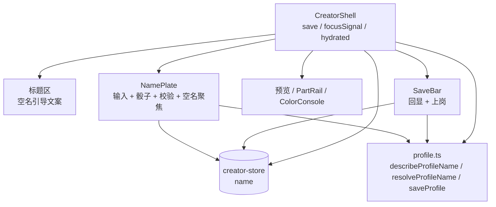

## Product Overview
捏人页要把「工牌名」变成显性的第一步：名字输入从底部固定保存栏的 12px 小输入框，升级为标题下方、预览之前的全宽工牌条，让用户进入页面第一眼就看见并填写。

## Core Features
- **全宽工牌条**：位于标题与预览之间，横跨整栏；大字号输入框、薄荷色描边、骰子随机按钮、显示宽度读数（n / 16）、双语小标签（工牌名 / NAMEPLATE）与「必填」标记。
- **状态反馈**：输入时描边亮起；超宽提示「头顶截断」；命中打码时提示「将自动打码」；不可用时提示「名字用不了」并禁用上岗。
- **空名拦截**：名字为空（含纯空白）点「上岗」不随机命名、不跳转，页面滚动并聚焦到工牌条，条内出现明确提示「先起个工牌名，或点骰子随机」。
- **底部保存栏精简**：移除输入框与骰子，只保留工牌名回显（空名时高亮「未填写工牌名 · 点此填写」，有名字时可点「修改」回到工牌条）、隐私说明与上岗按钮。
- **标题区引导**：未填写时在标题旁显示一句「先给自己起个工牌名」的引导；已有名字（含本地恢复）时恢复原有风味文案，不反复打扰老用户。
- **键盘与触屏**：输入框按 Enter 直接上岗（中文输入法组合中不误提交）；触摸目标不小于 44px；桌面、手机、横屏矮视口均保持工牌条在首屏可见且不遮挡预览。

## Visual Effect
工牌条读起来像园区发的实体工牌：暖褐底上一条冷光薄荷描边，左侧竖条加编号感的中英双语标签，右侧是整行最亮的输入区与可悬停轻转的骰子；它比左右面板更亮、更宽、更靠前，成为页面的视觉第一入口，而不是又一块普通面板。


## Tech Stack
- Next.js 15 App Router + React 19 + TypeScript（沿用 `apps/web`）
- Tailwind CSS v4 主题 token 与既有组件类（`.panel` / `.field` / `.btn-primary` / `.tag`）
- zustand（`apps/web/lib/creator-store.ts`，本次不扩展 store schema）
- bun:test（`apps/web` 现有 `bun test lib`）

## Implementation Approach
- **职责重排**：`CreatorShell` 升级为组合根，持有保存动作、`focusSignal` 与 `hydrated` 标记；`NamePlate` 负责输入与校验展示；`SaveBar` 退化为回显 + 按钮，保存链路只保留一份实现。
- **共享判定**：在 `lib/profile.ts` 新增纯函数 `describeProfileName(raw)`，统一输出 `trimmed / empty / blocked / masked / displayUnits / tooWide`，供工牌条与底部栏共用，避免两处规则漂移；判定与协议同尺（`MAX_NAME_CHARS`、`MAX_NAME_DISPLAY_UNITS`、`displayWidth`）。
- **空名保护**：`CreatorShell` 的 `save()` 在 `empty` 时只递增 `focusSignal` 并返回，绝不调用 `randomNickname()`；`NamePlate` 监听信号执行 `scrollIntoView({ block: 'center' })` + `focus({ preventScroll: true })`，并按 `prefers-reduced-motion` 降级为瞬时滚动，同时点亮 `role="alert"` 提示。校验仍通过的路径保持 `resolveProfileName → saveProfile → markSaved → router.push('/play')` 不变。
- **性能**：名字输入只触发订阅 `name` 的 `NamePlate` / `SaveBar` 重渲染；`PreviewStage` 订阅的是 `appearance` 与 `pose`，Pixi 预览不受影响；`describeProfileName` 为 O(n)，n ≤ 16，无需缓存。
- **布局校准**：工牌条插入后，xl 预览列现用的 `h-[calc(100dvh-var(--creator-top)-6rem)]` 需要同步扣掉工牌条高度（约 5rem～7rem）并下调 xl 最小高度，保证 1440×900、1280×800 首屏仍能完整看到角色；`[@media(max-height:500px)]` 复用既有压缩路径，工牌条改为单行紧凑形态（隐藏辅助说明、收窄内边距）。移动端预览仍是 sticky 48dvh，工牌条保持静态，不与之抢视口。
- **避免技术债**：不新增依赖、不改协议与存储键（`niuma:profile:v2`）、不动 `JoinGate`；仅在没有现成模式可复用时新增 `NamePlate` 一个组件文件。

## Implementation Notes
- 保留 `id="niuma-name"` 与 `htmlFor` 关联；label 在所有断点都必须可见，不再使用 `sr-only`。
- 空名时**不要**禁用上岗按钮（否则无法触发引导）；`blocked` 仍禁用并显示原因。
- 输入框补 `required`、`aria-invalid`、`aria-describedby`、`enterKeyHint="done"`；Enter 提交需判断 `event.nativeEvent.isComposing`，避免中文候选词确认时误提交。
- 用 `hydrated` 标记遮住首帧：本地已恢复工牌名的用户不应闪现「必填 / 未填写」。
- 底部栏变矮后同步收紧 `CreatorShell` 的 `pb`（`calc(5.5rem+env(safe-area-inset-bottom))` / `sm:pb-32`），避免留白过大。
- 视觉沿用 ink / mist / mint / amber、2px 边框、mono 小标签与双语提示；骰子仅做 180° 旋转与描边变化，时长 140–200ms，禁止 bounce。
- 校验命令：`pnpm --filter @niuma/web typecheck`、`pnpm --filter @niuma/web test`；UI 改动前跑 impeccable context，完成后按 craft floor 自检。

## Architecture Design


## Directory Structure
```
apps/web/
├── lib/
│   ├── profile.ts                     # [MODIFY] 新增 NameStatus 与 describeProfileName(raw)：trim、空名、审核 verdict、显示宽度与超宽判定；保留现有 resolveProfileName / checkProfileName / saveProfile / loadProfile 行为不变
│   └── __tests__/
│       └── profile.test.ts            # [MODIFY] 补 describeProfileName 用例：空串、纯空白、正常名、打码名、拒绝名、超宽名，风格对齐现有 bun:test
├── components/creator/
│   ├── NamePlate.tsx                  # [NEW] 全宽工牌条：可见 label、大输入框、骰子、显示宽度读数、必填标记、blocked/masked/tooWide 提示、Enter 提交、focusSignal 触发滚动聚焦与空名 alert；紧凑矮视口形态
│   ├── CreatorShell.tsx               # [MODIFY] 在 hero 与 grid 之间插入 NamePlate；上移 handleSave；持有 focusSignal/hydrated；空名时替换标题副文案；重算 xl 预览高度与底部 padding
│   └── SaveBar.tsx                    # [MODIFY] 删除输入框与骰子；改为工牌名回显（空名高亮「未填写工牌名 · 点此填写」，有名字显示名字与「修改」）、blocked 原因、上岗按钮；接收 onSubmit / onFocusName / hydrated
```

## Key Code Structures
```ts
// apps/web/lib/profile.ts
export interface NameStatus {
  trimmed: string;
  empty: boolean;
  blocked: boolean;
  masked: boolean;
  displayUnits: number;
  tooWide: boolean;
}
export function describeProfileName(raw: string): NameStatus;

// apps/web/components/creator/NamePlate.tsx
export interface NamePlateProps {
  onSubmit: () => void;   // Enter 或点击上岗，由 CreatorShell 统一处理空名拦截
  focusSignal: number;    // 递增即滚动聚焦并提示，0 表示尚未请求
}
```


## Design Style
沿用园区既有的「暖褐底 + 唯一冷光薄荷」工业像素风，把工牌条做成页面里最像实体工牌的一块：宽、亮、有编号感，但只用一个强调色，避免与调色面板抢戏。

## Layout
- **位置**：标题 hero 行之下、三栏工作台之上，跨满内容宽度；hero 自带的下边框保留，工牌条以 16px 间距独立成块。
- **桌面单行**：左侧竖薄荷条 + `工牌名` 主标题（Oswald 20px/600）+ 下方 mono 双语小字 `NAMEPLATE · 头顶会显示这个名字` 与「必填」tag；右侧输入组（输入框 flex-1、最大 520px，48–52px 高，2px 边框，聚焦转薄荷）+ 48px 骰子按钮 + 右对齐的 `显示宽度 n / 16` 读数。
- **手机双行**：第一行标签与「必填」/宽度读数，第二行输入框 + 骰子（输入框至少 48px 高，撑满剩余宽度），提示文案在下方单行显示。
- **矮视口**：隐藏辅助说明与宽度读数，内边距收到 12px，输入框 44px，保证首屏仍露出预览。

## Interactions
- 聚焦：边框由 ink-500 变 mint-400，配 1px 内阴影，无位移。
- 填写：宽度读数实时更新；超宽转 amber 并提示「头顶截断」；打码提示「将自动打码」；拒绝提示「名字用不了」并禁用上岗。
- 骰子：hover/focus 时图标旋转 180°、边框转薄荷，点击填入随机工牌名并保持焦点。
- 空名上岗：按钮可点但拦下，页面平滑滚到工牌条并聚焦，条内出现带琥珀圆点的 `role="alert"` 提示，工牌条边框短暂转琥珀。
- 底部栏：空名显示琥珀色「未填写工牌名 · 点此填写」胶囊按钮；有名字显示 mono 小标签 + 名字 + 「修改」，点击回到工牌条。

## Responsiveness & A11y
- 375px 宽不换行错位；触摸目标不小于 44px；输入框移动端 16px 防 iOS 缩放。
- label 常显、Enter 提交、焦点可见、错误用 alert 关联 `aria-describedby`；滚动聚焦避开固定顶栏；`prefers-reduced-motion` 下取消平滑滚动与旋转动画。

## Atmosphere
克制、精准、有秩序：薄荷只是「这里需要你」的信号，其余仍是暖褐与米白的低饱和层次。


## Agent Extensions
### Skill
- **impeccable**
  - Purpose: 在实现工牌条前运行 context 并遵循 craft floor，完成布局、层级、状态与空名提示的视觉打磨，提交前以 polish / audit 视角自检 a11y、响应式与反模式。
  - Expected outcome: 工牌条成为页面第一视觉入口，桌面、手机与横屏矮视口均无遮挡与错位，检测无 primary findings。
