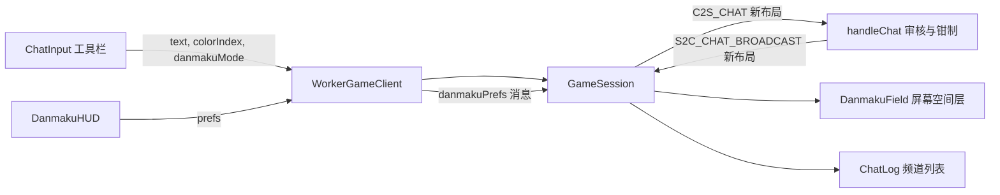

## 产品概述
《牛马 NIOMA》的园区聊天从角色头顶的局部文字气泡升级为覆盖整个游戏画面的像素弹幕。聊天消息不再跟随角色，而是沿屏幕轨道飞行，或在顶部/底部居中停留；频道列表继续保留完整记录。Zzz、发泄、互动、咀嚼等非聊天提示仍使用原有头顶气泡。

## 核心功能
- **消息同步**：每条聊天携带颜色与飞行模式（滚动/顶部/底部）一起发送；服务端继续做政治词拦截、脏话打码与限速，审核通过后把颜色和模式一并同步给同屏玩家，越界的颜色/模式回落到安全值。
- **配色**：8 种高对比、带职场寓意的预设色（纯白、薄荷绿、警示红、高光金、赛博蓝、赋能紫、落日橙、发疯粉），输入时即时生效并记住上次选择。
- **弹幕表现**：屏幕纵向划分 8~12 条 28px 轨道，避开左上工牌与右上控件；滚动弹幕从右缘匀速飞入，6~8 秒后离场；顶部/底部弹幕水平居中，停留 4 秒后淡出；文本带 2px 纯黑描边与轻阴影，前缀显示牛/马图标与昵称。
- **轨道调度**：优先使用无文本、或上一条尾部已完全入屏的轨道，避免前后文字交错；全部繁忙时轮替到最空轨道；固定弹幕优先独占空闲轨，轨道全忙时选择最空轨道以保证即时可见。
- **输入体验**：按 Enter 唤起聊天面板；输入框上方提供颜色胶囊、模式轮转与 6 条职场黑话快捷词条（老板正在靠近、收到这就去办、这个需求做不了、带薪拉屎中、今日摸鱼纯度 +1、建议立刻去中庭吃草），点击词条填入输入框；中文输入法选词期间回车与空格不会误发。
- **防打扰设置**：聊天框头部齿轮打开极简面板，提供弹幕总开关、20%~100% 不透明度（默认 85%）、全屏/半屏/精简三档覆盖；关闭后立即清屏，刷新后保留偏好。
- **验收**：同屏 100 条并发仍保持 60/120fps，文本对象池复用、离屏立即回收；全量类型检查零报错；双窗口验证红色顶部弹幕在另一窗口顶部居中即时出现并 4 秒淡出。


## 技术栈
- Monorepo：pnpm + Turborepo，全包 TypeScript strict，Bun test。
- 共享契约：`packages/shared-types`，纯 TS，不依赖运行时与 UI。
- 服务端：`apps/game-server`，Bun + WebSocket，AOI 通过 `player.known` 广播。
- 客户端：Next 15 + React 19 + Pixi 8 + zustand + Tailwind 4。
- 不引入新依赖；渲染仍跑在 Worker（`?render=main` 可回退主线程）。

## 实现策略
1. **契约先行**：新增 `packages/shared-types/src/danmaku.ts`，集中颜色索引、模式枚举与归一化函数；`ChatPacket` 与新增的 `ChatSendPacket` 携带元数据。协议按用户要求硬切，`S2C_CHAT` 即现有 `S2C_CHAT_BROADCAST (0x04)`。
2. **布局**：`C2S_CHAT` 变为 `[op][colorIndex u8][danmakuMode u8][len u16][utf8]`（5 + n 字节）；`S2C_CHAT_BROADCAST` 变为 `[op][entityId u16][msgId u16][colorIndex u8][danmakuMode u8][len u16][utf8]`（9 + n 字节）。编解码两端都做归一化，服务端即使收到伪造字节也只能广播 0~7 / 0~2 的安全值。
3. **屏幕空间层**：`DanmakuField` 持有独立 `Container`，在 `renderer.init()` 中于 `lightmap` 之后 `stage.addChild`，不进入 `world`，因此不受相机位移与缩放影响。
4. **轨道算法**：纯函数 `computeTrackLayout` 与 `selectScrollTrack` 负责轨道数量、可视区与避让；`DanmakuField` 只消费结果。滚动弹幕固定时长约 7 秒；固定弹幕停留 4 秒后淡出。
5. **对象池**：`Text` 对象最多 120 个，活跃上限 100，溢出队列 100；激活时只写一次 `text` 与 `style.fill`，帧内只改 `x`/`alpha`；离屏立即 `visible=false` 归还；队列满时丢最旧一条，保证内存有界。
6. **偏好接缝**：纯契约放 `lib/game/danmaku-prefs.ts`（Worker 可安全导入），localStorage 读写放 `lib/danmaku-prefs.ts`（仅主线程）。偏好随 `createGameClient` 初始化下发一次，之后每次变更发一条消息。
7. **聊天管道**：`session.handleChat` 不再调用 `renderer.showBubble`，改为 `renderer.showDanmaku`；`ChatEntry`、`ChatLog`、历史分页与 `history.add` 保持原样。非聊天气泡调用点全部保留。

### 关键取舍
- **前置 2 字节 vs 尾部扩展**：按需求前置，代价是双端必须同版本发布；由 ADR-0050 的构建版本强制刷新兜底，回滚只需回退三处代码。
- **Pixi 屏幕空间 vs DOM 覆盖层**：选 Pixi，满足“挂 `app.stage` 顶层”且不受相机影响；代价是设置面板需要跨线程消息，已收敛为一条 `danmakuPrefs` 消息。
- **Text vs BitmapText**：仓库没有位图字体管线，新增一套字体资产超出本次范围；用 `Text` 对象池 + 截断 + 上限控制，纹理只在激活时重建。

## 架构设计


- **主线程**：React 只负责输入、颜色/模式选择与设置面板；偏好落盘 `niuma:danmaku_pref:v1`。
- **渲染线程**：`GameSession` 收到 `ChatPacket` 后转交 `DanmakuField`；`GameRenderer.tickBubbles(dtMs)` 是唯一逐帧入口，`resize()` 是唯一视口变化入口。
- **服务端**：审核链路不变，`handleChat` 对元数据钳制后写入广播包；历史环形缓冲仍只存文本与昵称。

## 性能与可靠性
- 生成一条弹幕的轨道选择为 O(轨道数)，不超过 12 次比较；每帧更新为 O(活跃数)，不超过 100；无逐帧对象分配。
- `Text` 纹理重建只发生在激活时；消息按屏幕宽度截断（昵称 16 显示宽，正文按可用像素计算），避免一条弹幕横跨多轨。
- 总开关关闭时立即 `clear()` 并隐藏容器；覆盖区域变化时清空重排，避免旧弹幕落在禁用轨道。
- 固定弹幕优先独占空闲轨；全部轨道被滚动弹幕占用时选择最空轨道，允许极短暂交叠以保证“即时出现”，该降级在 ADR 中记录。
- 断线重连与世界重置时清空弹幕，避免残留消息；`?danmaku=0` 提供线上紧急关闭开关，`?danmaku=stress` 提供 100 条并发压测入口。

## 执行注意事项
- `GameRenderer.init()` 中弹幕层必须加在 `lightmap` 之后；`world` 的 `cssScale` 不要作用到弹幕容器。
- 屏幕空间坐标是 CSS 像素；`Text` 的 `resolution` 跟随 DPR，DPR 变化时统一更新池内文本。
- `Text` 的描边需要 `padding` 防止裁切；描边宽度 2、纯黑，阴影只烘焙一次。
- 聊天昵称取 `session.names`（已包含自己），物种取 `speciesById`，缺省用牛；不要再用“我”。
- `ChatDock` 现有展开态、聚焦序号、草稿保留、Esc 关闭与 `compact` 行为必须保持；工具栏所有按钮显式 `type="button"`，避免回车误触发表单提交。
- IME 三重守卫：`compositionstart/end` 状态、`nativeEvent.isComposing`、`keyCode 229`；`onSubmit` 一律先 `preventDefault`，合成期间直接返回。
- `WorkerGameClient`、`MainThreadGameClient`、`GameClient` 三处必须同步新增方法；Worker 只做 `import type` 引用偏好类型，localStorage 留在主线程。
- 协议硬切需要 web 与 game-server 同版本发布；不保留旧包解析分支，避免长期双格式债务。
- 不做无关重构：`EntityView.showBubble`、`ChatLog`、历史包与审核词库均保持原行为。

## 目录结构
```text
packages/shared-types/
├── src/danmaku.ts                         # [NEW] 模式枚举、颜色数量、归一化函数
├── src/types.ts                           # [MODIFY] ChatPacket 增字段；新增 ChatSendPacket
├── src/protocol.ts                        # [MODIFY] 四个聊天编解码改为新布局并归一化
├── src/index.ts                           # [MODIFY] 导出 danmaku 模块
└── src/__tests__/protocol.test.ts         # [MODIFY] 新布局 roundtrip、长度、越界值、截断包

apps/game-server/
├── src/sim/chat.ts                        # [MODIFY] handleChat 接收 ChatSendPacket，钳制并广播
├── src/sim/chat.test.ts                   # [MODIFY] 元数据透传、越界钳制、打码保留元数据、历史不变
├── src/server.ts                          # [MODIFY] decodeChatSend 返回值直接交给 handleChat
└── src/bench/bots.ts                      # [MODIFY] encodeChatSend 改对象参数

apps/web/
├── lib/game/danmaku-palette.ts            # [NEW] 8 色、模式图标/文案、6 条快捷词条、CSS 十六进制转换
├── lib/game/danmaku-prefs.ts              # [NEW] 纯契约：DanmakuPrefs、默认值、sanitize、覆盖档位
├── lib/danmaku-prefs.ts                   # [NEW] 主线程读写 niuma:danmaku_pref:v1，复用 lib/storage.ts
├── lib/game/danmaku.ts                    # [NEW] 轨道布局、防重叠分配、Text 对象池、生命周期
├── lib/game/__tests__/danmaku.test.ts     # [NEW] 轨道选择、全满轮替、覆盖区域、生命周期纯函数
├── lib/__tests__/danmaku-prefs.test.ts    # [NEW] 坏数据回落、透明度/颜色/模式钳制
├── lib/game/renderer.ts                   # [MODIFY] 创建并挂载弹幕层、tick、resize、showDanmaku、setPrefs
├── lib/game/session.ts                    # [MODIFY] handleChat 改弹幕、sendChat 三参数、偏好下发、重置清屏
├── lib/net/client.ts                      # [MODIFY] sendChat 三参数，onChat 透传 packet
├── lib/game/client/game-client.ts         # [MODIFY] sendChat 三参数、setDanmakuPrefs、danmaku 选项
├── lib/game/client/worker-client.ts       # [MODIFY] chat 消息带元数据，新增 danmakuPrefs 消息
├── lib/game/client/main-thread-client.ts  # [MODIFY] 与 Worker 实现保持同名同义
├── lib/game/runtime/worker-protocol.ts    # [MODIFY] chat 消息扩展，新增 danmakuPrefs 消息
├── lib/game/runtime/worker-host.ts        # [MODIFY] 转发三参数发送与偏好
├── components/game/ChatInput.tsx          # [NEW] 工具栏、颜色胶囊、模式轮转、快捷词条、IME 守卫
├── components/game/DanmakuHUD.tsx         # [NEW] 齿轮触发的设置浮层：总开关、透明度、覆盖区域
├── components/game/ChatDock.tsx           # [MODIFY] 集成 ChatInput/DanmakuHUD，保留展开与草稿行为
└── components/game/GameViewport.tsx       # [MODIFY] 三参数发送、初始偏好与变更下发

docs/adr/0055-danmaku-screen-space.md      # [NEW] 决策、备选、反向成本、回滚、BASELINE 证据行
README.md                                  # [MODIFY] 聊天包布局与弹幕偏好说明
```

## 关键代码结构
```ts
// packages/shared-types/src/danmaku.ts
export const DANMAKU_MODE = { Scroll: 0, Top: 1, Bottom: 2 } as const;
export type DanmakuMode = (typeof DANMAKU_MODE)[keyof typeof DANMAKU_MODE];
export const DANMAKU_COLOR_COUNT = 8;
export const DANMAKU_PROTOCOL_COLOR_MAX = 15;

export function normalizeDanmakuColor(value: number): number;
export function normalizeDanmakuMode(value: number): DanmakuMode;

export interface ChatSendPacket {
  colorIndex: number;
  danmakuMode: DanmakuMode;
  text: string;
}

export interface ChatPacket {
  entityId: number;
  msgId: number;
  colorIndex: number;
  danmakuMode: DanmakuMode;
  text: string;
}
```

```ts
// apps/web/lib/game/danmaku.ts
export interface DanmakuPrefs {
  enabled: boolean;
  opacity: number;
  coverage: 'full' | 'half' | 'compact';
  colorIndex: number;
  mode: DanmakuMode;
}

export interface DanmakuMessage {
  name: string;
  species?: 'cow' | 'horse';
  text: string;
  colorIndex: number;
  danmakuMode: DanmakuMode;
}

export class DanmakuField {
  readonly container: Container;
  constructor(renderer: Application['renderer'], prefs: DanmakuPrefs, resolution: number, stress?: boolean);
  resize(width: number, height: number, resolution: number): void;
  setPrefs(prefs: DanmakuPrefs): void;
  push(message: DanmakuMessage): void;
  update(dtMs: number): void;
  clear(): void;
  destroy(): void;
}
```

## 验证方案
- `pnpm typecheck` 全包零报错。
- `pnpm test` 或分包 `bun test`：shared-types 协议用例、game-server 聊天用例、web 弹幕算法与偏好用例。
- 手工双窗口：A 选红色 + 顶端发送，B 顶部居中即时出现并 4 秒淡出；B 关闭总开关后不再出现但列表仍有消息。
- 手工 IME：Chrome + 中文输入法，拼音选词期间回车/空格不发送。
- 手工性能：`?danmaku=stress` 压到 100 条并发，观察 HUD FPS 与内存曲线；`?danmaku=0` 验证紧急关闭。
- 回归：Zzz、发泄、互动、咀嚼头顶气泡正常；历史上翻与未读计数正常。

## ADR 要求
新增 `docs/adr/0055-danmaku-screen-space.md`，记录：协议硬切理由与发布保障、屏幕空间层选择、对象池与轨道算法、固定弹幕降级策略、历史包不变、回滚路径，并包含共享层/服务端/客户端三条 `BASELINE` 证据行；不改写 ADR-0028 与 ADR-0039 历史正文。


## 设计风格
延续仓库“暖褐底 + 薄荷冷光”的工业像素风，把输入栏做成园区机台的控制条：2px 硬边、无大圆角卡片、等宽小字标签、细密分隔线；颜色胶囊是唯一带 2px 小圆角的元素，像一排可插拔的色卡。整体克制、锐利，不引入紫色渐变、玻璃大卡片或通用聊天软件样式。

## 布局与交互
- **聊天框头部**：左侧频道标题与 `/local`，右侧未读/条数、齿轮、折叠箭头。齿轮 28×28，激活时薄荷描边并轻微提亮。
- **输入工具栏**：两行紧凑布局。第一行 8 个 16×16 色块（点击热区 24×24），选中项加薄荷外环并放大 1.08；右侧模式按钮显示 `➡ 滚动` / `⬆ 顶端` / `⬇ 底端`，点击按序轮转，切换时 120ms 淡入。第二行 6 个快捷词条，横向可滚动，点击填入输入框并聚焦，保留编辑权。
- **设置浮层**：齿轮下方右侧对齐，宽 220px，2px 硬边、墨色半透明背景。总开关为方形轨道开关；不透明度用原生滑块并显示百分比；覆盖区域用三段式按钮。浮层 120ms 淡入并上移 4px，无弹跳；Esc 与点击外部关闭。
- **弹幕视觉**：16px 中文粗体、2px 纯黑描边、轻阴影；滚动弹幕自右向左匀速，顶部/底部居中停留后淡出；全局不透明度作用于整层，颜色保持高对比。

## 响应式与可达性
- 桌面聊天框 340px，手机 250px；浮层最大宽度 `calc(100vw - 2rem)`，390px 宽下不溢出。
- 色块带 `aria-label`（颜色名 + 职场寓意）与 `aria-pressed`；模式按钮播报当前模式；开关用 `role="switch"`；滑块带 `aria-valuetext`；焦点环统一薄荷色。
- 颜色不作为唯一信息：选中态有外环与放大，色块提供文字提示；遵循 `prefers-reduced-motion`，减少位移与缩放。
- 手机端工具条不折行，第二行横向滚动；设置浮层不遮挡输入框与发送按钮。

## Agent Extensions
### Skill
- **impeccable**
  - Purpose: 在重构 `ChatInput`、`ChatDock` 与新增 `DanmakuHUD` 时执行 shape 与 polish 流程，确保工具条、色块、浮层符合仓库像素风，并完成可访问性、响应式与动效自检。
  - Expected outcome: 可用的输入工具栏与设置浮层，焦点态、选中态、键盘操作与 390px 窄屏布局均通过检查，无通用模板感。
- **principal-software-architect**
  - Purpose: 为协议硬切、屏幕空间层选择、对象池上限与固定弹幕降级策略做权衡记录，产出 ADR-0055 及 BASELINE 证据行。
  - Expected outcome: `docs/adr/0055-danmaku-screen-space.md` 包含备选方案、反向成本、30 天回滚路径与共享层/服务端/客户端三条基线。
- **verification-before-completion**
  - Purpose: 在宣布完成前逐条执行类型检查、分包测试、双窗口与 IME 手测，并用输出证据确认验收项。
  - Expected outcome: `pnpm typecheck` 与测试全绿，双窗口红色顶部弹幕、设置开关、覆盖区域与 100 条并发压测均有可复核结果。
