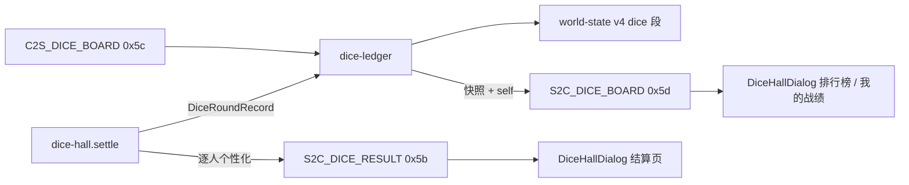

## 用户需求
在现有「摸鱼大赌场」双桌上优化赌桌玩法，把「开完就忘」的结算变成可回看、可比较的公开数据。

## 产品概览
亮牌瞬间即出「本局结算单」，全桌（含围观与未下注者）可见每位下注者的昵称、押注档位、注额、实际到手、净盈亏；同一面板内提供逐局历史与累计战绩，并提供全员共享、跨重启保留的输赢排行榜。结算以服务端真实入账为准，客户端只负责展示。

## 核心功能
- 每局结算单：命中档位、骰面、是否被查岗、中奖档、每位下注者一行明细（昵称 / 档位 / 注额 / 到手 / 净盈亏），本人行高亮；无注额局与无人命中退款局同样产出一张可读结算单。
- 实时输赢记录：本桌最近若干局的逐局结果（局号、骰面、我的净额），以及我的累计统计（局数、胜、负、退款、累计下注、累计到手、累计净收益、单局最佳）。
- 排行榜：默认「全赌场合并总榜」，可切「翡翠桌 / 鎏金桌」；排序可在「累计净收益」与「胜率」间切换；展示名次、昵称、净收益、胜率、局数，本人行标「你」并给出名次摘要。
- 数据实时更新：亮牌即刷新结算与统计，榜单按需拉取并限频，服务重启后榜单与历史仍在。


## 技术栈
沿用现有仓库栈：TypeScript monorepo（pnpm workspace），服务端 `apps/game-server`（Node + 自建 tick 循环 + `world-state.json` 落盘），共享协议 `packages/shared-types`（手写二进制编解码），前端 `apps/web`（Next.js + React + Tailwind + 自建像素弹窗组件）。不引入新框架、不引入数据库。

## 实现策略
核心是把「一次性的 settle 副作用」升级为「可持久化的结算事实」：

1. **新增战绩账本（服务端领域模块）**：`dice-ledger.ts` 持有按匿名设备号归户的累计统计与逐局记录，纯内存 + 显式 `collect/restore/sanitize`，容量与淘汰自管。
2. **结算统一出口**：`dice-hall.settle()` 的三条路径（无注额 / 无人命中退款 / 正常派彩）都构造同一条 `DiceRoundRecord` 并写入账本；`net` 一律取 `EconomyPorts.payout()` 的真实入账减去本金，退款局 `net = 0` 且标记退款，绝不使用 `splitPool()` 的理论分配值。
3. **协议只追加**：现有 `S2C_DICE_STATE`(0x47) 的 17 字节定长结构完全不动（它承担 1Hz 心跳，不能变长）。新增 `S2C_DICE_RESULT`(0x5b，亮牌时逐人个性化下发，含 `selfIndex`)、`C2S_DICE_BOARD`(0x5c，按需拉榜)、`S2C_DICE_BOARD`(0x5d，快照回包)。0x4d–0x50 不复用，编号只追加。
4. **落盘 v4**：`world-state.json` 版本升到 4，新增 `dice` 段（直接转出 runtime 的 `DiceLedgerSaveState`，不在 persist 层重新定义 interface）；v3 文件读取时 `dice` 缺省为空，向后兼容。
5. **前端按需拉榜**：结算单随亮牌推送到达即渲染；排行榜与「我的战绩」通过一次请求拉取快照，避免把名单塞进心跳包，避免每帧重算。

### 关键决策与权衡
- **公开明细但不泄身份**：结算单与榜单只下发昵称，`deviceId` 永不出网；服务端在归户时用 `profiles` 里的昵称并做控制字符清洗与长度截断，缺失时回落「匿名牛马」。
- **逐人下发而非全桌同包**：`S2C_DICE_RESULT` 需携带「你是哪一行」，若同包广播则客户端无法可靠自识别（昵称可重名）。单桌参与者上限为 6 凳，逐人填充成本 O(在线 × 12) 可忽略。
- **榜单拉取而非推送**：排序需要全量扫描，放在 1Hz tick 里是浪费。改为玩家打开榜单页签时请求，服务端按玩家做 2s 冷却（令牌桶，独立于 `interactive` 上行闸门），结果缓存 2s 复用。
- **胜率口径显式化**：`winRate = wins / (rounds - refunds)`，分母为 0 时展示「—」且排序置底，避免退款局污染胜率；该纯函数放 `shared-types`，服务端排序与客户端展示共用同一口径。

### 性能与复杂度
- `settle()` 追加 O(参与者) 写账本，与现有 `splitPool` 同阶，无额外遍历。
- 榜单查询 O(P log P)，`P ≤ DICE_LEDGER_MAX_PLAYERS = 2000`，仅按需触发 + 2s 缓存，不进热路径。
- 逐局历史按桌环形缓冲（`DICE_ROUND_HISTORY_PER_TABLE = 30`），写入 O(1)、内存上界固定；前端只渲染最近 20 条，避免长列表抖动。
- 结算包体积上界：12 行 × (昵称≤12 字符 + 7 字节) ≈ 300 字节，远小于一帧预算。

## 架构设计


模块边界：`dice-hall` 只负责「这一局发生了什么」，`dice-ledger` 只负责「累计与查询」，`protocol` 只负责「怎么出网」，`DiceHallDialog` 只负责「怎么显示」。查询与排序不进结算路径。

## 目录结构
```
packages/shared-types/src/
├── world/dice-hall.ts        # [MODIFY] 增 DICE_LEDGER_MAX_PLAYERS / DICE_ROUND_HISTORY_PER_TABLE / DICE_BOARD_LIMIT / DICE_NAME_MAX_BYTES、DICE_BOARD_SCOPE(合并/桌0/桌1)、DICE_BOARD_METRIC(净收益/胜率)、diceWinRate(wins, rounds, refunds) 纯函数
├── types.ts                  # [MODIFY] 增 DiceResultEntry / DiceResultPacket / DiceBoardRequest / DiceBoardEntry / DiceBoardPacket；OpCode 追加 0x5b/0x5c/0x5d
├── protocol.ts               # [MODIFY] encode/decode 三新包；内部 writeName/readName（按字节上限截断、解码不越界），不对外导出
└── protocol.test.ts          # [MODIFY] 三新包 round-trip、空名单、超长昵称截断、非法 count 拒绝

apps/game-server/src/
├── sim/dice-ledger.ts        # [NEW] 战绩账本：DicePlayerStat（rounds/wins/losses/refunds/totalBet/totalPayout/net/bestWin/lastSeenAt/name）、record(round)、statsOf(deviceId)、board(scope, metric, limit)、recentByTable(tableId, n)、collect/restore/sanitize；容量淘汰按 lastSeenAt
├── sim/dice-ledger.test.ts   # [NEW] 归户累加、退款不计胜负、胜率分母、淘汰与 restore 幂等、榜排序并列规则
├── sim/dice-hall.ts          # [MODIFY] Bet 增 deviceId/name；settle 三路径统一记一条 DiceRoundRecord 并产出结果数据（无注额局 count=0 也产出）；payout 真实入账算 net；onDisconnect 退款记 refund；新增 board() 查询入口
├── sim/dice-hall.test.ts     # [MODIFY] 三条结算路径的 net 断言、查岗抽水后 net 与实入账一致、退款局 net=0
├── server.ts                 # [MODIFY] 端口接线改用 payout 返回值；亮牌时逐人发 0x5b；0x5c 处理含 2s 冷却与拒绝回执；入场补发当前桌最近结果；落盘 collect/restore
├── persist/world-state.ts    # [MODIFY] WORLD_STATE_VERSION=4，WorldStateParts 增 dice 段，v3 兼容读
└── persist/world-state.test.ts # [MODIFY] v3→v4 迁移、dice 段缺失容错、超限 sanitize

apps/web/
├── lib/net/client.ts         # [MODIFY] 导入并分发 0x5b/0x5d，新增 sendDiceBoard；handler 契约增 onDiceResult/onDiceBoard
├── lib/game/runtime/worker-protocol.ts # [MODIFY] 如需穿过 worker 边界则补消息类型与转发（保持既有 request/response 模式）
├── lib/game-ui.ts            # [MODIFY] 增 diceResult / diceBoard / diceBoardPending 与对应 setter，默认值补齐
├── components/game/GameViewport.tsx   # [MODIFY] 接线 onDiceResult/onDiceBoard 到 store
├── components/game/EconomyLayer.tsx   # [MODIFY] 向 DiceHallDialog 传 result/board/onRequestBoard
├── components/game/DiceHallDialog.tsx # [MODIFY] 重构为「牌桌 / 本局结算 / 我的战绩 / 排行榜」四页签容器，保留 Esc 关闭、方向键切页、焦点陷阱、遮罩免疫窗
├── components/game/DiceSettlePanel.tsx # [NEW] 结算单表格：命中档徽标、逐行昵称/档位/注额/到手/净盈亏，本人行高亮，空名单与退款局空态
├── components/game/DiceBoardPanel.tsx  # [NEW] 范围与排序切换、名次列表、self 摘要、加载与错误态
├── components/game/DiceHistoryPanel.tsx # [NEW] 我的累计指标卡 + 最近 20 局逐局行
└── lib/game/dice-hall-format.ts        # [NEW] 带符号金额、胜率百分比、档位/净盈亏色调映射（amber 盈、ember 亏、mist 平）

README.md                                    # [MODIFY] 协议表补 0x5b–0x5d，「摸鱼大赌场」段补结算/榜单/落盘口径
docs/adr/0109-dice-settlement-ledger.md      # [NEW] 公开明细口径、设备号归户与容量上限、v4 落盘、包号追加、回滚路径
apps/web/data/release-notes.json             # [MODIFY] 追加玩家可感知的版本工报
```

## 关键数据结构
```ts
interface DiceRoundRecord {
  tableId: 0 | 1; roundId: number; dice: [number, number, number];
  hit: number | null; raid: boolean; endedAt: number;
  entries: { deviceId: string; name: string; side: number; bet: number; payout: number; net: number; refunded: boolean }[];
}

interface DicePlayerStat {
  name: string; rounds: number; wins: number; losses: number; refunds: number;
  totalBet: number; totalPayout: number; net: number; bestWin: number; lastSeenAt: number;
}
```

## 实施要点
- **准确的 net**：`payoutFromPool()` 先取走本金再按分配入账，`stake<=0` 返回 0 且 `payout<=0` 会原路退本金——三种返回都必须落成 `payout` 实值，`net = payout - bet`；若出现「splitPool 有分配但 payout 为 0」的异常，账本记 0 并打一条 warn（设备号只打前 6 位哈希），不刷屏。
- **金额与上限**：所有金额整数，落盘前 `clampCoins` 级别的哨兵校验；`totalBet/totalPayout/net` 用安全整数并在 sanitize 时钳制到合法区间，拒绝负数局数与超限昵称。
- **不泄身份**：结算包与榜单包字段里没有 `deviceId`；服务端逐人填 `selfIndex` 即完成「哪一行是我」，客户端不参与身份推断。
- **旧客户端安全**：只追加包号，未升级客户端对未知 opcode 走既有忽略分支；`S2C_DICE_STATE` 与 17 字节结构零改动，避免解码错位。
- **UI 约束**：像素边框 + `ink/mist/mint/amber/ember/signal` 调色板，禁止紫蓝渐变、纯黑纯灰与 bounce 缓动；数字用等宽字体对齐小数点，长昵称单行省略并保留 hover 全文。
- **渲染性能**：结算数据按 `roundId` 去重写入 store（同局重复包直接丢弃），面板内列表用 `useMemo` 派生、行组件 `memo`；榜单请求按页签可见才发，关闭面板时不轮询。
- **回归自检**：`pnpm --filter @niuma/shared-types test`、`pnpm --filter game-server test`、`pnpm lint`、`pnpm changelog:check`。


## 设计方向
沿用园区既有像素 HUD 语汇，把赌桌弹窗从「单一下注表单」升级为一块「赌桌台账」：左侧固定牌桌区（骰面、阶段倒计时、注额控件），右侧四页签信息区。整体像一张被钉在桌边的结算小票，硬边像素框 + 1px 内描边 + 内阴影，拒绝圆角卡片与渐变。

## 布局与页面
- **牌桌页**：三颗骰面居中以像素点阵绘制，投注期显示「?」占位，亮牌期点亮并带一次 120ms 的显影闪白；下方档位三按钮（大/小/豹子）横排，注额预设与自定义输入同一行，主按钮占满宽度，余额与限额用等宽小字靠右。
- **结算页**：顶部一行结果条（骰面 + 命中档 + 查岗徽标），下方表格四列——昵称、档位、注额、净盈亏（到手金额作次行小字）；本人行左侧 2px amber 竖条高亮并加「你」徽章；盈利 amber、亏损 ember、退款 mist；无注额局显示空态文案而非空白表格。
- **我的战绩页**：四格指标（累计净收益 / 胜率 / 局数 / 单局最佳）用像素分隔线拼成 2×2，下方最近 20 局行：局号、骰面、我的净额，最新的行带轻微左侧高亮。
- **排行榜页**：顶部两个分段控件（合并总榜 / 翡翠桌 / 鎏金桌）与排序切换（净收益 / 胜率）；前三名行加名次徽章底色，本人行高亮并 pinned 在列表底部摘要条；每行右侧数字右对齐等宽，胜率用百分比两位数。

## 交互与响应式
方向键切页签、Esc 关闭、Tab 焦点陷阱与遮罩免疫窗沿用现有弹窗约定；页签切换用 100ms 透明度过渡（无位移弹跳）。宽度 ≥ 900px 时左右两列，< 900px 时牌桌区置顶、页签区横向滚动，表格降为两列（昵称 + 净盈亏），注额与到手折叠进行内展开。


## Agent Extensions
### Skill
- **test-driven-development**
  - Purpose: 先写结算与账本断言（三条路径 net、退款不计胜负、胜率分母），再实现 `dice-ledger` 与 `settle` 改动。
  - Expected outcome: `dice-hall.test.ts` 与 `dice-ledger.test.ts` 全绿，异常分支有覆盖。
-
