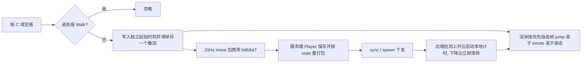

## 需求概述
把「叫唤」和「跳」拆成两个互不干扰的一次性动作：叫唤只动嘴、不改角色姿势，站着/坐着/躺着都能叫；跳跃独立成一个新动作，有自己的按键与按钮入口。

## 核心功能
- **叫唤只动嘴**：站立、坐、躺三种状态各有一套 3 帧叫唤（闭嘴 → 张嘴 → 闭嘴），不产生任何蹲下或腾空位移；叫唤约 0.44 秒，播完仍保持原来的姿势（坐着的还是坐着）。
- **跳跃独立**：新增「跳」动作，复用原来蹲下-起跳-落地的三帧节奏，跳跃时闭嘴，与叫唤在画面上明显区分；空格键触发，动作栏同时提供「跳一下」按钮。
- **坐/躺时跳**：先自动起身（切回站立）再播跳跃，跳跃结束后保持站立。
- **互斥与打断**：叫唤和跳跃互斥，后按的打断先按的；开始移动、切换坐/躺会立即中断叠加动作；连续按同一个动作从头重播。
- **行走中不触发**：走路时按叫唤或跳都不生效，避免脚步动画被替换成滑步。
- **多人一致**：其他玩家能看到你坐着叫唤、原地跳跃；叫唤结束后对方画面里你仍是坐姿，不残留张嘴帧或腾空帧。

## 视觉表现
- 新增站姿叫唤、坐姿叫唤、躺姿叫唤三组帧，张嘴沿用现有吻部暗格画法，描边与配色沿用现有图层，风格与现有帧一致。
- 叫唤帧只改变嘴部像素，身体的呼吸/起伏沿用各姿势原有的 1 像素节奏；跳跃保留原有起跳高度与脚下位置。
- 配件（帽子、眼镜、围巾、发型）在叫唤与跳跃过程中继续贴合头部锚点，不悬空。


## 技术栈
沿用现有栈，不引入新依赖：
- Monorepo：pnpm workspace + Turbo；测试 bun:test
- 客户端：Next.js / React + TypeScript + PixiJS（`apps/web`）
- 服务端：Bun + WebSocket（`apps/game-server`）
- 共享协议：`packages/shared-types`
- 像素资源：`packages/pixel-assets` 的 TS 生成器，`pnpm assets` 重出 PNG / `manifest.json` / `sprite-layout.generated.ts`

## 实现方案

### 核心策略
姿态与表现分离。wire 上的姿态只保留 `Idle / Walk / Sit / Lie` 四态，「叫唤」和「跳」变成两个与姿态正交的一次性叠加标志：
- 姿态决定基础帧（待机/行走/坐/躺），叠加动作只在渲染时替换帧序列，不写回姿态 —— 因此「叫唤结束回到原姿势」天然成立，不需要记忆和回滚上一姿态。
- 两个叠加动作各自持有独立的起始时间，时长约 440ms，过期自动失效。
- 远端同步复用 state 字节的空闲位（bit6 = 叫唤、bit7 = 跳），包长与 opcode 都不变，服务端只做保留与回传，不做计时。

### 关键决策与取舍
1. **叠加标志，而不是新增 `POSE.SitEmote / POSE.Jump`**
   新增姿态值会让服务端必须替玩家记住「动作前的姿态」并在播完后回滚，多一份状态与一条时序分支，正是当前 bug 的成因。叠加方案只多两个布尔位，代价是渲染层多一层选帧优先级。
2. **图集扩列，而不是图层叠加**
   嘴画在头部本体像素里，独立图层无法只改嘴形；扩列是唯一不破坏分层染色（`palette.ts` slot）的做法。
3. **跳跃复用原叫唤的蹲跳几何，改闭嘴**
   现有三帧的起跳高度与落地节奏已经调好，直接改名为 `jump` 并关掉张嘴即可，不新造动作；叫唤则换成只改嘴的九帧。
4. **服务端不做定时器**
   起止都以客户端 20Hz 上行包里的位为准，避免「服务端重发 vs 本地回收」互相打架（`session.ts` 现有注释已记录过这个坑）。

### 图集列预算（16 → 25，version v5 → v6）
```
idle       0-2    不变
walk       3-8    不变
sit        9-10   不变
lie       11-12   不变
jump      13-15   原 emote 的蹲跳几何，闭嘴
emote     16-18   站姿叫唤：只动嘴，无位移
sitEmote  19-21   坐姿叫唤：坐姿几何，只动嘴
lieEmote  22-24   躺姿叫唤：躺姿几何，只动嘴
```
- `COLUMNS = 25`，图集 1600×256（原 1024×256），远低于纹理上限。
- 每段 `frameMs` 合计 440ms（叫唤 140/160/140，跳 120/170/150），`loop:false`，叠加窗口与动画长度一致，不会在末帧停顿。
- 保留 `emote` 名字给站姿叫唤，`PonyPoseName` 语义不变；新增 `jump`。

### 状态字节
```
bit0-1  direction
bit2-4  pose（Idle/Walk/Sit/Lie）
bit5    moving
bit6    emote（叫唤）
bit7    jump（跳）
```

### 渲染选帧优先级
`jump` 高于 `emote`，`emote` 高于姿态；`Walk` 不参与叠加（行走中不触发，也不覆盖行走帧）。
叫唤按姿态映射：`Idle → emote`、`Sit → sitEmote`、`Lie → lieEmote`。

### 系统架构


### 性能与可靠性
- 渲染热路径 O(1)：会话启动时把姿态轨、三套叫唤轨、跳跃轨预编译成按姿态索引的数组，帧循环只做数组查表，不做字符串键查找、不分配对象。
- 网络：状态仍是 1 字节，包长与带宽不变，无新增 opcode；服务端只多两个布尔字段。
- 图集切片数从 64/层 增至 100/层（约 13 个图层），初始化时多创建约 470 个 Texture 包装对象，共享同一批 TextureSource，显存不变。
- 兼容性：旧客户端解析 state 时忽略 bit6/bit7，最多看不到叫唤与跳；图集版本不符会被 `atlas.ts` 的版本校验直接拦下并提示重跑 `pnpm assets`，不会静默错帧。

## 实现注意（执行细节）
- **`Motion.since` 语义不变**：它只表示当前姿态的起始时刻，换姿态才重置；叫唤/跳跃必须用新增的 `emoteSince` / `jumpSince`，否则会把坐姿呼吸打回第 0 帧。
- **不要用字符串键查 track**：`POSE_NAMES[pose]` 在帧循环里每实体每帧执行，改为预编译数组，与现有 `tracks` 一次性构建的风格一致。
- **服务端 `player.state` 是回传唯一来源**：必须在 `applyState` 里重新 `packState`，不能把客户端字节原样透传（现有实现就是重新打包，保持该纪律）。
- **`sanitizePose` 上限改为 `POSE.Lie`**：移除 `POSE.Emote` 后必须同步收口，否则非法姿态漏进世界状态。
- **张嘴沿用现有画法**：复用 `quadruped.ts` 里 `openMouth` 的吻部暗格与 `palette.ts` slot，不新增颜色常量，不做亚像素位移。
- **`nameplate.headTopYOf` 不用改**：它取所有列里最高的头顶，新增的叫唤帧只改嘴不动头，跳跃沿用原 hop 高度，兜底值仍然成立。
- **`bench/bots.ts` 不用改**：`packState` 新增参数给默认值，旧调用点自动兼容。
- **资源与代码同批发布**：图集扩列后旧 `manifest.json` 会触发版本校验报错，`public/sprites` 必须与 web 包一起上线。

## 目录结构
```
niuma/
├── packages/pixel-assets/
│   ├── src/layout.ts                       # [MODIFY] PoseName 增加 jump/sitEmote/lieEmote；COLUMNS 16→25；
│   │                                       #          CLIPS 重排为 13-15 jump、16-18 emote、19-21 sitEmote、
│   │                                       #          22-24 lieEmote（均 loop:false、合计 440ms）；
│   │                                       #          COLUMN_POSES 追加 16-24，更新列预算注释
│   ├── src/quadruped.ts                    # [MODIFY] sideOptions/facingOptions 抽出 sitting/lying/barking/jumping
│   │                                       #          四组语义：jump 沿用原 hop 与抬腿但闭嘴；emote 用站姿几何、
│   │                                       #          仅 phase 1 张嘴；sitEmote/lieEmote 用坐/躺几何、仅 phase 1 张嘴；
│   │                                       #          breatheOffset 覆盖新姿态；几何与 landmarksOf 共用，锚点自动跟随
│   ├── src/__tests__/layout.test.ts        # [MODIFY] 补断言：新 clip 存在、列覆盖仍无空洞无重叠、每段时长合计 440ms
│   ├── src/__tests__/cosmetics.test.ts     # [MODIFY] 循环里的硬编码 16 改为 COLUMNS 导入
│   └── scripts/generate.ts                 # [MODIFY] 两处 version 5→6，补 v6 变更注释（新增叫唤帧与 jump 拆分）
├── packages/shared-types/
│   ├── src/constants.ts                    # [MODIFY] POSE 收敛为 Idle/Walk/Sit/Lie；ACTION 只留 Sit/Lie
│   ├── src/quantize.ts                     # [MODIFY] packState 增加 emote/jump 参数（默认 false）写 bit6/bit7；
│   │                                       #          unpackState 返回 emote/jump；更新位注释
│   └── src/__tests__/protocol.test.ts      # [MODIFY] 四态姿势 × moving × emote × jump 全组合往返断言，
│                                           #          断言三个标志互不串位
├── apps/game-server/src/
│   ├── sim/world.ts                        # [MODIFY] Player 增加 emote/jump 字段；applyState 增加参数并重打包；
│   │                                       #          reset 时清零
│   ├── sim/movement.ts                     # [MODIFY] sanitizePose 上限改 POSE.Lie；applyMove 透传 emote/jump 位
│   └── server.ts                           # [MODIFY] C2S_ACTION 只映射 Sit/Lie，移除 Emote 分支
├── apps/web/
│   ├── public/sprites/**                   # [GENERATED] 25 列图集、manifest v6、配件图标与锚点
│   ├── lib/game/sprite-layout.generated.ts # [GENERATED] COLUMNS=25、jump/emote/sitEmote/lieEmote、version=6
│   ├── lib/game/ecs.ts                     # [MODIFY] Motion 增加 emoteSince/jumpSince: Float64Array，spawn 时清零
│   ├── lib/game/clip.ts                    # [MODIFY] 新增 buildOverlayTracks()/overlayTrackFor()，
│   │                                       #          预编译「姿态 → 叫唤轨」与 jump 轨，把选帧规则移出会话
│   ├── lib/game/__tests__/clip.test.ts     # [NEW] 覆盖 四姿态 × 叫唤开关 × 跳跃开关 的选帧矩阵：
│   │                                       #          jump 优先于 emote、Walk 不被覆盖、关闭时回落到姿态轨
│   ├── lib/game/session.ts                 # [MODIFY] perform 不再写 pose：emote 仅打点、jump 坐躺先置 Idle 再打点；
│   │                                       #          移动/坐/躺清叠加；columnFor 用预编译数组选帧；
│   │                                       #          handleSync 检测两路位上升沿与下降沿；handleSpawn 读取 state
│   │                                       #          初始化姿态与叠加；上行 packState 携带两个位；删除 resolvePose
│   ├── lib/game/input.ts                   # [MODIFY] ActionKey 增加 'jump'；Space 触发（已在 BLOCKED，不会滚页）
│   └── components/game/ActionBar.tsx       # [MODIFY] ACTIONS 增加「跳一下 / Space」一项，沿用现有按钮结构与样式
└── docs/adr/0018-emote-and-jump-overlay.md # [NEW] 记录姿态与叠加动作正交模型、bit6/bit7 分配、图集扩列代价、
                                            #          被否决的「新增 POSE 值」方案与 30 天回滚步骤
```

## 关键代码结构
状态字节（`packages/shared-types/src/quantize.ts`）：
```ts
export function packState(
  direction: Direction,
  pose: Pose,
  moving: boolean,
  emote = false,
  jump = false,
): number;
export function unpackState(state: number): {
  direction: Direction; pose: Pose; moving: boolean; emote: boolean; jump: boolean;
};
```
叠加轨选择（`apps/web/lib/game/clip.ts`）：
```ts
export interface OverlayTracks {
  emoteByPose: ReadonlyArray<ClipTrack | null>;
  jump: ClipTrack | undefined;
}
export function buildOverlayTracks(tracks: ClipTracks): OverlayTracks;
export function overlayTrackFor(tracks: OverlayTracks, pose: Pose): ClipTrack | null;
```

## 验证策略
- `pnpm assets` 后确认 `sprite-layout.generated.ts` 为 25 列、version 6，`manifest.json` 列数一致；人工查看 `.proof` 校对图，确认新帧不越界、描边闭合、张嘴能读出来、配件锚点贴合。
- `pnpm test`：布局契约（每列唯一归属、新 clip 时长）、比例/描边、协议全组合往返、选帧矩阵全部通过。
- `pnpm typecheck`：`POSE.Emote`、`ACTION.Emote` 移除后无残留引用。
- 手动验收：站→C（只张嘴、姿势不变）、坐→C（保持坐姿叫唤）、躺→C、空格跳（蹲-起跳-落地）、坐→空格（先起身再跳）、走→C/空格（无效）、坐→C 中途按 W（打断并起身走）、连按 C（重播）、双端观察远端坐姿叫唤与跳跃后回落。
- 回滚：单个提交包含资源与代码，`git revert` 即回滚；不回滚时不手工改列数。


## Agent Extensions
### Skill
- **layer-pixel-art**
  - Purpose: 扩展 `quadruped.ts` 绘制 jump 与三套叫唤帧时，保持像素栅格、描边闭合、配色 slot 与现有帧一致，避免新增帧越界或出现插值糊边。
  - Expected outcome: 站/坐/躺叫唤与跳跃共 12 帧 × 2 物种 × 4 朝向全部落在帧内，`.proof` 校对图无越界、无断描边，比例与描边测试通过。
- **impeccable**
  - Purpose: 在动作栏新增「跳一下」按钮时保持与现有三枚按钮一致的排版、间距、悬停态与可读性，不引入新的视觉风格。
  - Expected outcome: 四个动作按钮在同一排对齐、键位提示一致、无布局抖动，符合现有像素风界面的视觉纪律。
- **principal-software-architect**
  - Purpose: 复核「姿态 + 两个叠加标志」的状态模型与 bit6/bit7 分配取舍，按 ADR 规范沉淀决策与被否决方案。
  - Expected outcome: `docs/adr/0018-emote-and-jump-overlay.md` 包含上下文、备选方案对比、不可逆性评估与 30 天回滚路径，且结论与代码实现一致。
