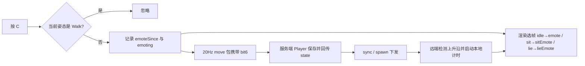

## 需求概述
把「叫唤」从一种会覆盖角色姿势的动作，改造成独立的一次性表现：叫唤期间角色保持当前姿势，叫唤结束后自然回到原姿势。坐姿、躺姿状态下同样可以叫唤，并各自播放对应的坐/躺叫唤动作。

## 核心功能
- **坐姿叫唤**：角色坐下后按叫唤，保持坐姿播放「坐着叫唤」动作，不出现站起再坐下的过程。
- **躺姿叫唤**：躺平后按叫唤，保持躺姿播放「躺着叫唤」动作。
- **站姿叫唤**：站立待机时叫唤沿用现有蹲跳动作，结束后回到待机。
- **叫唤不改变动作**：叫唤只叠加播放约 0.44 秒，不写入角色的基础动作状态，因此不会把坐姿重置成待机，也不会把站姿改写成别的状态。
- **打断规则**：开始移动、切换坐/躺会立即中断叫唤；连续按叫唤可从头重播；行走中按叫唤不生效，避免走路突然定格。
- **多人一致**：其他玩家能正确看到「坐着的你在叫唤」，并且叫唤结束后对方画面中的你仍保持坐姿或躺姿，不会残留张嘴或弹跳帧。

## 视觉表现
- 新增两组像素帧：坐姿叫唤（张嘴、身体轻微起伏、闭嘴收尾）与躺姿叫唤（张嘴、轻微起伏、闭嘴收尾），与现有站姿叫唤的节奏、配色、描边风格保持一致。
- 全部为整纹素位移，角色不下沉，配件（帽子、眼镜、围巾、发型）在叫唤过程中不悬空。


## 技术栈
沿用现有栈，不引入新依赖：
- Monorepo：pnpm workspace + Turbo；测试用 `bun:test`
- 客户端：Next.js / React + TypeScript + PixiJS（`apps/web`）
- 服务端：Bun + WebSocket（`apps/game-server`）
- 共享协议：`packages/shared-types`
- 像素资源：`packages/pixel-assets` 的 TS 生成器，`pnpm assets` 重出 PNG / `manifest.json` / `sprite-layout.generated.ts`

## 实现方案

### 核心策略
把叫唤从「姿态」里拆出来，变成与姿态正交的一次性标志：
- 姿态仍只有 `Idle / Walk / Sit / Lie` 四态，叫唤不再写入姿态，因此「叫唤结束回到原姿势」天然成立，不需要记忆和恢复上一姿态。
- 叫唤用独立的起始时间计时，约 440ms；渲染时按 `姿态 × 是否叫唤` 选帧：`Idle→emote`、`Sit→sitEmote`、`Lie→lieEmote`，`Walk` 不覆盖。
- 远端同步复用现有 state 字节的空闲 bit6，包长与 opcode 都不变。

### 关键决策与取舍
1. **叠加式叫唤，而不是新增 `POSE.SitEmote/LieEmote`**
   - 新增 wire 姿态值看似更省事，但服务端必须替玩家记住「叫唤前的姿态」并在播完后回滚，多一份状态、多一条时序分支，正是当前 bug 的来源。
   - 叠加式只增加一个布尔位与一个本地计时器，状态模型简单，后续再加别的表情动作也能复用同一通道。
2. **图集扩列而非图层叠加**
   - 张嘴像素画在头部本体上，靠独立图层叠加无法只改嘴形；扩列是唯一不破坏分层染色（`palette.ts` slot）的做法。
   - 列预算 16 → 22：`sitEmote` 3 帧 + `lieEmote` 3 帧，图集 1408×256（原 1024×256），单图层 RGBA 约 1.44MB，仍远低于纹理上限。
3. **服务端只做「保留并回传」，不做计时**
   - 叫唤开始与结束都以客户端 20Hz 上行包里的 bit6 为准，服务端不维护 emote 到期时间，避免与客户端本地计时打架（现有代码注释已踩过这个坑）。

### 性能与可靠性
- 渲染热路径保持 O(1)：会话启动时预编译 `poseTracks`（按姿态索引）与 `emoteTracks`（按姿态索引，Walk 为 null），帧循环只做数组查表，不做字符串键查找、不分配对象。
- 网络：每帧 1 字节状态位，包长不变，无额外带宽；无新增 opcode。
- 兼容性：旧客户端解析 state 时会忽略 bit6，最多看不到叫唤，不会错位；新客户端遇到旧服务端则降级为「无叫唤表现」，姿势仍正确。
- 图集版本号 v5 → v6，`atlas.ts` 已有版本与行列数校验，忘记重跑 `pnpm assets` 会在启动时立刻报错，不会静默错帧。

## 系统架构



数据流要点：
- 本地权威：本机姿势与叫唤都由本地决定，`handleSync` 对 `localId` 仍然只做位置纠正。
- 远端权威：远端姿势与叫唤位来自 state 字节；叫唤用「上升沿启动、计时到期或位清零停止」的规则，避免丢包导致永久张嘴。

## 实现注意（执行细节）
- **不要用字符串键查 track**：`POSE_NAMES[pose]` 这类映射在帧循环里每实体每帧执行；改为预编译数组，保持与现有 `tracks` 一次性构建的风格一致。
- **`Motion.since` 语义不变**：它只表示「当前姿态的起始时刻」，换姿态才重置；叫唤必须用新增的 `emoteSince`，否则会把坐姿呼吸动画打回第 0 帧。
- **服务端的 `player.state` 是回传唯一来源**：必须在 `applyState` 里重新 `packState`，不能把客户端字节原样透传（现有实现就是重新打包，保持该纪律）。
- **`sanitizePose` 上限改为 `POSE.Lie`**：移除 `POSE.Emote` 后必须同步收口，否则非法姿态会漏进世界状态。
- **张嘴沿用现有画法**：复用 `quadruped.ts` 里 `openMouth` 的 3×1.6 吻部暗格，走 `palette.ts` 的 slot，不新增颜色常量。
- **`pony-motion.ts` 的 `PONY_POSES` 暂不动**：预览台仍以 `emote` 作为可选视觉词表；本次只改渲染选择层，控制爆炸半径。
- **`apps/game-server/src/bench/bots.ts` 无需改**：`packState` 新增参数给默认值，旧调用点自动兼容。
- **资源与代码必须一起上线**：图集扩列后旧 `manifest.json` 会触发版本校验报错，部署时 `public/sprites` 与 web 包需同批发布。

## 目录结构

```
niuma/
├── packages/pixel-assets/
│   ├── src/layout.ts                       # [MODIFY] PoseName 增加 sitEmote/lieEmote；COLUMNS 16→22；
│   │                                       #          CLIPS 新增两组 3 帧（140/160/140ms，loop=false）；
│   │                                       #          COLUMN_POSES 追加 16-21，更新列预算注释
│   ├── src/quadruped.ts                    # [MODIFY] sideOptions/facingOptions 把 pose 判定改为
│   │                                       #          sitting/lying/mouthOpen 三组语义：sitEmote 用坐姿几何、
│   │                                       #          lieEmote 用躺姿几何，前两帧张嘴、末帧闭嘴；
│   │                                       #          breatheOffset 覆盖新姿态的 1px 起伏；
│   │                                       #          几何与 landmarksOf 共用，锚点自动跟随
│   ├── src/__tests__/layout.test.ts        # [MODIFY] 如有列数预算断言则同步（每列唯一归属断言保持）
│   ├── src/__tests__/cosmetics.test.ts     # [MODIFY] 循环里的硬编码 16 改为 COLUMNS 导入
│   └── scripts/generate.ts                 # [MODIFY] 两处 version 5→6，补充 v6 变更注释
├── packages/shared-types/
│   ├── src/constants.ts                    # [MODIFY] POSE 收敛为 Idle/Walk/Sit/Lie；ACTION 只留 Sit/Lie；
│   │                                       #          Pose/ActionId 类型随之收敛
│   ├── src/quantize.ts                     # [MODIFY] packState 增加 emote 参数写 bit6；
│   │                                       #          unpackState 返回 emote 布尔；位注释更新
│   └── src/__tests__/protocol.test.ts      # [MODIFY] 遍历四态姿势 + emote 两种取值做往返断言，
│                                           #          断言 emote 位与 pose/moving 互不串位
├── apps/game-server/src/
│   ├── sim/world.ts                        # [MODIFY] Player 增加 emote 字段，applyState 增加参数并重打包，
│   │                                       #          reset 时清零
│   ├── sim/movement.ts                     # [MODIFY] sanitizePose 上限改 POSE.Lie；applyMove 传入 emote 位
│   └── server.ts                           # [MODIFY] C2S_ACTION 只映射 Sit/Lie，移除 Emote 分支
├── apps/web/
│   ├── public/sprites/**                   # [GENERATED] 22 列图集、manifest v6、配件图标
│   ├── lib/game/sprite-layout.generated.ts # [GENERATED] COLUMNS=22、新增 clips、version=6
│   ├── lib/game/ecs.ts                     # [MODIFY] Motion 增加 emoteSince: Float64Array 与 emoting: Uint8Array，
│   │                                       #          spawn 时初始化
│   ├── lib/game/clip.ts                    # [MODIFY] 新增纯函数 clipFor(pose, emoting) 与
│   │                                       #          buildEmoteTracks(poseTracks)，把选帧规则移出会话
│   ├── lib/game/__tests__/clip.test.ts     # [NEW] 覆盖 idle/sit/lie/walk × 叫唤开关的选帧矩阵，
│   │                                       #          断言 Walk 不被覆盖、非叫唤时回落到原姿态 track
│   └── lib/game/session.ts                 # [MODIFY] perform 不再写 Motion.pose；叫唤仅在非 Walk 时打点；
│                                           #          移动/坐/躺打断叫唤；columnFor 用预编译数组选帧；
│                                           #          handleSync 检测远端 emote 边沿；handleSpawn 读取 state
│                                           #          初始化姿态与叫唤；上行 packState 携带 emote
└── docs/adr/0018-emote-as-overlay.md       # [NEW] 记录「姿态 + 叫唤标志」正交模型、bit6 分配、
                                            #          图集扩列代价、被否决的新增 POSE 方案与 30 天回滚路径
```

## 关键代码结构

状态字节布局（`packages/shared-types/src/quantize.ts`）：

```
bit0-1  direction
bit2-4  pose (Idle/Walk/Sit/Lie)
bit5    moving
bit6    emote  <- 新增
bit7    保留
```

选帧纯函数（`apps/web/lib/game/clip.ts`，签名级别）：

```ts
export function clipFor(pose: Pose, emoting: boolean): string;
export function buildEmoteTracks(poseTracks: readonly ClipTrack[]): ReadonlyArray<ClipTrack | null>;
```

## 验证策略
- `pnpm assets` 后确认 `sprite-layout.generated.ts` 为 22 列、version 6，`manifest.json` 列数一致，并人工查看 `.proof` 校对图确认新帧不越界、描边闭合、配件锚点贴合。
- `pnpm test`：布局契约（每列唯一归属）、比例/描边、协议往返、选帧矩阵全部通过。
- `pnpm typecheck`：`POSE.Emote` 移除后无残留引用。
- 手动验收：坐→C（保持坐姿叫唤→回坐姿）、躺→C、站→C、走→C（无效）、坐→C 中途按 W（打断并起身走）、连续按 C（重播）、双端观察远端坐姿叫唤与结束回落。


## Agent Extensions
### Skill
- **layer-pixel-art**
  - Purpose: 在扩展 `quadruped.ts` 绘制坐姿/躺姿叫唤帧时，保持像素栅格、描边闭合、配色 slot 与现有帧一致，避免新增帧越界或出现插值糊边。
  - Expected outcome: 产出 6 张风格统一的新帧（两条物种 × 四朝向），`.proof` 校对图无越界、无断描边，比例测试通过。
- **principal-software-architect**
  - Purpose: 复核「叠加式叫唤 + state bit6」的状态模型与协议位分配取舍，按 ADR 规范沉淀决策与被否决方案。
  - Expected outcome: `docs/adr/0018-emote-as-overlay.md` 包含上下文、备选方案对比、不可逆性评估与 30 天回滚路径，且结论与代码实现一致。
