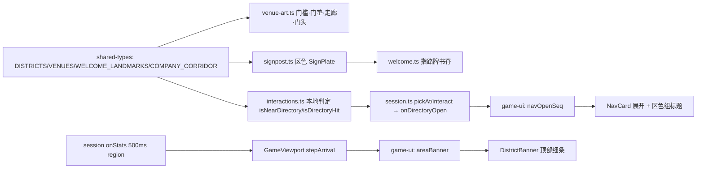

## 用户需求

在不推翻重写、不新增玩法、不动碰撞与可行走区的前提下，只打磨现有 5 区、25 处场所、5 座区门、迎宾拱门、企业楼东侧大门、道路与走廊的「进门 / 过门」表现与手感。

## 产品概述

园区的门将第一次"看得出是一道门"：每座门有自己的门槛石、门垫与区色灯；广场东侧指路牌变成可 F、可点击的导览入口，牌面与 HUD 导览卡都挂上五区色标；跨过门或走进场馆时，屏幕顶部弹出一条 2 秒左右的「区名 + 一句职场调侃」细条，来回蹭门不会狂闪。

## 核心功能

- **门前地面过渡**：迎宾拱门、5 座区门（企业 / 游乐 / 生活 / 服务 / 景观）、企业楼东侧总大门，各自补一层门垫 / 门槛石 / 石阶阴影，配色取 `DISTRICTS` 区色。
- **企业楼引导纹**：把 40px 走廊的地面补出来（现在是露草地），加中线节拍与两条方向箭头，明确「往北是办公 / 会议，往南是发泄室」；大门内外各一块门垫。
- **门头层次**：区门门柱加厚、匾额加外框与铜钉提高对比，门楣下侧加区色门灯亮核；`?light=0` 时亮核仍在、柔光关闭；与门楣彩旗、冬季冰棱不重叠不错位。
- **指路牌**：牌面每块加区色书脊，靠近或点击可以打开园区导览卡；导览卡的区组标题也挂区色块。
- **过门横幅**：跨门 / 进馆时顶部居中弹出一次「区名 + 副标题」，连续两拍确认 + 4 秒冷却，回原处不重播，不拦指针、不打断操作。
- **门口防卡位**：门洞净通行宽度与押送穿门路径加上回归测试，保住自动导览与 NPC 不擦边卡死。

## 已确认口径

1. 指路牌判定做在客户端本地（不动 `WORLD_HOTSPOTS`）。
2. 横幅复用 stats 500ms 节拍，连续两拍确认 + 冷却。
3. 横幅位于顶部居中细长条。
4. 走廊地面与引导纹只画在渲染层（不改 `WORLD_LAYOUT.paved`）。

## 边界

碰撞体、可行走区、`NAV_TARGETS` / `NAV_ARRIVALS` / `WORLD_HOTSPOTS` 一律不变；不新增协议与操作码；不新增灯位预算；所有新装饰不参与碰撞、不落盘。


## 技术栈

沿用现有结构，不引入任何新依赖：

- 渲染：PixiJS 8 + `Graphics` 构造期烘焙（`resolution: 1`、`antialias: false`、`scaleMode: 'nearest'`），`SortLayer` 的 `BAND_HEIGHT = 256` 分层不变。
- UI：Next.js App Router + React + Tailwind（`@theme` 里已有 `ink / mist / mint` 色板）+ zustand `useGameUi`。
- 契约：`@niuma/shared-types` 只读引用（`DISTRICTS` / `VENUES` / `WELCOME_LANDMARKS` / `COMPANY_CORRIDOR` / `PLAYER_RADIUS` / `isBlocked`），**本次不修改该包**。
- 测试：`apps/web/lib/game/__tests__` 走 bun test，`packages/shared-types` 走 vitest，服务端押送测试在 `apps/game-server/src/npc/`。

## 发版范围（关键结论）

| 层面 | 是否改动 | 发版 |
|---|---|---|
| `packages/shared-types`（坐标 / 碰撞 / `WORLD_HOTSPOTS` / `NAV_TARGETS`） | 否 | 不涉及双端同步 |
| `apps/game-server` 运行代码 | 否（仅新增测试） | 不涉及 |
| `apps/web` 渲染 + HUD + 交互 | 是 | **仅 web 单端发布** |

## 实现策略

### 1) 门前地面过渡：全部画进既有 `flat` 层

在 `venue-art.ts` 的 `build()` 里，紧跟 `paintDistrictStreets(flat)` 之后插入三个新方法，全部写同一个 `flat = new Graphics()`（`base` 层，永远在角色脚下，零新增显示对象、零排序成本）：

- `paintGateThresholds(g)`：遍历 `DISTRICTS`，以 `district.gate` 与 `district.color` 派生
  - 石阶阴影：`ellipse(x, y+6, 54, 9)`，`VENUE_SHADOW` + alpha 0.16；
  - 门槛石：`76×4` 三层（`TOWN_MATERIALS.stoneDark / stone / stoneLight`），跨在 `gate.y` 这条线上，正是玩家"跨过门"的那一像素；
  - 门垫：`72×24` 三层（`outlineOf(district.color)` 外框 → `district.color` 主体 → `lighten(district.color, 0.45)` 内芯 alpha 0.55），下沿再压一条 1px `lighten(color, 0.7)` 迎宾线；
  - 保留既有 `pool()` 与 68×3 短线（短线改叠在门槛石上，作为踏面高光，不再重复画两层同位置）。
- `paintArchThreshold(g)`：以 `WELCOME_LANDMARKS.arch` 派生，只在中间 112 宽路面上画三段踏步 + 一块 `112×40` 迎宾毯（`VENUE_COLORS.arch` 主色 + 2px 薄荷边 + 一条竖向打卡线），两侧立柱下方只留 `VENUE_SHADOW` 椭圆阴影。
- `paintCompanyGate(g)`：
  - 走廊地面：`COMPANY_CORRIDOR` 的 `920×40` 铺 `VENUE_COLORS.street.main`，上下 1px `seam`，中间 12px 走道条取 `VENUE_COLORS.workroom.main`（与工作区木地板同族）；
  - 中线引导：2px 暖白中线 + 每 40px 一道短横（节拍），在会议室门洞正下方（`MEETING_DOOR` 派生，`x+330..x+390` 中线）画向北 chevron，在发泄室门洞正上方（`VENT_DOOR` 派生，`x+300..x+360` 中线）画向南 chevron；chevron 全部 8×6 像素三角，不引入文字；
  - 门垫：`COMPANY_FORECOURT` 东侧补 `64×36` 木色门垫 + 白漆边，西侧与走廊地面接缝对齐，视觉上从广场 → 门垫 → 走廊 → 分岔箭头连成一条动线。

`venue-palette.ts` 增一行 `arch`（`VenueId` 联合类型 + `VENUE_COLORS` 表），避免在绘制函数里写新的十六进制（skill 硬约束 3 / 4）。全部装饰不登记 `solids`。

### 2) 区门门头

改写 `venue-art.ts` 的 `depthDistrictGates()`（仍是一区一个 `Container` + 一个 `Graphics`，不新增 sprite）：

- 门柱 6px → 8px 三层（`outlineOf(TOWN_MATERIALS.timber)` 1px 外描 + `timberDark` + `timberLight` 受光面），柱脚压 2px `stoneDark` 柱础；
- 横枋 108×16 → 112×18，加 1px 深描 + 2 枚 `brass` 铜钉；
- 匾额 60×10 → 64×14：`darken(color, 0.45)` 外框 1px、`color` 主体、`lighten(color, 0.5)` 1px 上高光、`darken(color, 0.7)` 1px 下暗线、四角 1×1 铜钉；
- 门灯亮核：横枋下沿正中一枚 `3×5`（`TOWN_MATERIALS.lampGlass` + 1px `0xfff6e0` 芯线 + 1px `lighten(color, 0.6)` alpha 0.35 外晕），**烘焙进同一张 Graphics**，因此与门楣彩旗同 `zIndex` 也不会靠插入顺序决胜；
- 夜里：`venueLights()` 里 5 盏区门灯 `radius 56 → 60`、`intensity 0.28 → 0.32`（数量不变，`lighting.test.ts` 的 26..32 与 `MAX_LIGHTS = 96` 均不受影响），`?light=0` 时柔光整层不建、亮核像素仍在。

### 3) 指路牌：纯客户端判定 + 区色书脊

- `signpost.ts`：`SignPlate` 增 `color: number`，`signPlates()` 从 `districtReadings()` 的 `district.color` 带出；纯函数，可直接单测。
- `welcome.ts`：`drawSignpost()` 每块目的地牌左侧画 4px 区色书脊（`darken(color, 0.55)` 1px 边 + `color` 2px），箭头仍 `mintDark` 保可读；「你在这里」底牌不变。
- `interactions.ts`：新增 `DIRECTORY_INTERACT_RANGE = 96`、`isNearDirectory(x, y)`（到 `WELCOME_LANDMARKS.directory` 底边中心）、`isDirectoryHit(x, y)`（整块 `96×120`，与 `HUB_SOLIDS` 同源），并在 `selectContextHint()` 里插在 `nearestHotspotOfKinds` 之后 → 返回 `HINT.directory`。
- `hint-copy.ts`：三处齐补（`HINT.directory`、`HINT_BUTTONS` 的 `interact/查看导览/F`、`TOUCH_HINTS` 的触屏说法），`Record` 全量类型会在编译期拦住漏补。
- `session.ts`：`pickAt()` 增 `isDirectoryHit` 分支（远处 `showHint('走近一点再看')`，近处 `callbacks.onDirectoryOpen?.()`）；`interact()` 在热区查询前插 `isNearDirectory` 分支（不发包，只回调 + `INTERACT_COOLDOWN_MS`）；`SessionCallbacks` 增可选 `onDirectoryOpen?()`。
- `game-ui.ts` + `NavCard.tsx`：store 增 `navOpenSeq` 与 `requestNavCardOpen()`（自增即可，不需要布尔态），`NavCard` 监听该序号把内部 `open` 置 true 并设 `manual.current = true`；区组标题左侧加 3px 区色块。

### 4) 过门区域横幅（零协议）

- `arrival-copy.ts` [NEW]：纯数据 + 纯函数
  - `arrivalCopy(region)` 返回 `{ title, subtitle, color }`，`color` 由 `VENUES` / `DISTRICTS` 按名字反查，兜底 `VENUE_COLORS.plaza.glow`；
  - 副标题表覆盖：`中央迎宾广场`、5 个区名、`工作区 / 会议室 / 发泄区 / 卫生间 / 小黑屋 / 护士急救站 / 摸鱼大赌场 / 绩效八角笼 / 游乐园 / 宿舍区 / 家庭影音室 / 牛马公寓 / 两栋小院 / 摸鱼亭 / 三湖`、`园区野地`；
  - 同文件导出纯状态机 `stepArrival(state, region, now)` 与常量 `ARRIVAL_CONFIRM_TICKS = 2`、`ARRIVAL_COOLDOWN_MS = 4000`（可单测，不依赖 Pixi / DOM）。
- `game-ui.ts`：增 `areaBanner: { key, title, subtitle, color } | null` + `pushAreaBanner` / `clearAreaBanner(key)`，`key` 自增驱动重播（复用 `shoutBanner` 的既有范式）。
- `DistrictBanner.tsx` [NEW]：顶部居中细长条，`pointer-events-none` + `z-30` + `transition-opacity`，`HOLD_MS 2600 / FADE_MS 320`，左侧 3px 区色竖条 + 顶部 2px 亮线，区名用 `font-display`、副标题用 `font-mono`；`compact` 时顺延到安全区下，`chatOpen && compact` 让位；`role="status" aria-live="polite"`；卸载清定时器。
- `GameViewport.tsx`：在 `onStats` 里跑 `stepArrival`，命中时 `pushAreaBanner`；`onDirectoryOpen` 接 `requestNavCardOpen()`；挂载 `<DistrictBanner />`；`entering` 首拍只记基线不弹。

### 5) 门口防卡位回归测试（不改常量）

- `apps/web/lib/game/__tests__/door-clearance.test.ts` [NEW]：
  - 从 `WORLD_LAYOUT.buildings` + `WORLD_LAYOUT.solids` **反推**每间房的门洞 gap（同一条边上两段 `kind: 'wall'` 之间的空隙），断言 `gap - 2 * PLAYER_RADIUS >= 20`，且门洞中心 `!isBlocked`、两侧 1px 处 `isBlocked`；
  - 断言 `CLINIC_FENCE_SOLIDS` 西侧缺口 ≥ 56（急救站人行门）、`COMPANY_CORRIDOR.h - 2 * PLAYER_RADIUS >= 20`（22px 净通行）；
  - 不写死任何门洞坐标，全部从导出常量派生。
- `apps/game-server/src/npc/escort-path.test.ts` [MODIFY]：对 12 个 `NAV_TARGETS` 断言 `findEscortPath(SPAWN_CENTER, target.arrive)` 非空（覆盖全部穿门路线），另加"门外 40px → 门内 40px"的短程断言，守住 24px 网格在 60px 门洞上仍能过。
- `apps/web/lib/game/__tests__/signpost.test.ts` [MODIFY]：每块牌 `color === DISTRICTS[i].color`。
- `apps/web/lib/game/__tests__/arrival-copy.test.ts` [NEW]：所有 `DISTRICTS` / `VENUES` 名都有副标题、长度 ≤ 20 字、`园区野地` 有兜底；`stepArrival` 的「一拍不弹 / 两拍弹 / 冷却内不重复 / 回原区清空」。

## 性能与可靠性

- 门槛、门垫、走廊地面、亮核全部在 `build()` 构造期画进既有 `Graphics`：**帧循环不新增节点、不 new 对象、不 generateTexture**；绘制量增加约 5 段嵌套矩形 + 3 段走廊条，一次性上传。
- 指路牌色标在 `bake()` 期完成，牌面纹理仍是一张 96×120。
- 横幅 2Hz 上限 + 连续两拍确认 + 4s 冷却，稳态每秒最多 0.25 次 store 写入；组件只在 `areaBanner` 变化时重渲染。
- 灯位数量不变（仍 30 盏，预算 96），不触碰 `MAX_LIGHTS`；`?venue=0` 整层不构造即可一键退回旧观感，`?light=0` 只关柔光，`?flat=1` / `?bands=0` / `?festival=0` / `?season=winter` 均与本层无耦合（冰棱只画在 `kind: 'wall'` 墙体上，区门无墙体）。
- 契约零改动，服务端零改动，无需双端同步发布。

## 架构与数据流



## 目录结构

```
apps/web/lib/game/
├── venue-art.ts                 # [MODIFY] 新增 paintGateThresholds / paintArchThreshold / paintCompanyGate，改写 depthDistrictGates；全部走既有 flat 与既有 Container，零新增显示对象类型
├── venue-palette.ts             # [MODIFY] VENUE_COLORS 增 arch 一行（含 main/alt/seam/accent/glow），VenueId 联合类型同步；供拱门迎宾毯取色，避免魔法十六进制
├── signpost.ts                  # [MODIFY] SignPlate 增 color；signPlates() 从 districtReadings().district.color 带出；保持纯函数无 Pixi 依赖
├── welcome.ts                   # [MODIFY] drawSignpost() 每块牌加 4px 区色书脊（darken 边 + 区色主体），箭头与文字排版不动
├── interactions.ts              # [MODIFY] 新增 DIRECTORY_INTERACT_RANGE / isNearDirectory / isDirectoryHit；selectContextHint 在热区之后、老板之前插入指路牌提示
├── hint-copy.ts                 # [MODIFY] HINT.directory + HINT_BUTTONS + TOUCH_HINTS 三处齐补
├── session.ts                   # [MODIFY] pickAt 增 isDirectoryHit 分支；interact 增 isNearDirectory 分支；SessionCallbacks 增可选 onDirectoryOpen（不发包）
├── arrival-copy.ts              # [NEW] 区域横幅文案表 + arrivalCopy(region) + stepArrival(state, region, now) 纯状态机与两个常量；不依赖 Pixi/DOM，可单测
├── __tests__/
│   ├── arrival-copy.test.ts     # [NEW] 文案覆盖、长度上限、兜底、防抖与冷却状态机
│   ├── door-clearance.test.ts   # [NEW] 从 buildings+solids 反推门洞 gap，断言净通行 >= 20px、中心可站、两侧为墙；走廊与急救站人行门单独断言
│   └── signpost.test.ts         # [MODIFY] 追加「每块牌 color 等于 DISTRICTS[i].color」
├── ../game-ui.ts                # [MODIFY] 增 navOpenSeq/requestNavCardOpen 与 areaBanner/pushAreaBanner/clearAreaBanner；全为会话态，不落盘
apps/web/components/game/
├── DistrictBanner.tsx           # [NEW] 顶部居中细条：3px 区色竖条 + 2px 亮线 + 区名 + 副标题；pointer-events-none、role=status、hold/fade 定时器与清理、compact/portrait 让位
├── NavCard.tsx                  # [MODIFY] 监听 navOpenSeq 展开；区组标题加 3px 区色块
├── GameViewport.tsx             # [MODIFY] onStats 里跑 stepArrival 并 pushAreaBanner；接 onDirectoryOpen → requestNavCardOpen；挂载 DistrictBanner
apps/game-server/src/npc/
└── escort-path.test.ts          # [MODIFY] 追加 12 个 NAV_TARGETS 的押送可达 + 三处门洞内外短程可达断言（仅测试）
apps/web/data/
└── release-notes.json           # [MODIFY] 追加一条面向玩家的版本工报并跑 pnpm changelog:check
```

## 关键结构

```ts
// signpost.ts：牌面带上区色，welcome.ts / 单测共用
export interface SignPlate {
  readonly label: string;
  readonly octant: NavOctant;
  readonly top: number;
  /** DISTRICTS 的区色，牌面书脊与 HUD 导览卡组标题共用 */
  readonly color: number;
}

// arrival-copy.ts：文案 + 纯状态机，2Hz 调用也不分配额外结构
export interface ArrivalState {
  /** 已展示过的区域名：回到原处不重播 */
  shown: string;
  /** 待确认的区域名与连续拍数 */
  pending: string;
  hits: number;
  /** 上次弹出的单调时钟毫秒 */
  lastAt: number;
}
export function arrivalCopy(region: string): { title: string; subtitle: string; color: number };
export function stepArrival(
  state: ArrivalState,
  region: string,
  now: number,
): { next: ArrivalState; fire: boolean };
```

## 执行注意

- 门槛 / 门垫必须画在 `flat`（`props.base`），**不得** `depth.add()`，否则会盖住角色脚背；只有门架本体留在 `depth`。
- 复用 `outlineOf / seamOf / lighten / darken / VENUE_OUTLINE / VENUE_SHADOW / TOWN_MATERIALS`，禁止新写纯黑或中性灰描边；每处地面明度阶梯不超过三档。
- 走廊 chevron 的横坐标必须由 `MEETING_DOOR` / `VENT_DOOR` 的等效区间派生（`MEETING_ROOM.x + 330..390`、`VENT_ROOM.x + 300..360`）；这两个常量在 `campus.ts` 内是模块私有，web 侧如需精确引用就在 `venue-art.ts` 里用 `MEETING_ROOM` / `VENT_ROOM` 的 `x + w` 与已知偏移计算，不复制整个坐标表，并在注释里标明来源。
- `session.ts` 是指路牌唯一改动点，务必确认**不发任何包**（与 `bulletin` / `board` 一致），否则会撞上服务端热区校验。
- 横幅文案不得含文件名、路径、IP、端口等内部信息（AGENTS.md 内容红线同样适用于横幅与版本工报）。
- 浏览器核对：默认视角、`?venue=0`、`?light=0`、`?flat=1`、`?bands=0`、`?festival=0`、`?season=winter`，逐项确认无漏光、无黑块、无遮挡错位。


## 设计定位

不新增玩法界面，只在既有像素画布与 HUD 上补「门的仪式感」。画布侧严守 1:1 整数纹素与 nearest 采样，用区色做低饱和点缀；HUD 侧沿用现有 ink / mist / mint 的暗色工业风，只新增一条顶部细长条。

## 画布：门的视觉语言

- **门槛石**：`76×4` 三级石阶（stoneDark → stone → stoneLight），像素级横跨门线，成为"跨过门"的那一像素参照。
- **门垫**：`72×24` 三层同心矩形，外框取区色压暗四成，主体为区色本体，内芯向暖白提亮（alpha 0.55），下沿一条 1px 迎宾亮线。远看是"这里有一块垫子"，近看能读出区色。
- **石阶阴影**：`ellipse 54×9` 深靛 alpha 0.16，给门架落地感，不压角色。
- **拱门迎宾毯**：`112×40` 奶油底 + 2px 薄荷边 + 一条竖向打卡线，与拱门霓虹同族，只在中间车道上铺，两侧立柱下只留阴影。
- **企业楼动线**：走廊铺浅石青，中间 12px 木色走道 + 2px 暖白中线 + 每 40px 一道节拍横线；会议门正下方向北三角、发泄室门正上方向南三角，8×6 像素符号，不写字。
- **门头**：柱宽 8px 三层木料 + 石柱础；匾额 `64×14` 带 1px 深描与四角铜钉；横枋下沿一枚 `3×5` 灯核（玻璃黄 + 1px 白芯 + 区色外晕）。`?light=0` 时只看得到这枚亮核。

## HUD：过门横幅

- 位置：顶部居中，宽 `min(440px, 86vw)`，距安全区约 88px，桌面/触屏各自顺延，不与世界事件横幅、断线横幅抢位。
- 结构：左侧 3px 区色竖条（贯穿整条高度）→ 区名（display 字体，16–18px，字距略放）→ 副标题（mono，10px，mist-300）→ 顶部 2px 区色亮线。
- 动效：淡入 + 轻微下移 4px，停留 2.6s，320ms 淡出；同一时刻只存在一条，新区域以 `key` 重播。
- 交互：`pointer-events-none`，永不拦截点击与摇杆；`aria-live="polite"`，不打断读屏。
- 克制：只有跨门与进馆才出，冷静期 4 秒；在门边来回蹭不会连续弹。

## Skill

- **pixel-venue-polish**
  - Purpose: 约束区门门槛、门垫、拱门迎宾毯、企业楼走廊与门头的像素绘制规范——色板取用、同色相压暗描边、明度阶梯 ≤3 档、每处 1–2 盏焦点光、构造期烘焙与零每帧分配。
  - Expected outcome: 新增的地面与门头全部符合全站画风，光位数量不变（仍 30 盏，预算 96），并通过 `?venue=0` / `?light=0` / `?flat=1` 的灰度核对。
