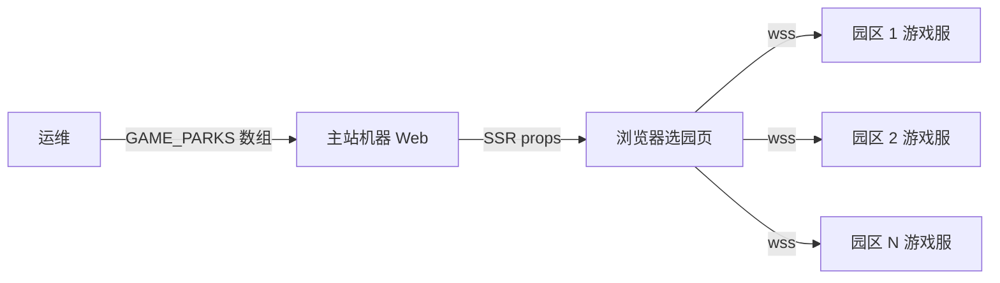

## 产品概述

当前部署文档是按「机器 1 + 机器 2」写死的双机手册，但实现本身与园区数量无关：不配 `GAME_PARKS` 就是单园区，配几项就是几座园区。需要把文档改成覆盖 1 台、2 台、N 台的通用口径，并修掉 3 座园区时选园页的排版孤行。

## 核心功能

### 1. 明确三种部署规模都适用
- **只部署一台**：默认形态，零配置。`/enter` 自动 307 到 `/play`，园内不显示「切换园区」，行为与多园区改造前完全一致。
- **两台**：主站机器跑 Web + 一号园区，第二台只跑游戏服。
- **N 台**：每加一座园区，就是再跑一次 `DEPLOY_ROLE=game`，并往 `GAME_PARKS` 数组里加一项。

### 2. 文档改为角色化写法
不再出现「机器 1 / 机器 2」这类写死顺序的称呼，改为「主站机器」与「游戏服机器（可多台）」。拓扑图、角色表、环境变量分节、nginx 片段、部署顺序、验收清单、故障排查全部按角色描述，具体机型号只作为示例出现并明确标注。

### 3. 补充扩容与决策入口
开篇给出「我要部署几座」的决策表，说明每种规模要配什么、`/enter` 表现如何；单独给出「加第三座园区」的操作清单，让后期扩容不依赖通读全文。

### 4. 容量算法公式化
不再只给两台机器的具体数字，改为给出「物理带宽 × 0.9 − 同机其它流量」的公式，现有 400 / 300 KB/s 保留为示例值。

### 5. 选园页支持三座及以上
卡片区从固定两列改为按可用宽度自适应：两座仍是两列，三座在宽屏排三列，更多座自动换行，不再出现「2 + 1」的孤立行。页面里「两座园区的人互相看不见」「两座园区都没有响应」这类写死数量的文案一并改为通用表述。

### 6. 术语与链接保持一致
全站统一用「园区 / park / GAME_PARKS」，不出现 `region`（已被园区内区域名占用）或「分线 / shard」。文档改名会牵动 README 与 ADR 的链接，因此保留现有文件名，只改标题与内容。


## 技术栈

沿用现有栈，**不引入任何新依赖、不引入服务发现或注册表**：

- 文档：Markdown（仓库现有 `docs/` 风格）
- Web：Next.js 15 + Tailwind CSS v4（仅改一处栅格 class 与两处文案）
- 校验：`tsc --noEmit`、`impeccable detect`

## 实施方案

### 总体策略

**文档为主，代码只动一处**。现有实现（`park.ts` / `park.server.ts` / `park-health.ts` / `use-park-health.ts` / `enter/page.tsx` / `jenkins-deploy.sh`）已经是数量无关的，改它们只会带来无收益的风险。

三件事：

1. **`docs/deploy-multi-park.md` 整篇重写**为 1…N 通用手册，角色化命名，容量公式化，验收按单园区 / 多园区分组。
2. **ADR-0043 与 README 措辞泛化**，把「两台」降级为带标注的示例。
3. **`ParkPicker` 的栅格与两处文案改成 N 无关**。

### 关键决策与理由

| 决策 | 理由 |
|---|---|
| 保留文件名 `docs/deploy-multi-park.md` | README 有两处、ADR-0043 有一处已经链到它；改名只换来链接维护成本，没有信息增量。标题改成「多园区部署」即可 |
| 角色命名用「主站机器 / 游戏服机器」 | 写死序号会在加第三台时立刻失真；角色名在 N 变化时保持稳定 |
| 不为 N 座引入服务发现 | N 是人工维护的小集合（实践上 ≤ 5），静态配置足够；注册表本身会成为新的单点，且与 ADR-0004 的零持久化取向相悖 |
| 探活继续并行，不改 `probeParks` | 每轮 N 个约 250 B 的 `/health` 请求，N ≤ 5 时可忽略；改成串行只会把首屏延迟乘以 N |
| 栅格用 `auto-fit` 而不是按数量切 `grid-cols-N` | 数量是运行时配置，用 class 分支会逼着 Tailwind 保留 N 套样式；`auto-fit` 由浏览器 layout 解决，零 JS、零分支 |
| 3 座以上不做分页 / 折叠 | YAGNI：当前无证据表明会出现两位数园区；`auto-fit` 已能优雅换行 |

### 性能与边界

- 选园页：探活仍是 `Promise.all` 并行，总耗时约等于最慢的一座（受 1.2s 超时约束），与 N 无关。
- 栅格：`repeat(auto-fit, minmax(min(100%, 280px), 1fr))` 是纯 CSS，无重排抖动；`min(100%, 280px)` 保证窄屏不会被 280px 撑出横向滚动。
- 兼容：单园区路径完全不变（`/enter` 307、无切换按钮），本次改动不触碰该分支。

### 向后兼容

- `GAME_PARKS` 缺省、非法 JSON、解析后为空，三种情况仍回落 `DEFAULT_PARK`，与本次改动前一致。
- 文档改写不涉及任何运行时行为；`/play`、`/enter` 的 URL 形态不变。

## 架构设计

本次不改变系统结构，只改变文档口径与一处呈现层栅格：



配置是唯一真相，游戏服之间仍然没有任何连接。

## 目录结构

```
niuma/
├── docs/
│   ├── deploy-multi-park.md              # [MODIFY] 整篇重写为 1…N 通用手册
│   │                                     #   标题改「多园区部署：Web 单源 + 1…N 座独立园区」
│   │                                     #   §0 新增「我要部署几座」决策表（1 台 / 2 台 / N 台）
│   │                                     #   §1 拓扑与角色：主站机器 / 游戏服机器（第 2…N 座）
│   │                                     #   §2 为什么这么分：保留带宽与 CPU 论据，去掉「两台」指代
│   │                                     #   §3 环境变量：按角色分节（主站机器 / 每一台游戏服机器）
│   │                                     #   §4 新增一台游戏服机器：5 步清单（GAME_PARKS / DEPLOY_ROLE=game / DNS / 证书 / nginx）
│   │                                     #   §5 nginx：主站机器一份、每台游戏服机器一份，子域名用 <park-subdomain> 占位
│   │                                     #   §6 容量：先给公式，再给两台机器的示例算例并标注「示例」
│   │                                     #   §7 部署顺序：先起游戏服机器，再改主站配置
│   │                                     #   §8 验收：拆成「单园区」与「多园区（2 座 / 3 座）」两组
│   │                                     #   §9 回滚：只留一项配置，通用化表述
│   │                                     #   §10 故障排查：通用化，不写死 b.example.com
│   │                                     #   §11 已知边界：改为「各园区互不可见」「同名可跨园区重复」
│   └── adr/0043-multi-park-deployment.md # [MODIFY] 标题与正文措辞泛化；两台机型标注为「当前示例」；
│                                         #   §决策 2 改为「Web 留在一台，其余每台各一个游戏服」并补「N 座只是再加一个进程 + 一条配置」；
│                                         #   §被拒方案「两台都完整部署」→「每台都完整部署」；
│                                         #   §后果的人数与闲置核数标注为示例并给公式
├── apps/web/components/park/ParkPicker.tsx # [MODIFY] 卡片容器栅格改 auto-fit；两处「两座」文案改通用
├── README.md                              # [MODIFY] :10「两座园区」→「不同园区」；
│                                          #   :63 目录说明「双机部署手册」→「多园区部署手册（1…N 台）」；
│                                          #   :333「两台机器的角色分配」→「主站机器与游戏服机器的角色分配」
└── .env.example                           # [MODIFY] GAME_PARKS 注释补充「数组支持 N 项，顺序即卡片顺序」
```

## 关键契约

```tsx
// ParkPicker 的卡片容器：数量由配置决定，栅格由可用宽度决定
<div className="mt-6 grid grid-cols-1 gap-4 sm:gap-5 grid-cols-[repeat(auto-fit,minmax(min(100%,280px),1fr))]">
```

```diff
- 两座园区的人互相看不见，工牌与外观通用。选过之后会自动进入这一座，园区里随时能换。
+ 不同园区的人互相看不见，工牌与外观通用。选过之后会自动进入这一座，园区里随时能换。

- '两座园区都没有响应：先确认游戏服进程与证书，再点右侧重新探活。'
+ '所有园区都没有响应：先确认游戏服进程与证书，再点右侧重新探活。'
```

## 实施注意

- **Tailwind v4 任意值不写空格**。`grid-cols-[repeat(auto-fit,minmax(min(100%,280px),1fr))]` 里逗号合法、空格不合法；若构建后该 class 未生成（可用 `next build` 产物或 devtools 的 computed style 核对 `grid-template-columns`），退回 `style={{ gridTemplateColumns: 'repeat(auto-fit, minmax(min(100%, 280px), 1fr))' }}`。
- **不要改 `park.ts` / `park.server.ts` / `park-health.ts` / `use-park-health.ts` / `enter/page.tsx` / `play/page.tsx` / `jenkins-deploy.sh` / 游戏服代码**：它们已经是数量无关的，改动只会扩大爆炸半径。
- **术语纪律**：统一 `park` / 园区 / `GAME_PARKS`；禁用 `region`（已被 `regionAt()` 占用，指园区内的区域）、`shard`、「分线」。
- **文档里的具体数字必须标注为示例**：`400 / 300 KB/s`、`50–65 / 40–50 人`、`2C4G/5M` 都是本次两台机器的算例，通用结论只保留公式。
- **保留仍正确的论据**：带宽换算、`GAME_MAX_ONLINE` 为什么设高、`limit_rate` 的必要性（水位计只统计游戏进程字节）、`wss://` 必要性、Origin 白名单、回滚只动配置。
- **验收清单要可执行**：单园区组断言 `/enter` 307 且园内无「切换园区」；多园区组断言 2 座两列、3 座宽屏三列、停掉任意一台只该那一张卡片变灰。
- 文档改写后检查 README 与 ADR 里指向 `deploy-multi-park.md` 的两处链接仍然有效（文件名未变，链接文本要改）。


## Agent Extensions

### Skill

- **principal-software-architect**
  - Purpose: 改写 `docs/adr/0043-multi-park-deployment.md` 时，保证「N 座只是再加一个进程 + 一条配置」这个结论与原有决策链（零持久化、Web 单源、无分片协议）一致，不因为措辞泛化而弱化被拒方案的论证
  - Expected outcome: ADR 标题与正文改为 1…N 口径，两台机型标注为「当前示例」，决策 2 的表述与实际部署形态对齐，回滚与复核信号仍然可操作

- **impeccable**
  - Purpose: 选园页栅格从固定两列改为 `auto-fit` 属于响应式呈现调整，需要按项目既有的工业终端风格收尾，避免三列时卡片高度、间距与信息密度失衡
  - Expected outcome: 2 座为两列、3 座在宽屏为三列且无孤立行、窄屏单列不横向溢出；`impeccable detect` 对改动文件无 primary findings
