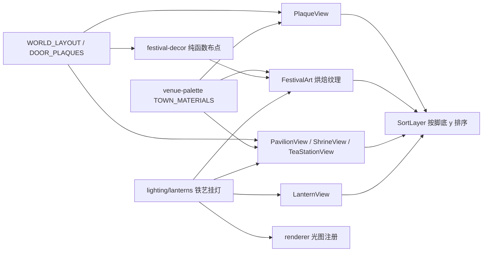

## 用户需求

把园区地图上的中国风装饰整体撤掉，改造成欧美小镇休闲风（类似星露谷、动物森友会的西式小镇观感）。经确认，改造范围与处理原则如下。

## 改造范围

- **节日装饰层**：跨路彩旗、门楣挂饰、树梢红灯笼，改为西式三角彩旗与暖白小灯串。
- **门头牌坊与朱漆对联**：四角院落的大牌坊、红纸竖联、黑漆金边匾额，改为白漆木构门架、奶油底木牌；对联整体删除。
- **宫灯与灯笼光源**：门柱、迎宾拱门、亭檐与彩旗上的红灯笼，连同夜间暖红光池，改为黑色铁艺挂灯与中性暖白光。
- **中式建筑本体**：摸鱼亭的八角重檐、朱红廊柱、青瓦改为西式木构凉亭；财神供案、紫砂茶台的陈设改为石砌神龛与木制饮品台；广场太湖石盆景改为灰岩叠石。

## 处理原则

- **只换外观**：交互点、感应范围、提示文案、协议、碰撞盒、座位与坐标一律不动；「上香祈福」「打开属性强化」等文案保持原样。
- **可回退**：保留 `?festival=0`、`?venue=0`、`?light=0` 等既有灰度开关，改完仍能对照新旧两套观感。
- **视觉要求**：像素风不变，描边只用同色相压暗（禁止纯黑）；每处仍保留 1–2 盏焦点光，夜景不能变黑；装饰仍不参与碰撞、不落盘、不上协议。


## 技术栈

- 现有 pnpm monorepo + TypeScript，无需新增依赖。
- 渲染：PixiJS v8 程序化像素画（`Graphics` 构造期 `bake()` 成 1:1 纹理，帧循环只写坐标/贴图/tint）。
- 共享几何：`@niuma/shared-types` 的 `WORLD_LAYOUT` / `DOOR_PLAQUES` / `MOPING_PAVILION*` / `SHRINE_ALTAR*` / `TEA_STATION*`。
- 测试：`apps/web` 用 `bun test lib`，`packages/shared-types` 用 vitest；版本工报校验 `pnpm changelog:check`。

## 实现策略

纯渲染层重绘（repaint-only）：所有坐标、碰撞体、座位、协议与文案保持零改动，只改各模块的调色板、`Graphics` 绘制函数与光源颜色；唯一的数据结构变更是 `DoorPlaque` 删掉中国风专属字段（`couplets`、`inkGold`）。

### 1. 统一材料色板（避免 5 份十六进制）

在 `apps/web/lib/game/venue-palette.ts` 追加 `TOWN_MATERIALS` 常量（该文件本就是全站色板与色温纪律的落点），供牌坊、亭子、神龛、茶台、院门共用：

| 语义 | 值 | 用途 |
|---|---|---|
| timber / timberLight / timberDark | `0x6b4a32` / `0x96714f` / `0x4b3324` | 深胡桃木柱、横梁 |
| paint / paintShade | `0xf3ede1` / `0xcfc6b6` | 白漆栏杆、横梁、柱帽 |
| board / boardEdge / boardInk | `0xfff6e0` / `0x8a6446` / `0x2f5d4a` | 奶油牌面、木边、墨绿字 |
| iron / ironLight | `0x3a3f47` / `0x5b636e` | 铁艺灯架、链条、螺栓 |
| brass | `0xc9a14a` | 铜钉、门牌小件 |
| lampGlass / lampGlow | `0xffe7b8` / `0xffc98a` | 灯罩玻璃与夜间光色 |
| stone / stoneDark / stoneLight | `0xcfc7b6` / `0xa79f8e` / `0xf0eadb` | 台基、石龛、叠石 |

彩旗配色改为奶油 `0xfff6e0` + 薄荷 `0x8fe3c7` + 珊瑚 `0xf08a6a` + 天蓝 `0x7fb8e8`，绳色由深红 `0x7d2418` 改为麻绳 `0xb08a5a`。

### 2. 挂灯与光色（`lighting/lanterns.ts`）

- `paintLantern()` 保持 9×22 的占位（`LANTERN_HEIGHT = 22`，调用方坐标不变），改画**黑色铁艺挂灯**：铁环提绳 + 梯形铁罩 + 暖白玻璃芯 + 底部小尖。
- `LANTERN_INK` 换成铁/玻璃色板；`LANTERN_LIGHT.color` 由 `0xff5a3c` 改 `0xffc98a`，`flicker` 由 `0.12` 降到 `0.06`（电灯不抖）；`radius 48`、`intensity 0.72` 不变。
- 灯数完全不变：拱门 2 + 门柱 4（`FIXED_LANTERNS`）+ 亭角 4 + 供案 2 + 节日 6，`MAX_LIGHTS` 预算与 `lighting.test.ts` / `ritual.test.ts` 的计数断言保持成立，只更新颜色断言（改为引用常量而非魔法数字，消除重复）。

### 3. 节日装饰（`festival-decor.ts` / `festival-art.ts`）

- 布点纯函数一行不改（`BUNTING_LAMP_GAP = 232`、`GATE_BUNTING_HANG_DY = 76`、`TREE_LANTERN_HANG_DY = 44`、`FESTIVAL_LIGHT_COUNT = 6`、`readFestivalEnabled`），只更新文档注释与 `FestivalAnchorKind` 的语义描述。
- `PALETTES` 三套配色换成小镇三色轮换；`paintBunting()` 的中央宫灯改为**三只玻璃小灯泡**（仍落在原光心正上方，`festivalLights()` 坐标不变）；`paintTreeLantern()` 改为树梢小灯串（横杆 + 两盏小玻璃灯 + 麻绳）。
- 保留两帧飘动（`FRAME_MS = 720`）与 30s 昼夜 `tint` 采样（`TONE_SAMPLE_MS`、`applyTone()`），帧循环仍零分配。

### 4. 门牌与牌坊（`plaques.ts` + `packages/shared-types/src/world/layout.ts`）

- 几何全保留（`POST_HALF 59`、`BEAM_TOP -78`、`BOARD 64×20`、`SIGN_BOARD 56×18`；门楣彩旗仍压在横枋上）。
- `drawGate()` 改为方木柱 + 白漆柱帽 + 石柱础；`drawPlaqueBoard()` 统一为奶油底 + 木边 + 墨绿字 + 两颗铜钉；`drawBoardSign()` 改为深木单/双柱 + 奶油横板。
- 删除 `drawCoupletPaper()`、`addVerticalText()`、`COUPLET_H/COUPLET_FONT`。
- `DoorPlaque` 删除 `couplets` 与 `inkGold` 两个字段，`DOOR_PLAQUES` 10 条记录同步精简；`frame`、`text`、`x`、`depthY` 不变（`place-signs.test.ts` 的坐标/可达性断言不受影响，只删「只有工作区保留对联」这条）。

### 5. 建筑本体

- `pavilion.ts`：保留 `MOPING_PAVILION` 包围盒、`PAVILION_COLUMN_OFFSETS` 8 根柱与后/前两条深度键；`eave()` 去掉两角飞檐，改木瓦坡面 + 白漆封檐；`column()` 改白漆方柱 + 深木柱础；靠背栏杆改白色竖栏；宝顶改铜球；四角仍挂灯并保留 4 盏光池。
- `shrine.ts`：`drawAltar()` 改石砌神龛（石基座 + 拱形龛 + 铜马蹄铁 + 两支白蜡烛 + 散落铜币）；青烟改灰白薄雾（`drawWisp` 只换色），金色脉冲改暖白（`drawGlow` 换色）；`flash()`、`update()`、2 盏光池与 `SHRINE_ALTAR` 坐标不变。
- `tea-station.ts`：`drawTeaTable()` 改深木吧台 + 不锈钢保温壶 + 两只白马克杯；`drawNeon()` 霓虹价签保留（ADR-0087 的「强化站」身份不动）；两股热气与 `TEA_STATION` 尺寸不变。
- `villas-view.ts`：院门匾额由黑底金字改奶油底墨绿字白框（`setState()` 逻辑不动）。
- `dice-hall-view.ts`：`C.pillar/pillarLight` 由朱红改深木 + 白漆柱头，绿瓦屋面保留。
- `venue-art.ts`：`paintParkGround()` 的朱红柱脚暖影改木色（`0x7f3427/0xa84634` → 木色低透明）；`paintTeaAndShrine()` 的茶渍/蜡痕保留（西式场景同样成立）。
- `venue-palette.ts`：`VENUE_COLORS.pavilion`、`shrine`、`tea` 三行由红调改木/石调，`glow` 统一到 `0xffc98a`。
- `props.ts`：`case 'taihu'` 两种变体改灰岩叠石（圆润巨石 / 层叠石板），删掉「透光孔」；`PROP_SIZE.taihu` 与坐标不动。竹丛（`bamboo`）作为普通植被保留——它不属于本次确认的四类装饰，改它还会连带竹笋贴花与 `isPlantable` 排除逻辑。

### 6. 装配与注释

`renderer.ts` 只在 1053–1114 的装配段与 950–966 的光源注册段更新注释措辞（宫灯 → 铁艺挂灯、牌坊 → 木牌门架）；装配顺序、`?festival=0` 的「连纹理都不烘」短路逻辑保持不变。

## 实施要点

- **性能**：全部改动停留在常量与 `Graphics` 指令层面，贴图数量、光源数量、每帧开销均不变；不新增 ticker，不新增每帧分配。
- **像素纪律**：坐标继续整纹素，竖挂彩旗仍用整 90° 旋转，1px 描边只用同色相压暗，明度阶梯不超过三档。
- **兼容性**：不改 `WORLD_LAYOUT` 的几何字段，不改任何协议字段与 `hint-copy` 文案；`DoorPlaque` 的字段删除只影响 `plaques.ts` 与一条测试。
- **文档**：新增 `docs/adr/0096-western-town-art-restyle.md`（不改 0061 / 0063），记录「只换外观、不动玩法」的边界与配色决策；按 AGENTS.md 在 `release-notes.json` 顶部追加一条 `2026-11-15-17` 工报并跑校验。

## 架构与数据流



## 目录结构

```
niuma/
├── apps/web/lib/game/
│   ├── venue-palette.ts            # [MODIFY] 新增 TOWN_MATERIALS 材料色板；pavilion/shrine/tea 三行由红调改木石调，glow 统一 0xffc98a
│   ├── lighting/lanterns.ts        # [MODIFY] paintLantern 改黑色铁艺挂灯（9×22 占位不变）；LANTERN_INK 换铁/玻璃色；LANTERN_LIGHT 色 0xffc98a、flicker 0.06
│   ├── festival-decor.ts           # [MODIFY] 仅更新注释与光源色来源说明；布点、光心、6 盏预算与 ?festival 开关保持
│   ├── festival-art.ts             # [MODIFY] PALETTES 换奶油/薄荷/珊瑚/天蓝，绳色改麻绳；中央宫灯改三只玻璃灯泡；树梢灯笼改小灯串；两帧飘动与 30s tint 保留
│   ├── plaques.ts                  # [MODIFY] 木构门架 + 白漆横梁 + 奶油牌面；删 drawCoupletPaper/addVerticalText 及对联常量；单套配色渲染
│   ├── pavilion.ts                 # [MODIFY] 飞檐改木瓦坡顶、朱红柱改白漆柱、白色竖栏、铜球顶饰；8 柱/4 凳坐标与 4 盏光池不变
│   ├── shrine.ts                   # [MODIFY] 红木供案改石砌神龛（铜马蹄铁 + 白蜡烛 + 铜币）；烟改灰白、闪光改暖白；交互与 2 盏光池不变
│   ├── tea-station.ts              # [MODIFY] 紫砂壶改不锈钢保温壶 + 白马克杯；霓虹价签保留；两股热气不变
│   ├── villas-view.ts              # [MODIFY] 院门匾额黑底金字改奶油底墨绿字白框；setState 状态逻辑不动
│   ├── dice-hall-view.ts           # [MODIFY] 朱红廊柱改深木柱 + 白漆柱头，绿瓦屋面与赌桌不动
│   ├── venue-art.ts                # [MODIFY] paintParkGround 的朱红柱脚暖影改木色；其余地面细节只换色不动布局
│   ├── props.ts                    # [MODIFY] case 'taihu' 改灰岩叠石（去透光孔），PROP_SIZE 与坐标不变；COLOR 注释去掉国风措辞
│   └── renderer.ts                 # [MODIFY] 仅更新装配段与光源注册段注释（宫灯→铁艺挂灯、牌坊→木牌门架），顺序与灰度短路不变
├── apps/web/lib/game/__tests__/
│   ├── festival-decor.test.ts      # [MODIFY] 光色断言改引用 LANTERN_LIGHT，不再写死 0xff5a3c；布点/数量断言保持
│   └── ritual.test.ts              # [MODIFY] 挂灯颜色断言同上；6 盏与预算断言保持
├── packages/shared-types/src/
│   ├── world/layout.ts             # [MODIFY] DoorPlaque 删 couplets/inkGold，DOOR_PLAQUES 10 条同步精简；注释去掉国风/朱漆表述；几何常量一行不动
│   └── __tests__/place-signs.test.ts # [MODIFY] 删除「只有工作区保留对联」用例，其余门牌契约保留
├── docs/adr/0096-western-town-art-restyle.md  # [NEW] 记录改造范围、材料色板、只换外观边界与可回退开关
└── apps/web/data/release-notes.json           # [MODIFY] 顶部追加 2026-11-15-17，面向玩家描述视觉变化（不写文件名/路径）
```

## 关键结构

```ts
// apps/web/lib/game/venue-palette.ts（新增导出，供牌坊/亭/龛/茶台/院门共用）
export const TOWN_MATERIALS: {
  readonly timber: number; readonly timberLight: number; readonly timberDark: number;
  readonly paint: number; readonly paintShade: number;
  readonly board: number; readonly boardEdge: number; readonly boardInk: number;
  readonly iron: number; readonly ironLight: number; readonly brass: number;
  readonly lampGlass: number; readonly lampGlow: number;
  readonly stone: number; readonly stoneDark: number; readonly stoneLight: number;
};
```

```ts
// packages/shared-types/src/world/layout.ts（字段精简，几何不变）
export interface DoorPlaque {
  readonly id: Exclude<NavTargetId, 'villa1' | 'villa2'>;
  readonly text: string;
  readonly x: number;
  readonly depthY: number;
  /** gate：木构门架；board：入口木牌 */
  readonly frame: 'gate' | 'board';
}
```


## Agent Extensions

### Skill
- **pixel-venue-polish**
  - Purpose: 提供全站像素画风与光照预算的硬约束（描边只用同色相压暗、明度三档、每处 1–2 盏焦点光、构造期烘焙、动效纯函数），并给出取色与分层验收清单。
  - Expected outcome: 挂灯、亭子、神龛、茶台的重绘符合既有色温纪律；`MAX_LIGHTS` 预算断言不破；最终按该 skill 的五步验收（typecheck / test / 灰度开关对照 / 版本工报）走完。
