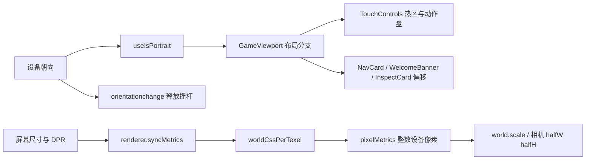

## 产品概述
《牛马》H5 游戏页 `/play` 目前会把手机竖屏强制转成横屏（请求横屏锁，失败时再用 CSS 旋转舞台兜底）。本次改为按设备真实朝向呈现：竖屏可直接游玩，横屏保持现状，并彻底移除自动横屏。

## 核心功能
- 移除自动横屏：不再请求横屏锁、不再旋转舞台；旋转设备时布局即时切换，不闪屏、不裁切。
- 保留全屏：进园首次点击仍自动全屏（只为隐藏浏览器地址栏），右上角全屏按钮保留。
- 竖屏视野自适应：按屏宽降低一档世界倍率，人物略小、左右多看约三成场景。
- 竖屏专用触控：浮动摇杆限定在左下区域生成；动作盘改为 2 列×3 行，打字主键靠右下。
- 竖屏 HUD 重排：顶栏右侧分两行、退出按钮图标化；聊天浮层、导览卡、欢迎条、轻提示、他人工牌互不重叠。
- 横屏回归：动作盘 3×2、顶栏单行、浮层偏移与现网一致；桌面 HUD 完全不变。
- 可访问性：图标按钮保留 aria-label 与 title；触控目标不小于 44px；摇杆描述随朝向变化。

## 范围边界
仅 `apps/web` 的 `/play` 页面；首页、捏人页、服务端协议与存档不改。

## 视觉结果
竖屏为满屏像素园区：左上工牌、右上两行小控件、左下浮动摇杆、右下两列动作盘；不出现旋转、横向溢出或控件压住操作区。


## 技术栈
- Next.js 15 App Router + React 19 + TypeScript + Tailwind CSS v4（沿用现有工程，不引入新依赖）。
- 渲染层 PixiJS v8（`apps/web/lib/game/renderer.ts`）；测试用 Bun（`bun test lib`）；包管理 pnpm + turbo。
- 朝向判定用 `matchMedia('(orientation: portrait)')`；不依赖 `screen.orientation`。

## 实现策略
1. **把朝向降级为布局变量**：删除「横屏锁 + CSS 旋转舞台 + 摇杆坐标补偿」这条链路；`useImmersiveStage` 只负责全屏，不再接触 orientation API；新增 `useIsPortrait()` 供 HUD 与触控层切换。
2. **竖屏取景自适应**：在 `pixel-scale.ts` 新增纯函数 `worldCssPerTexel(width, height, base, targetTexels)`：横屏或宽窗口原样返回 `base`（1.5）；竖屏按 `width / 360` 求值并取 `min(base)`，只降不升、下限 1。`renderer.syncMetrics` 每次尺寸/DPR 变化时用它算 `pixelMetrics(...)`，继续遵守「每纹素整数设备像素」（ADR-0005）。`?zoom=` 作为显式锁定值，命中时跳过自适应，保留线上灰度回退能力。
3. **竖屏触控布局**：`Joystick` 热区横屏 `inset-y-0 left-0 w-[54%]`，竖屏 `bottom-0 left-0 h-[58%] w-[56%]`；`TouchActions` 竖屏 2 列×3 行 56px、打字键 64px，横屏维持 3×2 60px + 68px。轻点坐标从「热区 offset」改为 `clientX/clientY`，由 `GameViewport` 用 `hostRef.getBoundingClientRect()` 换算舞台局部坐标，避免局部热区导致点选偏移。
4. **HUD 重排**：竖屏右列改两行（在线徽标一行；音效/全屏/下班一行），下班入口只留图标但保留 aria-label/title/`data-no-immersive`；工牌外层补 `min-w-0` 允许省略号。浮层 bottom 偏移竖屏抬到 `212px`（动作盘 184 + 安全区）；`NavCard` 在竖屏且聊天展开时收起。
5. **性能与可靠性**：`syncMetrics` 已有「尺寸/DPR 未变即返回」的短路，新增计算只在旋转/换屏时发生，O(1)、无逐帧分配；摇杆仍只写 `transform`，不触发 React 重渲染。方向切换时摇杆立即归零，避免角色继续滑行。

## 关键取舍
- 竖屏人物高度由约 72–80px 降到约 48–64px（随 DPR 与设备像素取整），换取 360+ 纹素的横向视野；`?zoom=` 可一键回退。
- DPR 1 屏受 `MIN_DEVICE_PX_PER_TEXEL = 2` 限制，竖屏无法真正再缩小；属已知限制，需在函数注释中写明，不做特例。
- 竖屏退出按钮文字改为图标，靠 aria-label/title 保可访问性，换来 360px 宽顶栏不溢出。
- 横屏与桌面走原分支，改动面收敛在触控与朝向判定，避免影响现有观感。

## 架构设计
朝向与取景是两条独立输入：朝向只决定 HUD/触控布局；屏幕尺寸只决定世界倍率。二者都收敛到现有组件与渲染器，不新增全局状态或服务。



## 实施要点
- `stickVector` 去掉 `rotated` 参数后同步删除 `joystick.test.ts` 的旋转用例；其余「同半径同速 / 死区 / 圆外钳制」用例保留。
- `GameViewport` 宿主的 `onPointerUp` 与摇杆轻点统一走同一条 `clientX/clientY` 换算路径，保证两种入口坐标口径一致。
- 顶栏 360px 预算：左右安全区 24 + 工牌 200 + 间距 12 + 图标行 124 = 360，刚好不溢出；工牌必须可截断。
- 删除 `.game-safe-rotated`，只保留 `.game-safe`；`ChatDock` 内「旋转舞台的 dvh」注释同步更新，避免误导后续维护。
- 不改历史 ADR，不主动新增文档文件；如需留档可另开 ADR-0037。
- 无新增日志需求；沿用现有 `console.error('[game] session failed')` 口径，不上报任何用户数据。

## 目录结构
```
apps/web/
├── app/
│   └── globals.css                     # [MODIFY] 删除 .game-safe-rotated，安全区只保留 .game-safe
├── components/game/
│   ├── GameViewport.tsx                # [MODIFY] 删除旋转舞台与 rotated；引入 useIsPortrait；顶栏/浮层重排；点选坐标改 rect 换算
│   ├── TouchControls.tsx               # [MODIFY] 摇杆热区随朝向；动作盘 2 列；onTap 改传 client 坐标
│   ├── NavCard.tsx                     # [MODIFY] 新增 portrait 可选属性，竖屏聊天展开时收起，避免与 250px 聊天浮层重叠
│   ├── WelcomeBanner.tsx               # [MODIFY] 新增 portrait 可选属性，竖屏 bottom 偏移 212px 并调整提示文案
│   └── ChatDock.tsx                    # [MODIFY] 仅更新旋转舞台相关注释，宽度与交互不变
├── lib/
│   ├── use-touch-stage.ts              # [MODIFY] 删除 useLandscapeStage 与 orientation 锁；新增 useIsPortrait；useImmersiveStage 去掉 lockLandscape
│   └── game/
│       ├── joystick.ts                 # [MODIFY] stickVector 去掉 rotated 分支，只处理屏幕向量
│       ├── pixel-scale.ts              # [MODIFY] 新增 worldCssPerTexel 纯函数与竖屏目标纹素常量
│       ├── renderer.ts                 # [MODIFY] init 与 syncMetrics 接入朝向倍率；?zoom 作为锁定覆盖
│       └── __tests__/
│           ├── joystick.test.ts        # [MODIFY] 删除旋转用例，保留同速/死区/钳制断言
│           └── pixel-scale.test.ts     # [MODIFY] 新增横屏不变、竖屏降低、平板不变、宽高为零回退的用例
```

## 关键接口
```ts
// apps/web/lib/use-touch-stage.ts
export function useIsPortrait(): boolean;
export function useImmersiveStage(): ImmersiveStage; // 不再接收 lockLandscape

// apps/web/lib/game/pixel-scale.ts
export const PORTRAIT_TARGET_TEXELS: number;
export function worldCssPerTexel(width: number, height: number, base: number, targetTexels?: number): number;

// apps/web/components/game/TouchControls.tsx
onTap?: (clientX: number, clientY: number) => void;
```


## 设计风格
沿用园区既有的「工业像素 HUD」：暖褐墨底、薄荷冷光强调、2px 硬边、终端等宽小字，不换肤、不加圆角卡片。竖屏只做重排与尺寸适配，视觉语言与横屏完全一致。

## 竖屏信息架构
- **顶部安全区**：左侧工牌胶囊（折叠时仅名字与物种，展开可看状态与统计）；右上两行——第一行在线徽标，第二行 36px 方形按钮组：音效、全屏、下班（仅图标）。
- **主画布**：满屏像素园区，相机居中跟随，无遮罩、无旋转容器；安全区留白为 12px。
- **左下摇杆区**：占屏宽 56%、屏高 58%，任意落点按下生成 112px 浮动基座与 44px 摇杆头；内环为满力边界，松手淡出并归零；空闲时左下角保留虚线基座与「移动」微文案。
- **右下动作盘**：2 列×3 行 56px 圆形动作键（跳/招手/叫唤/坐下/躺平/互动），右侧 64px 薄荷描边「打字」主键，整体贴右下安全区；按下 8ms 震动、active 态缩放 95%。
- **浮层秩序**：聊天浮层 250px 挂在工牌下方；导览卡 196px 在右上，聊天展开时收起；欢迎条、轻提示、他人工牌统一抬到动作盘上方 212px，互不遮挡。

## 横屏与桌面
- 横屏手机恢复 3 列×2 行 60px 动作盘与 68px 打字键，顶栏右列单行，浮层偏移回到 148/152/160px。
- 桌面 HUD 不变：聊天、动作条、小地图、他人工牌仍按原布局常驻。

## 交互与动效
- 朝向切换：摇杆立即释放回零，布局用 150ms ease-out-expo 过渡；不新增 bounce/elastic 缓动。
- 触控命中区：最小 44px，竖屏主键 56/64px；图标按钮保持 aria-label 与 title。
- 响应式：320–430px 竖屏宽度不溢出；平板竖屏（540px 以上）不触发降倍率；安全区统一用 env(safe-area-inset-*)。

## Agent Extensions
### Skill
- **impeccable**
  - Purpose: 对竖屏与横屏的 HUD 改动做 shape/polish 与反模式自检，重点覆盖触控命中区、布局密度、浮层层级、安全区与动效。
  - Expected outcome: 竖屏无溢出、控件层级清晰、横屏观感不回归，并产出可执行的打磨清单落实到组件。
- **verification-before-completion**
  - Purpose: 收尾前运行 `bun test lib`、`tsc --noEmit` 与 `next build`，确认没有类型、测试与构建回归。
  - Expected outcome: 三条命令全部通过，并给出与本次改动对应的验证证据。
