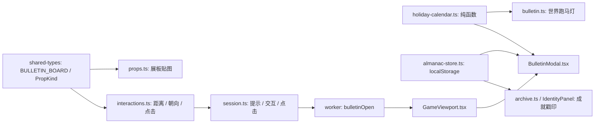

## Product Overview
中央迎宾广场北缘新增一块常驻的「牛马放假告示板」，与西侧牛马榜对称而立，出生点抬头即见。板顶悬浮一行薄荷绿跑马灯，走近面朝它按 F 或点击即可展开软木看板，查看本周下班倒计时、最近三个法定假日与当日黄历，还能敲赛博木鱼攒成就。

## Core Features
- **地标与碰撞**：80×48 的双立柱木牌，只有底部 80×20 挡人，可从上方、左右贴近；玩家在 64px 内且面朝公告板时提示 `[F] 查解放假倒计时`。
- **世界跑马灯**：常驻三句轮播（周五下班倒计时 / 春节 / 元旦），每 6 秒平滑滚动切换；周五 18:00 至周一 09:00 改显示「合法摸鱼周末进行中」。
- **本周下班冲刺**：秒级跳动的大号绿色时钟 `02天 06小时 41分 28秒`，下方用进度条展示本周工时已消耗百分比。
- **最近假日**：覆盖元旦、春节、清明、劳动节、端午、中秋、国庆，自动过滤过期节日，按时间排序取最近 3 个，标注剩余天数与连休预期。
- **今日牛马黄历**：按公历日期确定性抽取「宜」2 项、「忌」2 项与一句评语，保证同一天所有人看到同一份。
- **赛博木鱼**：点击或按空格敲击，播放合成的空灵音效并向上飘出金色像素微词；当天累计 20 次永久解锁工牌成就「急急急放假人」。
- **焦点与输入法**：Esc 或点击遮罩收起，焦点无缝归还游戏画布；中文输入法组合期间的空格不会误触木鱼。

## Visual Effect
外观是复古像素软木板：深木双立柱、斜切木纹、铜钉、泛黄便签与日历撕页，顶部挂红色小横幅；文字用薄荷绿霓虹与暖木色对比，整体与园区既有暖色 ink 界面一致。弹窗打开像把公告板拉到眼前，便签略歪、图钉有投影，敲木鱼时金钟轻震、金色小字上浮。


## Tech Stack Selection
- Monorepo：pnpm + Turborepo；`@niuma/shared-types` 为纯 TS 静态世界真相；`apps/web` 为 Next.js 15 + React 19 + Pixi v8 + Tailwind v4 + zustand。
- 测试：`apps/web` 用 `bun test lib`；`packages/shared-types` 用 vitest。
- 不新增任何依赖、不改服务端、不新增网络协议；唯一持久化是浏览器 `localStorage`（敲击次数与成就），符合 ADR-0004 零持久化。

## Implementation Approach
1. **世界真相只写一次**：`packages/shared-types/src/world/layout.ts` 新增 `BULLETIN_BOARD = { x: 4232, y: 3832, width: 80, height: 48 }`（底边中心锚点，与 `WELCOME_LANDMARKS.rankBoard` 的 y 对齐），并由它派生 `BULLETIN_BOARD_SOLID = { kind: 'prop', x: 4192, y: 3812, w: 80, h: 20 }`，推入 `HUB_SOLIDS`。底座只挡 20px，不侵入出生 56px 圈，牌面 4192–4272 完全避开 112px 北向主路（4040–4152）。
2. **展板走道具管线，文本单独叠层**：`PropKind` 增加 `'bulletin'`，`WORLD_LAYOUT.props` 由 `BULLETIN_BOARD` 派生一条实例；`props.ts` 的 `PROP_SIZE.bulletin` 直接取 `BULLETIN_BOARD.width/height`，`drawProp` 增加木柱、斜切木纹、软木板、铜钉、红布横幅的像素画法。中文横幅与跑马灯不能进烘焙纹理（文本要逐帧变），放在新建的 `bulletin.ts`，与 `welcome.ts` 同一范式：Pixi `Text` + `depth.add(BULLETIN_BOARD.y + 1, root)`，保证贴在板前且被更靠南的角色正确遮挡。
3. **纯函数引擎与表现层分离**：新建 `holiday-calendar.ts`，只依赖原生 `Date` 与本地日期工具，不引入 React / Pixi / zustand；Worker 里的跑马灯与主线程弹窗共用同一套函数，杜绝两处显示不同。
4. **交互链路最短化**：`interactions.ts` 提供 `isNearBulletin()`、`facesBulletin()`、`isBulletinHit()`；`session.ts` 在既有提示轮询里插入「公告板优先」，`interact()` 与 `pickAt()` 分别处理 F 键与点击；Worker 只新增一条 `{ t: 'bulletinOpen' }` 消息，不进入服务端。
5. **弹窗按「软木看板」而不是「通用 Modal」设计**：木框 + 软木底 + 三张钉住的纸（本周冲刺 / 假日卡 / 黄历）+ 右下角木鱼，键盘与 IME 规则复用 `LeaderboardDialog` 的成熟做法，但不改动既有弹窗。
6. **成就独立于主戳印**：`almanac-store.ts` 以 `niuma.almanac.v1` 保存 `{ day, knocks, unlockedOn }`，`archive.ts` 只增加 `achievements: string[]` 字段，`IdentityPanel` 在 `StampSeal` 上方新增「已解锁成就」区，`getStampTitle` 的优先级一字不改。

### 周倒计时与假日口径
- 工作日：本周周一 09:00 至周五 18:00 共 105 小时；`remainingMs = 周五18:00 - now`。
- 周末态：周五 18:00 起至下周一 09:00（含周一 00:00–09:00）返回 `state: 'IS_WEEKEND'`，同时给出 `weekendRemainingMs`。
- 假日表：固定日期元旦 01-01、劳动节 05-01、国庆 10-01；农历对照表 2026–2028：春节 2026-02-17 / 2027-02-06 / 2028-01-26，清明 2026-04-05 / 2027-04-05 / 2028-04-04，端午 2026-06-19 / 2027-06-09 / 2028-05-28，中秋 2026-09-25 / 2027-09-15 / 2028-10-03。表外年份的春节返回「日期待更新」，绝不猜日期。
- 连休预期：元旦 3、春节 8、清明 3、劳动 5、端午 3、中秋 3、国庆 7（文案标注「预期」）。
- 天数按本地零点相减后 `Math.round`，避免夏令时 23/25 小时日造成差一天；日期键不得用 `toISOString()`。
- 黄历：djb2 按码点哈希日期字符串，取两个不重复下标抽宜、忌各 2 项， motto 再用高位取一次；同日期恒定。

## Implementation Notes
- **Performance**：跑马灯每帧只写 `position.x`，`Text.text` 仅在秒数或轮播槽变化时更新（≤1Hz），避免每帧重排字形；弹窗用 1Hz state 驱动，`dailyAlmanac` / `upcomingHolidays` 按日期 `useMemo`，不做逐帧 React 渲染。假日计算是常数级（7 个节日 + 3 条农历），可忽略。
- **Worker 约束**：`holiday-calendar.ts` 不得 import `attendance.ts`（后者带 zustand store）。把本地日期键抽到纯模块 `local-date.ts`，`attendance.ts` 以 `export { localDateKey as dayKey }` 保持旧 API，纯粹是为了让 Worker 引擎不背 UI 依赖。
- **文字清晰度**：跑马灯 7px、`resolution = devicePxPerTexel`、坐标 `Math.round`；字体栈带 `'Apple Color Emoji','Segoe UI Emoji','Noto Color Emoji'` 兜底，emoji 缺字形时正文仍可读。
- **点击与 F 一致**：只有 64px 内点击牌面才打开，远处点击 `showHint('走近一点再看')`；命中矩形用牌面 80×48，不使用底座。
- **IME**：capture 阶段 `keydown` 先判 `event.isComposing || event.keyCode === 229`；`Space` 在可交互元素上只 `stopPropagation`（让按钮正常激活），在空白处才 `preventDefault + strike`；忽略 `event.repeat` 防止长按连击。
- **焦点**：打开时 `activeElement.blur()` 并聚焦面板；卸载时 `blur()` 后按 `[aria-label="游戏视口"] canvas` 选择器归还焦点，与 `LeaderboardDialog` 完全一致。
- **爆炸半径**：所有既有弹窗、协议、`getStampTitle` 行为保持不变；新增 worker 消息是纯追加，旧路径不受影响。世界坐标改动属静态内容，需前后端同版本发布（本次服务端无改动）。
- **存储健壮性**：`localStorage` 读取 try/catch + 字段校验，损坏时回落默认值；SSR 下返回默认值，避免水合告警。

## Architecture Design

- **分层**：静态世界（shared-types）→ 纯计算（holiday-calendar / almanac 纯函数）→ 适配层（Pixi Worker 视图、React 弹窗）→ 交互桥（interactions / session / worker 消息）。
- **数据流**：`Date.now()` → 引擎 → 跑马灯文字（Worker）或弹窗内容（主线程）；无网络、无服务端状态。
- **边界**：UI 不自己算日期，引擎不碰 DOM / Pixi / store，store 只做本地读写。

## Directory Structure
```
packages/shared-types/
├── src/world/layout.ts                     [MODIFY] 新增 BULLETIN_BOARD / BULLETIN_BOARD_SOLID / bulletin 道具实例；HUB_SOLIDS 追加底座；注释记录与牛马榜对称、避开北向主路的取舍。
├── src/world/campus.ts                     [MODIFY] PropKind 增加 'bulletin'；注释说明底座碰撞由 layout 的 HUB_SOLIDS 单独登记，不进 PROP_FOOTPRINT。
└── src/__tests__/bulletin-board.test.ts    [NEW] 断言 80×48 / 80×20、出生圈外、x=4096 通道无阻挡、不与牛马榜和长椅碰撞重叠、牌面四角在广场内。

apps/web/
├── app/globals.css                         [MODIFY] 新增软木纹理工具类、图钉落定与金色飘字 keyframes，沿用 --ease-out-expo。
├── components/BulletinModal.tsx            [NEW] 软木看板弹窗：木框、红布标题、三张钉住的便签、假日卡、宜忌、页脚；焦点陷阱、Esc/遮罩关闭、Space 与 IME 守卫。
├── components/bulletin/FishDrum.tsx        [NEW] 像素木鱼/金钟、敲击节流、金色飘字队列、今日 N/20 与解锁提示；导出 useFishDrum 供弹窗键盘调用。
├── components/badge/IdentityPanel.tsx      [MODIFY] 在 StampSeal 上方增加「已解锁成就」标签区，仅在有成就时渲染。
├── components/badge/SelfArchiveDialog.tsx  [MODIFY] 读取 readAchievements() 并传入 buildSelfArchive。
├── components/game/GameViewport.tsx        [MODIFY] bulletinOpen state、openBulletin/closeBulletin、onBulletinOpen 回调、渲染弹窗；公告板提示改右下角（桌面）。
├── lib/game/holiday-calendar.ts            [NEW] 周末倒计时、周进度、节假日表与最近 3 个、nextHoliday、djb2 黄历、格式化与跑马灯文案；纯函数无副作用。
├── lib/game/local-date.ts                  [NEW] localDateKey / startOfLocalDay 纯日期工具；attendance.dayKey 改为再导出，避免 Worker 拉入 zustand。
├── lib/game/bulletin.ts                    [NEW] BulletinView：红色横幅文字、薄荷绿跑马灯容器 + mask、6 秒三槽轮播；导出 tickerSlot/tickerOffset 纯函数供测试。
├── lib/game/props.ts                       [MODIFY] PROP_SIZE.bulletin 取自 BULLETIN_BOARD；drawProp 增加双木柱、木纹、软木板、铜钉、红布横幅。
├── lib/game/renderer.ts                    [MODIFY] 构造 / 逐帧 update / setTextResolution / destroy BulletinView；抽出 worldPointAt 供点击命中复用。
├── lib/game/interactions.ts                [MODIFY] BULLETIN_INTERACT_RANGE=64、isNearBulletin、facesBulletin、isBulletinHit。
├── lib/game/hint-copy.ts                   [MODIFY] HINT.bulletin「按 F 查解放假倒计时」+ 触屏「点「互动」查解放假倒计时」。
├── lib/game/session.ts                     [MODIFY] 提示优先级加入公告板；interact 打开公告板；pickAt 命中牌面并按距离决定打开或提示；新增 onBulletinOpen 回调。
├── lib/game/almanac-store.ts               [NEW] 每日敲击累计、20 次永久解锁、读成就；导出 applyFishKnock 纯函数，localStorage 读写带校验与 SSR 守卫。
├── lib/game/woodfish-audio.ts              [NEW] 纯 Web Audio 一次性合成：正弦基频 + 泛音 + 指数衰减 + 短延迟，`sfx.isMuted` 时静默，60ms 节流。
├── lib/game/archive.ts                     [MODIFY] BadgeArchive/SelfArchiveInput 增加 achievements，buildSelfArchive 透传，buildRemoteArchive 返回空数组。
├── lib/game/runtime/worker-protocol.ts     [MODIFY] 追加 { t: 'bulletinOpen' }。
├── lib/game/runtime/worker-host.ts         [MODIFY] onBulletinOpen 转发 post({t:'bulletinOpen'})。
├── lib/game/client/worker-client.ts        [MODIFY] 新增 case 'bulletinOpen' 派发回调。
├── lib/game/__tests__/holiday-calendar.test.ts [NEW] 周五 18:00 / 周一 09:00 边界、周末态、过期过滤、三年农历表、djb2 稳定、宜忌各 2 且不重复、周进度 0/100。
├── lib/game/__tests__/bulletin-ticker.test.ts  [NEW] 6 秒槽位循环、出画与回位偏移、长文本连续滚动。
├── lib/game/__tests__/almanac-store.test.ts    [NEW] 跨日重置、20 次解锁且只触发一次、损坏数据回落。
├── lib/game/__tests__/interactions.test.ts     [MODIFY] 64px 边界、朝向判定、牌面点击命中、NaN 防护。
├── lib/game/__tests__/bulletin-modal.test.tsx  [NEW] 静态渲染断言三个板块、宜忌、木鱼进度与成就文案。
└── data/release-notes.json                 [MODIFY] 追加 2026-11-12-3「广场北侧开张放假公告板」，最多 3 条玩家可感知改动。

docs/adr/0058-holiday-bulletin.md           [NEW] 记录零持久化、坐标取舍、Prop 管线与独立文本层、localStorage 成就边界、回滚方案与验证清单。
```

## Key Code Structures
```ts
// packages/shared-types/src/world/layout.ts
export const BULLETIN_BOARD = { x: 4232, y: 3832, width: 80, height: 48 } as const;
export const BULLETIN_BOARD_SOLID: WorldRect = {
  x: BULLETIN_BOARD.x - BULLETIN_BOARD.width / 2, // 4192
  y: BULLETIN_BOARD.y - 20,                        // 3812
  w: BULLETIN_BOARD.width,
  h: 20,
};
```
```ts
// apps/web/lib/game/holiday-calendar.ts
export type WeekendState = 'WEEKDAY' | 'IS_WEEKEND';

export interface WeekendCountdown {
  state: WeekendState;
  targetMs: number;          // 周五 18:00；周末态为刚过去的那个周五
  remainingMs: number;       // 工作日剩余；周末态为 0
  weekendEndsAt: number;     // 下周一 09:00
  weekendRemainingMs: number;
  days: number; hours: number; minutes: number; seconds: number;
}

export function weekendCountdown(now?: number): WeekendCountdown;
export function weekProgress(now?: number): { percent: number; totalMs: number };
export function upcomingHolidays(now?: number, limit?: number): Holiday[];
export function dailyAlmanac(dateKey: string): Almanac;
export function tickerMessages(now?: number): readonly [string, string, string];
```


## 设计风格
复古像素软木看板与园区暖色 ink 语汇结合：真实材质感（深木框、软木颗粒、泛黄纸、彩色图钉、红布横幅）叠加薄荷霓虹数字，既像手作告示板，又和现有 HUD 的 Oswald / JetBrains Mono 排版同源。拒绝通用玻璃拟态弹窗与纯灰界面。

## 整体结构
全屏遮罩（黑 75% + 2px 模糊）之上是 6px 木框包裹的软木看板，宽度 min(520px, 96vw)，高度 min(660px, 92dvh)。顶部红布横幅写「牛马放假告示板」，下方依次是三张略歪的便签：本周下班冲刺、最近假日、今日黄历；右下角木鱼从页脚探出。移动端三张便签纵向堆叠，内容区独立滚动，木鱼保持右下角可点。

## 分块设计
- **A 本周下班冲刺**：深 ink 电子钟纸条，薄荷绿等宽大字 `02天 06小时 41分 28秒` 秒级跳动；下方 6px 高进度条，mint 填充、amber 刻度，右侧标「已消耗 63%」；周末态改为「合法摸鱼周末进行中」并显示周末剩余。
- **B 最近假日**：三张撕页日历卡横向排列（移动端纵排），每张顶部一枚彩色图钉，主标题大字、下面「还有 42 天」与「连休 8 天」两行；最近的一个加 amber 边框与「最近」小签。
- **C 今日黄历**：左右两栏「宜 / 忌」，各两行，宜用 mint、忌用 signal；底部一句手写感评语，纸面带一道淡横线，像便签本。
- **D 赛博木鱼**：右下角 64×52 像素木鱼，深木鱼身、金色铜环与木槌；敲击时整体下沉 2px、木槌转 12 度，上方飘出金色像素词并淡出；下方「今日 N / 20」，解锁后出现旋转 15 度的 amber 印章。
- **E 页脚**：左侧「Esc 收起 · 空格敲木鱼」，右侧刷新式关闭按钮；桌面提示在右下，触屏提示居中，避免压住动作盘。

## 动效与交互
面板 180ms 从下方 4px 落定；便签依次 40ms 错峰淡入；图钉有 1px 投影；进度条 600ms 缓动；木鱼音效与飘字同步，60ms 内重复敲击合并；所有动效尊重 prefers-reduced-motion。焦点进入面板，Tab 循环，Esc / 遮罩关闭，关闭后焦点回到画布。

## 可访问性
role=dialog + aria-modal + aria-labelledby；倒计时数字对读屏 `aria-live="off"`，另给一句每分钟更新的可读摘要；木鱼按钮有明确 aria-label 与 44px 命中区；宜忌不只靠颜色区分，带「宜」「忌」文字标签；对比度满足 AA。

## 字体
标题 Oswald 600；数据与倒计时 JetBrains Mono 600 tabular-nums；正文 PingFang SC；英文小标签 JetBrains Mono 大写加字距。

## Agent Extensions
### Skill
- **impeccable**
  - Purpose: 为世界展板与软木看板弹窗做视觉定型与收尾，检查字体、间距、配色、动效、响应式与可访问性。
  - Expected outcome: 弹窗与展板在 390×844 与 1280×720 下均无溢出、无低对比文字、无通用模板感，交互态完整。
- **principal-software-architect**
  - Purpose: 把「零持久化 + 单一世界真相 + 纯前端计算」的取舍写成 ADR-0058，并给出可回滚路径。
  - Expected outcome: 一份含 Context / Decision / Options / Consequences / Tests 的决策记录，明确坐标、碰撞、存储边界与回滚窗口。
- **test-driven-development**
  - Purpose: 先为周倒计时、节假日过滤、黄历哈希与敲击解锁写失败测试，再实现纯函数。
  - Expected outcome: 边界（周五 18:00、周一 09:00、表外年份、跨日重置）全部被测试钉住。
