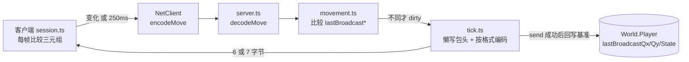

## 产品概述
这是一款多人像素园区产品，玩家大部分时间在工位上坐着不动，但服务端目前对“坐着不动”和“边走边聊”一视同仁地全速广播，导致 5M 带宽只够 60 人。本次改动把下行与上行都改成“有变化才发包”，再把同步条目从 7 字节压缩到 6 字节，使同一条带宽线路能承载更多在线人数。

## 核心功能
- **静态不再产生流量**：玩家坐标与状态（朝向、姿态、叫唤、跳、挥手）都没变时，服务端不再向任何观察者发送该玩家的同步条目；坐下、站定、发呆的人群下行趋近于 0。
- **只在变化时上行**：客户端站立不动时上行从 20Hz 降到 4Hz（250ms 保活）；一旦移动、转向、起坐、叫唤、跳、挥手，立即恢复 20Hz。
- **叠加动作不残留**：叫唤、跳、挥手动画在本地到期后，必须在 50ms 内发一包把标志位降下来，否则远端会永久循环播放。
- **同步条目瘦身**：单条实体增量由 7 字节压缩到 6 字节，位置精度从 1/8 像素降到 1/4 像素（肉眼不可见）。
- **新旧版本共存**：未刷新页面的旧客户端仍收到原 7 字节格式，不会报错断线；服务端按每个客户端声明的能力选择编码格式。
- **防瞬移**：上行变稀疏后，服务端速度校验的时间窗必须封顶，避免“站 10 秒再走”被放大成一次瞬移。
- **可验证**：压测机器人新增“全体静止”模式，能跑出改动前后的单客户端下行对比；文档给出 5M 机器的容量建议值。

## 视觉与体验效果
玩家侧几乎感觉不到差别：别人的走动依旧平滑跟手，坐下、起立、叫唤、挥手都能正常看到并正常结束；只有在人群静止时会明显感到网络流量骤降、卡顿减少、同屏人数上限提高。


## 技术栈
沿用现有栈，不引入任何新依赖：Bun + TypeScript 单进程游戏服、`packages/shared-types` 手写二进制协议、Next.js 客户端、Bun 压测机器人、Vitest 单测。

## 实施策略

### 核心思路
把“广播”从**时间驱动**改为**变化驱动**，两端对称：

```
服务端：收到 MOVE → 量化 (qx,qy) → 与「上次真正广播出去的三元组」比较 → 不同才 dirty
客户端：每帧打包 (qx,qy,state) → 与「上次真正发出去的三元组」比较 → 不同才发（20Hz 上限），否则 250ms 保活
```

比较对象必须是“上次真正发出去的值”（`lastBroadcast*` / `lastSent*`），不能是“上一帧算出来的值”，否则同一 Tick 内来回抖动会漏发或多发。

### 关键决策与理由

**1. 去脏的判定放在 `applyMove`，记录放在 `runTick`**
- `applyMove` 只负责算与比较，`runTick` 在真正写入包后回写 `lastBroadcast*`。这样“本 Tick 没发出去”不会污染基准值。
- `seats.ts` 的 sit/stand/lie 仍无条件 `dirty = true`：座位吸附会改坐标与姿态，属于真实变化，且频率极低。

**2. 6 字节条目的位分配（已被 15 bit 边界逼出来的唯一解）**
- 6 字节 = 48 bit；`STATE_BITS` 用满 8 位不可压（`quantize.ts:66-74`），剩 40 bit 给 id + x + y。
- 1/8 px 下 x/y 各需 16 bit（8192px × 8 = 65536），只剩 8 bit 给 id，只能 256 个 id，**不可行**；偏移基址也不行（岛屿 y 跨度 33696 单位 > 32767）。
- 因此同步条目内部改用 **1/4 px**（15 bit 正好覆盖 8192px），配 10 bit id + 8 bit state = 48 bit。位置误差 ≤0.25px，世界放大 1.5 倍后屏幕上 ≤0.375px。
- 解码后把 1/4px 左移一位还原成 1/8px 单位，`visitSync` 与 `dequantizeCoord` 全部不用改。

**3. 兼容性用“包长自描述”，不新增 OpCode**
- 服务端按 `player.syncFormat` 编码：能力协商走 HELLO 尾部 `[0xfd][format]`，沿项目既有 `STATUS_EXTENSION_MAGIC=0xff` / `ONLINE_EXTENSION_MAGIC=0xfe` 的魔数惯例；`0xfd > MAX_STATUS_BYTES(48)`，不可能是合法状态长度。
- 旧服务端：`decodeHello` 只在剩余 ≥8 字节且首字节 ≠0xff 时解析 resume，2 字节能力段会被安全忽略（`protocol.ts:513-538`）。
- 客户端解码按长度自适应：`count*6` 走紧凑、`count*7` 走旧格式、其它抛错。6≠7 无歧义，因此旧服务端 + 新客户端也能正常显示。
- 这样旧标签页不会因为 `payload mismatch` 直接 throw（`protocol.ts:311-315` 现在的行为）。

**4. 速度窗口必须同时封顶**
- `movement.ts:94-96` 的 `elapsed` 目前无上限，客户端改成 250ms 保活后，“站着不动很久再走”会拿到一个巨大的 `allowed`。
- 封顶 250ms（5 个 Tick）：`allowed ≈ 165×0.25×1.25+3 ≈ 55px`，既能吸收抖动丢包，又把瞬移压到一次 ≤55px。

**5. ID 收窄到 10 bit 的连带影响**
- `MAX_ENTITIES` 1024 → 1023，`World.nextId` 回绕从 `0xfffe` 改为 `0x3ff`。准入容量远低于此，无实际影响。
- `S2C_ENTITY_SPAWN` 仍用 u16 id，不受影响。

### 性能与可靠性

| 项 | 改动前 | 改动后 |
|---|---|---|
| 静态人群单客户端下行 | 8.12 KB/s（60 人满载实测） | ≈ 0（只剩 2s 一次的 ping/pong） |
| 单条实体增量 | 7 B | 6 B（-14%） |
| 客户端空闲上行 | 280 B/s（14B×20Hz） | 56 B/s（14B×4Hz） |
| Tick 内空包头写入 | 每人每 Tick 7 B | 0（懒写，无条目就不写） |

- 去脏后带宽水位下降，AIMD 会把容量往 `GAME_MAX_ONLINE` 涨，瓶颈会从带宽转到 CPU/人数维度。这是预期行为，不是回归；文档要写清水位主导维度的变化。
- 合并包、降 Tick 频率等不做：会牺牲手感，且当前带宽才是瓶颈。

### 风险与规避

| 风险 | 规避 |
|---|---|
| 叠加动作结束却没发包，远端永久循环动画（`applyOverlayBit` 无远端过期，`session.ts:465-471`） | 变化检测覆盖 emote/jump/wave 位；单测必须锁定“到期后 ≤50ms 内必发一包” |
| 旧标签页在新服务端上解析崩 | HELLO 能力协商，默认按旧格式编码 |
| 稀疏上行放大瞬移窗口 | `elapsed` 封顶 250ms |
| 去脏基准值被“没发出去的 Tick”污染 | 只在 `transport.send` 成功后回写 `lastBroadcast*` |
| 坐下瞬间被误判成“没变” | 座位吸附改变量化坐标，必然命中变化 |

## 架构设计

改动集中在三层，依赖方向不变：协议层（`shared-types`）只提供编解码与常量，不知道 World；仿真层（`sim`）持有比较基准；传输层（`server.ts`）只做 hello 字段搬运。



## 目录结构

```text
packages/shared-types/src/
├── constants.ts                 # [MODIFY] 新增 SYNC_ENTRY_BYTES_COMPACT=6、SYNC_COORD_SCALE=4、
│                                #   SYNC_CAPABILITY_MAGIC=0xfd、SYNC_FORMAT_COMPACT=1、MAX_ENTITY_ID=0x3ff；
│                                #   MAX_ENTITIES 1024→1023。所有字面量只在这里定义一次
├── quantize.ts                  # [MODIFY] 新增同步条目专用的 1/4px 量化/反量化（不改现有 quantizeCoord 语义）
├── protocol.ts                  # [MODIFY] writeSyncEntryCompact（按位表写 6 字节）、readSync 按包长自适应 6/7 字节、
│                                #   encodeHello 增加能力段参数、decodeHello 返回 syncFormat（缺省 0）
└── __tests__/protocol.test.ts   # [MODIFY] 紧凑条目往返、id=1023 / 坐标=8191.75 / state=255 边界、
                                 #   旧 7 字节包仍可读、6 与 7 混合长度必须抛错

apps/game-server/src/
├── sim/world.ts                 # [MODIFY] Player 增加 lastBroadcastQx/Qy/State 与 syncFormat；nextId 回绕 0x3ff
├── sim/movement.ts              # [MODIFY] 座位分支与常规分支的 dirty 改为三元组比较；elapsed 封顶 250ms
├── sim/tick.ts                  # [MODIFY] 懒写包头（首条条目到来才写 7 字节头）、按 viewer.syncFormat 选编码、
                                 #   send 成功后回写 lastBroadcast*；syncCount===0 不碰缓冲
├── server.ts                    # [MODIFY] handleHello 把 decodeHello 的 syncFormat 写入 Player
├── bench/bots.ts                # [MODIFY] BENCH_IDLE=1 时机器人只发一次入场与保活、不移动；
                                 #   汇总行增加“每 bot 下行”与格式标识，便于前后对比
└── sim/__tests__/
    ├── movement.test.ts         # [MODIFY] 重复同一包不置 dirty；位移/转向/姿态变化置 dirty；窗口封顶后 allowed 有上界
    └── tick.test.ts             # [NEW] 静态人群 syncCount=0 且不调用 send；混合场景只发变化实体

apps/web/lib/
├── game/move-send.ts            # [NEW] 纯函数：shouldSendMove(prev, next, sinceLastMs) → boolean，
│                                #   封装“变化即发 / 250ms 保活 / 50ms 下限”三条规则，便于单测
├── game/session.ts              # [MODIFY] 每帧打包三元组交给 shouldSendMove；命中即发；删除无条件 sendMove 调用
├── game/__tests__/move-send.test.ts # [NEW] 静止不发、转身即发、移动 20Hz、250ms 保活、叠加位清零立即放行
└── net/client.ts                # [MODIFY] encodeHello 带上 0xfd 能力段（声明支持紧凑格式）

docs/
├── adr/0039-idle-dirty-and-compact-sync.md  # [NEW] 记录去脏、6 字节位表、能力协商、速度窗口封顶与回滚路径
├── adr/0009-admission-queue.md               # [MODIFY] 修订容量推导（7→6 字节、静态人群不再计入）与复核信号
└── ../README.md                              # [MODIFY] 更新实测表与压测命令；写明 5M 建议 GAME_MAX_ONLINE=100

```

## 关键结构

6 字节条目位表（小端，48 bit，解码后坐标左移一位还原成 1/8px 单位）：

```text
bit  0..9    id        (10 bit, 1..1023)
bit 10..24   x @1/4px  (15 bit, 0..32767 → 0..8191.75px)
bit 25..39   y @1/4px  (15 bit, 0..32767)
bit 40..47   state     ( 8 bit, 与 packState 完全一致)
```

服务端基准字段（`Player`）：

```ts
lastBroadcastQx: number;   // 上次真正写进别人包的 1/8px 量化坐标
lastBroadcastQy: number;
lastBroadcastState: number;
syncFormat: 0 | 1;         // 0=legacy 7B，1=compact 6B，由 HELLO 能力段决定
```

## 验收口径
- 全体静止时，`/health` 的 `egressKbps` 相对基线下降 ≥90%；单客户端 10 秒内收到的同步包数量级从 200 降到 0。
- 有条目时仍是 20Hz，`syncEntriesPerTick` 只统计真实变化。
- 叫唤/挥手/跳跃结束后远端 100ms 内停止动画（单测 + 手动验收）。
- 旧格式客户端不崩：用旧 `encodeSync` 构造 7 字节包喂给新 `readSync` 仍可解析。
- `pnpm typecheck`、`pnpm test` 全绿；`pnpm bench` 的 idle 场景能跑出前后对比数字。


## Agent Extensions
### Skill
- **tdd**
  - Purpose: 协议位打包、去脏判定、上行节流这三处都属于“边界条件密集、肉眼难以验证”的逻辑，先写失败用例再实现
  - Expected outcome: `protocol.test.ts` / `movement.test.ts` / `tick.test.ts` / `move-send.test.ts` 先红后绿，覆盖 id 1023、坐标 8191.75、叠加位到期、窗口封顶等边界
- **verification-before-completion**
  - Purpose: 在宣布完成前实际跑通 typecheck、全量单测与 idle 压测，用真实输出而非推断作为证据
  - Expected outcome: 拿到 `pnpm typecheck` / `pnpm test` 通过记录与 bench 前后对比数字，写入 README 实测表
