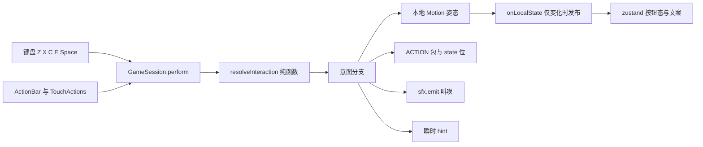

## 产品概述
园区里的牛马角色存在多处“点了没反应”的交互问题：叫唤没有声音，坐下/躺下是单向姿势无法再起身，动作按钮也不反映当前状态。本次将这些交互改为有反馈、可逆、状态可见的完整闭环。

## 核心功能
- **叫唤发声**：点击/按 C 时立刻播放叫唤音，牛与马使用不同音色；支持一键静音，静音偏好本地记住；首次交互即解锁音频，不需要额外点击授权。
- **坐下改为开关**：按 Z 坐下（附近有空位优先入座，否则原地坐），再按 Z 起身；起身时释放占用的座位。
- **躺平改为开关**：按 X 躺下，再按 X 起身。
- **座位上躺平保持无效**：坐在工位/马桶时按 X 不改变姿态，但按钮显示为不可用状态，点击后给出“先起身”的明确提示，而不是静默失败。
- **动作按钮状态可见**：坐下/躺平进入激活态并高亮，文案变为“起身”；行走中“打招呼”降级为不可用样式，点击给出“站定后才能打招呼”提示。
- **行走中叫唤**：仍然发声（动物边走边叫是合理的），但沿用现有图集约束不播叫唤动画，避免滑步。
- **其他交互修复**：
  - 长按 Z/X/C/E 不再反复触发（消除坐/起抖动与叫唤无限重播）。
  - Ctrl/Cmd/Alt + 动作键不再误触发。
  - 打开聊天输入时清空移动按键，避免松手后角色继续滑行。
  - 座位提示文案改为“按 Z 起身（移动也可）”，与新的开关语义一致。
  - 地面坐/躺起身会向服务端发送起身指令，远端视角立即同步，不再依赖下一包移动数据。

## 视觉与反馈效果
动作栏与触屏动作盘共用同一套状态：当前姿态对应按钮高亮为薄荷色描边、文案切换为“起身”；不可用按钮降低不透明度但保留可点击以触发提示；提示沿用现有底部居中的状态条样式，1.6 秒后自动消失并回落到座位/环境提示。

## 边界与约束
- 不改变协议、图集与姿态枚举，叫唤仍是与姿态正交的叠加标志位。
- 坐着叫唤依然保持坐姿，播完不会站起来。
- 坐/躺状态下按空格仍是先起身再跳。
- 座位抢座冲突仍以服务端广播为准。


## 技术栈选择
- 沿用现有栈：Next.js 15 App Router、React 19、TypeScript、PixiJS 8、zustand 5、Tailwind v4、lucide-react。
- 服务端：Bun + 现有二进制 WebSocket 协议（`OpCode`/`packState` 均不改）。
- 测试：`bun:test`。web 只跑 `lib/game/__tests__`，server 跑全量。
- 新增依赖：无。音效使用浏览器原生 Web Audio API 实时合成，不引入 mp3/wav 资源。

## 实现方案

### 1. 交互决策抽成纯函数（深模块）
新增 `apps/web/lib/game/actions.ts`，把“某个动作在当前姿态下应该发生什么”从 `GameSession.perform()` 的 if 分支里抽出来：

- `resolveInteraction(action, state)` 输入 `pose / seated / moving / seatAvailable`，输出意图：`sit-seat`、`sit-ground`、`lie`、`stand`、`jump`、`emote(animated)`、`wave`、`blocked(hint)`。
- `actionPresentation(action, pose, seated)` 输出 `{ active, unavailable }`，供桌面 ActionBar 与触屏 TouchActions 共用，避免两套组件各自判断。
- 纯函数无副作用、无 Pixi/网络依赖，可用 bun 直接跑矩阵测试；`GameSession` 只负责执行意图（改 `Motion`、发包、播音、出提示）。

关键判定：
- sit：已入座或已地面坐 → `stand`；有空位 → `sit-seat`（行走中也可吸附）；无空位且行走中 → `blocked`；否则 `sit-ground`。
- lie：已入座 → `blocked`（保留 ADR-0020）；已躺 → `stand`；行走中 → `blocked`；否则 `lie`。
- jump：始终可用，由 session 先起身再跳；行走中保留 Walk 姿态。
- emote：始终可用；`animated = 站定且非行走`，行走中只出声。
- wave：行走中 `blocked`，否则 `wave`。

### 2. 叫唤音效（Web Audio 合成）
新增 `apps/web/lib/game/sfx.ts`：

- 单例 + 懒初始化：模块顶层不触碰 `window`/`AudioContext`，首次 `emit()` 时创建 `AudioContext` 与 master gain（约 0.22），SSR 安全。
- `emit(species)`：牛为低频下滑“哞”（双振荡器 + 低通 + 缓慢 vibrato），马为带快速颤音的下滑“嘶鸣”（锯齿波 + 带通 + 13Hz vibrato）；时长约 420-480ms，与现有 440ms 叠加动作窗口对齐。
- 每次约 6 个节点，`stop()` 后 `onended` 主动 disconnect，不在帧循环里创建任何对象；90ms 节流防止连点叠音。
- `ctx.state === 'suspended'` 时在用户手势内 `resume()`；创建失败只 `console.warn` 一次并降级为静音。
- 暴露 `isMuted / setMuted / toggle`，静音值由 UI 写入 `localStorage`，模块本身不读存储。

### 3. 状态下行与提示通道
- `SessionCallbacks` 新增 `onLocalState({ pose, seated })`；session 在 tick 末尾比较 `(pose, seated)` 组合值，只在变化时回调，避免 60fps 触发 React 重渲染。
- 现有 `seatHint / onSeatHint` 改名为 `hint / onHint`，语义升级为“环境提示 + 瞬时动作提示”：session 内部维护 `overrideHint / overrideUntil`，瞬时提示优先 1.6 秒，过期后回落到座位提示；只在文案变化时通知 UI。
- `GameSession.start()` 记录 `profile.appearance.species`，`setAppearance` 同步更新，保证音色与角色一致。

### 4. 输入层加固
`apps/web/lib/game/input.ts`：

- `event.repeat` 仍然维护 `pressed` 集合（否则长按移动失效），但直接 return，不再派发动作键。
- `ctrlKey / metaKey / altKey` 组合键直接忽略，避免 Ctrl+Z 触发坐下。
- 打开聊天时由 session 调用 `input.clear()`，并保持 `inField` 判断不变。

### 5. 服务端起身语义
`apps/game-server/src/sim/seats.ts` 的 `stand()` 改为“起身”而不是“释放座位”：即使 `seat === 0`，只要姿态不是 Idle 也写回 Idle 并置 dirty。这样地面坐/躺的 `ACTION.Stand` 立即对远端生效，不必等下一包 20Hz move；`applyMove()` 里“坐姿上报非 Sit 视为起身”的调用链仍然兼容（随后会覆盖为上报姿态）。

### 关键取舍
| 决策 | 收益 | 代价 | 结论 |
|---|---|---|---|
| Web Audio 实时合成而非音频文件 | 0 资源体积、可按物种参数化、无加载失败 | 音色不如采样真实 | 采纳，调用点与实现解耦，后续可换采样 |
| 行走中叫唤只出声不动画 | 不改 92 张 png 与图集契约，交互立即有反馈 | 无肢体动画 | 采纳，写入 ADR |
| 座位上躺平继续无效 | 保留 ADR-0020 服务端规则与动画一致性 | 少一个捷径 | 采纳，用不可用态 + 提示替代静默失败 |
| 新增纯函数 resolver | 可测、三端一致、`perform` 变薄 | 多一个文件 | 采纳 |

## 实现要点
- **SSR/水合**：`sfx.ts` 全部副作用延迟到方法内；`SfxToggle` 初值固定为未静音，`useEffect` 再读 `localStorage`，避免水合不一致。
- **性能**：resolver 只在按键时调用，O(1)；`onLocalState` 变化才 setState；音频节点数量固定并主动断开；每帧主循环（插值、发包、动画选帧）不改动。
- **无障碍**：坐/躺按钮使用 `aria-pressed`，不可用态使用 `aria-disabled` + `title` 但仍可点击以触发提示；提示沿用 `role="status"`；触屏按钮保持 58px 点击区，静音按钮不小于 36px 并在触屏下加大。
- **影响面控制**：不改 `packState`、opcode、图集与 `OVERLAY_MS`；不改 `overlayTrackFor` 的行走回落规则；`ACTION.Stand` 的行为属于向后兼容扩展。
- **日志**：音频初始化失败只 warn 一次，不打印玩家数据，不进入帧循环。
- **验证**：
  - `pnpm --filter @niuma/web test`（新增 actions 矩阵）
  - `pnpm --filter @niuma/game-server test`（新增 stand 地面用例）
  - `pnpm typecheck`
  - 手动验收：站立按 C 有牛/马叫；静音后无声且刷新后保留；Z 坐/起（座位与地面）；X 躺/起；座位按 X 出提示；长按 Z 不抖动；行走中 E 出提示、C 有声音；触屏按钮状态与桌面一致。

## 架构设计


## 目录结构
```
niuma/
├── apps/web/lib/game/
│   ├── actions.ts                     # [NEW] 交互解析与按钮表现纯函数：resolveInteraction / actionPresentation，无副作用、可单测
│   ├── sfx.ts                         # [NEW] 叫唤音效单例：懒初始化 AudioContext、牛/马合成音色、节流、静音开关、SSR 安全
│   ├── session.ts                     # [MODIFY] perform 改为意图执行；standUp 支持地面起身并清叠加动作；onLocalState/onHint；species 记录；emote 触发 sfx；hint 瞬时覆盖
│   ├── input.ts                       # [MODIFY] event.repeat 与修饰键防护；动作键不再长按重复
│   └── __tests__/actions.test.ts      # [NEW] 切换矩阵测试：坐/起、躺/起、座位限制、行走降级、按钮表现
├── apps/web/lib/game-ui.ts            # [MODIFY] 新增 localPose/seated/hint 与 setter，reset 同步清理
├── apps/web/components/game/
│   ├── ActionBar.tsx                  # [MODIFY] 读取本地姿态，坐下/躺平显示激活态与“起身”文案，行走中打招呼降级
│   ├── TouchControls.tsx              # [MODIFY] TouchActions 复用同一套表现逻辑，保持与桌面一致
│   ├── Hud.tsx                        # [MODIFY] 新增 SfxToggle（Volume2/VolumeX，localStorage 记忆，aria-pressed）
│   └── GameViewport.tsx               # [MODIFY] 接入 onLocalState/onHint，渲染 hint，右上角挂载 SfxToggle
├── apps/game-server/src/sim/
│   ├── seats.ts                       # [MODIFY] stand() 无座位时也把 Sit/Lie 归零到 Idle，起身立即同步远端
│   └── seats.test.ts                  # [MODIFY] 新增“地面坐姿起身”用例
└── docs/adr/0023-action-toggle-and-emote-sfx.md  # [NEW] 记录 Z/X 开关语义、座位限制不变、音效合成与静音策略，注明覆盖 ADR-0020 §3 的“Z 已入座时无效”
```

## 关键结构
```ts
export interface InteractionState {
  pose: Pose;
  seated: boolean;
  moving: boolean;
  seatAvailable: boolean;
}

export type InteractionIntent =
  | { kind: 'sit-seat' }
  | { kind: 'sit-ground' }
  | { kind: 'lie' }
  | { kind: 'stand' }
  | { kind: 'jump' }
  | { kind: 'emote'; animated: boolean }
  | { kind: 'wave' }
  | { kind: 'blocked'; hint: string };

export function resolveInteraction(action: ActionKey, state: InteractionState): InteractionIntent;
export function actionPresentation(action: ActionKey, pose: Pose, seated: boolean): { active: boolean; unavailable: boolean };

export interface SessionCallbacks {
  onLocalState(state: { pose: Pose; seated: boolean }): void;
  onHint(hint: string | null): void;
  // 其余回调不变
}
```


## Agent Extensions
### Skill
- **test-driven-development**
  - Purpose: 先写 `apps/web/lib/game/__tests__/actions.test.ts` 的坐/躺/行走/座位限制矩阵，再实现 `actions.ts` 与 `session.ts` 接线
  - Expected outcome: 测试先红后绿，切换语义有可回归的确定性覆盖
- **codebase-design**
  - Purpose: 用深模块词汇定稿 `resolveInteraction` / `actionPresentation` 的接口形状与 seam，确保 `GameSession` 只做意图执行
  - Expected outcome: 交互决策集中在一个纯函数模块，接口简单、实现细节不外泄
- **impeccable**
  - Purpose: 对 ActionBar、TouchActions 的激活/不可用态、提示文案与静音按钮执行 polish 与 an audit（可访问性、触屏尺寸、对比度）
  - Expected outcome: 按钮状态在桌面与触屏一致、对比度达标、无静默失败的死按钮
