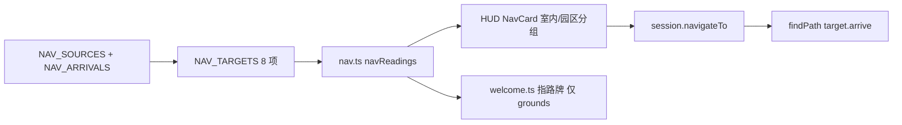

## 产品概述
园区导览从「区域目录」改为「可互动设施目录」：只保留玩家能走进去互动的地点和设施，静态观赏型地标不再出现在导览里。世界本身（游乐园、三湖、摸鱼亭、影音室等）原样保留，玩家仍可步行探索，只是不再有一键前往入口。

## 核心功能
- **导览清单收窄为 8 条**
  - 室内组（5）：工作区、会议室、卫生间、宿舍区、财神供案
  - 园区组（3）：游乐场、发泄区、擂台
- **删除 7 条导览条目**：研发园、家庭影音室、小黑屋、摸鱼亭、摸鱼湖、沉思浅塘、涟漪湖。只删导览卡与世界指路牌上的入口，园区地形、建筑、碰撞与美术全部保留。
- **新增两个设施入口**
  - 擂台：点击「去这里」自动走到场边报名点，落地即可按 F 报名，不会被传进围绳内。
  - 财神供案：走到工作区内的案前空地，落地即可上香。
- **世界指路牌同步收缩**：牌面只列园区级可互动设施（游乐场、发泄区、擂台），不再出现已删除的目的地；牌面块数随条目数自适应，不再固定五块，也不留空白牌。
- **视觉与交互效果**：导览卡分组标题右侧计数变为 5 与 3，8 行无需滚动；每行仍是「方位箭头 + 名称 + 步行秒数 + 去这里」，导航中变「取消」；折叠态「最近目标」自动指向最近的设施（出生点附近为财神供案）。

## 边界与不做
- 不删任何世界设施，不改碰撞、地形、美术与区域命名。
- 不列售货机、咖啡机、饮水机、茶台、牛马榜、放假告示板，也不列座位、床、马桶等家具。
- 服务端与通信协议零改动，导览仍为纯客户端能力。


## 技术栈
沿用现有仓库：pnpm + turbo monorepo，TypeScript；`@niuma/shared-types` 为唯一坐标与导览真相；HUD 为 React + zustand（`useGameUi`），世界指路牌为 PixiJS 构造期烘焙纹理，测试为 vitest（shared-types）与 bun:test（web）。

## 实现策略
把 `NAV_TARGETS` 收窄为 8 项，并让世界指路牌从 `NAV_TARGETS` 派生，消除当前第二份硬编码清单；HUD 与寻路链路本来就按 `NAV_TARGETS` + `area` 派生，无需结构性改动。

### 目标表（新契约）
| id | 名称 | area | 中心 (x,y) | 到达点 arrive |
|---|---|---|---|---|
| workroom | 工作区 | indoor | `rectCenter(WORKROOM)` | 现状不变 `(+230, +294)` |
| meeting | 会议室 | indoor | `rectCenter(MEETING_ROOM)` | 现状不变 |
| restroom | 卫生间 | indoor | `rectCenter(RESTROOM)` | 现状不变 |
| lounge | 宿舍区 | indoor | `rectCenter(LOUNGE)` | 现状不变 |
| shrine | 财神供案 | indoor | `SHRINE_ALTAR` 案面中心 | 案前空地 `(3740, 3818)` |
| park | 游乐园 | grounds | `rectCenter(AMUSEMENT_PARK)` | 现状不变 `(4096, 3020)` |
| bossArena | 发泄区 | grounds | `rectCenter(BOSS_ARENA)` | 现状不变 `(3950, 5600)` |
| ring | 擂台 | grounds | `rectCenter(RING_ARENA)` | `RING_EXIT (3780, 5430)` |

关键取舍：
- **擂台到达点取报名点而非场地中心**：非参赛者不能踏入围绳（移动被夹），到达点必须在 `RING_ARENA` 外且距围绳 ≤ `RING_NEAR_PX(96)`，落地就能报名，语义闭环。
- **财神供案归 indoor**：供案在 `WORKROOM` 内，按真实空间分组才不会让导览卡出现「室内目标列在园区组」的错位；HUD 分组逻辑不加分支。
- **指路牌只列 grounds**：牌面 96×92 且被 `layout-hub.test.ts` 锁死尺寸，室内目标继续交给 HUD；现有 `SIGN_PLATES` 手写 5 条与 `octant ?? 0` 静默兜底一并删除，改为从 `navReadings` 过滤 `area === 'grounds'`，名称取 `NAV_TARGETS`，从根上消除「删了 id 箭头悄悄指北」的失败模式。
- **牌面块数自适应**：新增纯函数 `signPlateTop(index, count)`，绘制与文字叠层共用同一份行位置，3 块牌在标题与「你在这里」之间垂直居中；画布尺寸不变。

### 性能与可靠性
- `navReadings` 为 8 项线性计算，500ms 一次，可忽略；指路牌仍只在构造期烘焙一次，无逐帧开销。
- `NavTargetId` 为编译期类型，仅 web 内使用（worker 协议同版本内传递），服务端零引用，收窄不会产生跨版本解码风险。
- 所有新到达点由测试兜底：可站立、不撞碰撞体、不落水；擂台到达点在围绳外且在报名半径内。

## 架构与数据流

单向数据流不变，不新增层级或状态；改动集中在契约层与指路牌渲染层。

## 目录结构与改动清单
```
niuma/
├── packages/shared-types/src/
│   ├── world/layout.ts                      # [MODIFY] NavTargetId 收窄为 8 项；NAV_ARRIVALS 删 7 增 2
│   │                                        #   （ring→RING_EXIT，shrine→案前空地）；NAV_SOURCES 同步；
│   │                                        #   头注释「12 处地标」改为「可互动设施 8 处」并注明新 ADR
│   └── __tests__/nav-arrival.test.ts        # [MODIFY] 长度 8；OUTDOOR 改 park/bossArena/ring；
│                                            #   新增擂台「围绳外且在报名半径内」、供案「在 WORKROOM 内且不撞案面」断言；
│                                            #   删除 southYard 相关断言
├── apps/web/
│   ├── lib/game/welcome.ts                  # [MODIFY] 删 SIGN_PLATES 与 NavTargetId import；
│   │                                        #   signPlates() 改为 navReadings 过滤 grounds；
│   │                                        #   drawSignpost 按 arrows.length 循环，新增导出 signPlateTop；
│   │                                        #   buildSignpost 文字行位置改用 signPlateTop；同步注释
│   ├── lib/game/__tests__/signpost.test.ts  # [NEW] 断言牌面条目等于 grounds 目标（名称与顺序）、
│   │                                        #   signPlateTop 单调且落在标题与底牌之间，防「静默指北」回归
│   ├── lib/game/__tests__/nav.test.ts       # [MODIFY] 总数 8；indoor 5；grounds 顺序 park/bossArena/ring；
│   │                                        #   室内距离极差断言限定在四间房内
│   ├── lib/game/__tests__/pathfinding.test.ts # [MODIFY] 目标数 8，其余遍历断言自动覆盖新目标
│   ├── components/game/NavCard.tsx          # [MODIFY] 仅更新「12 处地标」注释与分组说明，逻辑不动
│   └── data/release-notes.json              # [MODIFY] 追加一条玩家可感知的版本工报
├── docs/adr/0077-interactive-facility-nav.md # [NEW] 记录本次决策与回滚路径（不改历史 ADR）
└── README.md                                # [MODIFY] 导览口径：8 处可互动设施、指路牌随 NAV_TARGETS 派生
```

## 执行注意
- 到达点手排后必须由 `nav-arrival` 测试验证；若 `(3740, 3818)` 被道具底座判为不可站立，退到案面西南 `(3690, 3812)`，不要放宽断言。
- `welcome.ts` 的 `signPlates()` 入参仍是 `DIRECTORY`，箭头方位保持实时计算；不得再引入第二份 id 清单。
- 不改 `WELCOME_LANDMARKS.directory` 尺寸，`layout-hub.test.ts` 的几何断言保持绿色。
- 提交前按 AGENTS.md 追加版本工报并运行 `pnpm changelog:check`；回归跑 `pnpm typecheck` 与 `pnpm test`。
- 回滚路径：把 `NavTargetId` 与 `NAV_ARRIVALS`/`NAV_SOURCES` 恢复为 13 项 + 恢复 `SIGN_PLATES` 即可，指路牌派生逻辑可保留（过滤后自然回到 9 块，故回滚时需同时恢复固定 5 块布局）。

