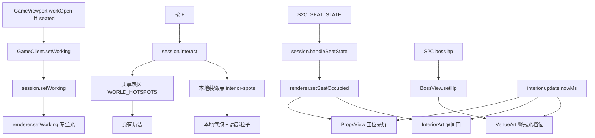

## 用户需求
对「牛马 NIOMA」现有 5 区、25 个场所的室内空间做表现力与交互手感打磨，不新增玩法、不扩建房间、不改协议。核心是让已存在但纯静态的室内陈设与状态变化产生联动，全部反馈在客户端本地完成。

## 产品概述
玩家进入企业楼工作区、卫生间、发泄室、宿舍区与小黑屋后，能通过画面与按 F 的即时反馈感知「这个世界是活的」：工位屏幕随占用亮起、隔间门随占用开合、洗手台有水花、老板血量影响房间气氛、小黑屋灯泡会闪、墙上留着前人刻痕。

## 核心功能
- **工作区**：8 个工位有人坐下时显示器由熄屏转蓝白亮屏，代码行两帧微闪；本人搬砖倒计时期间桌上多一圈淡蓝专注光；打印机、零食推车、白板立架可按 F 冒本地气泡吐槽。
- **卫生间**：4 个马桶被占用时对应隔间门从半掩变闭合、门锁转红并透出一线占坑微光，空出即恢复；洗手池按 F 洗手出现水花粒子与「带薪洗手 30 秒」类气泡；镜子按 F 依自身物种（牛／马）给自嘲台词；烘手机按 F 冒热风气泡。
- **发泄室**：企业楼走廊进发泄室的门口铺黄黑警示条纹过渡；进入发泄室后，老板血量低于 30% 时房间四沿转暖橙警戒微光并冒吐槽气泡，倒下后转灰。
- **宿舍区**：衣柜、书架、挂钟、雪窗按 F 各给一句彩蛋气泡；有人躺上下铺冒 Zzz 时，若为冬季或夜间，两盏壁灯外多一层暖黄光晕。
- **小黑屋**：吊灯出现接触不良式双闪，墙面新增反省刻痕；三个反省位附近按 F 冒「下次不敢了／我只是想坐下」类自嘲气泡。

## 表现与手感要求
- 所有新增装饰默认零碰撞，纯动效与气泡不进服务端热区表，不产生任何网络包。
- 动效幅度克制：1 像素级的明暗与纹理切换，不做浮点缩放，不破坏现有像素硬边与深度遮挡关系。
- 全部新表现可被现有灰度参数压制：关光时不留亮斑，冬季参数下雪窗与光晕生效，并新增一个统一开关可整体退回静态美术。


## 技术栈
沿用现有架构，不引入新依赖：TypeScript + PixiJS（构造期 `bake()` 烘焙 1:1 纹理、`nearest` 采样）+ 现有 `SortLayer`（y-band 256）+ 现有 `LightSpec` 光图 + Vitest/Bun 单测。改动范围仅 `apps/web`。

## 实施策略
一句话：**把「状态」与「美术」解耦成三条既有通道**——座位占用走 `S2C_SEAT_STATE`（已有），按 F 的装饰互动走客户端本地交互表（新增，不进 `WORLD_HOTSPOTS`），时间驱动微动效走纯函数 + `tickBubbles` 单一 ticker（已有）。任何一处都不新增协议、不改坐标与碰撞。

关键决策与理由：
1. **零 `packages/shared-types` 改动 → 不涉及双端同步发布**。所有需要的坐标（`WORKROOM/LOUNGE/RESTROOM/JAIL/VENT_ROOM/COMPANY_CORRIDOR`、`RESTROOM_STALLS`、`JAIL_ANCHOR`、`WORKSTATIONS`、`BOSS_ARENA`）都已导出；发泄室门洞位置改为从 `WORLD_LAYOUT.solids` 的北墙缺口反查（与既有 `innerWalls` / `fixtureIn` 同一手法），不新增导出面、不手写 2920/2980。
2. **装饰坐标收敛到一张客户端常量表** `interior-spots.ts`：现在 `interior-art.ts` 里写死的 `x+272`、`x+318`、`x+352` 等偏移抽到这里，绘制与交互点共用一份，避免「画在这、按在那」的漂移。这是本次唯一的结构性重构，且只影响一个文件。
3. **交互查询与按键分发同源**：`selectContextHint()` 与 `GameSession.interact()` 都调用同一个 `nearestInteriorSpotInto()`（槽位式、零分配，仿 `nearestInteractivePropInto`），优先级固定为「共享热区 → 本地装饰点 → 设施 prop → 座位」。否则会出现「提示说能按、按下去没反应」。
4. **可切换美术用「双帧纹理 + 换引用」而不是重绘**：工位亮屏（`litA/litB`）、隔间门（`open/closed`）、小黑屋灯泡（`on/dim`）全部在构造期烘好，运行时只做 `sprite.texture = x`；这与现有 `PropsView.setSeatOccupied` 的写法完全一致，帧循环零分配。
5. **老板血量只外露一个档位**：`BossView` 内部已有 `hpRatio` 与 `<30%` 转橙逻辑，向 `VenueArt` 只传 `alertTier ∈ {0,1,2}`，避免两个类各自解释血量、也避免每帧读血条。
6. **「本人在搬砖」信号只走客户端内部通道**：`GameViewport` 已有 `workOpen && seated`，把它通过 `GameClient.setWorking()` → worker 消息 → `session` → `renderer` 传给工位专注光。这是主线程与 Worker 之间的既有 UI 指令通道（与 `setDanmakuPrefs` 同构），**不是网络协议**，也不新增 opcode。

性能与预算：
- 新增纹理约 20 张（8 张专注光共用 1 张、门 2 张、灯泡 2 张、壁灯光晕 1 张、警戒光 3 张、水花 3 张），全部构造期烘焙，显存增量在几百 KB 级。
- 每帧新增运算：8 张工位纹理位比较（仅已占用）、4 扇门状态比较（仅变化时换纹理）、1 次灯泡相位取模、1 次警戒光 alpha 写值；均为 O(1) 标量写，无遍历扩容、无对象创建。
- 光源预算：**新增 0 盏 `LightSpec`**（发泄室警戒光与壁灯光晕都用烘焙精灵 + alpha 呼吸），`MAX_LIGHTS = 64` 现状不变，`lighting.test.ts` 预算断言不受影响。

## 架构设计


## 实施要点（防止回归）
- `InteriorArt.place()` 现返回 void，改为返回 `Sprite`；调用点都是丢弃返回值，兼容无破坏。门与灯泡需要持有引用，走新的返回值。
- `stallDoors()` 拆分时，厕纸架、隔断收口、地面阴影必须留在 `flat`（永远在角色下方），只有可开合的门扇进精灵；否则隔间门会随人物走动上下跳。
- 隔间门与马桶的映射在构造期用 `RESTROOM_STALLS` 的 x 区间去匹配 `WORLD_LAYOUT.seats` 中 `kind === 'toilet'` 的座位，不按 id 硬编码（座位表只允许末尾追加）。
- 门精灵的深度键取 `stall.y + stall.h`（门的下沿），保证与相邻隔断、角色遮挡关系正确。
- `clearWorld` 已有对全部占用座位置 false 的循环，天然会复位门与亮屏，不需要额外清理分支。
- 宿舍暖光与「夜间」判定必须走 `serverNow()` + `serverTzOffsetMin()`（`AGENTS.md` 时间口径），并按 30 秒低频采样，不得逐帧 `new Date()`。
- 冬季窗户文案与暖光只读 `renderer.season.winter`（已在 `buildLayers` 判定一次），不在子模块重复读 `location.search`。
- 警示条纹只画在地面层（`props.base` 的 flat），不申请碰撞、不进 `WORLD_LAYOUT.solids`。
- 老板吐槽气泡用预建 `Text`，只在档位变化时赋值一次；严禁每帧写 `text`（`boss.ts` 已有 8Hz 文本节流纪律）。
- 新增灰度开关 `?interior=0`：在本层关闭门联动/微闪/光晕的**动态部分**（美术本体保留），与 `?venue=0` 同一套 `params.get(...)` 写法，禁止在模块顶层读 `location`。
- 新增提示文案若沿用 `HINT.interact` 则无需动 `hint-copy.ts`；若要给打印机等专属文案，必须同时更新 `HINT`、`HINT_BUTTONS`、`TOUCH_HINTS` 三处（`Record` 类型会强制报错）。

## 目录结构
```text
apps/web/lib/game/
├── interior-spots.ts                       # [NEW] 室内本地交互点表：打印机/零食车/白板/洗手池/镜子/烘手机/衣柜/书架/挂钟/雪窗/反省位；坐标一律由 WORKROOM、RESTROOM、LOUNGE、JAIL 等共享常量派生，并与 interior-art 共用同一批偏移常量。提供 nearestInteriorSpotInto(out,x,y,range) 零分配查询、spot 命中半径、以及按 id + 计数 + 物种轮转的台词表（牛/马分支）。
├── interior-art.ts                         # [MODIFY] ①place() 改为返回 Sprite；②stallDoors() 拆成 flat 静态件 + 4 个可切换门精灵（open/closed 两张烘焙纹理，闭合态含红锁与门缝微光）；③新增 setSeatOccupied(seatId, occupied)，构造期建立「马桶座位 → 坑位下标」映射；④小黑屋吊灯拆成双帧精灵，新增 setCellBulb 切换；⑤新增 setLoungeResting(active) 控制预烘暖黄壁灯光晕；⑥墙面补反省刻痕；⑦新增 update(nowMs)，用纯函数推进灯泡双闪与光晕呼吸，并支持 ?interior=0 关闭；⑧陈设坐标改从 interior-spots 取。
├── props.ts                                # [MODIFY] ①新增工位专用蓝白屏幕色（不复用售货机的薄荷绿 screenLit）；②lit 屏补标题栏、代码行与光标；③每个朝向烘 litA/litB 两帧；④DeskSprite 增加 occupied 标记与纹理相位，新增 update(nowMs) 只在占用工位间切换两帧；⑤新增 setWorkingDesk(deskIndex, active) 与专注光精灵（共用一张预烘椭圆环纹理，默认不可见）。
├── renderer.ts                             # [MODIFY] ①buildLayers 解析 ?interior=0；②setSeatOccupied 追加转发 interior；③新增 setWorking(seatId, active) 把座位映射为工位下标；④setBossHp 同步把血量档位转给 venueArt；⑤tickBubbles 里追加 props/interior/venueArt 的一次 update(now)，位置与其他 update 同批。
├── venue-art.ts                            # [MODIFY] ①paintVentRoom 增加门口黄黑警示条纹与门槛线（门洞位置由 solids 北墙缺口反查）；②新增三档警戒光精灵（无/橙/灰）与 setBossAlert(tier)；③新增 update(nowMs) 做 alpha 呼吸；④受 ?interior=0 与 ?venue=0 双重约束。
├── boss.ts                                 # [MODIFY] 对外暴露血量档位（正常/残血/倒下），新增预建吐槽气泡（残血与倒下两条文案，仅档位切换时赋值），复用既有 8Hz 文本节流。
├── venue-motion.ts                         # [MODIFY] 新增三个纯函数：focusPulse（专注光呼吸 0.9–1.0）、badContactFlicker（接触不良双闪，偶发 120ms 断闪）、warmGlowBreath（壁灯光晕呼吸），全部 (seed, nowMs) 入参、可单测。
├── fx.ts                                   # [MODIFY] 新增水花粒子池（24 槽，白色/浅蓝 1–2 像素 + 一档水花环），spawnSplash(x,y) 与 update 复用现有单 ticker，帧循环零分配。
├── interactions.ts                         # [MODIFY] selectContextHint 在「共享热区之后、设施之前」插入本地装饰点查询，保证与 interact() 同一优先级；导出复用槽位。
├── session.ts                              # [MODIFY] ①interact() 未命中热区时先查本地装饰点：节流 + 冒气泡 +（洗手）触发水花 +（设施音复用）；②镜子台词按 this.species 分支；③新增 setWorking(active)，用 workDeskIndexOfSeat 把 localSeat 映射为工位下标后转给 renderer。
├── client/game-client.ts                   # [MODIFY] 接口新增 setWorking(active: boolean)。
├── client/worker-client.ts                 # [MODIFY] 新增 setWorking：delegate 直连，否则 post 内部消息。
├── client/main-thread-client.ts            # [MODIFY] 新增 setWorking：直连 session。
├── runtime/worker-protocol.ts              # [MODIFY] 上行消息联合类型追加一条 working 指令（客户端内部通道，不上网络）。
├── runtime/worker-host.ts                  # [MODIFY] 新增对应 case，转发到 session.setWorking。
└── __tests__/
    ├── interior-spots.test.ts              # [NEW] 断言每个交互点落在对应房间矩形内、命中半径互不重叠抢位、台词按计数与物种可复现。
    └── venue-motion.test.ts                # [MODIFY] 补 focusPulse / badContactFlicker / warmGlowBreath 的区间与可复现断言。

apps/web/components/game/GameViewport.tsx   # [MODIFY] 新增 effect 把 workOpen 且 seated 同步给 client.setWorking，关闭时复位。
apps/web/data/release-notes.json            # [MODIFY] 提交前按 AGENTS.md 追加一条面向玩家的版本工报。
```

## 双端发版结论
本次**不修改** `packages/shared-types`（不新增 `PropKind`、不进 `WORLD_HOTSPOTS`、不改任何坐标/碰撞/座位/`NAV_TARGETS`）、**不新增或复用任何 opcode**，服务端逻辑零变更，因此**不涉及双端同步发布**，仅需前端发布。若实施中出现必须把发泄室门洞导出为共享常量（本方案已用 solids 反查规避）、或需要给装饰交互加服务端校验的情况，则必须停止并回到方案确认——那将升级为双端同步发布。

## 验收
- `pnpm typecheck` 四包全绿；`pnpm test`（共享契约 vitest + 渲染纯模块 bun test）全绿；`pnpm changelog:check` 通过。
- 人工核对组合：默认、`?interior=0`、`?light=0`、`?season=winter`、`?venue=0`、`?bands=0`、`?flat=1`。重点看：门开合是否与坐下/起身同帧、专注光是否只在自己搬砖时出现、警戒光在 0 血时是否转灰、关光后是否残留亮斑、`?bands=0` 下门与人物遮挡顺序不变。


## Agent Extensions
### Skill
- **pixel-venue-polish**
  - Purpose: 本轮全部改动都落在室内场所的程序化像素绘制与灯光动效上，直接使用该 skill 的硬约束（不动坐标/碰撞/协议、优先零碰撞、描边只压暗、明度最多三档、每处 1–2 盏焦点光、微动效必须是纯函数且进 tickBubbles、构造期烘焙、可一键灰度关闭）来约束配色、分层与光照预算，并按其「场所 → 文件 → 坐标常量」映射表逐处落地。
  - Expected outcome: 每一处新陈设都能明确回答「我在 flat 还是 place()」「我用了几档明度」「我的相位种子是什么」「我用哪个参数关掉」，最终产出自查清单（分层层级、光源数仍不超预算、灰度参数全覆盖），且不出现纯黑描边、地面明度超过三档、或帧循环内烘焙纹理的问题。
