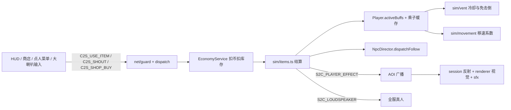

## 产品概述
在现有「牛马园区」的牛马币经济与商店之上，新增一套可扩展的道具与 Buff 引擎：玩家可以随时从顶部 HUD 打开随身商店购买消耗品，对自己使用增益道具，或点击任意玩家直接投放整蛊道具，并在茶台/商店里永久升级四维属性。

## 核心功能
### 1. 通用 Buff 与特效广播
- 服务端为每名玩家维护一份统一的状态表（增益、负面、整蛊贴纸、护盾层数），到期自动失效。
- 特效会广播给视野内的其他玩家，用于展示脚底风、绿色摸鱼贴纸、滑倒、护盾光环、保安盯梢等表现；旁观者与本人看到同一份结果。

### 2. 随身商店与道具（共 7 件）
顶部 HUD 新增「摸鱼百宝箱」入口（购物车图标 + 文案），随时打开就能买消耗品；原金币徽标入口保留。商店拆成「属性」与「消耗品」两个页签。
- 自用类：
  1. 冰美式 30 币：60 秒内移动速度 +15%，E 技能冷却额外缩短 30%，脚底出现小风线。
  2. 摸鱼护盾 80 币：获得 1 层护盾，自动抵消下一次被 E 撞飞或整蛊效果，角色身周出现青色护盾环。
  3. 全服大喇叭 100 币：输入不超过 30 字的自定义文案，通过审核后向全服发送一条金色发光边框、置顶显示的横幅弹幕。
- 点击玩家释放的整蛊类（从点人菜单直接放出，无需对方同意）：
  4. 香蕉皮 40 币：目标当场滑倒躺地 2 秒，头顶「滑倒了！」气泡，并播放短促滑倒音效。
  5. 摸鱼降薪贴 60 币：目标头顶悬挂 20 秒绿色像素贴纸「带薪摸鱼」，移速 -20%；同一目标对同类整蛊有 60 秒保护冷却。
  6. 雇佣保安卡 150 币：调度离目标最近的保安以 1.3 倍速赶来，喊出「盯紧你了！」并贴身尾随 15 秒；巡逻中的保安可被打断，押送中的不可；无可用保安则退回币并提示。
- 保留彩带礼花（纯演出）；能量饮料与续命奶茶下线，其编号永久留空不复用。

### 3. 永久属性强化面板
- 在茶台按 F 直接打开商店的「属性」页；也可从商店页签进入。
- 可花牛马币升级攻速、工效、暴击、韧性；服务端校验余额与 10 级上限，成功后立即回推完整钱包快照，等级条与余额在界面上同步刷新。

## 视觉与交互
- 延续现有深色像素 HUD：深靛色面板、青色强调、金色货币字。
- 点人菜单新增「整蛊」入口，弹出道具清单（显示持有数量与价格）；余额不足或未持有时置灰不可点。
- 大喇叭发送时弹出输入面板，含 30 字计数器与发送后置顶金色横幅，数秒后淡出。
- 道具被护盾抵消、保安缺席退币、文案被拦截等结果，都以顶部短提示告知操作者。


## 技术栈
沿用现有栈，不引入新依赖：
- 语言/包管理：TypeScript + pnpm workspace + turbo
- 服务端：Bun + `ws`（`apps/game-server`），二进制自定义协议（`OpCode` + `ByteWriter`/`ByteReader`）
- 前端：Next.js 15 App Router + React + Tailwind（`apps/web`），游戏渲染 PixiJS 8 跑在 Web Worker，主线程只做 DOM 覆盖层
- 共享契约：`packages/shared-types`（直接引用 TS 源码）
- 音效：Web Audio 合成（`apps/web/lib/game/sfx.ts`），无音频资源文件

## 实现策略
1. **协议先立骨架**：opcode 从 `0x41` 追加，不复用旧号。新增 `C2S_SHOUT(0x41)`、`S2C_LOUDSPEAKER(0x42)`、`S2C_PLAYER_EFFECT(0x43)`、`S2C_SHOUT_REJECT(0x44)`；`S2C_ITEM_EFFECT(0x3d)` 保留但停止发送（旧号永久留空）。`S2C_PLAYER_EFFECT` 定为 10 字节定长 `[op][effect u8][sourceId u16][targetId u16][extraId u16][durationMs u16][flags u8]`，`flags bit0`=接收者即目标，`bit1`=被护盾抵消/未生效。`extraId` 承载保安 id。
2. **Buff 用集中定义表**：新增 `packages/shared-types/src/buffs.ts`，`BUFF` 枚举只追加（Haste/Shield/Poster/Slip/Guard），`BUFF_DEFS` 描述时长、移速系数、冷却系数、贴纸文案；`Player` 持有 `activeBuffs: Map<number, number>`（键为 BuffType、值为 expiresAt），另有 `shieldCharges`、`trickGuard: Map<number, number>`（itemId → 保护截止）。`reset()` 与 `applyEconomy()` 必须同时清空这三项，避免对象池复用串状态。
3. **性能：乘子缓存而非每帧遍历**。Buff 变更时重算 `speedMul` / `ventCdMul` 两个标量缓存到 `Player`，`applyMove()` 与 `resolveVents()` 只读标量；每 Tick 末尾对 `activeBuffs` 做一次单遍 `prune`（条目数 ≤ 5，O(n) 可忽略），过期时同步重算缓存。避免在 20Hz 移动包路径上做 `Map` 迭代、对象分配或字符串拼接。
4. **道具结算集中在一处**：新增 `apps/game-server/src/sim/items.ts`，`applyItem()` 负责「分类校验 → 整蛊保护判定 → 护盾消耗 → 写 Buff/姿态 → 组装广播」，`server.ts` 的 `C2S_USE_ITEM` 分支只做「解码 + 库存扣减 + 委托 + 组接收者」。这样新增第 8、9 件道具只改 SKU 表与一个 `switch` 分支，不改网络层。
5. **服务端权威边界**：自用道具要求 `targetId === 自己`，整蛊道具要求目标是其他真人且距离 ≤ 1200px（AOI 1000px，留出点选误差），伪造包一律丢弃且不扣库存；库存扣减先于效果写入，任何失败路径都不产生副作用（保安聘请失败走 `grantCoins` 退币 + 新 `WALLET_REASON.ItemRefund=14`）。
6. **大喇叭走独立上行包**：`C2S_USE_ITEM` 是 4 字节定长，塞不下文本，故用 `C2S_SHOUT`（`[op][len u8][utf8]`，UTF-8 ≤ 90 字节）。服务端复用 `sim/moderation.ts` 词表与 `sim/chat.ts` 的长度/频率约束（`lastShoutAt` + 冷却），通过后才 `consumeItem` 并遍历 `world.players` 找 `wsId !== 0` 全服下发；失败回 `S2C_SHOUT_REJECT`，不扣道具。
7. **保安尾随复用现有 AI**：`NpcAgent` 增加 `follow: { targetId, until }`，`director` 增加 `dispatchFollow/cancelFollow`（仅在 `!agent.escort && !agent.follow && role === NPC_ROLE_GUARD` 中挑最近者，允许打断 `phase==='walk'|'pause'` 的巡逻）；`brain.updateAgent` 在 follow 分支按 `agent.speed * 1.3` 用 `findEscortPath` 追到 18px 内停步、面向目标，到期恢复巡逻；`dispatchEscort` 需跳过正在 follow 的保安，避免押送与盯梢抢同一人。
8. **客户端表现分层**：网络解码在 `lib/net/client.ts`，会话级反射（本地硬直、气泡、音效）在 `lib/game/session.ts`，持续型视觉（脚底风、护盾环、绿色贴纸）在 `lib/game/renderer.ts` 新增 `setBuffVisual(id, kind, durationMs)`，几何复用 `lib/game/nameplate.ts` 的 `statusBottomY/nameBottomY` 保证与昵称、状态行不重叠；吸附式文本仍走现有 `showBubble`（自带 6s 上限与 10 个同屏上限）。大喇叭横幅用 DOM 覆盖层（`game-ui` 状态 + 组件），不进入 PixiJS 弹幕通道，保证置顶与发光边框效果稳定。
9. **不动无关逻辑**：不重写 AOI、Tick 同步、经济持久化（localStorage 仍是唯一永久层）；旧 `S2C_ITEM_EFFECT` 与 `ITEM_EFFECT` 中的旧值只做保留注释，不删常量以免旧存档/旧包解析报错。

## 架构与数据流


## 实施要点
- 协议五连改必须一次做完：`types.ts`（OpCode + 包体）→ `protocol.ts`（encode/decode）→ `net/guard.ts`（`defineVariable(C2S_SHOUT, 2, 1, 90)`）→ `server.ts`（dispatch 分支 + 限频组）→ `lib/net/client.ts`（decode + handlers + `worker-protocol.ts`）。
- `effectiveVentCooldownMs` 的语义从「定值 −150ms」改为「乘 0.7」，并保留 500ms 下限；`sim/vent.ts` 的调用点同步改签名，避免出现两套冷却真相。
- 修掉现存缺陷：`CoinShopDialog` 第 112 行用 `wallet.inventory[sku.id]`（数字键）读持有量，恒为 0，改为 `sku.key`。
- 对象池安全：`Player.reset()`、`applyEconomy()`、`World.destroy()` 路径都要清空 `activeBuffs/trickGuard/shieldCharges/speedMul`。
- 日志：新增失败分支（余额不足、道具非法、文案被拦、保安缺席）沿用现有静默返回 + 面向玩家的 `setHint`/`S2C_SHOUT_REJECT`，不打印玩家文本内容，避免日志污染与隐私泄漏。
- 按项目约定：完成后不运行测试与类型检查，仅补 `release-notes.json` 并执行 `pnpm changelog:check` 的说明留给提交阶段。

## 关键结构
```ts
// packages/shared-types/src/buffs.ts
export const BUFF = { Haste: 1, Shield: 2, Poster: 3, Slip: 4, Guard: 5 } as const;
export type BuffType = (typeof BUFF)[keyof typeof BUFF];
export interface BuffDef {
  key: BuffType; durationMs: number;
  speedMul: number; ventCdMul: number;
  trick: boolean; label: string;
}
export const TRICK_GUARD_MS = 60_000;
export const SHIELD_HOLD_MS = 300_000;
export function speedMultiplier(buffs: ReadonlyMap<number, number>, now: number): number;
```

```ts
// apps/game-server/src/sim/world.ts（Player 新增字段）
activeBuffs = new Map<number, number>();   // BuffType -> expiresAt
trickGuard = new Map<number, number>();    // itemId -> 保护截止
shieldCharges = 0;
speedMul = 1;      // 缓存：applyMove 只读它
ventCdMul = 1;     // 缓存：resolveVents 只读它
lastShoutAt = 0;
```

## 目录结构
```
packages/shared-types/src/
├── buffs.ts                 # [NEW] BUFF 枚举、BUFF_DEFS、保护冷却与乘子纯函数
├── economy.ts               # [MODIFY] ITEM_SKUS 收敛为 7 件（id 1/3 留空注释，新增 4-9）、ITEM_EFFECT 扩展 Shout/Slip/Poster/Guard、ITEM_SKUS 增 target 字段、WALLET_REASON.ItemRefund=14、effectiveVentCooldownMs 改为乘子语义
├── types.ts                 # [MODIFY] OpCode 追加 0x41-0x44；新增 ShoutRequest/ShoutRejectPacket/LoudspeakerPacket/PlayerEffectPacket
├── protocol.ts              # [MODIFY] encode/decode Shout、Loudspeaker（变长）、PlayerEffect（10 字节）、ShoutReject
└── index.ts                 # [MODIFY] re-export buffs

apps/game-server/src/
├── sim/buffs.ts             # [NEW] setBuff/consumeShield/pruneBuffs/recomputeMultipliers，唯一状态机入口
├── sim/items.ts             # [NEW] applyItem：自用/整蛊分类、整蛊保护、护盾吸收、广播组装、保安派单与退币
├── sim/shout.ts             # [NEW] 大喇叭：词表+长度+频率校验、扣道具、全服广播、拒绝回包
├── sim/world.ts             # [MODIFY] Player 新增 activeBuffs/trickGuard/shieldCharges/speedMul/ventCdMul；reset/applyEconomy 清理
├── sim/movement.ts          # [MODIFY] allowed 乘以 player.speedMul（钳制 0.5-1.5）
├── sim/vent.ts              # [MODIFY] 冷却读 ventCdMul；命中前检查并消耗护盾层数，抵消时广播 PlayerEffect(flags bit1)
├── npc/brain.ts             # [MODIFY] NpcAgent.follow + 1.3 倍速追击分支（复用 findEscortPath，18px 停步、面向目标）
├── npc/director.ts          # [MODIFY] dispatchFollow/cancelFollow；dispatchEscort 跳过 follow 中的保安
├── economy/service.ts       # [MODIFY] refundItemPrice（或在 sim/items 用 grantCoins + ItemRefund）
├── net/guard.ts             # [MODIFY] 登记 C2S_SHOUT 变长包
└── server.ts                # [MODIFY] dispatch 增 C2S_SHOUT；C2S_USE_ITEM 委托 sim/items；Tick 中 pruneBuffs；全服广播遍历 wsId!==0

apps/web/
├── lib/net/client.ts        # [MODIFY] onPlayerEffect/onLoudspeaker/onShoutReject + shout() + useItem 语义
├── lib/game/client/worker-client.ts   # [MODIFY] shout/item 转发到会话
├── lib/game/runtime/worker-protocol.ts# [MODIFY] 新增下行消息类型
├── lib/game/runtime/worker-host.ts    # [MODIFY] 转发到 session
├── lib/game/session.ts      # [MODIFY] 处理特效：本地硬直镜像、气泡、滑倒音效、保安喊话；移除 brewTea 调用改为打开面板
├── lib/game/renderer.ts     # [MODIFY] setBuffVisual(id, kind, durationMs)：脚底风/护盾环/绿色贴纸；clearBuffVisual
├── lib/game/interactions.ts # [MODIFY] HINT.tea 文案改为「按 F 打开强化面板」
├── lib/game/sfx.ts          # [MODIFY] playSlipSound（噪声+下滑扫频短音）
├── lib/game/runtime/audio-sink.ts     # [MODIFY] 新增 case 'slip'
├── lib/game/runtime/engine-env.ts     # [MODIFY] AudioEvent 增 slip
├── lib/game-ui.ts           # [MODIFY] shopTab:'stats'|'items'、shout 输入与横幅状态、setShopOpen(open, tab?)
├── components/game/CoinShopDialog.tsx # [MODIFY] 双页签、自用道具「使用」按钮、修 inventory[sku.key] 缺陷
├── components/game/PlayerActionDialog.tsx # [MODIFY] 道具页签仅列整蛊类（target==='other'），显示持有与效果说明
├── components/game/InteractionMenu.tsx    # [MODIFY] 「使用道具」改为「整蛊」，带持有数徽标
├── components/game/ShopButton.tsx         # [NEW] HUD 摸鱼百宝箱按钮（购物车图标），打开消耗品页
├── components/game/LoudspeakerDialog.tsx  # [NEW] 30 字输入 + 计数器 + 发送
├── components/game/LoudspeakerBanner.tsx  # [NEW] 置顶金色发光边框横幅，数秒淡出
├── components/game/EconomyLayer.tsx       # [MODIFY] 挂载新弹窗与横幅
├── components/game/GameViewport.tsx       # [MODIFY] hudToolButtons 加 ShopButton；透传 shout/useItem；茶台回调打开属性页
├── components/game/WalletBadge.tsx        # [MODIFY] 打开商店默认落在属性页，更新注释
└── data/release-notes.json                # [MODIFY] 追加一条面向玩家的版本记录

docs/adr/
└── 0085-item-buff-engine.md               # [NEW] 记录 Buff 状态机、PlayerEffect 包与整蛊保护冷却的取舍
```


## 设计方向
沿用现有深色像素 HUD 语言做增量扩展，不新造视觉体系：深靛底面板 + 2px 硬边 + 偏移硬阴影 + 等宽数字，强调色沿用青色与金色，避免出现与现有界面割裂的新风格。

## 新增/改造界面
- HUD 摸鱼百宝箱：在右上工具栏新增一个与现有工具按钮同尺寸的方形按钮，购物车线性图标 + 悬停变青色；竖屏并入两列方钮格，横屏接在现有按钮右侧，带 1px 分隔线。
- 商店双页签：抽屉头部下方加「属性 / 消耗品」两段式页签，选中态青色描边 + 15% 底色。消耗品卡片按「自用 / 整蛊」分组，卡片含名称、一句话说明、持有数、价格按钮；自用道具额外显示「使用」按钮。
- 点人整蛊菜单：沿用现有底部浮层快捷菜单，四宫格中「整蛊」替换「使用道具」并显示可用户外道具数徽标；道具清单弹窗顶部标出目标昵称与余额。
- 大喇叭输入：居中卡片，深色底 + 金色描边，输入框等宽字体、右下角 30 字计数器，发送按钮金色填充；不满足条件时置灰。
- 大喇叭横幅：屏幕顶部居中、置于所有 HUD 之上，深靛底 + 金色双层发光描边，左侧小喇叭图标，文案单行溢出省略，入场从上方滑入，4 秒后淡出。
- 游戏内表现：脚底风为角色脚下两缕青色短弧线循环上飘；护盾为角色外圈 1px 青色环 + 呼吸式透明度；摸鱼贴纸为头顶绿色像素标签（带 2px 深色描边），20 秒后消失；滑倒沿用现有眩晕星星并追加一次灰尘小粒子。

## 交互与状态
- 余额不足、未持有、同类整蛊处于保护冷却时按钮置灰并给出原因文案，不做二次确认弹窗（点击即释放，符合「直接整蛊」的爽感）。
- 所有操作结果通过顶部短提示反馈，不使用阻塞式对话框。
- 移动端与桌面共用同一组件，触屏命中区高度不小于 44px。
