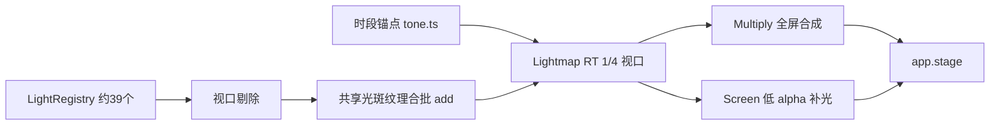

## 产品概述
为《牛马 NIOMA》的 2D 像素园区加入一套随昼夜变化的局部动态光影：白天保持现有明亮观感，黄昏起灯柱、壁灯与设备逐一亮起，夜间整体转为冷蓝暗调，而灯下、屏前、机器旁形成暖色或冷白色的光池。光影边缘保持像素化的粗颗粒，不出现平滑照片感。

## 核心功能
- **低清光照缓冲**：独立于主场景的低分辨率光图覆盖当前视口，像素化放大；先压暗环境，再把灯心与暗部细节补回来。
- **光源注册**：支持注册、更新、移除点光源（位置、半径、颜色、强度、抖动）；每帧按视口剔除，只提交可见光源。
- **地标光源**：庭院与路口灯柱（暖黄，带微弱烛光抖动）、会议室大屏与投影仪（冷蓝弱泛光）、宿舍壁灯（橘红柔光圈）、售货机与咖啡机（冷白像素霓虹）、工作区落地灯（暖黄）。
- **昼夜联动**：环境色与局部光强度随时段变化；白昼自动关闭局部光，夜间冷蓝底上保持暖光穿透。
- **合批与性能**：所有可见光源共享一张光斑纹理，一次合批、一次低清光图绘制；严禁逐光源全屏处理。
- **可回退**：保留 `?light=0` 关闭全部光影；提供 `?lm=2` 切换更高光图精度。


## 技术栈
- PixiJS **8.22.0**（现有依赖，`preference: 'webgpu'`，WebGL 回退）、TypeScript、Next.js 15；不新增运行时依赖。
- 使用 `RenderTexture` + 同纹理 `Sprite` 合批，不写自定义 shader、不引入 `ParticleContainer`。
- 测试沿用 `bun:test`，只覆盖不依赖 Pixi 的纯函数；GPU 行为走手动验收。

## 现状与关键事实
- 现有昼夜层 `apps/web/lib/game/ambient-light.ts` 是一个全屏 `Texture.WHITE` + `multiply` 的 `Sprite`，30s 采样一次；`AmbientLight` 调 `lightToneAt(hour)` 时漏传 `winter`，冬季锚点实际未生效，而 `winter-art.ts` 传了 `true`。
- 帧序已确认：`session.ts` 每帧先 `renderer.updateCamera(...)`，再 `renderer.tickBubbles(...)`，最后 Pixi 渲染 stage。光图 RT 的绘制应放在 `tickBubbles` 内，确保发生在主场景渲染之前。
- 场景光源坐标的单一事实源：
  - 29 盏灯柱、2 台售货机、3 台咖啡机全部来自 `WORLD_LAYOUT.props`（`HUB_PROPS` / `ROAD_PROPS` / `SOUTH_YARD_PROPS` / `WORK_PROPS`），道具锚点为 `(0.5, 1)`，`prop.y` 是脚底。
  - 会议室大屏、宿舍壁灯、工作区落地灯的位置目前硬编码在 `interior-art.ts` 的私有绘制方法中，必须由 `InteriorArt.build()` 收集并暴露，禁止在光源模块复制 `x+138 / x+396 / screenX` 这类偏移。
- PixiJS 8.22 的 `GpuBlendModesToPixi` 原生包含 `multiply` 与 `screen`（固定功能 blend factor，不依赖高级混合扩展）。
- `RenderTexture.create({ dynamic: true, resolution: 1, scaleMode: 'nearest', addressMode: 'clamp-to-edge' })`；`rt.resize(w,h)` 会同步 `texture.frame`，合成 Sprite 可直接持有同一张 RT。
- `renderer.render({ container, target: rt, clear: true, clearColor: [r,g,b,a] })` 可把未挂到 stage 的 Container 渲染进 RT，`clearColor` 支持 0..1 的 RGBA 数组。
- 同纹理、同 `blendMode` 的 Sprite 会被 Pixi 批处理器合并为一次 draw call，等价于“批量 Quad”，无需自定义 instancing。

## 方案对比

| 方案 | 收益 | 代价 | 不可逆性 |
|---|---|---|---|
| A. 每个光源一个全屏 Additive Pass | 质量可控 | 30–50 次全屏混合，直接违反约束 | 高 |
| B. 保留 AmbientLight + lights-only RT 做 Screen | 改动最小 | 夜间环境仍接近 0.94 亮度，暖光没有暗底可穿透；两个环境光 owner | 低 |
| C. 双 RT（环境+光做 Multiply、纯光做 Screen） | 物理标准，灯心可超过原亮度 | 同批光源要提交两次或额外拷贝一次，违背“一次性合批” | 中 |
| **D. 单 RT（环境底 + 点光源）+ Multiply + 低 alpha Screen（采纳）** | 一次 RT Pass、一次合批、两张全屏 quad；环境底与点光源共用一个 owner | 灯心亮度上限是光图本身，靠暗环境底形成冷暖/明暗对比 | 低 |

选 D。理由是约束里“所有点光源一次性合批”比“灯心可以超过 1.0”更硬；D 用同一张 RT 同时承担环境压暗与灯心提亮，避免第二个 RT 或第二次光源提交。

## 推荐架构



### 1. 光图尺寸与内容
- 默认 `1/4` CSS 视口：`rtW = ceil(screen.width / 4)`、`rtH = ceil(screen.height / 4)`；`?lm=2` 切 `1/2`，非法值回落到 4。
- `scaleMode: 'nearest'`、`antialias: false`、不生成 mipmap；RT 只在视口或 DPR 变化时 `resize`，帧循环不创建纹理。
- 每帧一次 RT Pass：以当前时段的环境乘子作为**不透明清屏色**，再把所有可见点光源以 `blendMode = 'add'` 合批画入。清屏 alpha 必须为 1，保证 Multiply 合成是纯乘算。
- 光斑纹理：一张共享的 32×32 白色径向渐变，4 阶量化 + Bayer 4×4 抖动，刻意保留像素颗粒；每个光源一个池化 Sprite，`tint = color`、`alpha = intensity × gain × flicker`、尺寸 `radius × 2 × (cssScale / divisor)`。

### 2. 合成
- `ambientSprite`：全屏，`blendMode = 'multiply'`，alpha 1，采样光图。
- `screenSprite`：全屏，`blendMode = 'screen'`，alpha 约 0.15–0.2（随时段深度缩放），采样同一张光图。
- 两个 Sprite 放进一个 `Container`，加在 `app.stage` 的 `world`、冬季雪层之后，确保只覆盖主场景，不进入 UI。
- 同一张 RT 被两个全屏 quad 采样，不产生第二次光源提交；Screen 只做暗部抬升与灯心加暖。

### 3. 环境光
- 把 `ambient-light.ts` 的时段锚点迁到 `lighting/tone.ts`，`LightTone` 的 `alpha` 改为 `ambient`（0..1 深度）。
- 环境乘子 = `mix(white, tone.color, tone.ambient)`；夜间约 `(0.57, 0.63, 0.74)`，黄昏暖橙、白昼纯白、冬季夜更深一档。
- `LightmapLayer.setAmbient(color, depth)` 作为环境光入口；渲染器每 30s 采样一次 `lightToneAt(hour, winter)`，修正现有冬季漏传问题。
- 现有单 quad 的 `AmbientLight` 职责并入 Lightmap，避免两个 multiply 层各自为政；`?light=0` 仍然一键全关。

### 4. 局部光增益与白昼跳过
- `localLightGain(tone) = clamp((tone.ambient - 0.05) / 0.45, 0, 1)`：夜间 1、黄昏约 0.6、黎明约 0.3、白昼 0。
- `tone.ambient` 接近 0 时隐藏合成层并跳过 RT Pass，白昼零开销；黎明/黄昏仍有环境底，正常渲染。

### 5. 光源注册、抖动与剔除
- `LightRegistry` 支持 `add / addAll / update / remove / clear / collect`，容量 64；`update` 接收 `LightPatch`（`x/y` 之外全部可选的更新载荷）。
- 每帧 `collect` 用相机矩形做 AABB × 圆 的保守剔除，O(总数)；30–50 个全遍历，只有可见的写入复用的 `Light[]`，不排序、不分配。
- Flicker 用 64 项确定性 LUT + 每光源种子/相位（`id` 派生）：灯柱约 0.16、壁灯 0.1、落地灯 0.08、售货机 0.02、其余 0；每帧只改 alpha。
- 光源位置和尺寸按 RT 像素取整，避免相机移动时亚像素抖动。

### 6. 地标光源
- 外景：`scene-lights.ts` 的 `propLights(props)` 派生灯柱/售货机/咖啡机，不复制坐标。
  - 灯柱 `(x, y-34)`，暖黄 `0xffc07a`，radius 84，intensity 0.85，flicker 0.16。
  - 售货机 `(x, y-30)`，冷白 `0xd9ecff`，radius 52，intensity 0.5，flicker 0.02。
  - 咖啡机 `(x, y-16)`，冷白 `0xe6f2ff`，radius 40，intensity 0.42，flicker 0。
- 室内：`InteriorArt.build()` 收集 `lights: LightSpec[]` 并暴露只读数组。
  - 会议大屏：北墙屏幕中心，冷蓝 `0x7fd6ff`，radius 140，intensity 0.6。
  - 投影仪：会议桌中心弱冷光，radius 78，intensity 0.28。
  - 宿舍壁灯 ×2：灯罩下方，橘红 `0xffcf8a`，radius 62，intensity 0.7，flicker 0.1。
  - 工作区落地灯：暖黄，radius 58，intensity 0.65，flicker 0.08。
- 合计约 39 个（29 灯柱 + 2 售货 + 3 咖啡 + 5 室内），落在 30–50 区间。

## 架构基线

```text
BASELINE | apps/web/lib/game/ambient-light.ts | expected: 只负责时段色温采样，合成与分辨率由光图层拥有 | observed: 自带单张全屏 multiply quad；AmbientLight 未把 winter 传入 lightToneAt（冬季锚点失效） | fit: partial | suggestion: 迁移为 lighting/tone.ts 纯函数，由 LightmapLayer 统一合成
BASELINE | apps/web/lib/game/renderer.ts | expected: 组合根与逐帧编排，不内嵌光照算法 | observed: 直接 new AmbientLight 并更新；无光源注册/剔除 | fit: align | suggestion: 接入 LightmapLayer，注册地标光源并在 updateCamera/tick 中编排
BASELINE | apps/web/lib/game/interior-art.ts | expected: 室内陈设与其光位同一事实源 | observed: 大屏/壁灯/落地灯坐标硬编码在私有绘制方法，未暴露 | fit: partial | suggestion: build 时收集 LightSpec 并暴露只读数组
BASELINE | packages/shared-types/src/world/layout.ts | expected: 世界道具坐标单一事实源 | observed: 29 灯柱 + 2 售货机 + 3 咖啡机均在 props 中；锚点 (0.5,1) | fit: align | suggestion: 由 propLights 派生，不新增共享类型
ALGBASELINE | light batch | problem: 30–50 点光源逐帧合成 | data: 全量约 39，视口内通常 2–10 | choice: O(n) AABB 剔除 + 同纹理 Sprite 池 + 单 RT Pass | complexity: 时间 O(n + visible)，空间 O(RT) + O(64) | preconditions: 相机矩形已知、同一纹理/混合模式 | exactness: AABB 保守剔除（不误删） | fit: sound | next: 单测剔除边界
```

## 目录结构

```text
apps/web/lib/game/
├── lighting/
│   ├── tone.ts                 # [NEW] 时段锚点、LightTone、ambientMultiplierOf、localLightGain；纯函数，替代 ambient-light.ts
│   ├── light-registry.ts       # [NEW] LightSpec/Light/LightRegistry、circleVisible、flickerAt、MAX_LIGHTS；纯函数
│   ├── light-texture.ts        # [NEW] 32×32 抖动径向光斑烘焙，复用 terrain-textures.ts 的 bake
│   ├── lightmap.ts             # [NEW] LightmapLayer：RT、Sprite 池、单次合批、Multiply/Screen 合成、setView/render/destroy
│   └── scene-lights.ts         # [NEW] propLights(props)：灯柱/售货机/咖啡机 → LightSpec[]
├── interior-art.ts             # [MODIFY] 新增 lights: LightSpec[]，在 decorateMeeting/decorateLounge/furnishWorkroom 收集室内灯位
├── renderer.ts                 # [MODIFY] 替换 AmbientLight；注册 propLights + interior.lights；setView/render/destroy；?light=0 / ?lm=2
├── winter-art.ts               # [MODIFY] lightToneAt 导入改到 lighting/tone.ts
├── ambient-light.ts            # [DELETE] 时段函数迁走后无剩余职责
└── __tests__/
    └── lighting.test.ts        # [NEW] 注册表 CRUD、剔除、flicker、时段、propLights 数量与颜色
docs/adr/
└── 0048-local-dynamic-lightmap.md  # [NEW] 按 0013 结构记录取舍、后果、回滚与复核信号
```

## 关键接口

```ts
export interface LightSpec {
  x: number;
  y: number;
  radius: number;
  color: number;
  intensity: number;
  flicker?: number;
}

export class LightRegistry {
  add(spec: LightSpec): number;
  addAll(specs: readonly LightSpec[]): number[];
  update(id: number, patch: LightPatch): boolean;
  remove(id: number): boolean;
  collect(minX: number, minY: number, maxX: number, maxY: number, out: Light[]): number;
}

export class LightmapLayer {
  readonly container: Container;
  register(specs: readonly LightSpec[]): void;
  setAmbient(color: number, depth: number): void;
  setView(screenW: number, screenH: number, cssScale: number, camX: number, camY: number, halfW: number, halfH: number): void;
  render(nowMs: number): void;
  destroy(): void;
}
```

`LightPatch` 为 `x/y` 之外全部可选的更新载荷；`Light` 在 `LightSpec` 之上增加稳定 `id` 与 flicker `seed`。

## 性能与可靠性
- **只有一次 RT Pass**：39 个注册光源中仅可见的进入 Sprite 池；同纹理、同 `add` 混合，Pixi 批处理器合并为一次 draw call。
- **全屏合成只有两张 quad**：Multiply + Screen 都是全屏常量开销，与光源数量无关。
- **零帧分配**：Sprite 池、可见光数组、注册表全部复用；不在帧循环 `new` 对象、数组或闭包。
- **白昼跳过**：`tone.ambient ≈ 0` 时隐藏合成层并跳过 RT Pass。
- **RT 生命周期**：只在视口/DPR/`?lm` 变化时 `resize`；销毁时按现有图层顺序释放 RT、光斑纹理与 Sprite 池，再交给 `app.destroy`。
- **错误与回退**：`?light=0` 完全关闭；`?lm=2` 提升精度；WebGPU 不可用时 Pixi 回退 WebGL，`multiply`/`screen` 仍可用。
- **爆炸半径**：只改 `apps/web/lib/game` 渲染层；`packages/shared-types` 不新增类型、服务端协议不变。

## 实施要点
- `renderer.updateCamera` 在算出 `camX/camY/halfW/halfH` 后调用 `lightmap.setView(...)`；`renderer.tickBubbles` 末尾调用 `lightmap.render(performance.now())`，确保在主 scene 渲染之前。
- 光图的清屏色必须不透明；点光源 Sprite 在 RT 内用 `add`，合并合成层再用 `multiply` + 低 alpha `screen`。
- 光源位置/尺寸取整到 RT 像素；不要对光斑使用线性采样或 mipmap。
- 室内灯位只由 `InteriorArt` 收集；外景只由 `propLights` 派生，避免两套坐标。
- 新测试只测纯函数；`typecheck` 与 `bun test` 必须通过，GPU 效果按验收清单手动确认。

## 验收
- `pnpm --filter @niuma/web test`
- `pnpm --filter @niuma/web typecheck`
- 手动：正午无光图开销；黄昏暖底 + 灯亮；深夜冷蓝 + 暖光池；`?season=winter` 更深一档；`?light=0` 完全关闭；`?lm=2` 光图更细；确认 39 个光源下每帧仅一次 RT Pass。


### Skill
- **codebase-design**
  - Purpose: 确定 `LightRegistry` 与 `LightmapLayer` 的深模块接口和 seam，让调用方只看到 `add/update/collect/setView/render`。
  - Expected outcome: RT、Sprite 池、合批细节全部藏在 `LightmapLayer` 内，`renderer.ts` 只做编排。
- **layer-pixel-art**
  - Purpose: 制作 32×32 像素化抖动径向光斑，保证 1/4 光图放大后仍是粗颗粒而非平滑糊边。
  - Expected outcome: 光斑呈 4 阶量化 + Bayer 抖动，边缘与像素栅格一致。
- **verification-before-completion**
  - Purpose: 在声明完成前执行 `typecheck`、`bun test` 与手动验收清单，保留命令输出与证据。
  - Expected outcome: 所有验收项有据可查，未验证项明确标注。
- **principal-software-architect**
  - Purpose: 将单 RT、双混合、剔除、白昼跳过与回退方案的取舍落成 ADR-0048。
  - Expected outcome: ADR 包含备选方案、后果、回滚成本与复核信号。
