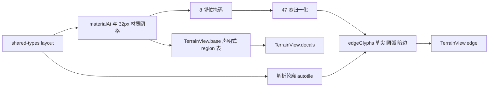

## 用户需求

把现有「90 度方块拼接」的地表改造成类 Pony Town 的自然像素地表，同时保持地图布局、碰撞与玩法不变。

## 产品概述

一张 8192×8192 的俯视像素园区地图。草地是绝对主体，土路、广场、沙滩、湖河、木桥都是叠在草地上的材质。改造后所有材质交界都由相邻地块状态驱动，边界是细碎草尖与外凸圆弧，不再出现直角切口与整块马赛克。

## 核心功能

- **自适应边缘**：草地与土地相交处不再 90° 直拼。逐格判定上下左右与四个斜角的相邻材质，按 16/47 态归类后绘制过渡边缘：2~4px 的锯齿草尖、转角处的外凸圆弧、内缘 1~2px 的压暗边。草自然盖在泥土上，不是两块色块对切。
- **统一边界语言**：草-土、草-沙、草-石（广场）、草-水、沙-水、木桥-水全部使用同一套边缘规则与同一张材质边缘表，不允许每种地面各写一套描边。
- **三层叠加**：第一层材质底色（泥土取低饱和粉彩暖棕 #C8A27A，禁止纯灰黑）；第二层带透明锯齿边缘的草地层，动态盖在泥土上；第三层程序化贴花，按坐标哈希在纯草地上以 12% 概率生成三叶草、小雏菊、微风草尖、小石子四类微小装饰，土路、广场、水面、桥面与花海不生成。
- **像素参数**：全图关闭图像平滑，相机位移取整，杜绝浮点坐标造成的像素撕裂与拉伸锯齿；缩放只取整数倍。
- **环境光**：地图绘制末尾叠一层全屏柔光，早晨为 rgba(255,230,180,0.08)；树木、花箱、石头底座补半透明椭圆投影 rgba(30,40,70,0.2)，让大物件「坐」在地上而不是浮着。
- **可回退**：保留关闭边缘层、关闭柔光、退回矩形平铺三个独立开关，线上出现观感回归时可单独关闭，不必整次回滚。

## 视觉目标

温暖低饱和的 cozy pastel 像素风：草地占画面约七成，边界是有机曲线加细碎草尖，转角圆润，没有硬直角、没有纯黑描边、没有拼贴接缝；贴花密度低到只打破重复感，不抢角色。


## 技术选型

沿用现有栈，不引入任何依赖：pnpm workspace + Turbo；`apps/web` 为 Next.js 15 + React 19 + PixiJS 8（WebGPU 优先、WebGL 回退）+ TypeScript；测试为 `bun:test`；世界数据唯一真相在 `packages/shared-types`。

### 渲染栈决策（用户要求「性能最佳、加载最快」）

| 方案 | 首屏成本 | 运行时成本 | 与现有契约 | 可逆性 | 结论 |
|---|---|---|---|---|---|
| A. 在 Pixi 内改造 `TerrainView` | 纹理一次上传，无额外烘焙 | 静态几何，GPU 批处理，边缘层 0 帧开销 | 保留实体 y-sort、遮罩、树冠遮挡、相机夹取 | 低（三个 URL 开关） | **采纳** |
| B. 离屏 Canvas2D 烘焙成纹理 | 8192×8192×4B ≈ 268MB 显存与同量级 CPU 光栅化 | 分块重烘会产生帧抖动 | 需把世界坐标再映射一次 | 高 | 否决 |
| C. 独立 2D canvas 垫在 WebGL 下 | 无烘焙 | 每帧一次跨画布合成 + 相机同步 | 拆成两套坐标与两套裁剪 | 中 | 否决 |

`imageSmoothingEnabled` 是 Canvas2D 上下文属性，WebGL/WebGPU 下不存在。本项目已有等价保证并保持不动：`bake()` 显式 `antialias:false` + `scaleMode:'nearest'`，`loadAtlas()` 统一置 nearest，`app.init()` 用 `antialias:false` + `roundPixels:true`，`pixelMetrics()` 把「缩放 × DPR」收敛成整数设备像素。

## 实现策略

一句话：**把「材质判定」与「边缘图元」下沉成两个纯模块，`TerrainView` 退回成图层编排者；位掩码只驱动边缘，不重建区域几何。**

1. **材质单一真相**：新增 `materialAt(x, y)` 与 `PAINT_ORDER`。现在 `addShoreSand / addPlaza / addPaths / addLake / addRivers` 各自内联描边与暗边，绘制顺序隐式写在 `build()` 的调用链里，这是「六种边界六套语言」的根因。收敛成一张声明式 region 表 + 一张材质优先级表，测试直接锁优先级（桥压水、水压路、广场压草）。
2. **两级双网格**：
   - 32px 材质网格（约 257×257 = 66k 格，`Uint8Array` 66KB）在构造期扫一遍，之后 `edgeMaskAt` 是纯位运算 O(1)；
   - 几何仍用解析轮廓：矩形区域走 `roundedRectContour`，湖/河/岛多边形走新增的 `polygonContour`（只给凸角且两侧边足够长的顶点切 8px 圆角），保证零格点量化；
   - 只有**没有解析轮廓的带状材质**（岛外浅滩、岸沙）用 marching-squares 从材质网格提轮廓，交叉点用二分法回投到解析边界，误差 ≤1px。
   - 这样既满足「位运算判定相邻地块」，又不会把土路末端量化到 32px 格点（ADR-0013 明确否决过这一点）。
3. **47 态归一化**：8 位邻域（N/E/S/W/NE/SE/SW/NW）按旋转与镜像折叠成 47 个等价类，`EDGE_STYLE` 按类给出齿长、弧半径、色。这是「16/47 态 bitmask」的落地形式，同时避免 47 张贴图的相位接缝。
4. **边缘图元全部 1×1、1×2 的整数 `rect`**，禁用 `Graphics.arc / ellipse / stroke`（会引入曲线细分与抗锯齿），与 ADR-0005 的硬像素纪律一致。齿长由 `decals.ts` 的 `hashCell` 决定，保证同坐标逐帧一致。
5. **边缘绘制顺序独立于底色顺序**：底色按 `PAINT_ORDER`（海→浅滩→草→沙→广场→土→水→桥），边缘统一在底色全部画完之后，按 `EDGE_DRAW_ORDER` 绘制，**草缘最后**。理由：草是被地，草尖永远压在所有人工铺装与水岸的暗边之上，这才是「草自然覆盖泥地」的层序。
6. **不铺全局泥土底**：需求写的是 Base/Dirt 平铺底层，但草占七成，铺一层 8192² 泥土只会被完全遮住并多一次全屏填充。改为把 #C8A27A 限定在土路本体与草缘内侧 2px 的露底，视觉等价、零额外填充。
7. **底座投影**：从 `fx.ts` 抽出可传尺寸的 `fillEllipse`（保留原常量与默认参数，角色阴影逐像素不变），按 `0x1E2846 @0.2` 烘焙 2~3 种椭圆，树/花箱/石头各挂一个 shadow Sprite，`zIndex = y - 0.5`，进 `cullables` 复用现有裁剪。
8. **相机只在源头取整**：`updateCamera()` 内对 `cameraAxis()` 的结果取 `Math.floor`，`snapTexel` 保持 `Math.round`。实体位置是逻辑坐标，改成 floor 会让所有角色整体偏半个纹素。
9. **柔光与调色**：`ANCHORS` 的 dawn 改 `0xFFE6B4 @0.08`（其余锚点不动，保留 multiply 与 `?light=0`）；`dirtBase` 改 `0xC8A27A`。

## 架构基线

```text
BASELINE | apps/web/lib/game/terrain.ts | expected: 只负责图层编排与纹理装载，几何与材质判定下沉纯模块 | observed: 六处边界描边内联，材质顺序隐式写在 build() 调用链 | fit: partial | patterns: [分层] | violations: [隐式契约] | suggestion: 抽声明式 region 表 + terrain-edge 纯模块
BASELINE | apps/web/lib/game/autotile.ts | expected: 纯几何、无渲染依赖、可单测 | observed: 满足且有 12 项单测，但草缘齿不看相邻材质 | fit: align | patterns: [纯函数模块] | violations: [] | suggestion: 增加位掩码入参，保留既有导出
BASELINE | apps/web/lib/game/decals.ts | expected: 位置哈希驱动、纯放置逻辑 | observed: 0.12 命中率与四类贴花已达标 | fit: align | patterns: [纯函数模块] | violations: [] | suggestion: 复用 hashCell 生成草尖长度
BASELINE | apps/web/lib/game/ambient-light.ts | expected: 屏幕空间单 quad、低频采样 | observed: multiply 已实现，dawn 为 0.15 而非需求 0.08 | fit: align | patterns: [单实例覆盖层] | violations: [] | suggestion: 只改锚点常量
```

## 性能预算

- 材质网格构建：66k 格，带包围盒早退，目标 3~6ms（构造期一次）。
- 边缘采样：周长约 42k px，按 6px 步长约 7k 个采样点，每点一次网格查询 + 一次哈希，目标 2~4ms。
- 边缘图元：约 7k 个草尖 + 约 2k 个圆弧像素块，合计不超过 12k 个 1px 四边形（约 24k 三角形），每个材质区域一个静态 `Graphics`，帧循环零成本。超出预算时先把弧半径降到 4，再把步长提到 8，不改采样格。
- 底座投影：新增约 500~600 个静态 Sprite，全部进 `cullables`；`cull` 仍是 O(n) 布尔赋值，总量从约 2900 到约 3500，可忽略。
- 内存：材质网格 +66KB，椭圆阴影纹理 3 张，合计远小于 1MB。

## 实施要点

- `materialAt` 必须是**唯一**的材质优先级实现，禁止在 `TerrainView` 里再写第二份判定；单测覆盖「桥压水、水压土路、广场压草、岛外为海」。
- `fillEllipse` 签名扩展时保留默认参数，确保 `GroundFx.shadowTextures()` 输出逐像素不变（角色阴影不能变）。
- 矢量轮廓遮罩与平铺层必须落在同一个容器坐标系，`tilePosition` 继续按 `rect.x % tileSize` 对齐世界相位，避免路口纹理错位。
- 新增 `?edge=0` 只跳过边缘层，`?flat=1` 退回矩形平铺（同时跳过边缘层），`?light=0` 保持现状。
- 不改 `packages/shared-types` 的世界数据、碰撞、协议；不改 `renderer.ts` 的实体与遮挡链路。
- 文档新增 `docs/adr/0016-dual-grid-edge-field.md`，说明「为什么不是 47 张拼贴、为什么位掩码只驱动边缘、边缘绘制顺序为何独立、性能预算与回滚路径」；不改写 ADR-0013，只在其中标注被细化。

## 架构与数据流



## 目录结构

```text
apps/web/lib/game/
├── terrain-edge.ts                      # [NEW] 纯模块，无 Pixi 依赖。MaterialId 枚举、PAINT_ORDER 与 EDGE_DRAW_ORDER、buildMaterialGrid（32px 采样）、materialAt（唯一优先级真相）、edgeMaskAt（8 位邻域位运算）、canonical47（旋转镜像折叠）、marchingSquares（仅为带状材质提轮廓，交叉点二分回投）、edgeGlyphs（按掩码产出草尖/外凸圆弧/内凹暗边图元）
├── autotile.ts                          # [MODIFY] 新增 polygonContour（凸角切 8px 圆角，仅当两侧边足够长）、arcGlyph 辅助；保留 roundedRectContour/organicContour/fringeTeeth/resampleContour 全部现有导出，避免破坏既有测试
├── terrain.ts                           # [MODIFY] 拆 base 与 edge 两个 Container；把六处手写边界收敛成声明式 region 表 + 统一 paint；接入 edgeGlyphs；树/花箱/石头挂底座投影；读取 ?edge=0；类注释标明「本项目的 MapRenderer 即 TerrainView」
├── terrain-textures.ts                  # [MODIFY] 新增 makePropShadowTexture（椭圆分环烘焙，非模糊）；makeDirtTexture 复用调色板新值
├── terrain-palette.ts                   # [MODIFY] dirtBase 改 0xC8A27A；新增 PROP_SHADOW 0x1E2846 与 EDGE_STYLE 用色引用
├── fx.ts                                # [MODIFY] fillEllipse 改为可传画布尺寸与半径，保留默认参数；导出供 terrain-textures 复用
├── renderer.ts                          # [MODIFY] buildLayers 按 base → edge → decals 顺序插入；updateCamera 对相机轴取 Math.floor；snapTexel 不动
├── ambient-light.ts                     # [MODIFY] dawn 锚点改 0xFFE6B4 / 0.08
└── __tests__/
    ├── terrain-edge.test.ts             # [NEW] 材质优先级、掩码对称性、47 态归一化幂等、图元整数坐标与预算上限
    └── autotile.test.ts                 # [MODIFY] 增补 polygonContour 圆角不产生直角、圆弧图元不越界
docs/adr/0016-dual-grid-edge-field.md    # [NEW] 决策记录：备选方案、边缘层序、性能预算、三个回滚开关
```

## 关键数据结构

```ts
export type MaterialId = 0 | 1 | 2 | 3 | 4 | 5 | 6 | 7; // Sea Shallow Sand Grass Dirt Plaza Water Bridge

export interface EdgeStyle {
  rim: number;              // 内缘暗边，取 EDGE_TINT
  rimWidth: 1 | 2;
  tooth: number;            // 草尖色
  toothLen: readonly [2, 3, 4];
  step: number;             // 沿弧长撒点间距，默认 6
  arcRadius: 4 | 6 | 8;
  arcTone: number;
}

export interface EdgeGlyph { x: number; y: number; w: number; h: number; color: number }

export function materialAt(x: number, y: number): MaterialId;
export function edgeMaskAt(gx: number, gy: number, self: MaterialId): number;
export function canonical47(mask: number): number;
export function edgeGlyphs(contour: readonly ContourPoint[], self: MaterialId, seed: number): EdgeGlyph[];
```

## 验收

- `cd apps/web && bun test lib/game/__tests__` 全绿；`pnpm --filter @niuma/web typecheck` 通过。
- 三个开关可独立回退：`?flat=1`（矩形平铺）、`?edge=0`（关边缘层）、`?light=0`（关柔光）。
- 构造期总耗时对比基线不超过 +60ms，可用 `?edge=0` 前后对比测。
- 人工验收：草土交界无 90° 直角，草尖长度 2~4px；湖、河、广场转角有外凸圆弧；树底有椭圆投影且角色走近时不遮挡；晨光不发灰；缩放到 125% 与 150% 系统缩放无锯齿拉伸。


## Agent Extensions

### Skill
- **tdd**
  - Purpose: 在实现 `terrain-edge.ts` 前先写材质优先级、掩码对称性与 47 态归一化的失败用例
  - Expected outcome: 纯模块测试先行，位运算与轮廓提取在接入渲染前就被锁死

- **layer-pixel-art**
  - Purpose: 确定草尖、外凸圆弧、贴花的像素网格与调色纪律，避免出现抗锯齿毛边
  - Expected outcome: 边缘图元全部落在整数像素栅格上，48 色以内的克制色板

- **impeccable**
  - Purpose: 改造完成后对地图整体观感做视觉审查与收尾，检查对比度、重复感与像素一致性
  - Expected outcome: 无 primary 级视觉问题，草地不出现明显平铺周期与马赛克块

- **principal-software-architect**
  - Purpose: 产出 ADR-0016 并复核材质判定与边缘层的边界划分、回滚路径与性能预算
  - Expected outcome: 决策记录落档，依赖方向为「渲染层依赖纯模块」，无反向依赖
