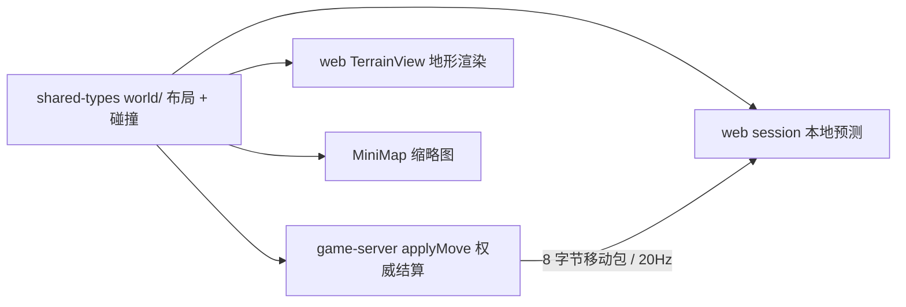

## 产品概述
把《牛马》8192×8192 的世界从「一张无限平铺的办公地板」升级为手写的中心园区：出生点周围是围栏圈起的办公广场，四个门洞通向土路，外围依次是森林、湖泊与蜿蜒河流，一座木桥跨过河面。地形会阻挡移动，服务端权威判定、客户端即时预测，小地图变成真实地形缩略图。

## 核心功能
- 手写中心园区布局：围栏（四门洞）、办公广场、土路、三片森林、湖泊与沙滩、阶梯状河流与木桥
- 地形碰撞：围栏栏板、树干、湖面、河面阻挡通行；门洞与桥面可通行；贴墙自动沿墙滑动，不会卡死
- 服务端权威结算 + 客户端同函数预测；不新增协议字段；出生点自动避开水面与围栏
- 主视图像素地形：草地基底、办公地砖广场、土路、水面流动、树冠按 y 轴正确遮挡角色
- 小地图：真实地形缩略图 + 视野内玩家点 + 当前区域名与人数
- 视口裁剪与一次性纹理生成，保证大地图下帧率与 Tick 不明显下降

## 视觉与体验
整体保持暗色苔绿像素风：办公广场是冷灰绿地砖，外围草地与森林偏深绿，湖面青蓝并缓慢流动，沙滩与土路偏暖褐，围栏是低饱和木色。围栏门洞与桥面形成明确的通行引导；小地图沿用现有终端风格面板，但内容从网格雷达升级为一块可读的园区缩略图。


## 技术栈
- 复用现有栈，不引入新依赖：TypeScript 5 strict、Next.js 15 + React 19、PixiJS 8（WebGPU 优先）、Bun WebSocket 服务端、vitest
- 地形数据与碰撞求解放在 `@niuma/shared-types`，保持 Bun / Node / 浏览器同构，无框架依赖
- 不修改二进制协议、不修改 `packages/pixel-assets` 图集生成器与 manifest 版本、不引入持久化

## 实现策略
### 总体思路
用一份「静态世界布局 + 纯函数碰撞」作为双端唯一真相：服务端在限速结算后调用 `resolveMotion` 得到权威坐标，客户端用同一函数做本地预测，渲染层与小地图从同一份布局取几何。地形美术在浏览器端用 `Graphics` 一次性生成 1:1 纹理（与现有地板、阴影、尘土的做法一致），走平铺与遮罩，不新增构建步骤。

### 关键决策与权衡
| 决策 | 选择 | 备选与拒绝理由 |
|---|---|---|
| 地形归属 | `packages/shared-types/src/world/` | 新建 `packages/world-map` 只增加 package/tsconfig/transpilePackages 装配成本；服务端下发地形需扩协议并阻塞握手 |
| 碰撞求解 | 网格索引 + 4px 子步 + 轴分离滑动 | 完整物理扫描代码量大；纯点采样会穿过 3px 薄栏板 |
| 地面渲染 | 草地基底 TilingSprite + 广场/土路矩形平铺 + 湖河水面遮罩 | 每区域烘一张大纹理会吃显存且首帧更慢；进图集生成器会联动 manifest 版本 |
| 深度关系 | `sortableChildren` 容器，角色与树/围栏统一按脚底 y 排序 | 不做排序会出现角色站在树冠上；标签与气泡单独提到顶层，避免被树冠吃掉 |
| 小地图 | 以世界→画布变换直接绘制布局（4Hz） | 预烘 1024² 离屏大图收益有限，且与布局改动容易不同步 |

### 性能与可靠性
- 碰撞查询：128px 均匀网格，单次查询只遍历邻近桶；200 人 × 20Hz ≈ 4000 次/秒，单次 O(k)，k 为邻近障碍数
- 子步 4px 小于「最薄栏板 + 玩家半径」，可视为无穿透；轴分离保证贴墙滑动稳定
- 确定性：树点用 `Math.imul` 的 mulberry32，禁止 `Math.random` / `Math.sin` / `Math.cos`，保证双端与刷新后完全一致
- 渲染：所有纹理在 `renderer.init()` 内生成完毕，帧循环零 `generateTexture`；props 按视口 ± 1 屏裁剪后再参与排序，可见对象控制在百级
- 失败兜底：出生点重采样失败时回落到广场中心；碰撞函数对非有限坐标直接返回原地，避免 NaN 污染服务端状态
- 日志：仅出生点回退时输出一次 warn，移动路径不打印日志，避免 Tick 内日志风暴
- 回滚：删除 terrain 图层与两处 `resolveMotion` 调用即回到原地板，单 PR 可逆

## 架构设计


### 模块划分
- 世界内容模块（shared-types）：手写布局、确定性撒树、区域名、障碍集合、网格索引、移动求解
- 权威结算（game-server）：限速截断后接碰撞，出生点避障
- 预测与快照（web session）：本地移动接同一求解；向小地图暴露绝对坐标快照
- 地形渲染（web）：`TerrainView` 负责纹理生成、图层填充、水面动画、视口裁剪
- 小地图（web component）：布局直接绘制 + 玩家点 + 区域名

### 数据流
按住方向键 → 客户端算目标点 → `resolveMotion` 得到本地预测 → 50ms 上报目标 → 服务端限速后 `resolveMotion` 得到权威坐标 → 同步包回到客户端 → 近距 0.35 收敛、超 8px 吸附。渲染层只消费位置，不参与碰撞判定。

## 目录结构
```
packages/shared-types/src/
├── world/
│   ├── layout.ts              [NEW]  手写中心园区坐标（围栏+四门洞、广场、土路、湖、河、桥、森林、区域名），mulberry32 确定性撒树，模块加载时构建一次
│   └── collision.ts           [NEW]  障碍类型（圆/胶囊/多边形）、128px 网格索引、isBlocked、resolveMotion（4px 子步 + 轴分离滑动）、findFreePoint
├── __tests__/
│   └── collision.test.ts      [NEW]  门洞可过、围栏阻挡并沿墙滑动、湖面不可进、桥面可过、河段不可过、出生点均不在障碍内
└── index.ts                   [MODIFY] 追加导出 world 子模块

apps/game-server/src/
├── sim/movement.ts            [MODIFY] applyMove 在限速截断后调用 resolveMotion，clampWorldX/Y 保留为最后一道
└── server.ts                  [MODIFY] spawnPoint 改为园区内随机 + findFreePoint 兜底，失败回落广场中心

apps/web/lib/game/
├── terrain.ts                 [NEW]  TerrainView：草地/水面/土路/树/围栏/桥纹理生成，地面图层填充，水面滚动，视口裁剪，资源释放
├── terrain-palette.ts         [NEW]  地形调色板唯一来源，供 TerrainView 与小地图共用，避免小地图引入 Pixi
├── pixel-art.ts               [NEW]  字符画 + 调色板生成 1:1 nearest 纹理的小工具，树/石头/芦苇用
├── renderer.ts                [MODIFY] 图层重构：草地基底、地形地面层、sortableChildren 排序层、标签顶层；updateCamera 触发裁剪；destroy 释放地形纹理
└── session.ts                 [MODIFY] 本地移动改用 resolveMotion；sampleNearby 换成 worldSnapshot（自身绝对坐标 + 附近实体绝对坐标 + self 标记 + 区域名）

apps/web/components/game/
└── MiniMap.tsx                [MODIFY] 168×168 方形画布，按世界→画布变换绘制地形、桥、围栏，叠加玩家点、区域名与视野内人数

docs/adr/0008-terrain-collision.md  [NEW]  记录地形归属、权威碰撞、不扩协议的决策、后果与复核信号
README.md                       [MODIFY] 目录说明补 terrain 模块，已知边界补充地形与碰撞描述
```

## 关键代码结构
```ts
// packages/shared-types/src/world/collision.ts
export type Blocker =
  | { kind: 'circle'; x: number; y: number; r: number }
  | { kind: 'capsule'; x1: number; y1: number; x2: number; y2: number; r: number }
  | { kind: 'polygon'; points: ReadonlyArray&lt;readonly [number, number]&gt; };

export const PLAYER_RADIUS = 7;

export function isBlocked(x: number, y: number, radius?: number): boolean;

/** 先试整段，再试单轴滑动；内部按 4px 子步推进，避免穿过薄栏板 */
export function resolveMotion(
  fromX: number, fromY: number, toX: number, toY: number, radius?: number,
): { x: number; y: number };

/** 以 (x,y) 为中心螺旋采样，返回最近的空闲点；全部被占则返回广场中心 */
export function findFreePoint(x: number, y: number, radius?: number): { x: number; y: number };
```

```ts
// packages/shared-types/src/world/layout.ts
export interface WorldRect { x: number; y: number; w: number; h: number }
export interface LakeShape { points: ReadonlyArray&lt;readonly [number, number]&gt;; shore: number }
export interface TreeInstance { x: number; y: number; variant: number }
export interface WorldLayout {
  plaza: WorldRect;
  fence: { rect: WorldRect; gates: WorldRect[] };
  paths: WorldRect[];
  lakes: LakeShape[];
  rivers: Array&lt;{ rect: WorldRect; flow: 'north' | 'south' }&gt;;
  bridges: WorldRect[];
  forests: Array&lt;{ rect: WorldRect; trees: TreeInstance[] }&gt;;
  regions: Array&lt;{ name: string; rect: WorldRect }&gt;;
}
export const WORLD_LAYOUT: WorldLayout;
export function regionAt(x: number, y: number): string;
```

## 实施要点
- 初始坐标以 (4096,4096) 为原点：围栏 3400–4800 × 3500–4600，四边门洞各 80px 宽；广场 3700–4500 × 3760–4420；湖心约 (5700,5700)、半径 650×420；河在西侧 x≈2900–3080 自北向南阶梯下行，东西主路处留 180px 桥面；三片森林分别在西北、东北、南面。数值可微调，但必须只在一处定义。
- 像素栅格：沿用 `generateTexture({ resolution: 1, antialias: false, textureSourceOptions: { scaleMode: 'nearest' } })`；不做非整数缩放；`world.scale`、`snapTexel`、`snapCss` 逻辑保持不变。
- 图层顺序：草地基底 → 林地暗斑 → 广场地砖 → 土路 → 沙滩 → 水面 → 桥 → 围栏与树（同排序层）→ 角色 → 标签气泡。水在角色之下，桥在水之上、角色之下。
- `EntityView` 需要把 label 与 bubble 拆到独立 `labelRoot`，`setPosition` 同时更新本体与标签两层位置；`destroy` 两层都要销毁。
- 围栏拆成约 64px 一段的精灵，各自 `zIndex = 段底边 y`，否则角色沿竖向围栏走时遮挡关系会错。
- 水面动画只改 `TilingSprite.tilePosition`，按整数像素步进；湖泊慢、河流快，帧率无关。
- 小地图 168×168 画布对应 ±900px 世界窗口，4Hz 重绘；`aria-label` 带上当前区域与人数。
- 远端实体仍走视觉插值，允许贴墙角轻微擦穿，不做二次碰撞修正，避免插值抖动。
- 验证顺序：`pnpm typecheck` → `pnpm test` → `pnpm bench`（200 人 Tick 对比），最后手动跑一局确认门洞、桥面、沿墙滑动与树冠遮挡。


## 设计方向
「暗色苔绿像素田园 × 办公园区」：保持现有终端绿与低饱和像素质感，不引入写实光照。用地砖的冷灰绿与草地的深苔绿形成冷/更冷的层次，用湖水青蓝、沙滩暖褐、木栏低饱和黄褐做点缀，让园区边界一眼可读。

## 主视图（游戏视口）
- 草地基底：256px 无缝图块，深苔绿底 + 1px 亮边草簇与零星碎石，铺满全世界但不抢角色。
- 办公广场：复用现有 256px 办公地砖，只铺在围栏内的矩形上，边缘加一圈 2px 深色路缘，形成「人造地面 / 自然地面」的硬边界。
- 土路：128px 泥土图块，从四个门洞向外延伸；路面有 1px 深色车辙与碎石，与草地交界处用 2px 抖动像素过渡。
- 湖泊：椭圆多边形，外圈 16px 沙滩，水面用 32px 水纹图块平铺并缓慢滚动；岸边压 2px 深青描边。
- 河流：轴对齐阶梯段，宽约 180px，水面滚动方向随段变化；横跨道路处放木桥，桥面 12px 木板 + 两侧 2px 栏杆，桥头压 1px 深色投影。
- 围栏：64px 分段，两根横栏 + 立柱，立柱顶部 1px 高光；门洞处断开并在两侧加短柱，形成明确入口。
- 森林：3–4 种 48×56 左右的树，深绿冠层 + 2px 暗边 + 3px 亮面，树干偏褐；树冠按脚底 y 排序，角色走到树后会被遮挡。
- 装饰：石头、芦苇、水洼只做视觉点缀，不参与碰撞，密度控制在每屏不超过 12 个。

## 小地图面板
- 尺寸改为 168×168 方形画布，保留 2px `ink-600` 边框与半透明 `ink-900` 背板，与现有 HUD 一致。
- 头部：MapPin 图标 + 当前区域名（办公区 / 摸鱼湖 / 加班林 / 周报河 / 园区围栏），右侧显示视野内人数。
- 地形层：草地深绿底、广场冷灰块、土路褐线、水面青蓝、沙滩浅褐、森林用 2px 深绿点阵、围栏 2px 木色线、桥 2px 高亮短线；全部按世界→画布变换直接绘制，不做插值模糊。
- 玩家层：自身 3×3 薄荷绿方块并带 1px 朝向刻线，他人 2×2 `mist-300` 方块；超出窗口的点裁掉。
- 底部：当前坐标与「AOI 900px」，等宽 9px 小字，颜色 `mist-500`。

## 动效与交互
- 水面每 480ms 以整数像素滚动一档，湖慢河快；树冠不做摆动，避免整屏噪声。
- 小地图 4Hz 刷新，玩家点位置取整到画布像素，不出现半像素抖动。
- 不使用 bounce / elastic 缓动；面板本身无入场动画。

## 可访问性
- canvas 的 `aria-label` 动态包含区域名与人数；面板标题用真实文本而非 canvas 绘制。
- 地形颜色对比度满足暗色背景下的可辨识要求，围栏与水面不单靠颜色区分，另有描边与纹理差异。

## Agent Extensions
### Skill
- **layer-pixel-art**
  - Purpose: 生成草地、水面、土路、树、石头、芦苇与围栏的像素图块，保证网格对齐、调色板一致、无抗锯齿
  - Expected outcome: 一套 1:1 nearest 的像素纹理定义（字符画 + 调色板），可直接被 `pixel-art.ts` 转成纹理
- **impeccable**
  - Purpose: 重做小地图面板的视觉与信息层级，并做一次可访问性与暗色对比度收尾
  - Expected outcome: 168×168 小地图的最终布局、字号、颜色与 aria 文案，通过 `/impeccable polish` 自检
- **principal-software-architect**
  - Purpose: 把「地形进 shared-types、服务端权威碰撞、不扩协议」固化为 ADR-0008，并复核权衡与回滚路径
  - Expected outcome: 一份含背景、问题、决策、后果、复核信号的决策记录
