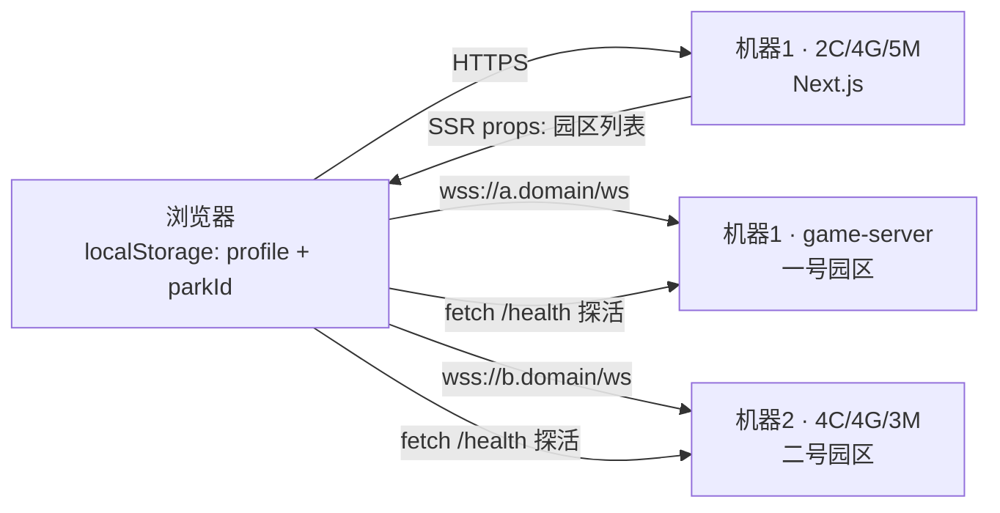

## 产品概述

园区目前是单实例部署。本次要在第二台服务器上再开一座**完全独立**的园区，玩家在捏完人后可以自行选择进入哪一座，并记住这次的选择；进入园区后还能随时切换。

两台机器的实际规格决定了角色分配：**2C/4G/5M 那台跑完整站点 + 主园区，4C/4G/3M 那台只跑第二园区**。瓶颈是出口带宽而非 CPU，方案的全部调参都围绕这一点。

## 核心功能

### 1. 抓完人后的选园
捏人页点击「保存并上岗」后进入新的选园页（`/enter`），页面用两张卡片分别呈现「一号园区」与「二号园区」。每张卡片实时展示在线人数、容量水位和浏览器到该园区的延迟；当某个园区无法连接时，显示「不可达」并禁止选择，同时仍保留另一个园区可选。

### 2. 记住上次的选择
玩家选过的园区写入本地存档。之后重新打开网站时，系统不再展示选园页，而是直接进入上次的园区；首次到访或存档中没有园区记录的老玩家，则会先看到一次选园页。

### 3. 园区内切换
园区界面右上角提供「切换园区」入口，点击后回到选园页，选完再重新进入。切换后角色从新园区的出生点开始，不会带过去上一座园区的座位和坐标。

### 4. 两座园区各自独立
线上的玩家、聊天、座位占用、排队都只属于各自园区，互不可见；但名字、外观、状态等本地资料在两边通用，玩家在两座园区里是同一个「人」。

### 5. 部署形态
一台机器保留完整站点（页面 + 游戏服），另一台只运行游戏服并使用独立子域名直连，保证两边的流量真正分流，同时玩家的本地存档不会因为域名不同而丢失。

## 视觉要求

选园页沿用园区既有的工业终端风格：深墨色背景、硬边框直角卡片、等宽大写字距标签、薄荷绿与琥珀色作为状态色。两张卡片并排，点击后有明确的选中与进入反馈；移动端改为纵向堆叠，信息不裁切。

## 技术栈

沿用现有栈，**不引入任何新依赖、不引入数据库/服务发现/网关**：

- Web：Next.js 15 App Router + React 19 + Tailwind v4 + Zustand 5
- 游戏服：Bun `Bun.serve` WebSocket，20Hz 固定 Tick
- 配置：环境变量（沿用 `loadConfig()` 的既有模式）
- 存储：仅浏览器 localStorage（遵守 ADR-0004 服务端零持久化）

## 实施方案

### 总体策略

三件事各归一层，互不渗透：

1. **园区列表是服务端配置**（`GAME_PARKS`），由 Server Component 直接作为 props 下发给客户端，不做客户端先 fetch 再渲染的瀑布。
2. **客户端只持有 parkId**，从不持有 URL。`/play?park=` 的解析在白名单内完成，非法 id 回落第一个园区，杜绝「改存档就连到任意地址」。
3. **连接端点在一次会话内不可变**：`GameSession.start()` 接收解析后的 `wsUrl`，重连沿用同一地址，不会在重连时漂移到另一座园区。

### 关键决策与理由

| 决策 | 理由 |
|---|---|
| 列表走 SSR props，不新增 `/api/parks` 路由 | 选园页首屏即带数据，少一跳；列表变更只重启 Web，无需重新构建 |
| `ws` / `health` 允许写成相对路径，客户端用 `new URL(x, location.href)` 归一化 | 单机部署零配置即可运行，也可写 `//b.domain/ws` 避免硬编码协议 |
| `GAME_PARKS` 缺省时合成单个 `main` 园区 | 保证现有单机部署行为完全不变，也是唯一需要的回滚开关 |
| 实时状态由浏览器直连各服 `/health`（已带 `access-control-allow-origin: *`） | 一次请求同时拿到在线人数与真实 RTT；跨域可读，且不占用主站带宽 |
| `/enter` 是独立页而非模态 | `GameViewport` 挂载即连服，插入「未连接态」会把连接生命周期判断塞进渲染层，回滚成本更高 |
| snapshot 增加 `park` 字段但不升 `v` | 升 v 会清掉所有老玩家的落点；加字段由 merge 写入兼容，跨园时丢弃 resume |
| Web 与主园区同机，且对 Web 静态资源做 nginx 限速 | 游戏出口水位计只统计游戏进程发出的字节，看不到 nginx 转发 Web 的流量；不限速时 Web 突发会吃满物理带宽而闸门毫无察觉 |

### 性能与可靠性

- 探活：`Promise.allSettled` 并行请求，单服超时 1200ms，页面可见时每 15s 轮询、`hidden` 时暂停，组件卸载清定时器与 AbortController。
- 选园页是纯静态渲染 + 一次并发探活，无渲染热路径；园区列表通常 2 项，O(n) 查表可忽略。
- 座位与坐标的跨园隔离在客户端完成（不带 resume），服务端仍然对座位做权威裁决，双保险。
- `DEPLOY_ROLE=game` 时跳过 Next 构建与 Web 目录切换，避免在只有游戏服的机器上浪费 1G+ 内存做一次永远用不上的构建。
- `GAME_MAX_ONLINE` 设得高于带宽可承载人数：带宽水位会先触发 AIMD 收缩，人数维度只是二次保险，不按「带宽÷人均」硬算。

### 向后兼容

- 不配 `GAME_PARKS`：`loadParks()` 合成 `{ id: 'main', name: '主园区', ws: '/ws', health: '/health' }`，行为与当前一致。
- 不配 `GAME_PARK_ID`：`/health` 返回 `parkId: 'main'`，老客户端不受影响（只是多了字段，无协议变更）。
- 协议零改动，`packages/shared-types` 不动。

## 架构设计



两座 game-server 之间**没有任何连接**：世界只在各自进程内存里，不需要分片协议与一致性机制。这是零持久化约束带来的结构性红利。

## 目录结构

```
niuma/
├── apps/
│   ├── web/
│   │   ├── app/
│   │   │   ├── play/page.tsx                    # [MODIFY] 改为 Server Component：读 loadParks() 与 searchParams.park，渲染 <PlayShell>
│   │   │   └── enter/page.tsx                   # [NEW] 选园页外壳（Server Component），读 loadParks() 与 ?from=play，导出 metadata，渲染 <ParkPicker>
│   │   ├── components/
│   │   │   ├── park/ParkPicker.tsx              # [NEW] 客户端选园卡片：探活、选中、跳转 /play?park=；含加载/不可达/空列表三态
│   │   │   ├── park/use-park-health.ts          # [NEW] 探活 hook：并行 fetch + 超时 + 15s 轮询 + hidden 暂停 + 清理
│   │   │   ├── game/PlayShell.tsx               # [NEW] 极薄客户端壳，用 next/dynamic(ssr:false) 加载 GameViewport 并透传 parks/parkId
│   │   │   ├── game/GameViewport.tsx            # [MODIFY] 接收 parks/parkId props；解析端点后传给 session.start；非法 id 回落
│   │   │   └── game/Hud.tsx                     # [MODIFY] 工牌「所在地」显示园区名；右上角控件列加「切换园区」按钮
│   │   ├── lib/
│   │   │   ├── park.ts                          # [NEW] 纯函数与类型：ParkEntry、sanitizeParks()、resolvePark()、toWsUrl()/toHealthUrl()、saveParkPref()/loadParkPref()（key = niuma:park:v1，id 只允许 /^[a-z0-9-]{1,32}$/）
│   │   │   ├── park.server.ts                   # [NEW] 仅服务端：loadParks() 读 GAME_PARKS，解析失败/空数组回落 main；memo 一次
│   │   │   ├── net/client.ts                    # [MODIFY] defaultUrl() 退为兜底；构造器 url 成为必传语义
│   │   │   ├── game/session.ts                  # [MODIFY] start() 增加 wsUrl 参数并透传给 new NetClient(handlers, wsUrl)
│   │   │   ├── game/snapshot.ts                 # [MODIFY] SessionSnapshot 加 park?: string；新增 readResumeForPark(parkId) 在 park 不匹配时返回 undefined
│   │   │   ├── auto-enter.ts                    # [MODIFY] 增读 niuma:park:v1（常量本地各写一份 + 测试断言不漂移），命中跳 /play?park=id，否则跳 /enter
│   │   │   ├── game-ui.ts                       # [MODIFY] 状态加 park: { id, name } | null 与 setPark
│   │   │   └── __tests__/
│   │   │       ├── park.test.ts                 # [NEW] sanitizeParks 丢弃非法项/重复 id/空列表回落；toWsUrl 相对与绝对路径、http→ws 换协议；parkPref 坏数据清理
│   │   │       └── snapshot.test.ts             # [MODIFY] 新增：park 不匹配返回 undefined；park 匹配正常恢复；无 park 的旧存档按「不匹配」处理
│   │   └── components/creator/CreatorShell.tsx  # [MODIFY] save() 末尾 router.push('/enter')
│   └── game-server/
│       └── src/
│           ├── config.ts                        # [MODIFY] ServerConfig 加 parkId/parkName，读 GAME_PARK_ID（默认 main）/ GAME_PARK_NAME（默认 主园区）
│           └── server.ts                        # [MODIFY] /health 响应增 parkId/parkName；CORS 头保持只挂 /health 与根路径
├── deploy/
│   └── jenkins-deploy.sh                        # [MODIFY] 新增 DEPLOY_ROLE=all|web|game；game 角色跳过 pnpm build 与 web 目录切换/pm2；GAME_PARK_ID/NAME 透传
├── docs/
│   ├── deploy-multi-park.md                     # [NEW] 双机部署指南：机器角色与规格对照、完整环境变量清单与取值依据、两台机器的 nginx 片段（wss 反代 / Origin 白名单 / Web 限速 / /health CORS）、certbot 签发、部署顺序、探活命令、容量调参、回滚开关、故障排查
│   └── adr/0043-multi-park-deployment.md        # [NEW] 决策、被拒方案（独立站点丢存档 / 同域名反代不分流）、后果与回滚开关
├── .env.example                                 # [MODIFY] 增加 GAME_PARKS、GAME_PARK_ID、GAME_PARK_NAME 示例
└── README.md                                    # [MODIFY] 「已知边界」去掉「不含分线」；新增多园区部署一节并链接 docs/deploy-multi-park.md
```

## 关键契约

```ts
// apps/web/lib/park.ts —— 服务端与客户端共用，不含任何 window / process.env 访问
export interface ParkEntry {
  /** 白名单 id，仅 [a-z0-9-]{1,32} */
  id: string;
  name: string;
  /** 可写 `/ws` 相对路径或 wss:// 绝对地址 */
  ws: string;
  /** 可写 `/health` 相对路径或 https:// 绝对地址 */
  health: string;
}

/** 服务端下发 → 客户端查表，永不把 URL 交给存档 */
export function resolvePark(parks: readonly ParkEntry[], id: string | null): { park: ParkEntry; fallback: boolean };
export function toWsUrl(endpoint: string, origin: string): string;   // /ws → wss://host/ws；http(s) → ws(s)
export function toHealthUrl(endpoint: string, origin: string): string;
```

## 实施注意

- **Next 15 的 `searchParams` 是 Promise**，`app/play/page.tsx` 与 `app/enter/page.tsx` 里必须 `await searchParams`。
- `next/dynamic` 的 `ssr: false` 不能在 Server Component 中使用，因此必须保留 `PlayShell` 这一层薄客户端壳，不要试图把 `dynamic` 直接写进 `page.tsx`。
- `auto-enter.ts` 是内联进 HTML 的字符串 IIFE，**不能 import 任何 `'use client'` 模块**；`niuma:park:v1` 的 key 与 profile key 一样，两处各写一份，由测试断言不漂移。跳转前必须用 `/^[a-z0-9-]{1,32}$/` 校验 id，避免存档被改出带引号或斜杠的路径。
- `niuma:session:v1` 的 `v` **不要动**。加字段靠 merge 写入即可；升 `v` 会清空所有老玩家的落点，这是不可接受的回归。
- 切换园区用整页导航而非原地重连：`GameSession.stop()` 会走 `persistNow()` 落盘，新页重新建会话，路径最短且不需要在 session 内部引入「换服」状态机。
- Hud 的「切换园区」按钮要带 `data-no-immersive`，与「打卡下班」一致，避免触发全屏手势拦截。
- `loadParks()` 在服务端模块作用域内解析一次即可（模块级 memo），避免每次 SSR 重复 JSON.parse。
- 探活失败必须与「在线 0 人」区分开：前者禁用选择，后者允许进入并提示「当前没人，去当第一个」。
- 第二园区的 `/health` 只对 `/health` 路径放开 CORS，nginx 层再加 `Origin` 白名单，不要把 `*` 扩散到全站。

## 部署要点

### 两台机器的角色分配

| | 机器 1：2C / 4G / **5M** | 机器 2：4C / 4G / **3M** |
|---|---|---|
| 角色 | 完整站点 + **一号园区（主园区）** | 仅游戏服 + **二号园区** |
| 进程 | nginx + pm2 `niuma-web`(Next) + pm2 `niuma-game`(Bun) | nginx + pm2 `niuma-game`(Bun) |
| 内存占用 | 768M + 600M + nginx/OS ≈ 1.8G / 4G | 600M + nginx/OS ≈ 0.9G / 4G |
| 物理带宽 | 5 Mbps ≈ 625 KB/s | 3 Mbps ≈ 375 KB/s |
| 可用载荷 (×0.9) | ≈ 560 KB/s | ≈ 340 KB/s |
| Web 预留 | 160 KB/s（`limit_rate 200k`） | 0 |
| `GAME_MAX_EGRESS_KBPS` | **400** | **300** |
| `GAME_MAX_ONLINE` | **90** | **70** |
| 预期在线 | 50–65 人 | 40–50 人 |

**为什么这么分：**

- 实测 60 人在线 Tick p95 = 2.03 ms，预算 25 ms，只用掉 8%；200 人全同屏 p95 = 6.49 ms，用掉 26%。**CPU 从不是瓶颈，出口带宽是**。两台合计 8 Mbps ≈ 700 KB/s 载荷，按人均 5–8 KB/s 对应 90–115 人，对比当前单机 60 人上限。
- 2 核那台正好承载两个单线程事件循环（Node 一个、Bun 一个），一进程一核，互不抢占。这是它唯一「刚刚好」的用法。
- Web 首访只有约 0.8 MB（`public/` 全量 362 KB + JS chunk），且浏览器缓存后近似为零；把它放在宽管上，配合限速把最坏占用钉死，剩下全部留给主园区的稳定流量。
- 4 核那台多出来的 CPU **不能用**：在上面多开第三个园区不会增加一个玩家（出口共享），跑第二份 Web 会带来双份部署成本而收益极低。留白。

### 机器 1 环境变量（`DEPLOY_ROLE=all`）

```bash
DEPLOY_ROLE=all
GAME_PARKS=[{"id":"a","name":"一号园区","ws":"/ws","health":"/health"},{"id":"b","name":"二号园区","ws":"wss://b.你的域名/ws","health":"https://b.你的域名/health"}]
GAME_PARK_ID=a
GAME_PARK_NAME=一号园区
GAME_SERVER_HOST=127.0.0.1     # 只允许本机 nginx 访问，不直连 3001
GAME_SERVER_PORT=3001
GAME_MAX_EGRESS_KBPS=400       # 5M × 0.9 − Web 预留
GAME_MAX_ONLINE=90             # 高于带宽可承载，由水位先收缩
GAME_TICK_BUDGET_MS=25
WEB_PORT=3000
WEB_HOST=127.0.0.1
WEB_HEAP_MB=512                # 4G 机型：768M + 600M 进程上限后仍有富裕
NEXT_PUBLIC_GAME_WS_URL=       # 留空，浏览器走同源 /ws
```

### 机器 2 环境变量（`DEPLOY_ROLE=game`）

```bash
DEPLOY_ROLE=game
GAME_PARK_ID=b
GAME_PARK_NAME=二号园区
GAME_SERVER_HOST=127.0.0.1
GAME_SERVER_PORT=3001
GAME_MAX_EGRESS_KBPS=300       # 3M × 0.9 − TLS/nginx 余量
GAME_MAX_ONLINE=70
GAME_TICK_BUDGET_MS=25
```

机器 2 **不需要** `NEXT_PUBLIC_GAME_WS_URL`、`GAME_PARKS`、`WEB_*`：它不构建也不运行 Web。

### 机器 1 的 nginx 追加

```nginx
# Web 静态资源限速：把 Web 的最坏带宽钉死，剩余全部留给游戏服
location ~ ^/(sprites|_next/static)/ {
    limit_rate 200k;
    limit_conn addr 6;
    expires 1y;
    add_header Cache-Control "public, immutable";
}

# 一号园区（同源 WebSocket）
location /ws {
    proxy_pass http://127.0.0.1:3001;
    proxy_http_version 1.1;
    proxy_set_header Upgrade $http_upgrade;
    proxy_set_header Connection "upgrade";
    proxy_set_header X-Real-IP $remote_addr;
    proxy_read_timeout 3600s;   # WS 空闲不能被 60s 默认超时掐断
    proxy_buffering off;        # 实时帧不要过缓冲
}
```

`limit_rate 200k` 让首访约 4 秒打开，游戏侧最多被挤 4 秒；不设限速时会按 TCP 公平竞争，最坏可持续十几秒。

### 机器 2 的 nginx 站点

```nginx
map $http_origin $park_origin_ok {
    default                       0;
    "https://你的域名"             1;
    "https://www.你的域名"         1;
}

server {
    listen 443 ssl http2;
    server_name b.你的域名;

    # 探活接口单独放开，只给它 CORS
    location = /health {
        add_header Access-Control-Allow-Origin "*" always;
        add_header Cache-Control "no-store" always;
        proxy_pass http://127.0.0.1:3001;
    }

    # 游戏服 WebSocket：只放行主站来源
    location /ws {
        if ($park_origin_ok = 0) { return 403; }
        proxy_pass http://127.0.0.1:3001;
        proxy_http_version 1.1;
        proxy_set_header Upgrade $http_upgrade;
        proxy_set_header Connection "upgrade";
        proxy_set_header X-Real-IP $remote_addr;
        proxy_read_timeout 3600s;
        proxy_buffering off;
        proxy_socket_keepalive on;
    }
}
```

证书：`certbot --nginx -d b.你的域名`。**必须是 `wss://`**：主站是 HTTPS，浏览器不允许连 `ws://`。

### 部署顺序

1. 机器 2：装 Bun / nginx / certbot → `DEPLOY_ROLE=game` 部署 → 子域名解析 → 签发证书 → 套用上面的 nginx 站点。
2. 机器 1：更新 `GAME_PARKS` 与 `GAME_MAX_EGRESS_KBPS` → `DEPLOY_ROLE=all` 重新部署 → 套用 Web 限速与 `/ws` 反代。
3. 探活：`curl -s https://b.你的域名/health` 必须返回 `parkId: "b"`；`curl -s http://127.0.0.1:3001/health` 在机器 1 返回 `parkId: "a"`。
4. 验收：A 进 → 切 B → 关浏览器重开直进 B → 停掉机器 2 的 game 进程，确认选园页 B 显示「暂不可达」且 A 仍可进。

### 回滚

`GAME_PARKS` 只保留 `main` 一项并重启 Web：选园页自动退化为单卡片直接进入，等价于当前行为。**代码不回滚，只回滚配置**，这就是这套方案不可逆性低的地方。

### 部署指南文档

`docs/deploy-multi-park.md` 需要写成一份可以照着抄的操作手册，至少含：

- 两台机器的角色、规格与「为什么这么分」的带宽/CPU 依据（含上面那张分配表）
- 完整的 A / B 环境变量清单，每个变量标注取值理由
- 机器 2 从零开始的步骤：装 Bun、装 nginx、装 certbot、DNS 解析、签发证书、站点配置
- 两台机器的 nginx 片段（`/ws` 反代、Origin 白名单、`/health` CORS、Web 静态限速）
- 部署顺序与探活命令（`curl /health` 校验 `parkId`）
- 容量与阈值的调参依据：`GAME_MAX_EGRESS_KBPS` 怎么按带宽算、`GAME_MAX_ONLINE` 为什么设高
- 回滚开关与验收清单
- 故障排查：B 显示不可达、B 延迟偏高、只排队进不去、Web 突发导致游戏卡顿

## 设计风格

沿用园区既有的「工业终端 / 打孔工牌」语言，不另起一套视觉。选园页是玩家从捏人工作台走向园区的那道门，观感要像在门禁机前刷卡选楼层，而不是商城里的商品列表。

- **底色**：`ink-950` 全屏，卡片用 `ink-900`，中间不加任何渐变或玻璃拟态。
- **结构**：2px 硬边框、零圆角、不用阴影；卡片之间用 1px 分隔线与留白建立节奏。
- **信息层级**：卡片顶部是等宽大写、字距 0.16em 的小标签（`PARK 01 / 一号园区`），中部是大号园区名，底部一行三列的实时数据（在线 / 容量 / 延迟），数字用等宽字体且字号明显大于标签。
- **状态色**：可用为 `mint-400`，拥塞为 `amber-400`，不可达为 `mist-500` 加斜线纹理；绝不使用红绿交通灯式的饱和色。
- **微交互**：卡片 hover 时边框转 `mint-400/60` 并把右上角箭头右移 2px，选中后整卡出现一条 2px 的左侧竖条；延迟数字按实测值在 200ms 内做一次滚动淡入，不做弹跳缓动。

## 页面结构（`/enter`）

1. **顶部标识条**：左侧返回箭头「返回工作台」，中间「选择园区」标题，右侧当前工牌名与物种标签（复用 `CreatorShell` 头部结构）。
2. **引导区**：一行 28–34px 的标题「今天去哪座园区上班」，下面一行 `mist-500` 说明「两座园区的人互相看不见，工牌与外观通用」。首次进入时在右侧显示「之后会自动进入上次的选择」。
3. **园区卡片区**：桌面两列等宽，移动端纵向堆叠。每卡含编号标签、园区名、一句状态描述（`园区空闲` / `正在排队` / `暂不可达`）、三列数据与右下角「进入」按钮。骨架屏用同尺寸的灰色方块，不改变布局高度。
4. **底部提示**：等宽小字说明「切换园区后角色从园区门口开始，座位不会跟随」，以及 `p95` 延迟的采样说明。

## 响应式

- `>=768px`：两列卡片 + 顶部横向标识条；卡片高度固定 220px，避免探活回填时跳动。
- `<768px`：单列铺满，卡片高度降到 168px，三列数据压缩为两列（在线 / 延迟），容量改为卡片底部的一条 2px 水位条。
- 安全区：底部留 `env(safe-area-inset-bottom)`。

## 无障碍

- 卡片是 `<button>`，`aria-describedby` 指向状态文本；不可达时 `aria-disabled="true"` 但仍可聚焦以读出原因。
- 状态不只靠颜色：不可达同时有斜线纹理与文字「暂不可达」。
- 探活结果变化用 `aria-live="polite"` 播报一次，轮询不回填时不重复播报。

## Agent Extensions

### Skill

- **impeccable**
  - Purpose: 新增 `/enter` 选园页与园内「切换园区」入口属于新建 UI，需按既有视觉语言成形并收尾
  - Expected outcome: 选园页与 HUD 按钮符合项目硬边框工业风，通过 `/impeccable polish` 自检无 primary findings（不使用烂大街字体、不用紫蓝渐变、不用弹跳缓动）

- **principal-software-architect**
  - Purpose: 产出 `docs/adr/0043-multi-park-deployment.md`，把「Web 单源 + 多 game-server」的决策、被拒方案与回滚路径留档
  - Expected outcome: 一份与现有 ADR 风格一致、含决策/后果/替代方案的决策记录，且明确 Web 单点与 4 核机器 CPU 闲置为已知非目标

- **codebase-design**
  - Purpose: 保证 `lib/park.ts`（纯函数 + 类型）与 `lib/park.server.ts`（配置读取）之间的接缝是深模块，客户端不需要了解环境变量与 URL 归一化细节
  - Expected outcome: 两个文件的接口保持小面（`loadParks` / `resolvePark` / `toWsUrl`），实现细节全部藏在内部
