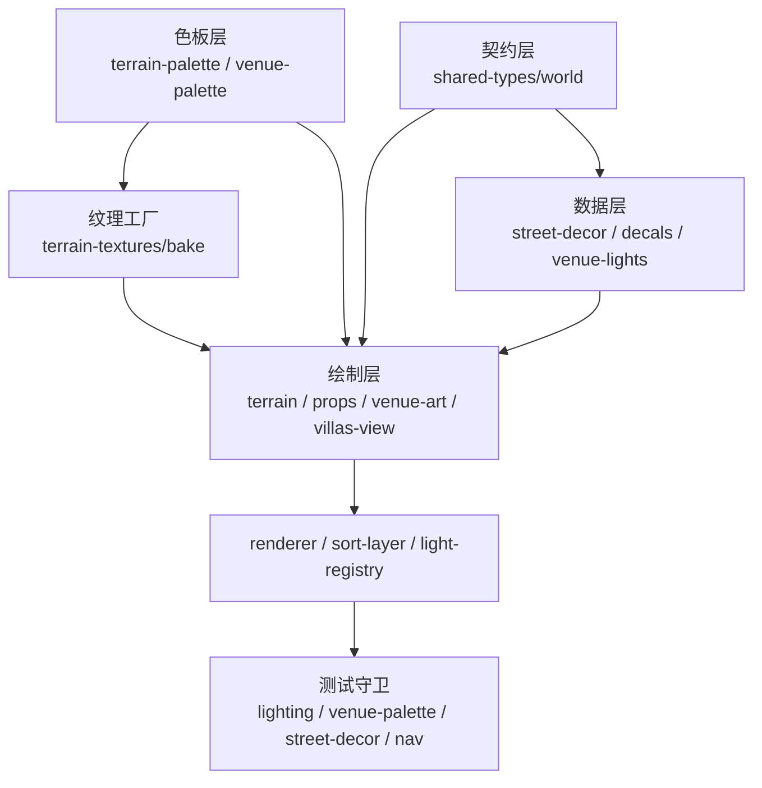

## 用户需求
在《牛马 NIOMA》中执行一次覆盖全图的美术方向重置，彻底剔除刻意国风与中式仿古元素，转为「现代高压科技园区 + 赛博街头夜市 + 90s 复古工业」。

## 核心功能
- **审美推翻**：拆除朱红门楼、瓦当屋檐、仿古牌坊、古典石雕；改用清水混凝土、钢构玻璃幕墙、哑光钢板、卷帘门、金属雨棚、LED 大屏。
- **氛围对撞**：企业区冷白荧光（0xd8eef8 / 0x7ca8b8）与生活区琥珀暖灯、霓虹粉紫（0xffd285 / 0xf06595 / 0x9b5de5）形成冷暖张力；沥青路带微雨积水与霓虹倒影。
- **五大辖区重塑**：西区企业核心区（玻璃幕墙 + CRT 冷光栅格 + 气密门 + 咖啡吧台）、北区霓虹娱乐街（夜店霓虹 / 改车铺 / 美式餐车）、中央广场（折叠钢结构雨棚 + LED 荣誉屏 + 亚克力排班架）、南区生活庄园（包豪斯公寓 + 现代 Loft 小院）、景观水系湿地（银杏 / 冬青 / 羽毛枫 / 芦苇美人蕉 / 矩阵竹带 / 玻璃花房 / 临水冷萃馆 / 亲水浮台）。
- **环境叙事**：空调外机与冷凝水渍、施工锥桶减速带、压扁纸箱外卖杯、电驴拖痕。
- **二期锚点**：2 座现代玻璃电话亭（CALL 灯箱）、12 面水泥毛坯涂鸦墙，本期只布点不接通交互。

## 视觉与工程约束
- 严禁纯黑与中性死灰；轮廓统一深靛 0x2a3142 或固有色 ×0.40 混深靛；投影统一冷靛 0x1e2846 @0.18~0.22。
- 1:1 整数纹素烘焙、nearest 采样、2:1 像素斜线阶梯，不出现混像素与插值虚边。
- 60FPS 循环零分配；牌匾与动态信息沿用字段脏检查。
- 常驻场所光不超过 20 盏并通过 18..22 断言，总预算 MAX_LIGHTS = 96。
- 碰撞收敛到底座 AABB，18 处导航点、路网与 A* 全部畅通。

## 交付效果
玩家进入园区即读到「冷冽加班楼 vs 暖黄夜市」的对照；建筑、植被、道具、路面呈现统一的现代工业像素质感，且全仓类型检查、单测与生产构建全部通过。


## 技术栈
沿用现有仓库技术栈，不引入新框架：
- 渲染：PixiJS v8（`Graphics` 构造期烘焙 + `bake()` 1:1 纹素工厂），Dedicated Worker + OffscreenCanvas
- 语言/构建：TypeScript + Next.js 15 App Router，npm workspaces 四包
- 测试：`bun:test`（`apps/web/lib/game/__tests__`）+ Vitest 全仓
- 契约层：`packages/shared-types`（禁止 Pixi/React/DOM/Node API）

## 实施策略

### 单一真相优先
色板先行：所有材质色先进 `terrain-palette.ts` / `venue-palette.ts`，绘制代码只引用，不写第二份十六进制。这是本次改造的根，先做能一次性消灭大量散落硬编码。

### 「数据层加种类，绘制层加贴图」的两段式扩展
仓库已存在成熟分工，直接沿用、不新造模式：
- `street-decor.ts`（纯数据，可被 bun:test 直接导入）+ `street-decor-art.ts`（Pixi 绘制）
- `decals.ts`（种类 + 落点哈希）+ `terrain.ts` 的 `addDecals`
- `terrain-textures.ts`（`bake` 工厂）+ `terrain.ts`（组装进场景）

新增街道家具、地面细节、树种一律走这条链，**不新建 `terrain-art.ts` / `foliage-art.ts` / `props-view.ts`**（提示词中的这三个文件在仓库不存在）。

### 关键决策与取舍
1. **国风几何 vs 纯色板可解**：仅靠换色能解决的（门楼改色、灯笼改霓虹串灯）走色板；几何本身是瓦当/飞檐/牌坊的（`WELCOME_LANDMARKS.arch`、`venue-art.ts` 檐口带、`festival-decor.ts` 树梢灯笼），必须重画几何，并在 `packages/shared-types/src/world/layout.ts` 只追加、不改既有坐标。
2. **树种不扩契约**：`WORLD_LAYOUT.groves/looseTrees` 已有 `variant` 字段，新增 `speciesAt(x, y)` 纯函数按辖区/区域派生树种，避免改动 51KB 的 `layout.ts` 与双端数据同步。这是最低可行层。
3. **新道具不进 `PROP_KINDS`**：`street-decor.ts` 明确「零碰撞、只画不挡、不改协议」。电话亭与涂鸦墙按装饰层布点，位置导出为客户端常量供二期接单/涂鸦使用，避免动服务端校验与 `hotspots.ts` 分发链。
4. **灯光只换色温不加盏数**：`venueLights()` 维持 18–22，`lighting.test.ts` L150-214 的坐标与色值断言要同步核对（灯柱 0xffc07a / 售货机 0xd9ecff 是写死的）。
5. **树碰撞已达标**：`collision.ts` 已用 `TREE_TRUNK_RADIUS = 12` 的 `footCircle`，即树冠可穿行。本次不改成 AABB（避免破坏 `pathfinding`/`nav` 断言），只为新增底座道具补 AABB。

### 性能与零 GC
- 所有新纹理只在 `build()` 构造期烘焙一次，帧循环零新增分配。
- 新增纹理所占显存需设上限：街道家具每种 1 张、树种每类 trunk+canopy 各 1 张、地面材质每种 1 张，不做运行时 `generateTexture`。
- 水洼倒影、Scanline、空调热浪一律用已有 `venue-motion.ts` 的相位函数（`neonPulse`/`waterGlint`/`flicker`）驱动 alpha，不新建计时器。

### 风险控制
- `STREET_DECOR_KINDS`、`DECAL_KINDS` 的数组顺序即图集帧号，**只允许尾部追加**。
- `festival-decor.test.ts` L157 断言门楣彩旗与树梢灯笼不计入常驻光池，改灯笼外观时不得改变 `lit` 语义。
- `venue-palette.test.ts` 断言 seam ≤ main 明度、描边不超过母色 0.8 倍，新冷色板必须满足。
- `pixel-assets` 列 0..33 不可移动。

## 架构设计



依赖方向单向：契约 → 数据 → 绘制 → 渲染。色板是全站叶子节点，被所有绘制层引用但自身不依赖任何模块。

## 目录结构

```
apps/web/lib/game/
├── terrain-palette.ts        # [MODIFY] 追加现代材质色（混凝土/沥青/水磨石/荧光/霓虹），保留既有草地水系键名不变
├── venue-palette.ts          # [MODIFY] 重写 VENUE_COLORS 19 项色值；新增 URBAN_MATERIALS（钢/哑光钢板/玻璃/亚克力/铝）；保留 TOWN_MATERIALS 导出以兼容既有 import
├── terrain-textures.ts       # [MODIFY] 新增 makeAsphaltTexture / makeWetAsphaltTexture / makeConcreteTexture / makeTerrazzoTexture；makeTreeParts 增加 species 参数
├── terrain-edge.ts           # [MODIFY] 新增 4 种抖动过渡瓦片，草/泥/沙/湖岸交界不再硬切
├── terrain.ts                # [MODIFY] addTrees 按 speciesAt 取纹理；addDecals 追加落叶/垃圾/拖痕层；addWaterSurface 波光
├── vegetation-species.ts     # [NEW] 纯函数 speciesAt(x,y) 与 5 种树种的形态/色板参数表，可被 bun:test 直接导入
├── decals.ts                 # [MODIFY] DECAL_KINDS 尾部追加 litter / tireTrack / fallenLeaf，顺序即帧号
├── road-dressing.ts          # [MODIFY] 追加井盖、微裂纹、积水反光块、黄色导向箭头变体
├── street-decor.ts           # [MODIFY] STREET_DECOR_KINDS 尾部追加 bench/busStop/binSorted/lampPost/acUnit/crateStack/scooter/vending/arcade/phoneBooth/graffitiWall/cone/bump；新增尺寸与落点规则
├── street-decor-art.ts       # [MODIFY] 为每个新 kind 写 bake 绘制函数，全部走 VENUE_SHADOW 投影与深靛描边
├── villas-view.ts            # [MODIFY] C 色表与五类立面重绘为现代 Loft / 工业车库 / 赛博夜店 / 美式餐车 / 极简浮台+玻璃房；保留牌匾三态与差分刷新
├── venue-art.ts              # [MODIFY] 拱门迎宾毯改钢构雨棚地面、发泄室改气密门与旋转警示灯、茶台改铝吧台咖啡机、新增 CRT 幕墙与百叶窗立面
├── welcome.ts                # [MODIFY] 拱门招牌改 LED 大屏（Scanline 用相位 alpha），文案与外框重绘
├── venue-lights.ts           # [MODIFY] 20 盏色温重排为冷白/琥珀/霓虹粉紫，坐标与盏数不变
└── __tests__/
    ├── venue-palette.test.ts # [MODIFY] 追加「无中性死灰」「冷暖分区色相区间」断言
    ├── street-decor.test.ts  # [MODIFY] 追加新 kind 的尺寸/落点/不侵占主干道断言
    └── veg-species.test.ts   # [NEW] speciesAt 确定性、五树种覆盖、树底座碰撞半径断言

packages/shared-types/src/world/
├── layout.ts                 # [MODIFY] 仅追加：钢构雨棚几何常量、电话亭/涂鸦墙锚点坐标；不改既有坐标与 NAV_TARGETS
└── collision.ts              # [MODIFY] 仅为新增底座道具追加 AABB，树仍用 TREE_TRUNK_RADIUS
```

## 校验口径
- `npm run typecheck` 四包全绿
- `npm run test` 中 lighting / venue-palette / street-decor / nav / pathfinding / festival-decor 全部 PASS
- `npm run build` 通过（含 `.gz` 预压缩）
- `npm run changelog:check` 通过，release-notes 单行中文 ≤80 字且不含内部标识


## Agent Extensions

### Skill
- **pixel-venue-polish**
  - Purpose: 项目内置的场所像素美化规范与色温纪律（ADR-0013、光照预算），是本次色板与光源改造的权威依据
  - Expected outcome: 每处场所的材质、描边、明度阶梯与光位都符合既有规范，`lighting.test.ts` 与 `venue-palette.test.ts` 一次通过
- **layer-pixel-art**
  - Purpose: 约束新树种的像素网格尺寸、受限色板与 anti-mixel 规则，避免出现缩放糊图
  - Expected outcome: 五树种与街道家具纹理在 64×64/72×108 窗口内保持硬边与 2:1 斜线阶梯
- **ui-ux-pro-max**
  - Purpose: 为「冷白荧光 / 琥珀暖 / 霓虹粉紫」三组色建立可验证的对比阶梯，替代凭感觉调色
  - Expected outcome: 产出一份可落进 `venue-palette.ts` 的色阶表，明度差 ≥2 档且无中性灰

### SubAgent
- **code-explorer**
  - Purpose: 全仓扫描残余国风几何与配色（朱红/瓦当/飞檐/牌坊/灯笼/木构），产出精确到文件与函数的清单
  - Expected outcome: 一份可执行清理清单，避免遗漏 `welcome.ts` / `festival-decor.ts` / `venue-art.ts` 中的隐性国风元素
