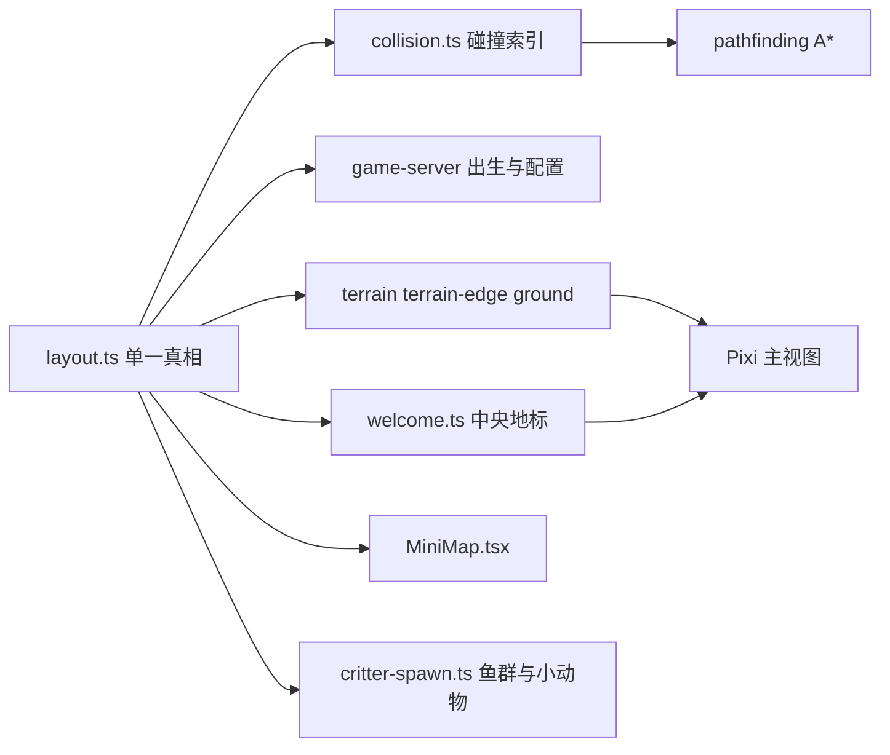

## 用户需求
在保持海岛总尺寸 3805×4212 与外海岸线完全不变的前提下，重构《牛马 NIOMA》的内陆地形、水系与中心景观。玩家出生点移到岛心（世界坐标约 4096,4096，对应岛内约 1900,2100）；保留西北工作区、东北会议室、西南宿舍区、东南卫生间与南庭院，把四角房之间的中庭扩成直径 720px 的圆形石砖迎宾广场。

## 产品概述
俯视角像素园区从“四角院落 + 环河”改为“中央迎宾广场 + 四向放射动线 + 三处内嵌景观湖 + 散落树簇”的开阔布局。玩家出生即站在石砖圆庭中心，南侧是带“牛马园区 / NIOMA”霓虹像素招牌的迎宾拱门，旁边有园区导览地图立牌与打卡签到处；广场边缘对称摆放售货机、咖啡机与休息长椅。四向道路分别通往工作区、会议区、生活区与庭院湖泊，沿路点缀复古路灯、花海与落叶。

## 核心功能
- 中央枢纽：岛心出生，720px 圆庭，迎宾拱门、导览牌、打卡柱，售货机、咖啡机、长椅、路灯对称布置；56px 出生圈内无碰撞。
- 去河流化：删除周报河、晨会溪、护园溪、全部跨河木桥与码头，内陆连成整块；北门旧地标删除，只留普通入口与土路。
- 三处景观湖：东南扩大版“摸鱼湖”、东北“沉思浅塘”、西侧小湖；轮廓自然圆润，岸边有浅滩与碎石、芦苇过渡。按本轮确认，水域保持可涉水，不新增湖面碰撞体。
- 植被疏解：废除“加班林”整块碰撞区，改为每簇 2–5 棵的有机树簇与林荫道，任意两棵树间隙不小于 80px，杜绝走廊式卡位。
- 放射路网：以中央广场为原点，向西北、东北、西南、东南连接四区，并向北、南、西、东延伸；平滑自然土路或石板路，路缘保留草齿与暗边过渡。
- 地表丰富度：草地上散落花海、三叶草、雏菊与林间落叶贴花；沿路布置复古路灯柱。
- 工程同步：isOnLand、岛界、障碍物列表、出生常量、服务端出生、寻路、小地图、小动物与测试全部同步；删桥后无悬空区域，室内外走道平滑无死角。


## 技术栈
- TypeScript monorepo（pnpm + Turbo）。
- `packages/shared-types`：纯几何与数据契约，服务端、客户端、小地图共用的唯一真相。
- `apps/game-server`：Bun 运行时，出生点与拒绝采样。
- `apps/web`：Next.js、React、PixiJS 渲染层。
- 测试：Vitest（shared-types）与 Bun test（web、game-server）。
- 本次不新增依赖，不改变协议与网络包。

## 实施策略
1. **数据契约先行**：在 `packages/shared-types/src/world/layout.ts` 定义 `PathShape`、`TreeCluster`、`PLAZA_RADIUS`、`SPAWN_CENTER`、`WELCOME_LANDMARKS` 与新区域表；删除 `rivers`、`bridges`、`docks` 字段，不留空数组占位。
2. **路径几何复用河道算法**：把 `river.ts` 泛化为 `ribbon.ts`，`buildRibbon(stations, halfWidth)` 产出 `polygon`、`leftBank`、`rightBank`、`centerline`、`rect`。路径是开放带状多边形，渲染沿用 `paintRegion` 的“矩形平铺 + 多边形遮罩”，材质判定用“包围盒粗筛 + pointInPolygon”。
3. **广场与材质**：`PLAZA = {x:3736,y:3736,w:720,h:720}`、`PLAZA_RADIUS = 360`。渲染用 `roundedRectContour(PLAZA, 360)` 得到 1px 步进圆；`terrain-edge.ts` 增加 `MATERIAL.stone`、移除 `MATERIAL.bridge`，材质优先级为 水 > 土路 > 石砖 > 岸沙 > 草 > 浅滩 > 海。
4. **水域**：删除三条河、六座桥、两个码头与 `isOnBridge`；保留 `isWaterAt`、`isWadingAt`、`distanceSqToWater`，湖面不注册 blocker（按本轮确认）。
5. **树簇**：`groves: TreeCluster[]` 与 `looseTrees: TreeInstance[]`。簇心用 320px 粗网格加 mulberry32 抖动生成；簇内从固定 8 偏移表取 2–5 棵，最小间距 86px；簇间最小 220px；林荫道沿路径两岸每 160–180px 取点。测试断言全树两两不小于 80px。
6. **地标**：`WELCOME_LANDMARKS = { arch, directory, checkin }`；`welcome.ts` 负责像素拱门、霓虹字、导览牌与打卡柱，文字使用 Pixi Text；北门旧 banner、signpost 删除。
7. **消费方同步**：collision、terrain、terrain-edge、ground、decals、props、MiniMap、critter-spawn、winter-art、pathfinding、resume 与全部布局测试。
8. **ADR-0047**：记录决策、本轮可涉水让步、取代关系、风险与回滚路径。

## 实现要点
- `layout.ts` 与 shared-types 内禁止 `Math.random`、`Math.sin`、`Math.cos`；只用 mulberry32、手写坐标与 `Math.sqrt`。渲染层可继续使用 `autotile` 的圆弧采样。
- `ISLAND_POINTS` 与外海岸线一个字都不改；`WORLD_WIDTH`、`WORLD_HEIGHT` 保持 8192；新增断言锁定 `ISLAND.bounds = {x:2146,y:1956,w:3805,h:4212}`。
- 仓库中不存在 `WORLD_BOUNDS` 符号。世界边界契约以 `ISLAND.bounds` 与 `isOnLand` 为准，不新增无人消费的别名；出生点、树簇、路径、湖全部用 `isOnLand` 校验。
- 广场是石砖不是草地：用 `isOnPlaza(x,y)` 的圆心距离判定；`ground.isOutdoorGround`、`isPlantable`、`decals`、`critter-spawn` 都要排除石砖，避免贴花和小动物长在广场上。`plaza` 矩形仍作为包围盒供小地图与相机粗筛。
- 拱门立柱、导览牌、打卡柱加入少量 `solids`；立柱必须让开南向 112px 主路，56px 出生圈内不得有任何 solid、prop、tree、lake。地标 solids 用 `kind: 'prop'`，避免 `props.fillSolidFlat` 重复画地面方块。
- 路径不参与碰撞，只影响材质、贴花、种树留白、小动物与寻路代价。删桥后所有路径都在陆地上，新增“路径中心线不落水、不出岛”的测试。
- 性能：所有几何在模块加载期生成；`materialAt` 先包围盒再判多边形；碰撞 blocker 仍走 128px 网格；小地图 4Hz；主视图每条约 1 个平铺层加 1 个遮罩，新增约 10 条路、1 个石砖广场、约 28 块林下地面，删除 3 条河、6 座桥、2 个码头、10 块林地，绘制开销净下降。帧循环不分配。
- 删除 `WorldLayout.rivers/bridges/docks` 是破坏性类型变更：用 `rg "WORLD_LAYOUT.(rivers|bridges|docks)|isOnBridge"` 全仓扫一遍，同一提交内改完所有消费方。
- 贴花图集在末尾追加 `leaf`（索引 7），保持既有帧号不变；`GROUND_DECAL_KINDS` 不变，落叶用独立 `LEAF_KINDS = [7]` 在树簇范围内撒点。
- 鱼群从河道迁到三湖：在湖面多边形内按 40px 网格采样，离岸不小于 40px，两两不小于 120px；往返端点用水平或垂直方向检测仍在水中；删除桥与码头避让。
- `layout-density` 阈值先跑实测再定：目标仍是纯草格不超过 20%、任意 512 窗口不超过 45%；若因去森林化导致超标，优先补花海、路灯、树簇，不堆无意义装饰；确需调整阈值时在 ADR 写明依据。
- 文档：新增 `docs/adr/0047-central-hub-and-lakes.md`，标注部分取代 ADR-0015、ADR-0036、ADR-0045 与 ADR-0028 的桥码头部分；ADR-0030 可涉水继续有效；同步 README 与 deploy 文档里“北门出生点”的过期描述。

## 架构


## 目录结构
```text
packages/shared-types/
├── src/world/layout.ts                   [MODIFY] 主布局：删 rivers/bridges/docks；新增 3 湖、PathShape、TreeCluster、720px 广场、SPAWN_CENTER、WELCOME_LANDMARKS、HUB_PROPS、PLANTERS、REGIONS；导出 PLAZA_RADIUS 与树间隙常量。
├── src/world/ribbon.ts                   [NEW] 通用带状几何：buildRibbon，miter 偏移、像素取整、polygon/leftBank/rightBank/rect。
├── src/world/river.ts                    [DELETE] 被 ribbon.ts 取代。
├── src/world/collision.ts                [MODIFY] 树簇与散树 blockers；删除桥码头语义；保留湖可涉水。
├── src/world/campus.ts                   [MODIFY] 仅移除旧 PLAZA_PROPS（迁到 layout.ts）；房间、门、工位、座位、NAV 不动。
├── src/index.ts                          [MODIFY] 导出 world/ribbon。
├── src/__tests__/layout-hub.test.ts      [NEW] 出生圈、广场、地标、3 湖、树间隙、路径连通、岛界锁定。
├── src/__tests__/ribbon.test.ts          [NEW] 半宽、闭合、不自交、确定性。
├── src/__tests__/river.test.ts           [DELETE] 河桥断言整体移除。
├── src/__tests__/collision.test.ts       [MODIFY] 湖可涉水、无桥、出生圈、树簇、区域优先级。
├── src/__tests__/layout-density.test.ts  [MODIFY] 0 河 0 桥 3 湖、树簇数量与间隙、草格阈值重标定。
├── src/__tests__/campus-layout.test.ts   [MODIFY] 中央广场区域与广场陈设。
└── src/__tests__/seats.test.ts           [MODIFY] 新 props 与 planters 不挡通道、不落水。

apps/game-server/
├── src/sim/resume.ts                     [MODIFY] 更新出生注释与兜底说明；spawnPoint 继续读 SPAWN_CENTER 与 SPAWN_RADIUS。
└── src/sim/resume.test.ts                [MODIFY] 出生区域改为牛马园中央广场，断言 56px 圈内可站立。

apps/web/
├── lib/game/terrain.ts                   [MODIFY] 删除 addRivers/addBridges/addDocks/addDeck；新增石砖广场、带状路径、湖岸装饰、树簇与落叶贴花。
├── lib/game/terrain-edge.ts              [MODIFY] MATERIAL 增加 stone、删除 bridge；materialAt 与绘制顺序同步；路径改多边形判定。
├── lib/game/terrain-textures.ts          [MODIFY] 新增石砖纹理与落叶贴花图元，图集末尾追加 leaf。
├── lib/game/terrain-palette.ts           [MODIFY] 新增石砖、落叶、小地图石砖色；清理仅桥使用的色值。
├── lib/game/ground.ts                    [MODIFY] 路径改多边形判定；删除 bridges/docks；排除石砖广场。
├── lib/game/decals.ts                    [MODIFY] 新增 leaf 种类与 LEAF_KINDS。
├── lib/game/props.ts                     [MODIFY] 把 lamp 画成复古铸铁灯柱，保持尺寸与光晕契约。
├── lib/game/welcome.ts                   [MODIFY] 重做中央拱门、导览地图立牌、打卡柱；删除北门横幅与指路牌。
├── lib/game/pathfinding.ts               [MODIFY] 删除 isOnBridge 引用，水面仍按 WATER_COST 计算。
├── lib/game/critter-spawn.ts             [MODIFY] 鱼群迁入三湖；路径改多边形距离；森林改树簇。
├── lib/game/winter-art.ts                [MODIFY] forests/wildTrees 改为 groves/looseTrees。
├── components/game/MiniMap.tsx           [MODIFY] 删除河桥码头层；绘制石砖圆庭、带状路径、三湖、树簇点。
├── lib/game/__tests__/critter-spawn.test.ts  [MODIFY] 鱼全在湖内；删除桥码头避让断言。
├── lib/game/__tests__/pathfinding.test.ts    [MODIFY] 新出生点到四区可达，拱门立柱不堵路。
├── lib/game/__tests__/nav.test.ts            [MODIFY] 从新出生点计算方位与距离。
├── lib/game/__tests__/terrain-edge.test.ts   [MODIFY] 新材质优先级，删除桥压水断言。
├── lib/game/__tests__/decals.test.ts         [MODIFY] leaf 图元与石砖/土路排除。
└── lib/game/__tests__/interactions.test.ts   [MODIFY] 确认 vending、cooler、coffee 仍存在并可互动。

docs/
├── adr/0047-central-hub-and-lakes.md     [NEW] 中央广场、去河流化、三湖、树簇、出生点迁移与 q-1 让步。
├── README.md                             [MODIFY] 同步出生点与北门描述。
└── deploy-multi-park.md                  [MODIFY] 同步出生点与北门描述。

回归验证（不改代码）：
NavCard.tsx 的 300px leashing、renderer.ts 的 WelcomeView 与 isWadingAt、critters.ts 的避水、nav.ts 的 NAV_TARGETS、game-server 的 movement/world/seats 测试。
```

## 关键结构
```ts
export interface RibbonShape {
  polygon: Point[];
  leftBank: Point[];
  rightBank: Point[];
  centerline: Point[];
  rect: WorldRect;
}

export interface PathShape extends RibbonShape {
  halfWidth: number;
}

export interface TreeCluster {
  x: number;
  y: number;
  radius: number;
  trees: TreeInstance[];
}

export interface WorldLayout {
  plaza: WorldRect;
  plazaRadius: number;
  paths: PathShape[];
  lakes: LakeShape[];
  groves: TreeCluster[];
  looseTrees: TreeInstance[];
  // 其他字段保持不变；不再有 rivers、bridges、docks
}
```

## 验证
- `pnpm --filter @niuma/shared-types test`
- `pnpm --filter @niuma/web test`
- `pnpm --filter @niuma/game-server test`
- `pnpm typecheck`
- `pnpm --filter @niuma/web dev` 目视检查：出生圈、拱门、导览牌、打卡柱、四向路、三湖、树簇、小地图；确认 0 河 0 桥、无悬空区域、室内外走道平滑。


## 设计风格
“牛马园区”的温暖像素牧场：俯视 3/4 视角，16-bit 像素网格，1px 深色边缘、无抗锯齿；低饱和奶油草地、石砖、薄荷霓虹与暖木色。中央 720px 圆形石砖广场是视觉锚点，四向土路像叶脉一样展开，三处湖泊与散落树簇留出呼吸感。

## 场景区块
- 中央圆庭：720px 石砖圆，外圈 10px 石缘与 2px 深缝；中心留空，南缘中轴立 320×112 拱门，深木或铸铁柱、奶油底牌、薄荷霓虹“牛马园区 / NIOMA”；西侧导览地图立牌，东侧打卡柱；东西缘对称售货机、咖啡机与长椅，四角复古路灯。
- 放射路网：112px 主路与 96px 支路，圆角带状，土色路面、2px 深栗暗边与草齿；路口不出现 90 度硬拼；沿路每 180–220px 一盏复古灯。
- 三湖：东南大湖、东北浅塘、西侧小湖；12–16 点自然轮廓，22px 浅滩沙带与碎石、芦苇；水面低饱和青绿。
- 树簇：每簇 2–5 棵，树冠 56–62，间隙不小于 80；簇间 220 以上；林荫道沿主路两侧错列。
- 地表：6–8 片花海（白雏菊、金盏、暖粉），三叶草、雏菊、落叶贴花；石砖与土路上不撒贴花。
- 小地图：石砖圆庭用浅石色填充与深缝描边；三湖、路径、树簇点、建筑与花海保持同色系。

## 交互与动效
水面平铺滚动、霓虹静态像素发光、路灯暖光；不做每帧粒子或发光运算。玩家出生在圆心，南向可见拱门与导览牌；所有地标可走近、可遮挡，不阻塞主路。

## 响应式
画布按 DPR 渲染，像素 1:1；小地图 168px 画布按 DPR 放大；HUD 文本保持 8px 倍数。桌面与移动端共用同一世界坐标，不另做布局。

## Agent Extensions
### Skill
- **layer-pixel-art**
  - Purpose: 设计中央拱门、导览牌、打卡柱、复古路灯、石砖与落叶贴花的像素画法。
  - Expected outcome: 1:1 像素网格、有限色板、硬边，与现有 terrain-textures、props、welcome 的风格一致。
- **principal-software-architect**
  - Purpose: 评审跨包数据契约、ADR-0047 与本轮可涉水让步的可回滚性。
  - Expected outcome: 一份决策记录，明确取代关系、风险与回滚路径。
- **test-driven-development**
  - Purpose: 在改 layout.ts 前先锁定出生圈、3 湖、0 河桥、树间隙、路径连通等不变量。
  - Expected outcome: 新测试先红后绿，防止渲染层各写一份几何。
- **impeccable**
  - Purpose: 审阅 MiniMap、HUD 与地标文字的可读性、对比度与层级。
  - Expected outcome: 小地图与地标文字在 1x、2x 下清晰，无低对比或过密问题。
- **verification-before-completion**
  - Purpose: 交付前跑三包测试与 typecheck，核对视觉验收清单。
  - Expected outcome: 有命令输出证据，不以“看起来没问题”收尾。
