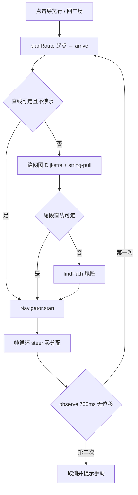

## 产品概述
在「牛马 NIOMA」现有 5 区 / 25 场所 / 5 座区门的园区里，打磨道路网与自动导览的观感与手感：让主路与街面在路口、区门、斑马线处不再是一整块平涂，让窄通道不再顶墙发黏，让导览卡能去影音室、摸鱼亭、急救站并能一键回广场，让自动寻路真正沿马路转弯进门。不扩建地图、不新增玩法、不新增协议。

## 核心功能
- **路面叙事（纯渲染）**：五条主街与生活大街、游乐大街在路口加像素级铺砖拼接；铺装街区补路缘石与内凹收边；广场五向出口补斑马线；主路沿线按节奏铺低饱和度方向指引；长直路段补路缘与磨损像素，压掉「大片纯平」的单调。
- **沿路地标与节奏**：五个街口各立一根带区色的路边指示桩（不可坐、不挡人），与既有路灯、长椅、花箱、散树形成固定「灯—椅—桩」段落节奏；路灯贴图自带光晕加一圈柔光与十字光针（夜间更明确，不改光源预算）；冬季在主路两侧加薄积雪压边。
- **窄通道通行**：企业楼走廊净宽 40→56、公寓巷道 40→48，斜向贴墙撞到 90° 内角时不再一下停死，而是顺着墙角滑进去。
- **导览补全**：导览卡新增家庭影音室、摸鱼亭、护士急救站三项（按原五区分组自动归位），底部新增「回中央广场」一行；广场不做成场所目标，避免破坏「目标—场所—大区」一一对应。
- **自动导览走真路**：从中央广场出发，沿「广场 → 五条主街路口 → 街区广场 → 目标门口」的固定路网走，进门那一段再交给原有的格子寻路；被挡住时原地换一条路再试一次，仍不行才提示手动。


## 技术栈
沿用现状，不引入新依赖：
- 共享契约层 `packages/shared-types`（纯 TS、禁 Math.random / sin / cos，服务端与客户端共用）。
- 客户端 `apps/web`：PixiJS 8 + 1:1 整数纹素烘焙 + `nearest` 缩放，`SortLayer` 按 y-band 256 分层，纹理与轮廓全部构造期生成。
- 测试：`vitest`（shared-types）+ `bun:test`（apps/web）。
- **零协议改动**：不新增 S2C/C2S 操作码，不动 `0x20 / 0x2a / 0x2b / 0x3d / 0x4d–0x50`。

## 现状问题点 → 优化方案 → 涉及文件与发版

### A 路网细节与路面叙事（纯渲染，不改碰撞）

**A1 现状问题**
- `terrain.ts` 的 `addPaths()` 只是「128px 土纹平铺 + 多边形遮罩 + 草缘暗边」，四主路与六支路交会处全是同一块土色，没有路口语言。
- `props.ts` 的 `fillPaving()` 只画一个 `0xc9c4b1` 底 + 每 40px 一道 `0xb0ab97` 井字缝，`COMPANY_FORECOURT / AMUSEMENT_STREET / SERVICE_SQUARE / LIVING_AVENUE` 五片街区广场读起来是一整块灰布，没有路缘、没有收边。
- 广场圆庭有路缘（`addPlaza` 的 12px 缝 + 10px 缘），但五条街射出去的「街口」没有斑马线/铺砖过渡，出生点四望五个方向长得一样。
- 路灯夜间只有光图里一团柔光，灯柱贴图自带的光晕半径 10、α 0.24，白天几乎看不出「这是灯」。

**A2 优化方案**
- 新增纯数据 + 绘制模块 `road-dressing.ts`，由共享布局**推导**（不写第二份坐标）：
  - 路口节点 = `WORLD_LAYOUT.paths[].centerline` 顶点 ∩ `DISTRICTS[].gate` ∩ 街区广场中心，去重合并；
  - 每个路口铺 48×48 的 8×8 石砖拼花 + 2px 路缘环（`C.plazaCurb` / 加深 `pavingSeam`），T 型口只铺三面、十字口四面；
  - 广场五向出口内侧 6 道 6×24 斑马线（`lighten(paving, .18)`，α 0.5），方向随主街走；
  - 主路（`halfWidth === PATH_MAIN_HALF_WIDTH`）每 220px 一枚 9×3 低饱和箭头（α 0.35），指向广场；
  - `fillPaving` 升级为「底色 + 40px 错缝 + 2px 内凹路缘 + 1px 顶面高光」，五片街区一眼能认出是铺装而不是泥地。
- 全部画进 `PropsView.build()` 的那一个 `ground: Graphics`（在贴花之上、y 排序层之下），一次成图、单批次、帧循环零成本；`?flat=1` 时整层跳过，回到旧画法。
- 路灯贴图（`props.ts` `case 'lamp'`）加一圈 `circle(7,5,13) @ α 0.10` 柔光与两根 1px 十字光针。**不新增 `Light`**：`lighting.test.ts` 钉死 `propLights + venueLights + 6 + 11 ≤ MAX_LIGHTS(96)`，所以走贴图而不是光图。
- 冬季薄雪压边：`terrain.ts` 的 `flushEdges()` 冬季分支里，对每条 `MATERIAL.dirt` 轮廓再压 2px `W.snowLight` 内缘，并按 7px 间距用 `fringeTeeth` 埋 1×1 雪粒（`edgeEnabled && !flat` 才画）。
- 路边指示桩：客户端新模块按五个街口 + 四条长路段中点各立一根 8×26 木桩（顶上一块 10×6 区色小牌，取 `DISTRICTS[].color`），构造期 `bake` 一次、`depth.add(y, sprite)` 进 `SortLayer`（沿用 `welcome.ts` 的范式）。**不进 `WORLD_LAYOUT.props`**，因此不产生碰撞、不扰动 `isPlantable` 的树木撒点、不动 `PROP_FOOTPRINT`。
- 说明：**不新增可坐长椅**。`BENCH_SEATS` 长度变化会连带平移急救站病床、赌桌圆凳、观战长椅的 `seatId`，而 `niuma:session:v1` 里存着 seatId；本轮用不可坐的路边装置补层次。

**A3 文件 / 发版**：`apps/web/lib/game/road-dressing.ts`〔新〕、`props.ts`、`terrain.ts`、`renderer.ts`（把 `flat` 透传给 `PropsView.build`）。**仅客户端，服务端无需发版。**

### B 窄通道通行体验（涉及 shared-types 坐标，需双端同步发布）

**B1 现状问题（实测数据）**
- `PLAYER_RADIUS = 9` → 直径 18。
- 企业楼走廊 `COMPANY_CORRIDOR.h = 40`（y 3560–3600，墙在走廊外），净宽 40，两人交错只剩 4px；走廊东口 x=3540 是 40px 敞口，西端还有 10px 封口墙。玩家之间不互撞（`movement.ts` 只解算地形），所以「会车」只是观感，真正的问题是斜向进 40px 口时撞在会议室的东南内角上。
- 公寓巷道 301 东沿 3500 / 302 西沿 3540 → 40px；楼体是整块实心，走进去两侧全是墙。
- 室内工位列距 104、桌宽 88 → 桌间 16px 缝，小于 18 直径，**本就不可穿**（设计意图是绕行，本轮不改桌距）。
- `resolveMotionInto` 被挡后只试 x 轴、再试 y 轴，两者都挡就 `break`，剩余位移全丢——这正是「贴内角一下停死」的根因。

**B2 优化方案（已与用户确认）**
- 走廊 40 → 56：`CAMPUS_RECT.h` 760 → 776，`COMPANY_CORRIDOR.h = 56`；`VENT_ROOM` 保持 `h = ROOM_H` 且由 `COMPANY_CORRIDOR.y + h` 派生，南墙随楼下移 16px 到 3976。`BOSS_ARENA` / `BOSS_SOLID` 随 `VENT_ROOM.y` 整体下移，室内余量分毫不变（净高 340、垫子 300、南侧余 14）。`WORKROOM_GATE`、`DOOR_LANTERN_POSTS`、`DOOR_PLAQUES.workroom` 全部从 `COMPANY_CORRIDOR` 派生，自动跟随。两人交错余量 4px → 20px。
- 公寓巷道 40 → 48：新增 `APARTMENT_ALLEY = 48`，中列 302 / 305 的 x 由手写 3540 改为 `3200 + APARTMENT_W + APARTMENT_ALLEY`（3548），视觉与碰撞仍由 `rect` 单点派生。
- `resolveMotionInto` 增加第三级「内角辅助滑行」：整步、单轴滑都失败时，用模块级常量表 `NUDGE_X / NUDGE_Y` 探 8 个 1px 方位，取「与原始方向点积最大且可站」的那一档推进 1px 再继续。纯标量、零分配、每步最多 8 次 `isBlocked`，且只在被挡时发生；不改变半径、不加协议，双端跑同一份函数所以预测与权威不会打架。

**B3 文件 / 发版**：`packages/shared-types/src/world/campus.ts`、`apartment.ts`、`collision.ts`。**改动坐标与碰撞行为 → 涉及双端同步发布**（服务端碰撞解算与客户端预测同源）。同步更新 `campus-layout.test.ts`（走廊 56、`CAMPUS_RECT.h` 776）、`apartment-layout.test.ts`（精确巷道 48）、`collision.test.ts`（新增 90° 内角用例）。

### C 自动导览补全与路网图（共享契约 + 客户端）

**C1 现状问题**
- `NAV_TARGETS` 只有 12 条，缺家庭影音室、摸鱼亭、护士急救站；导览卡按 `DISTRICTS` 自动分组，景观区因无目标而整组不显示。
- `findPath` 是 16px 网格 8 向 A*，可从出生点直达全部目标（测试已证），但**路径是最短可通行路径而不是道路**：会贴着墙根、切过草地，`Navigator` 再逐格直线推进，于是贴墙、卡角、700ms 卡死判定被触发，然后整段导航被取消。
- `NAV_TARGETS` 与 `VENUES` 被 `districts.test.ts` 钉成一一对应，`district` 是 `DistrictId`；广场不属于任何大区，所以不能直接做成目标。

**C2 优化方案**
- 补 3 个目标（都已有 `VENUES` 条目，只加 `navId`）：`theater` 家庭影音室（living/indoor）、`pavilion` 摸鱼亭（scenery/outdoor）、`clinic` 护士急救站（service/indoor）。`NAV_TARGETS` 由 12 → 15，沿用按区聚拢顺序：workroom, meeting, shrine, bossArena, park, diceHall, ring, apartment, lounge, theater, villa1, villa2, restroom, clinic, pavilion。
- 到达点（沿用「站过去就能互动」口径，实施时用 `isBlocked` 断言复核）：影音室 `(HOME_THEATER.x + w − 48, HOME_THEATER.y + 160)`；摸鱼亭 `(PAVILION_CENTER.x, PAVILION_CENTER.y + 86)` 落在南侧两柱之间；急救站 `(CLINIC_ACCESS_PAVING.x + 50, CLINIC_ACCESS_PAVING.y + 28)` 正对西门人行门洞。
- 三处各补一块入口小门牌（`DOOR_PLAQUES`，`frame: 'board'`），坐标取整、离到达点 40px 以上、`!isBlocked`。
- 广场不做 NAV_TARGET：新增客户端动作「回中央广场」，走 `SPAWN_CENTER`，`Navigator` 的目标类型放宽为结构化 `NavGoal`（只要求 `name` 与 `arrive`），`onNav` 载荷的 id 放宽为 `NavTargetId | 'plaza'`。共享契约与一对一断言零改动。
- 新增纯前端路网节点图 `road-graph.ts`（惰性构图，首次点击导航才算）：
  1. 候选节点 = 广场中心 + 10 条 `paths[].centerline` 顶点 + 5 座区门 + 4 片街区广场中心 + 企业楼门廊口 `(CAMPUS_RECT.x + w + 24, COMPANY_CORRIDOR 中线)` + 若干岸线/门口地标点，按 12px 量化去重；
  2. T 型接点：节点落在既有边 6px 内就把那条边在投影处劈开（生活大街西延、影音室支路、景观区支路、沉思浅塘支路都靠这一步入网）；
  3. 每条边按 8px 采样 `isBlocked(x, y, PLAYER_RADIUS)` 校验，不通就丢边（布局再改也不会静默生成穿墙路线）；
  4. 查询用 Dijkstra（节点 ~50、边 ~60，微秒级），再对折线做 string-pull：能直连就跳过中间点，去掉沿路锯齿；
  5. 尾段：从最后一个路网节点到 `arrive` 的直线若不撞墙且不涉水，直接走；否则用现有 `findPath` 跑最后一段（室内、门口台阶都靠它）。
- `nav-route.ts` 统一出口 `planRoute(from, target)`：直线可走 → 单点；否则「图路线 + 尾段」；图为空/不可达 → 回退 `findPath`。`pathfinding.ts` 保持原样作为兜底，单测不动语义。
- 卡死重试放在 `session.ts`（**不改 `Navigator` 的 `WAYPOINT_RADIUS / ARRIVE_RADIUS / STUCK_MS` 常量**，`navigator.test.ts` 钉着它们）：`'stuck'` 第一次 → 以当前位置重新 `planRoute` 并 `navigator.start()`，提示「换条路继续走」；第二次才取消并提示手动。

**C3 文件 / 发版**
- 共享契约：`districts.ts`（`NavTargetId`、`NAV_ARRIVALS`、`NAV_SOURCES`、`VENUES.navId`）、`layout.ts`（`DOOR_PLAQUES` 3 条）。**涉及双端同步发布**（服务端随包重建，逻辑上不读 `NAV_TARGETS`，但版本必须对齐）。同步更新 `nav-arrival.test.ts`（15 条与顺序、`ROOM_OF` 加 theater、`OUTDOOR` 加 pavilion）、`place-signs.test.ts`（15 条、board 9 → 12）、`districts.test.ts`（自动通过）。
- 客户端：`road-graph.ts`〔新〕、`nav-route.ts`〔新〕、`navigator.ts`（`NavGoal`）、`nav.ts`（`plazaReading`）、`session.ts`、`game-client.ts`、`main-thread-client.ts`、`worker-client.ts`、`runtime/worker-host.ts`（`navigateHome` 消息）、`game-ui.ts`、`NavCard.tsx`（底部「回中央广场」行）、`pathfinding.test.ts` + `nav.test.ts` 计数更新、新增 `road-graph.test.ts`。**仅客户端。**

## 架构设计



分层不新增抽象：`road-graph` / `road-dressing` 是纯数据 + 纯几何，Pixi 只在 `props.ts`、`terrain.ts`、`welcome` 式视图层出现；路网图从 `WORLD_LAYOUT` / `DISTRICTS` **推导**，不写第二份坐标。

## 目录结构（新增 / 修改）

```
packages/shared-types/src/
├── world/
│   ├── campus.ts            [MODIFY] CAMPUS_RECT.h 760→776、COMPANY_CORRIDOR.h 40→56（新增具名 CORRIDOR_H），注释同步「40→56、两人交错余量 4px→20px」
│   ├── apartment.ts         [MODIFY] 新增 APARTMENT_ALLEY = 48；302/305 的 x 由 3540 改为 3200 + APARTMENT_W + ALLEY（3548），门/出门点/窗表继续从 rect 派生
│   ├── collision.ts         [MODIFY] resolveMotionInto 增第三级内角辅助滑行：模块级 NUDGE_X/NUDGE_Y 八向 1px 探测，点积最大且可站者推进 1px；零分配、不改半径
│   ├── districts.ts         [MODIFY] NavTargetId 增 theater/pavilion/clinic；NAV_ARRIVALS 增三条；NAV_SOURCES 按区插入（15 条）；VENUES 三条补 navId
│   └── layout.ts            [MODIFY] DOOR_PLAQUES 增 theater/pavilion/clinic 三块 board 门牌（整数坐标、离 arrive 40px 以上、不压碰撞）
└── __tests__/
    ├── campus-layout.test.ts     [MODIFY] 走廊 h 56、VENT_ROOM 派生关系、CAMPUS_RECT.h 776
    ├── apartment-layout.test.ts  [MODIFY] 精确断言巷道 = APARTMENT_ALLEY(48)
    ├── collision.test.ts         [MODIFY] 新增 90° 内角斜向推进用例（滑行后位移大于 0）
    ├── nav-arrival.test.ts       [MODIFY] 15 条 id 顺序、ROOM_OF 加 theater、OUTDOOR 加 pavilion
    └── place-signs.test.ts       [MODIFY] 15 条全覆盖、board 12 块、新门牌可站人且不压 arrive

apps/web/lib/game/
├── road-dressing.ts         [NEW] 纯数据 roadDressingPlan()（路口/斑马线/指引/路缘/指示桩）+ paintRoadDressing(g) 烘焙；从 WORLD_LAYOUT、DISTRICTS、SPAWN_CENTER 推导，不写坐标
├── road-graph.ts            [NEW] 惰性构图（中心线顶点 + 区门 + 街区中心 + 门口锚点，12px 去重、6px 投影插点、8px 采样校验、Dijkstra、string-pull），导出 routeViaRoads(from, to)
├── nav-route.ts             [NEW] planRoute(from, target)：直线优先 → 图 + 尾段 → findPath 兜底；返回 PathPoint[] | null
├── props.ts                 [MODIFY] fillPaving 升级（错缝 + 路缘 + 高光）；build() 接受 { flat } 并调用 paintRoadDressing；lamp 贴图加柔光环与十字光针（不新增 Light）
├── terrain.ts               [MODIFY] flushEdges 冬季分支对 dirt 轮廓压 2px 薄雪内缘 + 7px 间隔 1×1 雪粒（edgeEnabled && !flat）
├── renderer.ts              [MODIFY] 把 ?flat=1 透传给 PropsView.build，并挂路侧指示桩视图进 SortLayer
├── navigator.ts             [MODIFY] 目标类型放宽为 NavGoal { id?, name, arrive }，常量与行为不变
├── nav.ts                   [MODIFY] 新增 plazaReading(x, y)（复用内部 readingOf，走 SPAWN_CENTER）
├── session.ts               [MODIFY] navigateTo 改用 planRoute；新增 navigateHome()；stuck 第一次就地重规划、第二次取消提示
├── game-ui.ts               [MODIFY] navTarget.id 类型放宽为 NavTargetId | 'plaza'
├── client/game-client.ts    [MODIFY] 接口增 navigateHome()
├── client/main-thread-client.ts [MODIFY] 同上转发
├── client/worker-client.ts  [MODIFY] 新增 { t: 'navigateHome' } 消息
├── runtime/worker-host.ts   [MODIFY] 处理 'navigateHome'
└── __tests__/
    ├── pathfinding.test.ts  [MODIFY] 15 条目标 + 末点落在 arrive 断言
    ├── nav.test.ts          [MODIFY] readings 15 条、分组计数 living 5 / service 2 / scenery 1、plazaReading 可读
    ├── road-graph.test.ts   [NEW] 图连通性、每条边走人不撞墙、五座区门与 15 个 arrive 的最近节点均可达
    └── road-dressing.test.ts [NEW] 纯数据：路口不与建筑/水面重叠、斑马线落在广场内缘、指示桩数量与街口一致

apps/web/components/game/
├── NavCard.tsx              [MODIFY] 滚动区末尾加「回中央广场」行（距离/秒数取自 plazaReading），高亮与取消逻辑对齐现有行
└── GameViewport.tsx         [MODIFY] 传 handleNavigateHome → client.navigateHome()

docs/adr/0099-road-graph-and-corridor-width.md  [NEW] 决策记录：走廊 56 / 巷道 48 的测算、resolveMotionInto 第三级滑行、前端路网图优先 + A* 兜底的边界
apps/web/data/release-notes.json                [MODIFY] 提交前按 AGENTS.md 追加一条（路口铺装、窄道加宽、导览补三处与回广场、走真路）
```

## 关键数据结构

```ts
/** navigator.ts：只依赖「名字 + 落点」，广场这类非场所目标也能复用同一台状态机 */
export interface NavGoal {
  readonly id?: string;
  readonly name: string;
  readonly arrive: { readonly x: number; readonly y: number };
}

/** road-graph.ts：节点图一次建好，之后只读 */
export interface RoadNode { readonly x: number; readonly y: number; }
export interface RoadEdge { readonly a: number; readonly b: number; readonly cost: number; }
export function routeViaRoads(fromX: number, fromY: number, toX: number, toY: number): PathPoint[] | null;
```

## 实施注意事项

- **零分配**：`road-graph` 只在点击/卡死时运行（不在 `update` 里）；`road-dressing`、指示桩、冬季雪缘全部构造期成图；`resolveMotionInto` 的内角探测只用模块级标量表。
- **不新增光源**：`MAX_LIGHTS` 预算已被 `lighting.test.ts` 钉死，夜间灯感只改 lamp 烘焙贴图。
- **不新增碰撞**：所有新装饰画在客户端（`ground` 图元或 `SortLayer` 精灵），不进 `WORLD_LAYOUT.props/solids`，因此不扰动 `isPlantable` 的树点与 `seatId` 分配。
- **灰度兼容**：`?flat=1` 关路口铺装/路缘/指引/雪缘（回旧画法）；`?edge=0` 关雪缘齿；`?season=winter` 才画薄雪；`?light=0` 不影响贴图光晕；`?bands=0` 走单一容器（指示桩只用 `DepthSink.add`）。
- **契约纪律**：`shared-types` 三处改动（campus、apartment、collision）与导航目标补全**均需双端同步发布**；导航补全不新增协议与操作码，服务端逻辑不读 `NAV_TARGETS`，但包版本必须一起发。
- **回归重点**：走廊加宽后复核企业楼门架/挂灯/门牌落点（都派生自 `COMPANY_CORRIDOR`，测试已覆盖可站人）；公寓中列右移 8px 后复核与 303/306 的间距、门口台阶、窗表；新增 3 个 arrive 与 3 块门牌必须通过既有 `isBlocked` / `isOnLand` / 距离 40px 断言。
- **流程**：先跑 `packages/shared-types` 与 `apps/web` 全量测试；提交前写 `release-notes.json` 并 `pnpm changelog:check`；按仓库约定新增 ADR-0099，不改历史 ADR。


## 使用的扩展
### Skill
- **pixel-venue-polish**
  - Purpose: 在实现路口铺砖、斑马线、路缘、指引箭头、指示桩与冬季薄雪压边时，按全站像素画风（调色板复用、1px 描边纪律、光源预算、微动效循环）与既有场所美术保持一致，并做一次合规评审。
  - Expected outcome: 新增路面细节只复用 `terrain-palette` / `venue-palette` 既有色阶，不引入新色系；光源预算不变；每个新图元都是整数纹素且构造期烘焙。

### SubAgent
- **code-explorer**
  - Purpose: 在动手前用「medium」档复核全部触点，避免漏改：`PropsView.build` 的调用点、`Navigator.start` 的全部调用点、`onNav` 载荷流经的 worker/主线程链路、`DOOR_PLAQUES` 与 `NAV_ARRIVALS` 的所有消费方。
  - Expected outcome: 得到一份精确的调用点清单，确认本方案列出的文件就是完整改动面，没有遗漏的消费方。
