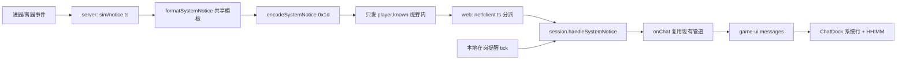

## 产品概述
在园区频道（聊天栏）里加入「系统消息」通道：有人进园、离园时自动播报，所有消息都带 HH:MM 时间；同时把系统提示做成可扩展的模板机制，后续新增「在岗提醒」等自动化播报只需加一条模板。

## 核心功能
- 进园播报：视野内（900px）有人进入时，聊天栏出现「xxx 进入了园区」。
- 离园播报：视野内有人下线时，出现「xxx 离开了园区」，与真实的 despawn 同时到达，不误报「走出视野」。
- 时间戳：普通聊天与系统消息每一行都显示 HH:MM（24 小时制），鼠标悬停可看完整时间。
- 在岗提醒：本地定时自动化，连续在线满 30 分钟 / 1 小时 / 2 小时各播报一条「你已经在岗 X，起来走动一下」。
- 模板机制：系统文案集中在一份模板注册表里；新增提示 = 加一个编号 + 一条模板 + 一处触发，服务端广播与客户端本地播报共用同一套渲染与样式。
- 视觉区分：系统消息是整行弱化样式（时间 + 类型标记 + 说明），不占名字列；进园用薄荷色「+」、离园用灰色「−」、其它提示用琥珀「·」，与玩家发言明显分层。
- 只播报视野内、不含自己；不做持久化，刷新即清空。

## 交互与视觉
- 聊天行：`14:03  我  下班了`（时间 9px 等宽小字、名字保持现有薄荷/柠檬绿、正文保持主色）。
- 系统行：`14:03  +  阿牛 进入了园区`（10px 等宽、整体降一档灰度，整行不换行错位）。
- 空态补一句「进园、离园与在岗提醒会在这里播报」，让新玩家知道这一栏会自己动。


## 技术栈
- 共享层：TypeScript（`@niuma/shared-types`），沿用现有 `ByteWriter/ByteReader` 二进制协议工具。
- 服务端：Bun + 现有 `Transport`/AOI `known` 机制，不新增依赖。
- 客户端：Next.js 15 + React 19 + zustand（`useGameUi`）+ Tailwind v4 token，不新增依赖。

## 实现方案
1. **协议新增一个包，而不是复用聊天**：`S2C_SYSTEM_NOTICE = 0x1d`，包体 `[op u8][kind u8][entityId u16][len u16][utf8 text]`。文本由服务端用共享模板格式化后下发，客户端只负责展示；`kind` 仅用于样式与将来的过滤开关。旧客户端 `handle()` 的 `default: break` 会静默丢弃新包，天然向前兼容。
2. **模板只在共享层写一份**：`packages/shared-types/src/notice.ts` 提供 `SYSTEM_NOTICE_KIND`、`SYSTEM_NOTICE_TEMPLATES`、`formatSystemNotice(kind, params)`。未知 kind 返回 `null`，调用方跳过；文案为中文，参数只允许 `name` / `minutes` 这类简单值。模块头注释写清「新增一种提示的三步」。
3. **服务端只发两种事件**：进园在 `refreshView()` 之后发（此时双方 `known` 已补齐，`player.known` 就是「看得见他的人」），离园在 `broadcastDespawn()` 之前发（它内部会 `known.clear()`）。都只遍历 `player.known`，不发给本人，不进聊天限速窗口。
4. **客户端复用现有消息管道**：`net/client.ts` 新增 `onSystemNotice` 回调与分派；`session.ts` 的 `handleSystemNotice` 把包转成 `ChatEntry { kind: 'system', systemKind, id: 负数递增 }` 后走现有 `callbacks.onChat`，因此 `GameViewport` 与 `game-ui` 的 `pushMessage` 一行都不用改，也不会触发头顶气泡。
5. **本地自动化走同一条管道**：`session.tick` 里 500ms 的统计分支检查 `onlineSecOf(localId)`，跨过 30/60/120 分钟各推一条本地系统消息（`formatSystemNotice(OnDuty)`），`handleWelcome` 重置游标，断线重连重新计时。
6. **时间与排版是纯函数**：`formatClock(at)` 手写 `padStart` 输出 HH:MM，不依赖 `Intl`/locale，避免每次渲染建格式化器，也避免 SSR/水合差异；`<time dateTime>` + `title` 带完整时间，读屏与悬停都能拿到精确时刻。

性能与可靠性：
- 系统包 ≤ 约 60 字节，只在进出园时发，不进 20Hz tick；服务端不新建长生命周期对象，每次事件编一次包即可。
- 客户端仍受 `MAX_MESSAGES = 40` 约束，列表长度固定；渲染只是多一个条件分支，没有新增订阅。
- 乱序/截断保护：解码长度越界按空串处理（与 `decodeStatusBroadcast` 同风格）；未知 kind 照常显示文本，只是标记退回「·」。
- 风险控制：新增字段全部可选，旧数据与旧服务端不影响现有聊天渲染；服务端未升级时客户端只是收不到系统包。

扩展方式（写进 `notice.ts` 注释与 ADR）：
1）在 `SYSTEM_NOTICE_KIND` 加编号；2）在 `SYSTEM_NOTICE_TEMPLATES` 加文案函数；3）服务端事件调用 `broadcastSystemNotice`，客户端本地事件调用 `session.pushLocalNotice`。不需要改协议、不需要改 UI。

## 架构设计


## 目录结构
```
packages/shared-types/
├── src/notice.ts                         # [NEW] 系统提示模板注册表：KIND 枚举、格式化函数、扩展说明；未知 kind 返回 null
├── src/types.ts                          # [MODIFY] OpCode 增加 S2C_SYSTEM_NOTICE=0x1d；新增 SystemNoticePacket 接口
├── src/protocol.ts                       # [MODIFY] encodeSystemNotice/decodeSystemNotice；文本用 truncateChat 收口，长度越界回空串
├── src/index.ts                          # [MODIFY] 导出 ./notice
└── src/__tests__/protocol.test.ts        # [MODIFY] 系统包 round-trip、未知 kind、长度越界、UTF-8 中文

apps/game-server/
├── src/sim/notice.ts                     # [NEW] enterNotice/leaveNotice 组装包；broadcastSystemNotice 遍历 player.known
├── src/sim/notice.test.ts                # [NEW] 只达视野内、不发给本人、文本与 kind 正确、未知模板不发包
└── src/server.ts                         # [MODIFY] admit() 在 refreshView 后播报进园；handleClose() 在 broadcastDespawn 前播报离园

apps/web/
├── lib/net/client.ts                     # [MODIFY] NetHandlers 增加 onSystemNotice；handle() 增加 0x1d 分支
├── lib/game/session.ts                   # [MODIFY] ChatEntry 增加 kind/systemKind；handleSystemNotice；本地在岗提醒与游标重置
├── lib/game/clock.ts                     # [NEW] formatClock(at)：纯函数输出 HH:MM
├── lib/game/__tests__/clock.test.ts      # [NEW] 补零、午夜、非法值兜底
└── components/game/ChatDock.tsx           # [MODIFY] 每行加时间；系统行独立样式与类型标记；空态补一句说明

docs/adr/
└── 0038-system-notice-channel.md         # [NEW] 新协议包、AOI 口径、模板注册表、扩展步骤、刷屏与静音的后续信号
```

## 关键代码结构
```ts
// packages/shared-types/src/notice.ts
export const SYSTEM_NOTICE_KIND = { Enter: 1, Leave: 2, OnDuty: 3 } as const;

export interface SystemNoticePacket {
  kind: number;
  /** 关联实体；0 表示没有具体对象（如本地在岗提醒） */
  entityId: number;
  /** 服务端/本地已经套好模板的最终文案 */
  text: string;
}

export function formatSystemNotice(
  kind: number,
  params: { name?: string; minutes?: number },
): string | null;
```

## 实施要点
- 服务端播报顺序是硬约束：进园必须在 `refreshView` 之后、离园必须在 `broadcastDespawn` 之前，用注释写清原因（`known` 尚未建立 / 即将被清空）。
- 离园与断线在服务端不可区分，文案统一用中性的「离开了园区」，不要写「打卡下班」以免网络掉线时失真。
- 系统消息不调用 `renderer.showBubble`，不参与聊天限速与词表审核。
- `ChatEntry.id` 对系统消息用会话内递减的负数，避免与聊天 `msgId` 撞 key；React key 维持 `${id}-${at}`。
- 时间戳统一取客户端 `Date.now()`（与现有聊天一致），只用于展示，不参与排序或对齐逻辑。
- 测试与门禁：shared-types 与 game-server 各补协议/广播单测，web 补 `formatClock` 单测；最后跑根 `pnpm run typecheck` 与 `pnpm run test`（部署门禁）。


## Agent Extensions
### Skill
- **impeccable**
  - Purpose: 打磨聊天面板新增的时间戳与系统消息行：层级、对比度、等宽数字、空态文案与窄屏表现，确保与现有像素终端风格一致
  - Expected outcome: 系统行与玩家发言一眼可分，时间戳不挤压正文，桌面 340px 与手机 250px 宽度下都不折行错位
- **domain-modeling**
  - Purpose: 按仓库既有格式产出 ADR-0038，记录新协议包、AOI 口径与模板扩展方式
  - Expected outcome: 一篇与 0001–0037 同结构、可直接归档的决策记录
