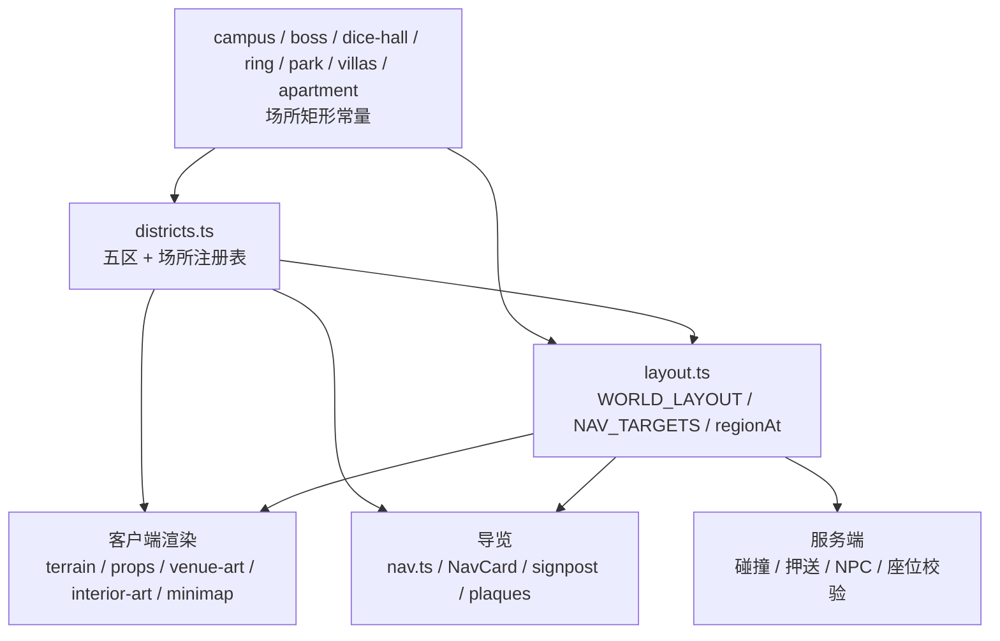

## 产品概述
把现在的「一院四房 + 散落设施」重做成一座完整的小城：中央广场是市政中心，五条街分别通往企业区、游乐区、生活区、景观区、服务区。每个场所都要有明确的归属区、明确的室内外身份，走进去一眼就知道「我进的是公司楼、游乐场还是住宅区」。

## 核心功能
- **五区归拢**：企业区（工作区、会议室、宿舍、发泄区、财神供案、紫砂茶台）、游乐区（游乐园、摸鱼大赌场、绩效八角笼）、生活区（六栋牛马公寓、两栋小院、家庭影音室）、景观区（摸鱼湖、摸鱼亭、涟漪湖、沉思浅塘、竹林、花海、太湖石）、服务区（卫生间、小黑屋、护士急救站）。
- **中央广场作为市政中心**：保留迎宾拱门、四向导览牌、牛马榜公告栏与放假告示板；五个方向的街口各立一座区门，门头写区名，门内第一段铺装用该区专属色收边。
- **室内外必须可感知**：公司楼四间房全部成「室内」——有外墙、有门、有门厅与走廊、有顶棚阴影与室内顶灯；发泄区改成公司楼里的「发泄室」，橡胶地、沙袋与老板都在屋里；赌场保持半开敞亭子但挂上霓虹门头；八角笼是露天围栏场地，配观战长椅与顶灯；卫生间、小黑屋、急救站是开在服务街上的独立小楼；公寓、小院、影音室是住宅街上的室内房间；三湖与摸鱼亭保持室外。
- **导览与标识按区重组**：HUD 导览卡按五区分组，每行标出「室内 / 室外」，卡片底部显示「企业区 · 工作区」这类两级地名；世界指路牌不再罗列十二处设施，改为只指五座区门；每个场所入口的门牌保留，区门另有更大的门头匾额。
- **地图与小地图读得出城市结构**：小地图用五个区色块画出街区边界，主路在广场汇成十字+西北支路；区域名按「场所优先、区次之、野地兜底」给出。
- **视觉基调**：延续现有像素画风与暖色低饱和色板；公司楼偏奶油木与胡桃木、游乐区偏糖果橡胶色、生活区偏暖灰抹面与木色、服务区偏冷白与水泥、景观区偏水绿。夜里只有区门、门廊、赌场霓虹、擂台顶灯与室内灯亮，不靠堆灯。


## 技术栈
沿用现有仓库技术栈，不引入新依赖：
- 共享真相：`packages/shared-types`（TypeScript strict，零运行时依赖，禁 `Math.random` / `Math.sin` / `Math.cos`，双端逐像素一致）
- 渲染：PixiJS 8 + `apps/web/lib/game/*`（场所层 `venue-art` / 室内层 `interior-art` / 地板 `props` / 光图 `lighting`）
- 服务端：Bun `Bun.serve`，碰撞、押送、NPC 落点全部读同一份 `WORLD_LAYOUT`
- 校验：`pnpm typecheck`、`pnpm test`、`pnpm changelog:check`

## 实现策略
**数据先行、坐标重排、表现收尾**，三层严格分开：

1. 先落一张「区 + 场所」注册表（`packages/shared-types/src/world/districts.ts`），作为分区、室内外、区域名、导览分组、小地图配色、区门位置的唯一真相。所有坐标仍从各场所模块的常量派生，注册表只做「归属 + 边界」，不复制第二份手写坐标。
2. 再按五区重排坐标。之所以可行：四角院落的桌椅、工位、门牌、门前铺装、陈设**全部由 `WORKROOM` / `MEETING_ROOM` / `LOUNGE` / `RESTROOM` 的矩形按相对偏移派生**（`WORKSTATIONS`、`CAMPUS_SEATS`、`*_PROPS`、`DOOR_PAVING`、`AREA_LOGOS` 均如此），所以整栋楼平移只需改 `CAMPUS_RECT`；`interior-art.ts` 也按建筑名查找矩形，不写死绝对坐标。
3. 最后补表现：区门、门厅、顶棚阴影、室内顶灯、街区铺装与人行道，全部走现有 `VenueArt` / `InteriorArt` / `props` 管线，不改协议、不落盘。

**关键取舍**
- 企业楼沿用现有「四角房间 + 内院」结构，只把第四间从卫生间换成发泄室。这样 4 个槽位正好用完，改动面最小，且保住了已验证的桌椅/床位/隔断布局。
- 景观区不做湖泊平移：三湖分散在东北、西、东南，强行搬成一片要重做岸线贴图、游鱼、贴花排除与全部留白规则，收益低于风险。景观区定义为「全园水景与绿地网络」，在西主路尽头设区门（涟漪湖—竹林—花海），另两处水面作为该区飞地，区域名仍归景观区。
- `NavTarget.area`（`indoor | grounds`）替换为 `district` + `scene`，不再保留兼容字段：它只被 `NavCard`、`signpost` 与三个测试消费，硬切成本低于维护双语义。

## 目标布局
```text
y≈2500   ┌───────── 游乐区：赌场亭 · 游乐园 · 八角笼 ─────────┐
y≈3220   ├──────────────────────────────────────────────────┤
         │  企业区           ┌───────────┐        服务区      │
         │  企业楼           │  中央广场  │       卫生间      │
         │  工作/会议        │  五区门    │       小黑屋      │
         │  宿舍/发泄        └───────────┘       急救站      │
y≈4780   ├──────────────────────────────────────────────────┤
         │            生活区：公寓 · 小院 · 影音室            │
y≈5680   └──────────────────────────────────────────────────┘
         西主路 → 景观区门（涟漪湖 · 竹林 · 花海；飞地：摸鱼湖 · 摸鱼亭 · 沉思浅塘）
```

| 区 | 目标范围（x/y/w/h，允许 ±80 微调） | 归属场所 | 场景主调 |
|---|---|---|---|
| 企业区 | 2700 / 3250 / 1000 / 1350 | 工作区、会议室、宿舍区、发泄区、财神供案、紫砂茶台 | 室内 |
| 游乐区 | 2700 / 2520 / 2720 / 700 | 摸鱼大赌场、游乐园、绩效八角笼、游乐大街 | 室外（赌场半开敞） |
| 生活区 | 3260 / 4780 / 1480 / 900 | 六栋公寓、两栋小院、家庭影音室 | 室内为主 |
| 服务区 | 4700 / 3350 / 750 / 1250 | 卫生间、小黑屋、护士急救站 | 室内 + 站台 |
| 景观区 | 网络状（涟漪湖 + 竹林 + 花海 + 摸鱼湖 + 摸鱼亭） | 三湖、摸鱼亭、竹林、花海、太湖石 | 室外 |
| 中央广场 | 保持 3736 / 3736 / 720 / 720 与出生点不动 | 拱门、导览牌、牛马榜、放假告示板 | 公共中心 |

**硬约束**
- 五个区块两两不重叠、与中央广场留 ≥36px 草地；区内场所之间留 ≥60px 通道。
- 出生点 56px 内无碰撞；五区门到广场之间有一条可走通的路（`resolveMotion` 不卡死）。
- 三湖多边形不平移；摸鱼亭、太湖石、拱门、告示栏坐标保持不变（只改归属）。
- 座位 id 仍遵守「只能追加、不能插队」；`WORK_DESK_SEAT_IDS`、`CLINIC_BED_SEAT_IDS`、`DICE_HALL_SEAT_IDS`、`RING_BENCH_SEAT_IDS` 的区间派生方式不变。
- 不新增 `world-state.json` 字段；不修改历史 ADR。

## 架构设计


数据流：区常量 → `districts.ts` 注册表 → `WORLD_LAYOUT` 与 `regionAt` → HUD / 小地图 / 渲染 / 服务端。任何一处需要「这是哪个区、室内还是室外」都只查注册表，不新增第二份归属表。

## 关键数据结构
```ts
export type DistrictId = 'corporate' | 'amusement' | 'living' | 'scenery' | 'service';
export type SceneKind = 'indoor' | 'outdoor' | 'semi';

export interface DistrictSpec {
  readonly id: DistrictId;
  readonly name: string;
  readonly scene: SceneKind;
  readonly rect: WorldRect;
  /** 区门：导览到达点、门头牌匾与指路牌共用 */
  readonly gate: { readonly x: number; readonly y: number };
}

export interface VenueSpec {
  readonly id: string;
  readonly name: string;
  readonly district: DistrictId;
  readonly scene: SceneKind;
  readonly rect: WorldRect;
  /** 对应 NAV_TARGETS 的 id；纯观赏场所不填 */
  readonly navId?: NavTargetId;
}

export function districtAt(x: number, y: number): DistrictSpec | undefined;
export function venueAt(x: number, y: number): VenueSpec | undefined;
```
`regionAt` 改为：中央广场 → `venueAt`（室内场所优先、面积小的优先，顺序在注册表里显式排出）→ `districtAt` → `FALLBACK_REGION`。`VENUES` 在模块加载时排好序，查询是 5 次矩形命中 + 至多 12 次矩形命中，无分配。

## 目录结构
```
packages/shared-types/src/
├── world/
│   ├── districts.ts            # [NEW] 五区常量 + 场所注册表 + districtAt/venueAt。区名、区色、区门、室内外归属的唯一真相；坐标一律从场所模块常量取，不手写第二份。
│   ├── campus.ts               # [MODIFY] CAMPUS_RECT 迁到企业区；第四间房由 RESTROOM 改为新 VENT_ROOM（发泄室，橡胶地、南墙开门）；新增 VENT_ROOM_SOLIDS / 门前铺装 / 室内陈设锚点；RESTROOM 整体迁往服务区并保持名称不变。
│   ├── boss.ts                 # [MODIFY] BOSS_ARENA 改为企业楼发泄室内的 420×320 橡胶地；BOSS / BOSS_SOLID / BOSS_HIT_RECT 由房间矩形派生；保留 NAV 到达点语义（垫内左下角）。
│   ├── dice-hall.ts            # [MODIFY] DICE_HALL 迁到游乐区西翼，所有柱子、吧台、赌桌、铺装改成相对 rect 的派生（禁止残留绝对坐标）。
│   ├── ring.ts                 # [MODIFY] RING_ARENA 迁到游乐区东侧场地；RING_EXIT / RING_SIGNUP / 围栏 / 观战长椅全部随矩形派生。
│   ├── park.ts                 # [MODIFY] 游乐园保持 1080×600 原位；新增「游乐大街」铺装矩形，把南门、赌场门前、擂台场地连成一条街。
│   ├── apartment.ts            # [MODIFY] 六栋楼由「绕广场铺开」改为生活区 3×2 网格，楼体尺寸与门牌号不变。
│   ├── villas.ts               # [MODIFY] 两栋小院迁入生活区，院门朝人行道。
│   ├── hotspots.ts             # [MODIFY] 热区坐标随常量自动跟随；补区门热区（仅提示，无交互）。
│   └── layout.ts               # [MODIFY] 重写路网（五区支路）、REGIONS 改为从注册表派生、NAV_TARGETS 加 district/scene 并改为五区门 + 场所两组、DOOR_PLAQUES 跟随、isPlantable 留白清单按新区块更新、paved/props/solids/buildings 汇总、WORLD_LAYOUT 增加 districts。
├── index.ts                    # [MODIFY] 导出 districts。
└── __tests__/                  # [MODIFY] campus / boss / clinic / jail / theater-park / nav-arrival / place-signs / layout-hub / collision / layout-density 按新坐标与新区域名更新；新增 districts.test.ts 断言五区不重叠、区内场所全归属、门可达、无「无区场所」。

apps/web/
├── components/game/NavCard.tsx  # [MODIFY] 五区分组 + 室内外徽标 + 底部「企业区 · 工作区」；组标题吸顶逻辑保留。
├── lib/game/
│   ├── nav.ts                   # [MODIFY] 读数透传 district/scene，新增按区分组与区门最近距离。
│   ├── signpost.ts              # [MODIFY] 只列五座区门，牌数由 DISTRICTS 派生（5×13 行仍在 96×120 画布内）。
│   ├── plaques.ts               # [MODIFY] 新增区门门头画法（木架 + 匾额 + 区色灯），沿用 TOWN_MATERIALS。
│   ├── venue-palette.ts         # [MODIFY] 新增 vent（发泄室）与 street（游乐大街）颜色，补五区强调色；保持「相邻场所有色相错开」纪律。
│   ├── venue-lights.ts          # [MODIFY] 区门 5 盏（低强度）、发泄室 1 盏、游乐大街 1 盏；卫生间灯随迁；同步更新预算断言常量。
│   ├── venue-art.ts             # [MODIFY] 新增游乐大街、生活区人行道、服务区站台、企业楼前庭铺装与收边。
│   ├── interior-art.ts          # [MODIFY] 企业楼门厅/走廊/顶棚阴影、发泄室沙袋与宣泄墙、卫生间迁址后的贴墙陈设。
│   ├── props.ts                 # [MODIFY] 新增 vent 橡胶地板画法；区界收边色带。
│   ├── minimap-draw.ts          # [MODIFY] 按 DISTRICTS 画五区色块与边界，保持 4Hz 与矩形直绘。
│   ├── terrain.ts               # [MODIFY] 铺装与路网跟随新区块；贴花排除规则自动生效（读 paved/buildings）。
│   ├── navigator.ts             # [MODIFY] 五区门到达点与场所到达点分派。
│   ├── hint-copy.ts             # [MODIFY] 区门提示文案（「[F] 查看区导览」不新增交互时改为纯装饰则移除）。
│   ├── boss-art.ts / dice-hall-view.ts / ring-art.ts   # [MODIFY] 坐标改为矩形派生，避免残留旧绝对坐标。
│   └── __tests__/               # [MODIFY] nav / signpost / lighting / actions / interactions 断言更新。

apps/game-server/src/
├── npc/escort-path.test.ts      # [MODIFY] 押送用例改为「服务区西门 → 反省点」，路面起点取自新主路。
└── sim/*.test.ts                # [MODIFY] jail / boss / ring / dice / seats 位置断言随常量更新。

docs/adr/0097-five-districts-indoor-outdoor.md   # [NEW] 记录五区划分、企业楼四房复用、景观区网络化取舍、NavTarget 字段替换、区门体系。
README.md                                        # [MODIFY] 地图与导览章节改写为五区结构，更新区域名与灯位预算说明。
apps/web/data/release-notes.json                 # [MODIFY] 追加一条玩家可感知的版本记录。
```

## 实施注意事项
- **禁止第二份坐标**：新区门、区界、门头一律由 `DISTRICTS` 与场所矩形派生；`venue-art` / `venue-lights` / `minimap-draw` 只读常量。
- **服务端一致性**：地图是静态内容，碰撞与坐标变更必须双端同版本发布；`escort-path` 的可行走格在首次使用时全量构建，改地图后要确认预热仍在启动期完成。
- **区域名回归**：现有测试直接断言「工作区」「卫生间」「摸鱼大赌场」「中央迎宾广场」「园区野地」等字符串，改名会连锁失败；除新增「发泄区」外不改既有场所名。
- **性能**：`districtAt` / `venueAt` 为纯矩形命中，无分配；小地图只多 5 个 `fillRect`；光位总数仍受 `MAX_LIGHTS=96` 约束（当前约 50，新增 ≤7 盏），同步更新 `lighting.test.ts` 与 `venue-lights` 的上下限断言。
- **灯光预算**：室内灯由 `InteriorArt` 现场收集，`lighting.test.ts` 按最坏情况给定额；新增发泄室灯后必须重算该定额，不能只在注释里加数。
- **落盘与协议零改动**：不新增 `world-state.json` 字段，不改二进制协议；本轮只是静态布局与表现。
- **回滚**：保留 `?venue=0`、`?festival=0` 等灰度开关；区门与街区铺装并入 `VenueArt`，可整层关闭。

## 风险与对策
- 企业楼整体平移后，四角房与广场间距变化可能让原有八字支路穿过新墙：路网重画后必须跑 `nav-arrival`、`collision` 与 `navigator` 三组测试，并用 `isBlocked` 采样验证五条区门路径连通。
- 生活区放六栋公寓 + 两栋小院 + 影音室最紧张：先按 3×2 网格排公寓，再沿人行道排小院，影音室放西北角；放不下时优先压缩人行道宽度，不压缩楼间距。
- 服务区里急救站要保留救护车进出通道（南侧敞开段），别被小黑屋或卫生间挡死。


## Agent Extensions
### Skill
- **pixel-venue-polish**
  - Purpose: 为五区补齐地面材质、门头、陈设与灯光氛围，保证与全站像素画风、明度阶梯和光照预算一致
  - Expected outcome: 企业楼门厅与顶棚阴影、发泄室橡胶地与宣泄陈设、游乐大街、服务区站台、生活区人行道与五座区门全部符合 `pixel-venue-polish` 的色板与光照纪律，并留下可复核的评审结论
### SubAgent
- **code-explorer**
  - Purpose: 在坐标重排前一次性摸清所有读取世界坐标与区域名的消费方（渲染、服务端、测试、HUD），避免漏改
  - Expected outcome: 产出一份「坐标/区域名消费清单」，覆盖 `apps/web/lib/game`、`apps/game-server` 与全部布局测试，作为重排任务的验收依据
