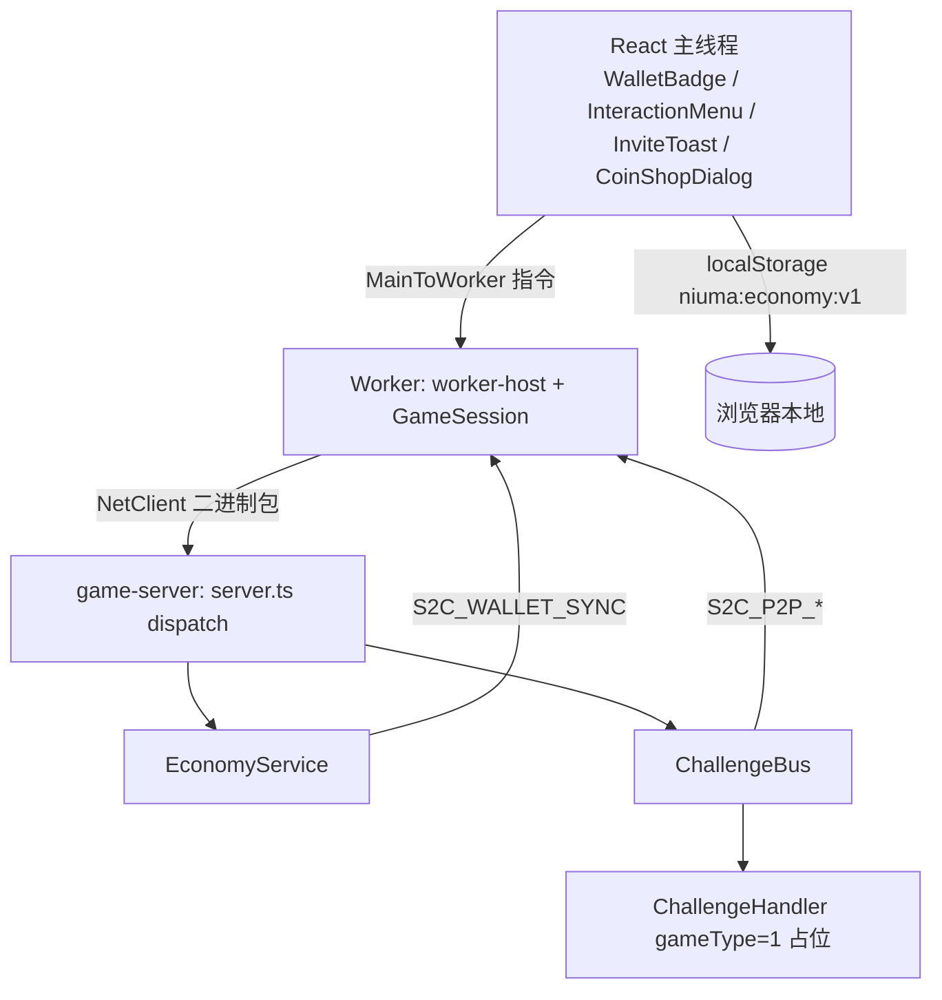

## 用户需求

在既有「牛马园区」多人游戏上，搭建**牛马币经济底座**与**可扩展的 1v1 玩家互动引擎（ChallengeBus）**，并形成可玩的经济闭环与完整邀请链路。

## 产品概述
服务端保持零数据库持久化：永久资产存浏览器 `localStorage`（`niuma:economy:v1`），进园时随 HELLO 上报，园内以服务端内存为准，变动时用二进制包通知客户端落盘。移动包 8 字节格式与原有 8 位 state 严禁改动，新功能全部走 `0x2d` 之后的新 OpCode 与手写小端编码。

## 核心功能
### 1. 经济与背包
- 定义玩家经济档案：牛马币余额、四维属性等级（攻速 / 工作 / 暴击 / 护甲，各 0-10）、已解锁外观、消耗品背包数量、房屋等级、每日任务进度。
- HELLO 尾部追加经济摘要段上报初始资产；新增服务端到客户端的钱包同步包，携带最新余额、属性、完整背包与变动原因枚举。
- 服务端统一经济服务：发币、扣币（余额永不为负）、升级、背包增减、托管冻结。
- 攻速等级改造 `E` 键发泄：冷却由基础 1200ms 随等级递减，最低锁定 500ms（客户端与服务端同一把尺子）。

### 2. 玩家快捷互动菜单
- 画布点击其他玩家（Worker 命中检测）后，在原有「查看工牌」旁弹出可扩展快捷菜单：发起挑战、使用道具、打赏、查看工牌。
- 视觉：跟随玩家的像素风浮层，四项入口图标 + 文案，金币按钮带余额徽标。

### 3. 邀请与 1v1 状态机
- 发起邀请：校验双方在线、均不忙碌、视距内（沿用约 400px AOI 视野口径）、发起方金币不低于赌注。
- 被邀请方收到右上角邀请浮窗：发起者名字、玩法名称、赌注金额、15 秒倒计时、接受 / 拒绝。
- 接受后双方赌注冻结（Escrow），创建对局实例并分发给对应玩法处理器；本阶段仅注册 gameType=1 占位处理器，由服务端延时自动裁决并结算赌注。
- 断线 / 超时 / 拒绝一律自动退款并清理忙碌态，绝不锁死玩家。

### 4. 收益闭环与商店
- 擂台前三名、击倒他人、踹倒老板、每日任务达成时发币，重复发包不重复发奖。
- 新增「牛马币商店」面板：花币升级四维属性（价格随等级递增、等级封顶）、购买消耗品写入背包，并同步落盘。

### 5. 快捷互动两项
- 打赏：向目标转币，双方看到飘字与余额同步。
- 道具：选择消耗品，服务端扣库存并给目标临时增益或表情效果。

## 验收
- 右上角显示牛马币数字；点击玩家弹出快捷互动面板与工牌按钮；发起模拟邀请后，拒绝或超时能正确清理状态与退款；拒绝/超时/断线三条 refund 路径可测。
- `pnpm typecheck` 与 `pnpm test` 全部通过。

## 技术栈
- 语言与工程：TypeScript 严格模式、pnpm + turbo monorepo、vitest。
- 协议层：`@niuma/shared-types` 纯函数 + 手写小端 `ByteWriter` / `ByteReader`（无第三方序列化）。
- 服务端：Bun WebSocket（`apps/game-server`），全内存状态机，Tick 50ms 驱动。
- 客户端：Next.js + React + zustand（`useGameUi`）+ Tailwind 自定义 token；游戏逻辑与 Socket 在 Dedicated Worker，主线程只跑 UI。

## 实现思路与关键决策

### 1. 协议扩展：追加式演进，绝不改旧字节
- 新 OpCode 从 `0x31` 起：`C2S_P2P_INVITE 0x31`、`C2S_P2P_RESPOND 0x32`、`C2S_TIP 0x33`、`C2S_USE_ITEM 0x34`、`C2S_SHOP_BUY 0x35`、`S2C_WALLET_SYNC 0x36`、`S2C_P2P_INVITE_NOTIFY 0x37`、`S2C_P2P_INVITE_RESULT 0x38`、`S2C_P2P_MATCH 0x39`、`S2C_TIP 0x3a`、`S2C_ITEM_EFFECT 0x3b`。
- 需求写的 `0xfa` 已被 `SESSION_EXTENSION_MAGIC` 占用，改用**空闲魔数 `ECONOMY_EXTENSION_MAGIC = 0xf7`**（0xf8–0xff 全部已被占用，0xf7 且大于 `MAX_STATUS_BYTES`(48)，不可能是合法状态长度）。
- 经济段追加在 HELLO **最末尾**（设备段之后），沿用 `careerSegmentSizeAt / readCareerSegment` 的既有范式；**必须把 0xf7 加入 `decodeHello` 中 resume 段的魔数排除列表**，否则尾部会被误读成落点。
- 未注册 opcode 天然被 `guard.ts` 判为 `PACKET_UNKNOWN` 静默丢弃 → 新旧客户端混跑天然兼容。

### 2. 权威边界：内存为准 + 客户端落盘，事件驱动
- 经济字段挂在 `Player`（`coins / stats / inventory / houseTier / dailyQuests / busyMatchId`），`world.ts` 已是所有在线态的集中地。
- 顺序：主线程读 localStorage → `init` 带进 Worker → `GameSession` 随 `C2S_HELLO` 上报（不可信但**有界**：金币钳到 u32 上限、等级 0-10、道具 id 必须在目录内、数量 ≤ 99）→ 服务端清洗并回一条 `S2C_WALLET_SYNC(reason=init)` 纠正本地 → 之后每次变动只按事件推送。
- 回包采用**完整背包快照**而非增量：包体 ≤ `12 + 4×N` 字节（N 为道具种类，约 10），幂等、无合并 bug，远小于 2048 上限。
- 明确**不写入** `persist/profiles.ts` 与 `world-state.ts`：经济永久层只有浏览器 localStorage，服务端进程重启即回到 HELLO 上报值。

### 3. EconomyService：单一入口保证非负
- `grantCoins / trySpendCoins / upgradeStat / addItem / consumeItem / freezeEscrow / settleEscrow / refundEscrow` 全部为 O(1)；`trySpendCoins` 用「先判后减」避免负数；所有变动走同一个 `applyChange` 钩子统一发 `WALLET_SYNC`，杜绝漏推。
- 增益挂点：`RingRuntime` 的 `onSettled` 回调（需给 `RingSettleEntry` 补 `id` 字段才能定位 Player）；`vent.ts` 命中路径新增可选观察者回调 `onKnockdown / onBossKill`（把现有 `VentHitObserver` 改为方法可选，向后兼容既有测试与 `detention`）；均由「一局一次 / 一击一次」的上游语义保证幂等。
- 发泄冷却：`ventCooldownMs(atkSpeedLv)` 纯函数（1200 − 70×lv，下限 500，lv10 恰为 500），服务端 `sim/vent.ts` 与客户端 `session.ts` 同步改读，`VENT_COOLDOWN_MS` 保留为兼容常量。

### 4. ChallengeBus：总线 + 插件化 Handler
- 三段状态：`PendingInvite`（15s 超时）→ `ActiveMatch`（Escrow 已冻结）→ 结算/退款；`Player.busyMatchId` 是「忙碌」的唯一真相。
- `ChallengeHandler` 接口 `onStart / onInput / onTick / onCancel`，由 `Map<gameType, Handler>` 注册；占位处理器 `gameType=1` 在 `endsAt` 时用注入的 `rng` 裁决胜负并调用总线结算，便于确定性测试。
- Tick 成本：`if (pending.size + active.size === 0) return;` 早退，稳态零开销；仅随活跃对局线性增长。
- 断线：`server.ts` 的 `handleClose` 在 `world` 清理**之前**调用 `challengeBus.onDisconnect(id)` → 退还双方冻结金币、给对手发取消包、清 `busyMatchId`。

### 5. 前端数据流（不破坏现有分层）
- 新方法沿既有门面链路传播：`GameClient`（新增 `invite/respond/tip/useItem/buyShop`）→ `WorkerGameClient` / `MainThreadGameClient` → `MainToWorker` 指令 → `worker-host` → `GameSession` → `NetClient`。
- 下行：`NetClient.handle` 新增 case → `GameSession` 回调 → `WorkerToMain`（`wallet / invite / inviteResult / match / tip / itemEffect`）→ `WorkerGameClient` → `SessionCallbacks`（`onWallet? / onInvite? / onMatch? / onTip? / onItemEffect?`，全为可选，主线程回退实现无需同步改动）。
- **localStorage 只在主线程写**（沿用「session 只认网络与渲染」纪律）：`GameViewport` 在 `onWallet` 里 `saveEconomy` + 写 zustand。
- `useGameUi` 只新增切片（`wallet / invite / match / targetMenu / shopOpen / actionTarget / coinPops`），组件按字段选择订阅，避免整店重渲染。

### 性能与可靠性
- 钱包包每条 ≤ 60 字节、纯事件驱动，无 Tick 注入；`EconomyService` 无每帧分配。
- 邀请/打赏/道具/购买均带每连接冷却（沿用 `lastLikeAt` 式时间戳闸门），防包放大。
- 占位对局与邀请表都有硬上限（各 32 条），拒绝新请求而非无限增长。
- 所有新 decoder 对截断/畸形包返回 `undefined` 而非抛错，配合 `guard.ts` 定长表（`TABLE_SIZE = 0x40` 已覆盖到 0x3b）在 dispatch 前挡掉最坏情况。

## 架构关系

## 执行要点（防回归）
- `packages/shared-types/src/protocol.ts` 改动后必须补 `decodeHello` 排除列表与 `checkPacket` 定长登记，否则「旧包被误判畸形 → 直接断线」。
- 现有 `sim/vent.test.ts` 有多处基于 `VENF_COOLDOWN_MS = 700` 的时间断言（含「冷却结束后可以再打一次」），改为按等级量取的快照值，不改语义。
- 收益挂点必须幂等：擂台结算只在 `settle` 一次、老板只在 `justDied` 一次、击倒只在场外 `onVentHit` 分支。
- 日志沿用现有 `console` + 5 秒窗口聚合（`logAbuse` 范式），不打印金币明细与设备号。
- 不改动 8 字节移动包与 `control-channel.ts`；不改历史 ADR，新增 `docs/adr/0082-*.md` 与 `0083-*.md`。

## 设计风格
沿用园区既有的「像素街机 + 暖褐底板 + 薄荷冷光」视觉语言（`ink-900 #14100C` 底、`mist-100` 文字、`mint-400` 唯一主强调），新增的四个面板不引入第二套风格：全部 2px 硬边框、无圆角、`backdrop-blur-sm`、像素等宽数字。牛马币是**金色**专属：只用于货币数字与飘字，不与薄荷主色抢位。

## 界面与区块
### 1. 右上角工具栏 · 牛马币徽标
嵌在现有 `HudDock` 状态段右侧：金币图标 + 6 位等宽数字（`#F2C879`）+ 余额变动时数字做一次 200ms 上跳并按 `+N / −N` 飘字。整块可点，点开商店；桌面上悬浮显示「牛马币可升级属性与购买道具」。

### 2. 玩家快捷互动菜单
点击角色后在其头顶上方弹出 2×2 紧凑网格（宽约 168px、`ink-900/92` 背板、`ink-600` 边框），四项：发起挑战（mint 图标）、使用道具、打赏（金色）、查看工牌。菜单顶部一行 `名字 · 阵地` 小字；点画布空白处或滚动即收起，同时从「查看工牌」可进入原档案弹窗。

### 3. 邀请浮窗（15 秒）
右上角贴边竖卡，左侧 3px 金色竖条 + 剩余秒数环形进度；标题「〔发起者〕邀你对战」，副行玩法名与赌注 `押注 120 币`；底部两枚按钮：接受（mint 实心）/ 拒绝（ghost）。最后 3 秒边框转 `signal-500` 并轻微闪烁。

### 4. 对局浮层与结算
对局中为顶部居中窄条：玩法名 + 双方名字 + 倒计时；结算时展开为一张卡片，显示胜负、赌注结算与最终余额，3 秒后自动淡出，可手动关闭。

### 5. 牛马币商店
右侧抽屉（桌面 380px / 移动全屏）。两段：四维属性升级行（图标 + 名称 + 等级 pip 10 格 + 价格按钮，满级转灰）；消耗品卡网格（2 列，显示持有数量与单价）。顶部固定余额条，不足时价格按钮转 `signal-500` 并禁用，点击给出提示音与抖动。

### 6. 打赏 / 道具子面板
由互动菜单就地展开的小卡：打赏为 10 / 50 / 100 / 自定义 四档 + 确认；道具为背包横滑列表，选中后确认。均显示当前余额与目标名字，操作成功即关闭并飘字。
