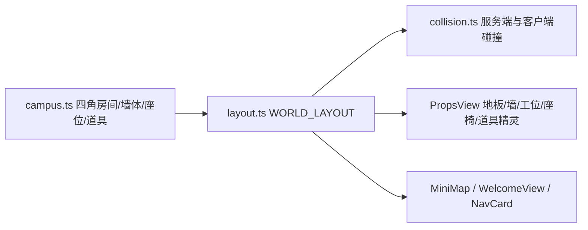

## 产品概述
把牛马园北门内的园区重排为紧凑的四角院落：进门即见中央庭院与十字通道，四个功能区各占一角，整体从“沿四边散落一圈工位”变为“一院四房”的清晰格局。

## 核心功能
- 方位：以地图北向为上方，从北门进入时左上（西北）为工作区、右上（东北）为会议室、左下（西南）为宿舍区、右下（东南）为卫生间。
- 收窄：办公区由 1760×1384 收到 1520×1240，中庭 600×520；删除沿四边散布的 45 个工位与只为旧休息室服务的北岸横路。
- 工作区：唯一不加墙的区域，木地板开放式布局；8 个工位两排背靠背、每排 4 张，横向成排、椅子对椅子，形成开放式大办公室的读感。
- 会议室 / 宿舍区 / 卫生间：四面加墙、各开一扇门；宿舍区两组上下铺、每铺睡两人，陈设精简为少量高频家具。
- 卫生间：自西向东为男厕 / 中央洗手池 / 女厕三区，两侧各 2 个马桶，隔墙留门洞，中央南墙放两个洗手台。
- Logo：四区入口各一块带像素图标的立牌（显示器 / 会议桌 / 上下铺 / 卫浴），不参与碰撞。
- 南园：原研发园收为小型休息庭院，保留长椅、野餐桌、单车、灯柱与绿植，树篱围边并在北侧留入口。
- 视觉：沿用现有像素色板与 1:1 硬边贴图，四个院落门朝中庭，玩家从北门一眼能读出四个方位。


## 技术栈
- Monorepo：pnpm + Turborepo，TypeScript 5.7。
- 共享布局：`@niuma/shared-types` 纯 TS，不依赖 Pixi / DOM / Bun。
- 客户端：Next.js 15 + React 19 + Pixi.js 8，装饰在构造期用 Graphics 烘焙 1:1 纹理（ADR-0005）。
- 服务端：Bun + TS，碰撞与移动求解直接复用 `shared-types`。
- 测试：shared-types 用 vitest，web / game-server 用 bun test；不新增依赖。

## 实现方案

### 核心策略
以 `packages/shared-types/src/world/campus.ts` 为四角院落的几何源头，`layout.ts` 只做世界接线；渲染层完全由 `WORLD_LAYOUT` 数据驱动，因此不改协议、不改服务端模拟逻辑，只改共享常量、渲染贴图与测试。

### 几何蓝图
`CAMPUS_RECT` 改为四角院落（原研发园矩形改名为 `SOUTH_YARD`）：

| 区域 | rect | 门 |
|---|---|---|
| 院落 | 3336, 3476, 1520, 1240 | — |
| 工作区（西北） | 3336, 3476, 460, 360 | 无墙、无门 |
| 会议室（东北） | 4396, 3476, 460, 360 | 南墙 4726–4786 |
| 宿舍区（西南） | 3336, 4356, 460, 360 | 北墙 3536–3596 |
| 卫生间（东南） | 4396, 4356, 460, 360 | 北墙 4596–4656 |
| 中庭 | 3796, 3836, 600, 520 | 四角房间之间的十字通道 |
| 南园 | 3336, 5140, 1520, 560 | 北侧树篱缺口接南向主路 |

房间尺寸 460×360、墙厚 10、门宽 60；房间贴院落四角，中庭宽高正好等于院落减去两间房后的余量（600×520），无需额外走道常量。

### 关键决策
1. **删除散落工位**：删掉 `officeWorkstations()`、`PLAZA_DESKS`、`GATE_LANE_X/Y` 与北岸横路；`DESKS` 只保留工作区 8 张桌，座位从 51 降到约 25。
2. **工作区开放**：只建 `BuildingSpec` 木地板，不调用 `roomWalls()`；两排 4 张工位背靠背，排距 124、列距 104，上排 `DIRECTION.Up`、下排 `DIRECTION.Down`。
3. **卫生间三区**：外层仍用 `roomWalls(rect, northDoor)`；两道 10px 内隔墙作为 `kind:'wall'` 的 `SolidRect` 手工写入，各留 60px 门洞；每侧 2 个马桶朝南、贴房间北墙，中央区南墙 2 个 `sink`。
4. **上下铺不新增 SeatKind**：每个铺位用两个 `kind:'bed'` 座位表示上下层，垂直相距 44px（满足 `seats.test` 两两大于 40 的约束）；只新增 `PropKind 'ladder'` 小道具示意上下层。这样 `seatPose`、服务端 `kind === 'bed'`、打呼、`findNearestSeat`、动作按钮全部不用改。
5. **Logo 单 PropKind 多 variant**：新增 `PropKind 'logo'` 与 `PropInstance.variant?: number`（0 工作区 / 1 会议室 / 2 宿舍区 / 3 卫生间）；`PROP_SIZE.logo` 约 28×36，贴图缓存键改为 `kind:variant`，立牌不产生碰撞。
6. **南园收窄**：`SOUTH_YARD` 1520×560、铺装 1440×520；删掉会议室、卫生间、会议桌、马桶、隔断、洗手池及对应座位/碰撞；保留长椅、野餐桌、单车、灯柱、绿植、垃圾桶并重排；`softEdgeHedges()` 移到南园边界、北侧留入口，保住树篱数量与视觉密度。
7. **文案与导航**：`REGIONS`、`NAV_SOURCES`、`CAMPUS_BUILDINGS`、指路牌与测试里的「休息室」改为「宿舍区」；`NavTargetId` 的 `'lounge'` 保留，避免 HUD 与测试大改；房间区域必须排在「办公区」之前。

### 备选方案与取舍
| 方案 | 收益 | 代价 | 结论 |
|---|---|---|---|
| 保留四边工位环 | 改动最小 | 不满足“删除分散工位”，座位/碰撞/渲染仍是 51 桌 | 否决 |
| 工作区单排 6 张 | 最字面的横向排列 | 房间要加宽到约 560，破坏 460×360 对称 | 否决 |
| 新增 SeatKind `bunk` | 语义最干净 | `seatPose`、服务端 sit/lie、客户端 actions/session/interactions/badge 及测试连锁修改 | 否决，改用两张 bed 座位 |
| 四个独立 logo PropKind | 不改 `PropInstance` | 四个 union 成员与四个 switch 分支，未来扩展更碎 | 否决，用 variant |
| 完全删除南园 | 地图更空 | 铺装减少约 0.83M 像素，空地密度测试风险高 | 否决，缩小保留 |

### 性能
- 工位桌从 51 降到 8，桌面碰撞体同步减少 43 个；花箱 26 降到约 8，广场道具 28 降到约 10，树篱约 100 降到约 60。
- 新增贴图仅 4 个 logo 变体 + 1 个 ladder，共 5 张小图，构造期各烘焙一次；帧循环不新增分配、不新增查询。
- 渲染精灵、裁剪条目、碰撞 blocker 全部下降，初始化与 AOI 渲染成本都是净收益。

## 实现注意
- 坐标全部手写偶数；禁止 `Math.random` / `Math.sin` / `Math.cos`；派生只用常量加减，不做运行期缩放。
- 墙厚 10、门宽 60；座位中心离任何固体至少 20px（`seats.test` 用 20 半径校验），上下铺两层相距 44；工作区椅子与桌边正好 20px 是既有边界，不要改成 19。
- 四个 `NAV_ARRIVALS` 要落在门内空地且不等于房间中心：工作区 (3566,3770)、会议室 (4756,3760)、宿舍区 (3566,4426)、卫生间 (4626,4426)；寻路测试要求从出生点全部可达。
- `(4096,4096)` 必须保持附近无座位（服务端多组测试在此处验证“地面坐/躺”）；售货机、饮水机、咖啡机各至少保留一个（`interactions.test`）。
- `terrain-edge.test` 的 `(4096,3800)` 必须仍是草地、`(4096,4800)` 必须是土路：北向土路止于院落北缘 3476，不延伸进院落。
- `REGIONS` 顺序：水体 → 林地 → 牛马园北门 → 工作区 → 会议室 → 宿舍区 → 卫生间 → 办公区 → 研发园；房间在办公区内部，必须先于办公区命中。
- 空地密度测试若逼近阈值，优先补孤树/花海或调 `WILD_TREE_CHANCE`，不要改水系、林地、桥梁数量断言。
- 共享坐标是双端唯一真相，本次必须客户端与服务端同版本发布；旧客户端连新服务端会被持续拉回。

## 架构设计


- `shared-types` 仍是唯一真相：服务端碰撞、客户端预测、小地图、指路牌、导览卡全部读同一份矩形与座位表。
- 不新增模块、不改协议、不改 `SeatKind`；新增的只有 `PropKind 'ladder' | 'logo'` 与 `PropInstance.variant`。
- 渲染层只扩展 `PROP_SIZE`、`drawProp` 与贴图缓存键，`PropsView.build()` 主流程不变。

## 目录结构

```
niuma/
├── packages/shared-types/src/world/
│   ├── campus.ts                    # [MODIFY] 四角院落几何：CAMPUS_RECT 改为 3336,3476,1520,1240；
│   │                                #   新增 WORKROOM/MEETING_ROOM/LOUNGE/RESTROOM 四角矩形、门与墙、
│   │                                #   卫生间三区隔墙与洗手池、宿舍上下铺与沙发/凳子/床头几、
│   │                                #   SOUTH_YARD 与铺装/道具、NAV_ARRIVALS、PropKind 增加 ladder/logo、
│   │                                #   PropInstance 增加 variant；删除两栋旧房与会议桌/马桶/隔断/洗手池
│   └── layout.ts                    # [MODIFY] OFFICE_RECT 改为 CAMPUS_RECT 别名；PLAZA 收为 600×520；
│                                    #   PATHS 四向止于院落外缘并删除北岸横路；删除 officeWorkstations 与 51 桌；
│                                    #   PLANTERS/PLAZA_PROPS/ROAD_PROPS 重排；softEdgeHedges 移到南园；
│                                    #   REGIONS/NAV_SOURCES 改名与排序；树留白引用新矩形
├── packages/shared-types/src/__tests__/
│   ├── campus-layout.test.ts        # [NEW] 四角方位、房间贴角、工作区无墙、卫生间三区、4 个 logo、
│   │                                #   上下铺成对 44px、ladder 就近、宿舍门/会议门方位等新不变量
│   ├── seats.test.ts                # [MODIFY] 座位下界 51→约 25；四间房门洞坐标；朝向集合改为上/下；
│   │                                #   删除东西向工位分支；区域名改宿舍区；上下铺/马桶/凳子断言
│   ├── collision.test.ts            # [MODIFY] 南北与东西通道不被挡；南缘绕行改为十字通道穿行；
│   │                                #   树篱数量与区域优先级
│   ├── nav-arrival.test.ts          # [MODIFY] 四个 DOOR_OUTSIDE 新坐标（含工作区开放边缘）
│   └── layout-density.test.ts       # [MODIFY] CAMPUS_RECT 语义变更，covered 同时纳入 SOUTH_YARD；
│                                    #   密度阈值实测后按需微调
├── apps/web/lib/game/
│   ├── props.ts                     # [MODIFY] PROP_SIZE 增加 ladder/logo；drawProp 增加 variant 参数；
│   │                                #   新增 drawLadder 与四变体 drawLogo；propTextures 键改 kind:variant；
│   │                                #   其余地板/墙/工位/座椅管线不动
│   └── __tests__/nav.test.ts        # [MODIFY] 最近目标改为工作区；工作区方位改为西北；
│                                    #   卫生间/会议室仍在南侧的断言保留
├── docs/adr/
│   └── 0044-four-quadrant-campus.md # [NEW] 记录方位、墙策略、卫生间三区、上下铺方案、logo 立牌、
│                                    #   南园收窄、备选方案、后果与回滚路径（不改写历史 ADR）
└── README.md                        # [MODIFY] 地图段更新：删除“工位沿四边排一圈”，
                                     #   改写四角院落、宿舍区、收窄后的研发园与卫生间三区
```

验证型不改文件：`collision.ts`、`MiniMap.tsx`、`welcome.ts`、`NavCard.tsx`、`interactions.ts`、`pathfinding.ts`、`apps/game-server/src/sim/seats.ts`；`pathfinding.test.ts`、`terrain-edge.test.ts`、`interactions.test.ts`、game-server 的 `seats.test.ts` / `resume.test.ts` 预计无需修改，但必须随全量测试跑一遍。

## 关键代码结构
```ts
// campus.ts：一个原点 + 院落尺寸推出四角房间，禁止在别处再写一套坐标
export const CAMPUS_RECT: WorldRect = { x: 3336, y: 3476, w: 1520, h: 1240 };
export const ROOM_W = 460;
export const ROOM_H = 360;
export const WORKROOM: WorldRect = { x: CAMPUS_RECT.x, y: CAMPUS_RECT.y, w: ROOM_W, h: ROOM_H };
export const MEETING_ROOM: WorldRect = {
  x: CAMPUS_RECT.x + CAMPUS_RECT.w - ROOM_W, y: CAMPUS_RECT.y, w: ROOM_W, h: ROOM_H,
};
export const LOUNGE: WorldRect = {
  x: CAMPUS_RECT.x, y: CAMPUS_RECT.y + CAMPUS_RECT.h - ROOM_H, w: ROOM_W, h: ROOM_H,
};
export const RESTROOM: WorldRect = {
  x: CAMPUS_RECT.x + CAMPUS_RECT.w - ROOM_W,
  y: CAMPUS_RECT.y + CAMPUS_RECT.h - ROOM_H, w: ROOM_W, h: ROOM_H,
};
```

```ts
// campus.ts：logo 复用一条道具管线，variant 决定图标；ladder 只是可穿过的小道具
export interface PropInstance {
  kind: PropKind;
  x: number;
  y: number;
  /** 仅 logo 使用：0 工作区 / 1 会议室 / 2 宿舍区 / 3 卫生间 */
  variant?: number;
}
```


## Agent Extensions
### Skill
- **principal-software-architect**
  - Purpose: 按项目既有 ADR 结构写 ADR-0044，给出备选方案、后果、回滚路径与双端发布约束，避免布局改动演变成架构漂移。
  - Expected outcome: 一份可复核的 ADR，明确四角方位、墙策略、上下铺折衷与 logo 变体方案，并记录 30 天回滚方式。
- **verification-before-completion**
  - Purpose: 在最终验收阶段先跑自动化与手动检查，再声明完成，避免“看起来对”但测试或寻路回归。
  - Expected outcome: `pnpm test`、`pnpm typecheck` 全绿，并附四区方位、卫生间三区、上下铺、logo 立牌的本地验收证据。
