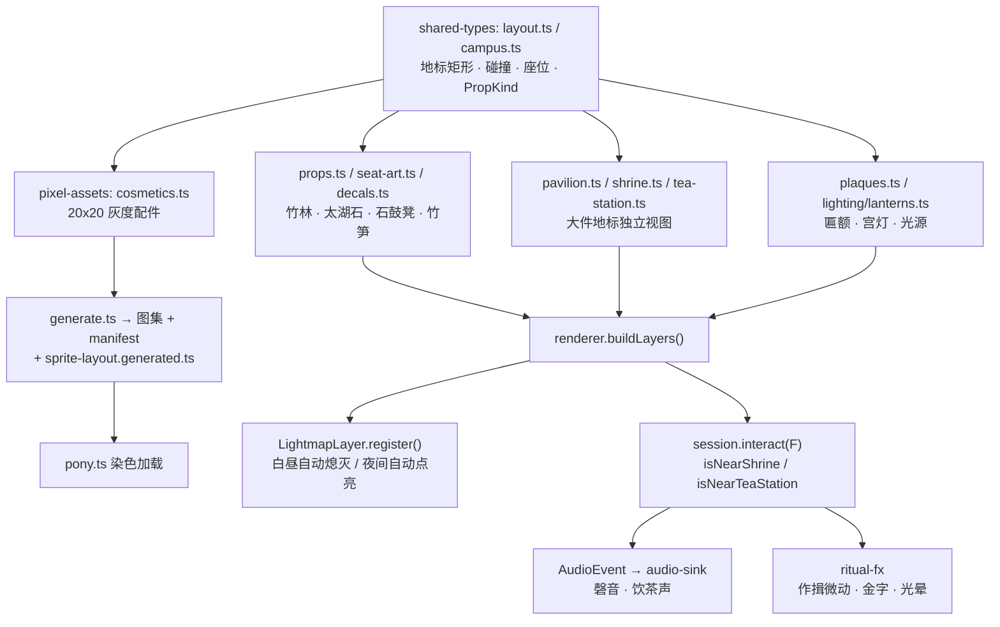

## 产品概述
为《牛马 NIOMA》注入「中式传统园林 + 中式职场玄学」风格体系：把江南园林的亭、竹、石、匾、灯搬进这座像素园区，并让「上香求暴富」「续杯养生茶」成为可交互的日常仪式。整体观感从「现代办公园区」升级为「香火与青瓦并存的牛马道场」，日夜冷暖对比更强。

## 核心功能
**一、国风捏人配件（共 7 件，20×20 像素）**
- 头饰 3 件：财神官帽（两侧带飞翅的硬质官帽）、江湖斗笠（倾斜下压、帽檐留 1px 编织纹）、赛博紧箍咒（前额发光金箍 + 正中卷云纹）。
- 颈饰 2 件：吉祥中国结（胸前菱形盘长结 + 双流苏）、翡翠平安扣（环形玉璧、中心镂空 1 像素）。
- 发型 2 件：发髻、长辫。
- 全部遵循 1px 硬朗描边，颜色由所属色槽染色决定；捏人页可直接挑选佩戴。

**二、中式园林地标**
- 摸鱼湖畔立「摸鱼亭」：八角重檐、青瓦朱柱、飞檐微翘；亭内一张圆形汉白玉石桌 + 4 个石鼓凳，走近按 Z 可落座，坐下即面朝湖面「观湖沉思」。亭子可走入，前后柱有正确遮挡。
- 西北工作区与中庭交界处铺两片翠竹林，替换原地部分普通树木；竹竿带竹节纹理，地面零星青绿竹笋贴花。
- 迎宾广场拐角摆放带透光孔洞的太湖石叠石盆景。

**三、赛博财神供案（工作区入口旁）**
红木雕花供案、微缩发光财神像、青铜三足香炉；香炉上方常驻 3 缕缓缓升起消散的青烟。靠近按 F：角色做合十作揖微动效，响起一声悠扬的寺庙磬音，财神像闪过一道金光，头顶升起金色飘字「祈求暴富 / 保佑本周无 Bug / 功德 +1」。当天首次上香额外获得 60 秒淡金光晕（仅本机可见）。

**四、老干部紫砂茶台（工作区饮水机旁）**
红泥紫砂壶、白瓷品茗杯、白色温热蒸汽。按 F 续杯：屏幕提示「咕嘟咕嘟… 喝了一大口枸杞黄芪老参茶！」，头顶冒泡「防脱发指数 +10% ｜ 气血恢复中」，并解除困倦相关的僵直与打盹状态。

**五、门头牌匾与夜景宫灯**
- 工作区门头挂黑底金字匾额「难得糊涂」，会议室挂木牌「画饼充饥」，宿舍区挂「安乐窝」；工作区门头配一副红底金字的竖排短联「有事烧香 / 无事摸鱼」。
- 摸鱼亭四角、迎宾拱门横幅两侧、四间房门柱共挂 10 盏红色宫灯。白天熄灭，进入夜间冷蓝调时自动点亮，向下投出半径 48px 的暖红柔光圈，与冷色夜景形成冷暖撞色。

## 验收
图集重新生成无报错、捏人页可选新配件；摸鱼亭石凳可落座；供案按 F 有磬音与金色飘字；全量类型检查通过。


## 技术栈
- TypeScript 5.7 + pnpm workspace（apps/web、apps/game-server、packages/shared-types、packages/pixel-assets），**不引入任何新依赖**。
- 渲染：PixiJS v8，沿用 `Graphics` 逐像素 `rect()` + `bake()` 一次性烘焙成 `Texture`；沿用 `SortLayer`（按脚底 y 分桶）与 `LightmapLayer`（屏幕空间加色柔光）。
- 资产：bun 跑 `packages/pixel-assets/scripts/generate.ts`，产出 `apps/web/public/sprites/**`、`manifest.json`、`sprite-layout.generated.ts`。
- 音频：纯 Web Audio 振荡器合成，零音频资源。
- 持久化：服务端零状态；客户端 localStorage 存外观、落点、当日上香标记。

## 实施策略
按「数据 → 美术 → 装配 → 交互」四层推进，重申仓库既有纪律：**坐标只写一份、渲染只读数据、帧循环不建节点**。

1. **数据层（shared-types）**：新地标/植被/座位/交互点先落成常量 + `SolidRect` + `SeatInstance`，渲染与交互全部从这一份派生（照抄 `BULLETIN_BOARD` / `BULLETIN_BOARD_SOLID` 的单点真相写法）。
2. **美术层**：配件走 20×20 灰度 + `silhouette()` 硬描边；世界美术走逐像素 `rect()` + `bake()`，禁止 `Graphics.ellipse/circle/渐变`。
3. **装配层（renderer）**：新视图构造期 `depth.add(y, container)` 进 `SortLayer`；光源在构造期收集为 `LightSpec[]`，在 `lightmap.register()` 之前注册（`this.interior.lights` 已是这条通路）。
4. **交互层**：复用 F = `interact`，只加 `isNearXxx` 分流；音频一律走 `AudioEvent` 事件到主线程播放。

### 关键决策与取舍
1. **国风配色**：配件保持纯灰度，红金官帽/翠绿玉璧由玩家 headwear/neckwear 色槽 tint 表达（ADR-0011）。否决「烘焙彩色」——会与 tint 相乘发脏，且直接违反 `cosmetics.test.ts` 的纯灰度断言。
2. **作揖动效**：不动 atlas 列预算（34 列已被 `CLIPS` 与「每列恰属一个动作」测试钉死），改用客户端程序化包络（前倾 2px + 纵向压缩约 6%，900ms）。否决「新增 pray clip」——要改 `CLIPS`/`COLUMN_POSES`/生成器/布局测试，代价远超收益。
3. **大件地标 vs 道具管线**：摸鱼亭、财神供案、紫砂茶台用独立视图 + 显式 `SolidRect`（需求也点名了独立文件），因为其绘制尺度与遮挡关系（亭子要能走进去）超出 `PROP_SIZE` 单精灵模型；竹林、太湖石走新 `PropKind`，借 `PropsView` 的纹理缓存、视口裁剪与自动碰撞。
4. **亭子遮挡**：拆成后景（后柱 + 主屋顶）与前景（前柱 + 前檐）两条深度键，玩家在亭内时被前柱压住、后柱留在身后。否决「单键排序」——进亭即被屋顶盖住。
5. **灯笼入夜点亮**：不自己判昼夜，只注册 `LightSpec`；`lightmap.render` 已用 `localLightGain(tone)` 做「白昼 0 / 深夜 1」的淡入。否决「按小时改色温」——需给 `LightSpec` 扩字段并在 `render` 里 `update`，收益不抵复杂度。
6. **磬音**：新建一次性合成模块（非谐正弦分音 + 长指数衰减 + 短延迟尾），不复用 6 路 `Voice` 池——池的 3 路振荡器装不下钟的 4–5 个分音，且长衰减会被 `acquire()` 抢占。经 `AudioEvent` 落主线程播放。
7. **当天首次上香**：沿用 `danmakuPrefs`（init 期主线程读 localStorage 带进 Worker）+ `writeSnapshot`（写穿回主线程落盘）两条既有通路，新增 `incenseDay` 初值与 `writeIncenseDay()`。零服务端状态、零网络字段。
8. **中文匾额**：仓库无位图 CJK 字库，只能 Pixi `Text` + `resolution: devicePxPerTexel`（`bulletin.ts` / `welcome.ts` 已是范式），并补 `setTextResolution` 转发；竖排对联靠 `Text` 内换行实现。

### 性能与可靠性
- 竹林预算 ≤ 26 丛、太湖石 ≤ 3 座；`PropsView` 按 `kind:variant` 缓存纹理，新 kind 只多 4–6 张纹理。
- 光源总数必须 ≤ `MAX_LIGHTS = 64`（当前约 39）：新增 10 盏宫灯 + 2 盏供案灯 = 51，留 13 余量；`add()` 超限会静默返回 -1，需在测试里断言。
- 青烟、蒸汽、金字飘字全部构造期建好，帧里只改 `position/alpha/scale`，零 `new`、零 `generateTexture`。
- `?light=0`、`?flat=1`、`?bands=0` 三个灰度开关必须继续生效。
- 布局改动会牵动 `layout-density` / `collision` / `seats` 断言，必须先跑这几项再收尾。

## 架构设计



## 目录结构

```
niuma/
├── packages/shared-types/src/
│   ├── catalog.ts                  # [MODIFY] HEADWEAR_IDS +3 / NECKWEAR_IDS +2 / HAIR_IDS +2，仅追加到末尾
│   ├── world/layout.ts             # [MODIFY] 新增 MOPING_PAVILION + 碰撞、BAMBOO_ZONES/BAMBOO_PROPS、TAIHU_ROCKS、SHRINE_ALTAR、TEA_STATION、灯笼锚点、REGIONS 补「摸鱼亭」，SEAT_DRAFTS 补石鼓凳
│   ├── world/campus.ts             # [MODIFY] PropKind 加 bamboo/taihu；SeatKind 加 drum；补 PROP_FOOTPRINT
│   └── __tests__/layout-guofeng.test.ts  # [NEW] 亭子在陆上且离水够远、宫灯数 ≤ 64 光源预算、石鼓凳在亭内且可坐
├── packages/pixel-assets/src/
│   ├── cosmetics.ts                # [MODIFY] COSMETIC_CATALOG 追加 7 项；drawHeadwear/drawNeckwear/drawHair 各加新分支（含 up 背面构图）
│   └── __tests__/cosmetics.test.ts # [MODIFY] 补 3 条设计意图断言：紧箍在额线以上、平安扣中心 1px 透明、斗笠檐口有 TRIM 编织纹
├── packages/pixel-assets/scripts/generate.ts  # [MODIFY] ATLAS_VERSION 8 → 9；试穿清单补新配件
├── apps/web/lib/creator-store.ts    # [MODIFY] PART_META 头饰/颈饰/发型中文名
├── apps/web/lib/game/
│   ├── props.ts                    # [MODIFY] PROP_SIZE + drawProp 新分支：bamboo（竹节/风动偏移）、taihu（透光孔洞叠石）
│   ├── seat-art.ts                 # [MODIFY] OTHER_SEATS 加 drum（石鼓凳 w/h/sink）
│   ├── decals.ts                   # [MODIFY] DECAL_KINDS 加 shoot，竹林区专属撒点池
│   ├── pavilion.ts                 # [NEW] 八角重檐凉亭：后景/前景双深度键、汉白玉石桌、四角宫灯；收集 lights
│   ├── shrine.ts                   # [NEW] 红木供案 + 财神像 + 三足香炉 + 3 缕青烟对象池；flash() 金色微光；收集 lights
│   ├── tea-station.ts              # [NEW] 紫砂壶 + 白瓷杯 + 2 股蒸汽池；isNearTeaStation
│   ├── ritual-fx.ts                # [NEW] 作揖微动包络、金色升起文字池（构造期建 Text、帧里只改属性）、60s 淡金光晕
│   ├── plaques.ts                  # [NEW] 三块匾额 + 竖排对联；Graphics 底板 + Pixi Text；setTextResolution
│   ├── lighting/lanterns.ts        # [NEW] 宫灯像素画、anchors 派生、lanternLights() → LightSpec[]
│   ├── interactions.ts             # [MODIFY] SHRINE_INTERACT_RANGE / TEA_INTERACT_RANGE + isNearShrine / isNearTeaStation
│   ├── hint-copy.ts                # [MODIFY] HINT.shrine / HINT.tea + TOUCH_HINTS 对应说法
│   ├── session.ts                  # [MODIFY] updateSeatHint 加两档提示；interact() 加供案/茶台分支；当日首香判定与光晕授予
│   ├── renderer.ts                 # [MODIFY] buildLayers 装配新视图；lightmap.register 扩三处；帧循环推进烟/蒸汽/飘字；setTextResolution 转发
│   ├── runtime/engine-env.ts       # [MODIFY] AudioEvent 加 incense/tea；EngineEnv 加 incenseDay 与 writeIncenseDay
│   ├── runtime/audio-sink.ts       # [MODIFY] 两个新 case → 一次性合成模块
│   ├── ritual-audio.ts             # [NEW] playTempleBell()（非谐正弦分音 + 长衰减 + 延迟尾）、playTeaGulp()
│   ├── runtime/worker-protocol.ts  # [MODIFY] init 消息带 incenseDay；新增写回消息
│   ├── runtime/worker-host.ts      # [MODIFY] 注入 incenseDay / writeIncenseDay
│   ├── client/worker-client.ts     # [MODIFY] 读写 localStorage 对应键
│   ├── client/main-thread-client.ts# [MODIFY] 同一份读写实现
│   └── __tests__/ritual.test.ts    # [NEW] 距离判定、当日首香纯函数、灯笼锚点全部落在陆地
├── apps/web/data/release-notes.json # [MODIFY] 追加 2026-11-12-8
└── docs/adr/0061-guofeng-garden-and-shrine.md  # [NEW] 记录灰度染色、亭子双深度键、灯笼光源复用、零持久化取舍
```

## 关键代码结构

```ts
// packages/shared-types/src/world/layout.ts —— 坐标只写一份
export const MOPING_PAVILION = { x: number; y: number; width: number; height: number } as const;
export const MOPING_PAVILION_SOLIDS: ReadonlyArray<WorldRect>; // 四角柱 + 后墙，中心留空可入亭
export const BAMBOO_ZONES: ReadonlyArray<WorldRect>;            // isPlantable 排除，实现「替换普通树木」
export const SHRINE_ALTAR = { x: number; y: number; width: number; height: number } as const;
export const SHRINE_ALTAR_SOLID: WorldRect;
export const TEA_STATION = { x: number; y: number; width: number; height: number } as const;

// apps/web/lib/game/lighting/lanterns.ts —— 灯笼只产数据，亮度交给光图层
export interface LanternAnchor { x: number; y: number; hang: number }
export const LANTERN_SPEC = { radius: 48, color: 0xff5a3c, intensity: 0.72, flicker: 0.12 } as const;
export function lanternLights(anchors: readonly LanternAnchor[]): LightSpec[];
```


## Agent Extensions
### Skill
- **layer-pixel-art**
  - Purpose: 为 7 件 20×20 国风配件、宫灯、竹林、太湖石、亭子瓦作建立统一的像素网格与明度分层纪律，避免出现抗锯齿、半像素与色阶失控。
  - Expected outcome: 所有新图形落在整数像素网格上，配件保持纯灰度四档 + 1px 描边并通过现有 `cosmetics.test.ts` 断言。
- **domain-modeling**
  - Purpose: 按仓库 `docs/adr/` 既有格式撰写 ADR-0061，记录灰度染色、亭子双深度键、灯笼光源复用与「本地日签」四个决策。
  - Expected outcome: 产出 `docs/adr/0061-guofeng-garden-and-shrine.md`，含背景、决策、取舍、后果四段，且不改写历史 ADR。
- **verification-before-completion**
  - Purpose: 在收尾阶段逐条跑 `pnpm assets`、`pnpm typecheck`、`pnpm test`、`pnpm changelog:check` 并保留真实输出，避免「声称通过」。
  - Expected outcome: 四条命令的真实结果与失败修复记录，人工目视/试听项单独标注为未自动化验证。
