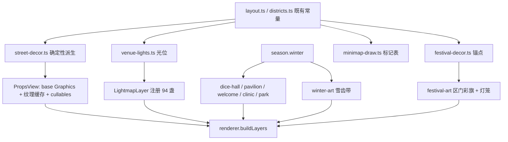

## 产品概述
在不新建岛屿、房间与玩法的前提下，对现有 5 大区、25 个场所、5 座区门、迎宾拱门与路网做一轮「看得见但摸不到」的表现层精修：把大区之间的空草地填出生活密度，让 6 栋核心建筑扫一眼屋顶就能认出用途，把夜间动线用温暖柔光串起来，修掉冬季覆雪与节日装饰的边缘瑕疵，并让小地图真正读得懂。

## 核心功能
- **过渡带补密度**：企业区、游乐区、生活区、服务区之间的 5 条空草带补上碎石小径、灌木丛、路边邮筒、消防栓、备用垃圾桶与排水篦，全部零碰撞，玩家直线行走不受任何阻挡，树间距保持不小于 80px。
- **建筑外立面特征化**：企业楼加玻璃幕墙带、檐口阴影与企业色门槛；赌场亭加屋檐雪线与绿绒桌台灯灯罩；公寓 301-306 加门头雨棚与屋顶机组；急救站加红十字灯箱与车位标线；卫生间加男女标识与外门指示；小黑屋加铁门、警示条纹与门口黄线。远看屋顶与墙面即可分辨用途。
- **夜间光影层次**：广场中心出现一枚低强度大半径暖光池；5 座区门灯从纯区色改为偏暖的门头光；企业楼走廊、赌场两张绿绒桌、急救站大门各补一处柔光；八角笼保持冷白顶光但降低南侧补光刺眼度。整体暖而不糊、亮而不爆。
- **`?light=0` 完全退场**：关闭光照时不仅点光消失，地面残留的暖色光池与光晕也一并退场，画面回到纯平涂。
- **冬季接缝修复**：赌场亭内地板不再透雪；摸鱼亭台基与檐口出现自然雪线；迎宾拱门横梁积雪、柱脚起雪堆；各门洞、街面与草地的交界长出雪齿而不是直角硬切；屋顶雪与地面雪统一为同一色阶。
- **节日对齐**：5 座区门新增门楣彩旗与两侧灯笼，挂点抬到横枋之上、不压匾额、不悬空；与企业楼牌坊、卫生间的门楣彩旗保持同一套飘动节奏。
- **小地图清晰化**：5 大区出现可辨识的色轮廓而非一层灰蒙；道路骨架与街面外沿描出 1px 边界；区门与发泄区、赌场、擂台、急救站等核心场所出现 3px 微缩色块图标。


## 一、技术栈与边界

- 沿用现有栈：TypeScript + PixiJS v8 渲染（`apps/web/lib/game`）、`@niuma/shared-types` 作为坐标唯一真相、bun:test（渲染纯模块）+ vitest（共享契约）。
- **本次改动全部落在 `apps/web` 客户端表现层**。不触碰 `packages/shared-types`、不改 `protocol.ts`、不新增操作码、不改碰撞体与 `NAV_TARGETS`，因此**协议零新增、无需双端同步发布**。
- 美术约束沿用 `.codebuddy/skills/pixel-venue-polish`：不为挂装饰去动 `PropKind`；平面装饰进 `props.base`，立式摆件按脚底 y 进排序层；描边只用同色相压暗（禁纯黑）；明度阶梯 2–3 档；构造期一次 `bake()`，帧循环零分配。

## 二、现状问题点、方案与发版影响

| 现状问题点（证据） | 具体优化方案 | 涉及文件 | 双端发版 |
|---|---|---|---|
| 过渡带大片空草：`GROVE_CENTERS` 仅 19 簇（layout.ts:893-920），贴花只有 0.24 概率且**冬季整层不生成**（terrain.ts:719） | 新建客户端装饰层：5 条过渡带内用位置哈希撒灌木/石径，区门与街口手写邮筒/消防栓/垃圾桶；地面件合成单张 Graphics，立式件烘 1:1 纹理并注册进 `PropsView.cullables` | `street-decor.ts`[NEW]、`props.ts`、`renderer.ts` | 否 |
| 企业楼墙体统一由 `fillSolidFlat` 平涂（props.ts:978-989），无企业特征；急救站/卫生间/小黑屋无外部标识 | 在 `venue-art.ts` 增企业楼幕墙带+檐口阴影+门槛色条；增卫生间男女牌、小黑屋警示条、急救站车位标线与红十字灯箱底座；赌场加桌灯罩 | `venue-art.ts`、`apartment-view.ts`、`clinic-view.ts`、`interior-art.ts` | 否 |
| 广场中心无光源（8 盏地灯最近光心距中心 308，r 仅 62）；区门灯用纯区色（服务区冷青 0xa8c4cc、景观区偏绿）；企业楼走廊 `COMPANY_CORRIDOR` 无灯；赌桌中心距两盏灯 192 无直射 | 光位**再分配而非叠加**：广场 8→4、新增中心 1、赌桌 2、企业走廊 1、区门灯暖化、急救站门灯提档。净增为 0，总数仍 94 | `venue-lights.ts`、`__tests__/lighting.test.ts` | 否 |
| 预算断言失真：测试按 `+11` 算（实际室内 8+挂灯 6+亭 4+龛 2+公园 2=22），真实已 94/96，加灯会静默丢弃（light-registry.ts:102） | 断言改为实测口径并钉住「剩余余量 ≥ 2」，避免以后再静默丢灯 | `__tests__/lighting.test.ts` | 否 |
| 光池画在 `props.base`（venue-art.ts:55-58），`?light=0` 只关 lightmap，地面仍留暖椭圆 | 光池拆到独立 `Graphics`，由 `build()` 的 `light` 选项统一控制 `visible` | `venue-art.ts`、`renderer.ts` | 否 |
| 赌场亭内地板 alpha 0.12 透雪（dice-hall-view.ts:68-79）；摸鱼亭台基直角切雪且无 winter 参数（pavilion.ts:118-136）；拱门无 winter（welcome.ts:250）；`terrain-edge` 无 paved 材质（terrain-edge.ts:32-40）；屋顶雪三处各写 0xf2f7ff 与地面 0xe9f0f7 不一致 | 亭内改不透明木地板+内沿雪齿；pavilion/welcome/clinic/park 接入 `winter`，加檐口雪线与柱脚雪堆；`winter-art` 新增沿 `paved` 与门洞外沿的雪齿带（跳过门洞 40px）；三处屋顶雪统一取 `WINTER_COLORS` | `dice-hall-view.ts`、`pavilion.ts`、`welcome.ts`、`clinic-view.ts`、`park.ts`、`villas-view.ts`、`apartment-view.ts`、`winter-art.ts`、`renderer.ts` | 否 |
| 节日层只覆盖企业楼牌坊+卫生间共 2 条门楣（festival-decor.ts:215-240）；5 座区门完全无彩旗；76px 挂高正好压匾额（venue-art.ts:103-105） | 新增 `district-bunting` 锚点，从 `DISTRICTS[].gate` 派生，挂高 `gate.y-92`（横枋顶 −88 之上），宽度 108 独立烘焙；两侧挂自发光灯笼（只画像素，不占光池） | `festival-decor.ts`、`festival-art.ts`、`__tests__/festival-decor.test.ts` | 否 |
| 小地图区色是 0.18 单层平涂、无轮廓（minimap-draw.ts:179-183）；区门与 `VENUES` 未被使用；每帧 new 6 个数组 + 5 个颜色字符串；文案仍写 AOI 900px | 区色改「0.10 填色 + 1px 轮廓」；路网提亮一档并给 `paved` 加外沿；新增 5 区门标记与 8 处核心场所 3px 图标；常量全部提到模块顶层，闭包改 for 循环 | `minimap-draw.ts`、`components/game/MiniMap.tsx` | 否 |

## 三、关键实现决策

**1. 过渡带装饰走客户端确定性派生，不写第二份坐标**
`street-decor.ts` 从既有常量派生落点：五条过渡带矩形以 `DISTRICTS[].rects`、`AMUSEMENT_STREET`、`SERVICE_SQUARE`、`COMPANY_FORECOURT`、`LIVING_AVENUE` 的相邻空隙定义；散布用与 `decals.ts` 同款的 `Math.imul` 位置哈希（禁 `Math.random`），保证每次进服长在同一处。
放置条件全部复用既有判定：`isOutdoorGround`（ground.ts:15-27）、距任意树 ≥80（`TREE_MIN_GAP`）、距 `WORLD_LAYOUT.solids` 与 `props` ≥28、距 `paths` 多边形 ≥24、距水面 ≥40、距 `paved` 边缘 8–40（只在草缘带）。命中失败的格子直接跳过，不做回退重试。

**2. 复用现成管线，纹理数不随密度增长**
地面件（石径、篦子、路缘石）合成一张 `Graphics` 挂进 `props.base`，一次绘制永久复用；立式件（灌木两档、邮筒、消防栓、垃圾桶）用 `bake()` 烘 1:1 纹理，按 `kind:variant` 缓存并统一 `destroy`，纹理种类固定为 10 张。全部注册进 `PropsView` 的 `cullables`，复用 `cull()` 的视口裁剪。`PropsView` 只需新增一个注入方法（`depth` 与 `cullables` 由它提供），不新增 `PropKind`、不改碰撞。

**3. 光池预算做等量置换，不动 `MAX_LIGHTS`**
广场八盏斜向地灯的位置本身就有 `lamp` 道具光（r84 / i0.85，scene-lights.ts:23）覆盖，属于重复照明，压到四盏不会让任何一盏灯变黑。腾出的 4 个名额给「中心 1 + 赌桌 2 + 企业走廊 1」，净变化为 0。区门灯与急救站门灯只改色温与半径，不增数量。中心光池刻意用「大半径 + 低强度（r300 / i0.20 / flicker 0.03）」实现暖而不爆，避免加一盏高亮度灯把广场洗白。

**4. 雪齿不扩材质系统**
`terrain-edge` 只有 6 种材质，扩 `paved`/`building` 会牵动掩码与既有 47 态测试。改在 `winter-art` 里加一层「沿铺装外沿的雪齿带」：遍历 `WORLD_LAYOUT.paved`，沿四条外边按 3px 步进画 2–4px 高的雪齿，宽度用位置哈希抖动；与门洞中心距离小于 40px 的片段跳过，天然在门口断口，不糊住门槛。

**5. 节日新增种类而不是改旧锚点**
`FestivalAnchor.kind` 增加 `district-bunting`，`festival-art` 按 kind 选贴图（已有分派结构，:157-171 只需加一支）。区门横枋宽 108，若复用 148 宽的 `gate-bunting` 会左右各溢 20px 悬空，因此单独烘一档 108×40。挂高取 `gate.y-92`，正好在横枋顶 −88 之上、匾额 −84..−74 之外，既对齐又不压牌。

**6. 性能与零分配**
- 帧循环不新增任何 `new`：`street-decor` 与所有新贴图在 `buildLayers()` 阶段完成；`FestivalArt.update` 仍只切 `texture`；`minimap-draw` 的图标表、区色字符串、花点偏移全部提到模块顶层常量。
- 逐帧成本：装饰精灵约 200–260 个，全部可被裁剪；地面件是一张 Graphics（约 200 个小矩形，一次提交）；小地图维持 4Hz、约 110 次 fill，但每帧分配从 11 次降到 0。
- 光图仍是 1/4 视口单 Pass，同一视口提交的光源数不变（新增点与删减点位置互斥），填充率不上升。

**7. 灰度开关**
保留全部既有开关，新增 `?decor=0` 关闭过渡带装饰（与 `?venue=0` 同一套读法，在 `buildLayers` 里读一次）。冬季、节日、光照、平铺、单容器排序五条回退路径都保持可用。

## 四、架构与数据流



## 五、目录结构

```
apps/web/lib/game/
├── street-decor.ts                    # [NEW] 过渡带装饰。定义 5 条过渡带的派生落点、位置哈希散布、放置合法性判定（isOutdoorGround / 树距 80 / solids 28 / paths 24 / 水面 40 / paved 草缘带）；烘 10 张 1:1 纹理（灌木夏冬两档、邮筒、消防栓、垃圾桶、篦子、石径块）；地面件合成单 Graphics，立式件按脚底 y 进排序层。导出 buildStreetDecor(sink, renderer, winter)。
├── props.ts                           # [MODIFY] 只加注入点：PropsView 暴露 addDecorSprite(texture, x, y, padX, padY)（内部 depth.add + cullables.push），在 build 末尾调用 buildStreetDecor；不动现有 PROP_SIZE / drawProp / PROP_FOOTPRINT。
├── renderer.ts                        # [MODIFY] 读 ?decor=0；把 season.winter 传给 PavilionView、ClinicView、ParkView、WelcomeView；把 lightEnabled 传给 VenueArt.build。
├── venue-art.ts                       # [MODIFY] 企业楼幕墙带/檐口阴影/企业色门槛、卫生间男女牌、小黑屋警示条、急救站车位标线、赌场桌灯罩；pool() 改画进独立 glow Graphics 并由 light 选项控制 visible。
├── venue-lights.ts                    # [MODIFY] 光位再分配：广场 8→4、新增中心 1、赌桌 2、企业走廊 1、区门灯按区色混暖白并提半径、急救站门灯提档、擂台南侧补光降亮。
├── dice-hall-view.ts                  # [MODIFY] 冬季亭内地板改不透明木色 + 内沿雪齿；桌沿雪与柱帽雪改用 WINTER_COLORS。
├── pavilion.ts                        # [MODIFY] 构造函数加 winter；eave() 加檐口雪线；drawTerrace() 加台基雪齿。
├── welcome.ts                         # [MODIFY] build 接收 winter；横梁积雪条、柱脚雪堆、落地投影随雪地调淡。
├── clinic-view.ts                     # [MODIFY] 接收 winter：站台屋顶雪线 + 红十字灯箱底座。
├── park.ts                            # [MODIFY] 接收 winter：南门门头与器械顶面积雪条。
├── villas-view.ts                     # [MODIFY] 屋顶雪色统一取 WINTER_COLORS.snowBase/snowShade。
├── apartment-view.ts                  # [MODIFY] 屋顶雪色统一；门头雨棚 + 屋顶机组剪影 + 雨棚投影。
├── winter-art.ts                      # [MODIFY] 新增 addSnowDrifts(base)：沿 WORLD_LAYOUT.paved 四外边画 2–4px 雪齿，距门洞中心 40px 内跳过。
├── festival-decor.ts                  # [MODIFY] 新增 DISTRICT_BUNTING_HANG_DY=92、DISTRICT_BUNTING_W=108；gateAnchors() 从 DISTRICTS 派生 5 条 district-bunting；修正过期注释。
├── festival-art.ts                    # [MODIFY] 烘 108×40 三配色×2 帧；新增 district-bunting 分派与区门两侧灯笼精灵（只画像素，不注册光位）。
├── minimap-draw.ts                    # [MODIFY] 区色 0.10 填色 + 1px 轮廓；路网提亮一档、paved 加外沿；5 区门标记 + 8 处场所 3px 图标（模块顶层常量）；traceWorldPolygon 改 for 循环；去掉每帧数组与颜色字符串分配。
└── __tests__/
    ├── lighting.test.ts               # [MODIFY] 预算断言改实测口径：lights + venueLights + 6 + 22，断言 ≤ MAX_LIGHTS 且余量 ≥ 2。
    ├── festival-decor.test.ts         # [MODIFY] district-bunting 恰 5 条、挂高高于横枋顶、不压匾额区间、仍不落碰撞体。
    ├── street-decor.test.ts           # [NEW] 确定性（同输入同输出）、不落路/水/建筑/paved、与树 ≥80、总数上限、纹理种类固定。
    └── minimap-marks.test.ts          # [NEW] 标记表坐标在陆地内、五区门各一、核心场所不重叠。

apps/web/components/game/MiniMap.tsx   # [MODIFY] 底部文案 AOI 900px → 1000px，与 VIEW_RADIUS 对齐。

apps/web/data/release-notes.json       # [MODIFY] 按 AGENTS.md 追加一条面向玩家的版本工报。
```

## 六、执行注意事项

- 先修 `lighting.test.ts` 的预算断言，再加灯；否则新灯会被 `MAX_LIGHTS` 静默丢弃且无报错。
- `festival-decor.ts` 的 `insideSolid(x, y, 6)` 校验必须对新锚点保持通过；区门锚点 `depthY` 直接用 `district.gate.y`，与 `venue-art.ts:107` 同键，靠 `renderer.ts:1131` 的后挂顺序压住门架。
- 所有新增贴图必须走 `bake()` 的 `frame` 参数做 1:1 整数纹素烘焙，禁止 `scale` 缩放与运行时 `generateTexture`。
- 新增装饰不得进入 `PROP_FOOTPRINT`，也不得写入 `WORLD_LAYOUT.solids`；`collision.test.ts` 与 `campus-layout.test.ts` 是这条红线的守门测试。
- 时间口径统一用 `serverNow()` / `serverHourFraction`，新代码不出现 `Date.now()`。
- 验收：`pnpm typecheck`、`pnpm test`、`pnpm changelog:check`；浏览器逐一核对默认视角与 `?season=winter`、`?light=0`、`?festival=0`、`?flat=1`、`?bands=0`、`?decor=0`、`?venue=0`，确认新旧两套都能看、无漏光、无黑块、无穿模。
- 光池再分配属于关键决策，若需要留存决策记录，按 `docs/adr/` 现有格式新增一条（不修改历史 ADR）。


## Agent Extensions

### Skill
- **pixel-venue-polish**
  - Purpose: 约束过渡带装饰、六栋建筑外立面、夜间焦点光与冬季雪线的画法：零碰撞路线、同色相压暗描边、明度 2–3 档、每处 1–2 盏焦点光、构造期一次烘焙、微动效零分配。
  - Expected outcome: 新增装饰与立面改动在色相、明度阶梯、描边规则与光照预算上与全站现有像素画风一致，评审时无「越界配色」「纯黑描边」「光超预算」「每帧分配」四类打回项。

### SubAgent
- **code-explorer**
  - Purpose: 在改写前复核引用面：`venue-art.ts` 全部 `pool()` 调用点、`props.ts` 的注入位置、`renderer.ts:1049-1133` 各 View 构造签名、以及新增 `district-bunting` 会影响到的测试与消费方。
  - Expected outcome: 拿到一份精确的改动清单（函数名 + 行号），确保签名变更（`PavilionView`、`ClinicView`、`ParkView`、`VenueArt.build`）没有遗漏调用点，改造期间不出现编译期连锁错误。
