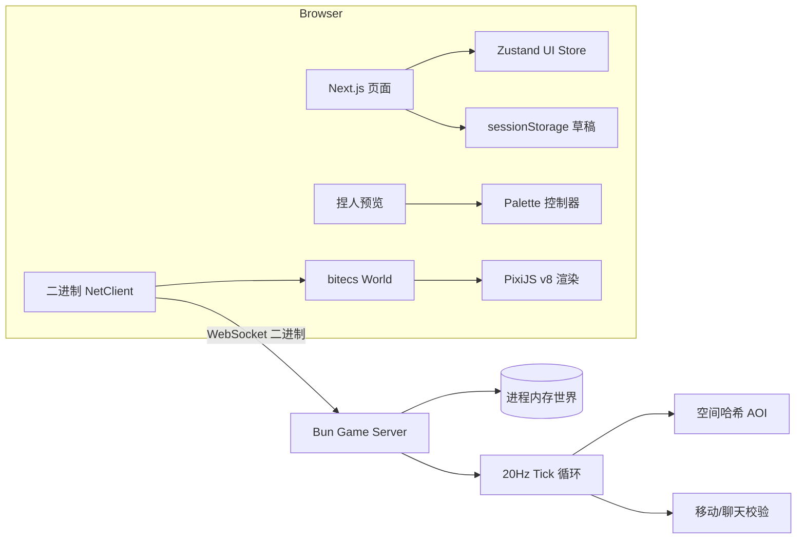

## 产品概述
《牛马》是一款 2D 像素风多人在线社交 MMO。玩家化身为“牛”或“马”，在同一张办公园区大地图上自由走动、实时打字聊天、做动作与“摸鱼/躺平”，并在捏人界面自定义物种、斑纹、角/鬃毛、蹄色、工牌领带等外观。本期交付端到端纵切片：一条命令起全栈，两个浏览器窗口即可互相看见、走动、聊天。

**零持久化**：服务端不接数据库、不写磁盘，世界只存在于进程内存；浏览器端只用 sessionStorage 保存昵称与外观草稿，关闭标签页即清空。没有注册、没有令牌、没有表结构。

## 核心功能
- **大地图多向移动**：WASD/方向键八向行走，服务端权威校验，客户端即时预测 + 远端平滑插值，摄像机跟随，边界钳制。
- **双物种捏人**：牛/马切换，5 个颜色槽（身体、斑纹、蹄、眼、角/鬃毛）实时预览，斑纹/口鼻/角/鬃毛/尾巴/工牌/领带/叼物/背包可选，刷新后由 sessionStorage 恢复草稿。
- **实时社交**：地图内文字气泡聊天，AOI 范围内广播；坐下、躺平摸鱼、叫唤等动作同步。
- **在线感知**：进入视野即出现、离开视野即消失，头顶昵称与工牌信息，在线人数与延迟显示。
- **即开即玩**：输入昵称直接进入，无账号体系；关闭页面后该玩家的世界数据随之消失。
- **可替换美术管线**：程序化生成的双物种分层像素图集与 manifest，正式美术可直接替换而不改代码。

## 视觉与体验
暗色工业办公风：炭黑绿底、CRT 荧光青绿、警示黄与橙红点缀，像素网格、扫描线与硬边框，文案带“打卡/工位/摸鱼/绩效”式的冷幽默。落地页为终端式 Hero 与物种选择；捏人页为三分栏工作台（部位栏、聚光预览台、调色控制台），拖动取色 60Hz 无抖动；游戏页为全屏视口 + 悬浮 HUD、聊天坞与动作栏。

## 范围边界
不含多地图/分线、好友私聊公会、Redis 多进程分片、完整反作弊、移动端虚拟摇杆、正式美术资源；**不含任何数据库、ORM、迁移与容器化数据库**。单进程单节点，但为水平扩展预留端口。

## 技术栈
| 层 | 选型 |
|---|---|
| 工作区 | pnpm + Turborepo 2.x，TypeScript 5.x strict，包内直接导出 TS 源码（Next 侧 `transpilePackages`，Bun 原生解析），无额外 build watch |
| Web | Next.js 15 App Router + React 19 + Turbopack + Tailwind CSS v4 + Zustand 5 |
| 渲染 | PixiJS v8（`preference: webgpu`，自动回落 WebGL2）+ bitecs 0.4（SoA + TypedArray） |
| 服务 | Bun `Bun.serve` WebSocket（官方实现基于 uWebSockets）+ 20Hz 固定 Tick |
| 协议 | 手写二进制 ArrayBuffer 编解码（默认）+ msgpackr 兜底开关，代码同构于 shared-types |
| 状态 | 服务端进程内存为唯一真相；浏览器 sessionStorage 存昵称/外观草稿 |
| 校验 | Vitest（协议/量化/AOI）+ bun:test（服务端 tick）+ bench 机器人脚本 |

## 架构总览


## 关键决策
**D1 传输层**：直接用 `Bun.serve` 的 WebSocket，而不是引入 `uWebSockets.js` 原生插件。Bun 内部实现即为 uWebSockets，且自带 `server.publish`/`subscribe` 与二进制帧；外挂 Node 原生插件会破坏 Bun 运行时并增加 ABI 风险。抽象出 `Transport` 端口（open/message/close/send），未来换节点分片只改适配器。可逆性：低。

**D2 调色板替换（核心权衡）**：逐角色挂 Filter 会让每个实体多一次 RenderTexture pass，200 人场景必然掉帧，与“最高性能”冲突。采用分层 seam：
1. `TintedPaletteStrategy`（默认，全量玩家）：图集在生成期就按 slot 拆层（body/pattern/hoof/eyes/extra/snout/tail），每层灰度图 + `Sprite.tint`，数学上等价于调色板替换，完全合批、每帧零成本；
2. `ShaderPaletteStrategy`（捏人预览单实例）：`Filter.from` 同时提供 GLSL 与 WGSL 源，用 5 个 vec3 uniform 做实时光栅重映射，用于预览中的实时换色与「夜班模式」；
3. 能力探测失败或 shader 编译失败时静默回退到 tint。行为写入 ADR-0002。

**D3 同步模型**：服务端权威 20Hz（50ms/tick），客户端 60Hz 预测本地玩家；远端实体用 100ms 插值缓冲渲染。偏差超过 8px 直接吸附，8px 内 200ms 线性收敛，避免橡皮筋。快照只发“本 Tick 移动过的实体”，WebSocket 可靠有序，无需冗余全量包。

**D4 零持久化**：世界状态只存在于 game-server 进程内存，进程重启即清空；玩家断开连接立即销毁实体并向视野内其他玩家广播 despawn。身份不是账号：昵称与外观由客户端在 HELLO 中自报，服务端只做长度/取值合法性钳制。代价是换设备/换浏览器无法恢复外观，收益是零数据库依赖、零迁移、零连接池抖动、一条命令可跑。

## 协议设计
| OpCode | 方向 | 载荷 |
|---|---|---|
| 0x01 C2S_MOVE | C→S | 8 字节：op、entityId u16、x u16、y u16、state u8 |
| 0x02 S2C_SYNC_ENTITIES | S→C | op、tick u32、count u16，随后 count × 7 字节（id、x、y、state） |
| 0x03 C2S_ACTION | C→S | op、entityId u16、action u8 |
| 0x04 S2C_CHAT_BROADCAST | S→C | op、entityId u16、msgId u16、len u16、UTF-8 |
| 0x05 S2C_ENTITY_SPAWN | S→C | op、id u16、x、y、state、nameLen u8、name、appearance 20 字节 |
| 0x06 S2C_ENTITY_DESPAWN | S→C | op、id u16、reason u8 |
| 0x10 C2S_HELLO | C→S | 昵称（≤24 字节 UTF-8）+ appearance 20 字节 |
| 0x11 S2C_WELCOME | S→C | 自身 id、服务器 tick、世界尺寸、自身坐标 |
| 0x12 C2S_SET_APPEARANCE | C→S | appearance 20 字节（大厅内实时改外观） |
| 0x14/0x15 PING/PONG | 双向 | 客户端时间戳 u32 |

量化契约：`FIXED_SCALE = 8`（1/8 像素），世界 8192×8192（256×256 个 32px 图块），u16 可表达 0 至 65535。`quantize`/`dequantize` 只存在于 shared-types，客户端与服务端同源引用，禁止各写一份。state 字节：bit0-1 朝向（下/左/右/上），bit2-4 姿态（idle/walk/sit/lie/emote），bit5 移动标志，bit6-7 保留。

## 服务端设计
**Tick 流水线**：`输入入队 → 移动校验与积分 → 跨格重算视野 → 构造按视野分组的发送缓冲 → 聊天/动作广播 → 采样指标`。单 Tick 预算 8ms，超阈值记录 p50/p95。

**AOI**：Cell 512px，视野半径 900px。`Map<cellKey, Set<entityId>>` 反向索引。实体跨格时才重算视野集合并做差集：新增发 spawn（双向）、移除发 despawn（双向）。广播只遍历“移动实体的视野订阅者”，复杂度与 AOI 内人数相关，而非全图人数。

**GC 控制**：每 Tick 复用预分配发送缓冲与 AOI 集合，禁止每帧新建数组；实体对象池化，断开后归还。

**权威校验**：位移上限 = 速度 × tick 间隔 × 1.15 容差，超限钳制并计数；坐标钳制到世界边界；非法 opcode、超长包直接丢弃并累计异常分。聊天限流 3 条 / 5 秒。服务端不信任客户端上报的 entityId，一律以连接绑定的实体为准。

**会话生命周期**：连接建立 → 等待 HELLO（5 秒超时踢出）→ 分配 entityId、随机出生点、计算初始视野 → 加入 Tick；断开 → 向所有 known 玩家广播 despawn → 从世界与网格移除 → 对象归还池。

## 客户端设计
**渲染**：`Application.init` 指定 WebGPU 优先，失败回落 WebGL2 并在 HUD 标注后端。预分配 512 个实体槽与精灵池；帧内只写 TypedArray 与 `sprite.position`，运行期零 new。纹理图集一次加载，`scaleMode: nearest`，整数像素对齐与摄像机取整避免抖动。

**ECS**：组件为 SoA（Position、PrevPosition、RenderSlot、AppearanceKey、LocalPlayer Tag）。`app.ticker` 内以固定步长推进预测，渲染读 ECS。React 完全不参与帧循环。

**React 隔离**：Zustand 只存 UI 状态（连接态、聊天环形缓冲、FPS/Ping）。颜色选择器通过 `store.subscribe` 命令式推给 Palette 控制器，rAF 合并同一帧多次输入；React 只重渲染色块标签。

**捏人页**：草稿写入 sessionStorage（关闭标签页即丢），`/play` 直接读取同一份草稿，无需网络往返。

## 数据模型（内存）
| 结构 | 字段 |
|---|---|
| PlayerEntity | id u16、name、appearance(20B)、x、y（量化 u16）、state u8、cellKey、known:Set、needsViewRefresh、ws、lastChatAt |
| World | 固定容量实体槽（容量 1024）、空闲槽位栈、dirty 列表、tick 计数、AOI 网格 |
| sessionStorage | `niuma:nickname`、`niuma:appearance`（JSON 草稿，仅本标签页） |

## 目录结构（全新创建）
```
niuma/
├── package.json / pnpm-workspace.yaml / turbo.json / tsconfig.base.json   [NEW] 工作区与任务编排（dev/build/typecheck/test/assets/bench）
├── .env.example / README.md                                                [NEW] 环境变量与一键启动说明
├── docs/adr/0001-transport.md 0002-palette-swap.md 0003-aoi-grid.md        [NEW] 三项关键决策与回滚条件
├── packages/shared-types/src/
│   ├── index.ts                                                            [NEW] Species、CharacterAppearance、OpCode、协议常量
│   ├── protocol.ts                                                         [NEW] 各包编码/解码，严格长度断言
│   ├── quantize.ts                                                         [NEW] 定点量化、state 位打包、世界边界
│   ├── appearance-codec.ts                                                 [NEW] 20 字节外观压缩与合法性钳制
│   ├── catalog.ts                                                          [NEW] 角/鬃毛/工牌/领带/叼物/背包的 id 目录
│   ├── constants.ts                                                        [NEW] tick 率、速度、AOI 半径、包长上限
│   └── __tests__/protocol.test.ts                                          [NEW] 8 字节断言、往返一致性、越界用例
├── packages/pixel-assets/
│   ├── scripts/generate.ts                                                 [NEW] 生成 48×48 双物种分层图集、atlas.json、manifest.json
│   └── src/png.ts palette.ts quadruped.ts cosmetics.ts                     [NEW] 零依赖 PNG 编码、slot 调色板、参数化四足、配件
├── apps/game-server/src/
│   ├── index.ts server.ts config.ts                                        [NEW] 启动、WebSocket 升级、健康检查
│   ├── net/connection.ts rate-limit.ts writer.ts                           [NEW] 连接状态机、令牌桶、可复用写缓冲
│   ├── spatial/grid.ts                                                     [NEW] 空间哈希、视野差集、单元测试
│   ├── sim/world.ts tick.ts movement.ts chat.ts actions.ts                 [NEW] 实体世界、Tick 流水线、校验与广播
│   └── bench/bots.ts metrics.ts                                            [NEW] 200 机器人压测与 p50/p95、带宽统计
└── apps/web/
    ├── app/page.tsx create/page.tsx play/page.tsx layout.tsx globals.css   [NEW] 落地页、捏人页、游戏页
    ├── components/creator/*  game/*  ui/*                                  [NEW] 部位栏、预览台、调色控制台、视口、聊天坞、动作栏
    ├── lib/net/client.ts codec.ts reconnect.ts                             [NEW] 二进制客户端、心跳、指数退避重连
    ├── lib/game/ecs.ts systems/* renderer.ts palette/*                     [NEW] ECS 定义、预测/插值、精灵池、调色策略
    └── public/sprites/                                                      [NEW] 生成的图集产物
```

## 性能预算与验收
- 移动包严格 8 字节，单测断言；编解码往返误差不超过 1/16 px。
- 200 并发机器人下 Tick p95 低于 8ms；单客户端下行低于 20KB/s（100 可见实体）。
- 捏人取色拖动稳定 60fps，无 React 重渲染风暴。
- 两个窗口互见、互聊、动作同步；关闭标签页后其他玩家立即看到其消失。
- WebGPU 不可用时自动回落 WebGL2，HUD 显示后端标识，视觉一致。

## 风险与应对
- PixiJS v8 内置滤镜的 WebGPU 支持存在版本差异：默认路径是 layer tint，不依赖滤镜；shader 仅用于单角色预览且失败即回退。
- bitecs 0.4 为完全重写版：组件按 SoA 定义，先核对 d.ts 再写系统层，避免 API 变更扩散。
- Next 15 + React 19 生态：锁定版本并提交 lockfile，typecheck 与 build 双闸。
- Windows 开发机：脚本走 Bun/Node API，不使用 bash 语法与 shell 链式命令。
- 无持久化：进程重启或断线即失去位置与外观，UI 需明确提示“本局不保存”，避免用户误以为丢档。

## 设计方向
暗色工业办公朋克：把“工位”做成一座夜班工厂。炭黑绿底、CRT 荧光青绿主光、警示黄与橙红做状态强调，配合 2px 硬边框、像素网格、扫描线与噪点，形成高对比、可长时间注视的界面。拒绝圆润卡片堆叠与紫蓝渐变。

## 页面规划
1. **落地页 /**：全屏 Hero 左侧终端式标题与“打卡上班”主行动，右侧像素园区剖面插画（视差）；下方双物种卡与跑马灯式“本司福利”；底部技术指标条。
2. **捏人页 /create**：三分栏工作台。左侧物种切换与部位清单；中部聚光预览台（棋盘格地台、姿态切换）；右侧调色控制台（HSV + 十六进制 + 预设色板）；底部吸附保存条。
3. **游戏页 /play**：全屏画布。左上玩家卡（昵称、部门、FPS/Ping/坐标）；左中聊天坞；底部动作栏（坐下/躺平/叫唤）；右上小地图与在线人数；右下“摸鱼中”状态胶囊与操作提示。

## 交互与动效
主按钮 hover 边框扫描光位移，按下 1px 下沉；切换物种 120ms 像素溶解过渡；HUD 数值等宽字滚动；聊天从底部推入 160ms。缓动统一 cubic-bezier(0.2, 0.8, 0.2, 1)，禁用弹跳缓动。焦点态 2px 荧光描边，键盘全可达。

## 响应式
桌面优先（1280–1920）。小于 1024px 捏人页上下堆叠、预览台缩至 320px；游戏页 HUD 折叠为图标条，聊天坞默认收起。触屏不做虚拟摇杆，仅提示使用键盘。

## Agent 扩展
- **codebase-design**：定义 shared-types 契约边界、AOI/Tick 深模块接口、客户端 Palette seam。
- **layer-pixel-art**：指导 48×48 网格双物种四足骨架、行走循环帧序与分层调色板。
- **frontend-design / impeccable**：暗黑工业办公朋克视觉方向、三页 UI 与反模式自检。
- **vercel-react-best-practices**：隔离 60Hz 渲染与 React 重渲染，Zustand 订阅收敛。
- **shader-art-coding**：为捏人预览编写 GLSL 与 WGSL 对等的调色板重映射片元着色器。
