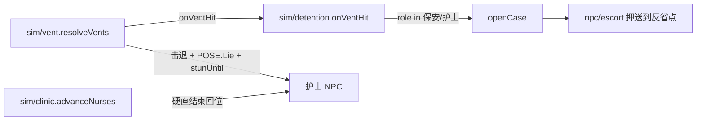

## 用户需求

玩家攻击护士时同样应触发保安执法（被抓进小黑屋）。

## 产品概述

园区急救站的护士是固定站桩 NPC。此前只有攻击保安才是「一击零容忍」，打护士既不会建案，也没有任何后果。

## 核心功能

- **医务人员零容忍**：命中护士一次即建案，附近通播「{名字} 被保安请进了小黑屋：园区内不许动手。」，最近的空闲保安立刻出警押送到反省点，流程与袭警完全一致（不走普通同事的 2 分钟 / 3 次累计）。
- **普通同事不受影响**：打普通 NPC 同事仍不进入执法；打真人仍是 2 次警告、3 次建案。
- **护士硬直后自恢复**：被打倒的护士在 1.5 秒硬直结束时恢复站姿并回到护士站原位，不会一直躺在地上；急救站视觉与站桩状态回到正常。
- **无协议与界面改动**：客户端照旧只按服务端下发的阶段包与系统提示渲染，无需新增 UI。


## 技术栈

- TypeScript + Bun（`apps/game-server` 用 `bun:test`），仓库为 pnpm + turbo 单仓
- 服务端权威模拟层：`apps/game-server/src/sim/*`，状态只活在进程内存（ADR-0004）
- 共享协议与角色常量：`packages/shared-types`（`ENTITY_ROLE_GUARD = 1`、`ENTITY_ROLE_NURSE = 2` 已存在）→ **协议零改动**

## 实现方案

1. **判定白名单收口在 `sim/detention.ts`**
   - 在 `ASSAULT` 常量旁新增零容忍角色集合，`onVentHit` 的 `victim.isNpc` 分支由「只放行 `ENTITY_ROLE_GUARD`」改为「`ZERO_TOLERANCE_ROLES.has(victim.role)`」，随后仍复用既有 `openCase(attacker, now, SYSTEM_NOTICE_KIND.DetainedFight)`（清账本 + 占反省点 + `tryDispatch` + 通播）。
   - 不写成两个 `if` 叠加：角色集合未来还会扩展（医生 / 前台），一处白名单扩展、注释与文档口径同步，避免规则漂移。
   - 真人受害者路径（`ASSAULT` 账本、`AssaultWarn` 私聊）完全不动；`cases.has(attacker.id)` 闸门与擂台豁免已在该函数上方，天然覆盖护士场景（重复打击不重复建案）。
   - 同步更新文件头 doctrine 注释与 `ASSAULT` 上方注释里「只统计真人 / 只认保安」的表述。
2. **护士自恢复放在 `sim/clinic.ts` 的 `advanceNurses`**
   - `nurses` 数组下标与 `CLINIC_NURSE_SPOTS` 一一对应，回位坐标直接取 `CLINIC_NURSE_SPOTS[index]`，不新增字段。
   - 判定条件：`nurse.pose === POSE.Lie && now >= nurse.stunUntil`（硬直由 `sim/vent` 写入 `VENT_STUN_MS = 1500`）→ 清 `stunUntil`、写回站位坐标、`applyState(DIRECTION.Down, POSE.Idle, false)`、`markDirtyIfChanged()`；仅当 `grid.update()` 返回 true 时置 `needsViewRefresh`，AOI 与脏同步走既有的同一路径。
   - 恢复判定排在挥手动效之前（同一函数内先扫回位、再走 `nurseNextWave` / `nurseWaveUntil`），避免用旧 `pose` 打包挥手状态。
3. **不复用的方案**：不给护士加免伤挡板（会与「被打要抓」的因果冲突）、不新增通知编号（ADR-0080 已否决扩枚举）、不给护士接 NPC brain（站桩定位是急救站设计，接大脑会让她走出柜台）。

### 性能与成本

- 执法侧每次 NPC 命中只多一次 `Set.has(number)`，捕获命中本就受 440ms 出招窗口与冷却限频约束，可忽略；不打护士时零额外成本。
- 护士侧每 Tick 线性扫 2 个护士、2 次姿态比较，稳态接近零开销；回位只在被击倒后发生一次。
- 押送链路复用既有 BFS（`npc/escort-path.ts` 24px 网格全图可走，急救站在东侧尽头同样可达），`CASE_TIMEOUT_MS = 90_000` 仍是硬兜底。

### 可靠性

- 回位坐标来自出生时的合法站位，不经碰撞求解也不会进墙；网格更新后由既有 AOI 刷新驱动客户端看到「起身」。
- 断线 / 关服清理路径不变（`dispose` 只清案子与账本，护士属于进程内常驻 NPC）。

## 架构设计

改动集中在两个既有模块，依��方向保持 `sim` 内部自洽，不新增跨层依赖：



## 执行要点

- 护士被 `nearestInCone` 选中后先走通用击退与倒地，再回调 `onVentHit`，因此「被抓」与「护士倒地」是同一次命中产生的两个独立结果，互不依赖；不要为了执法去改 `sim/vent` 的命中几何。
- `clinic.observeHit` 开头 `if (target.isNpc ...) return;` 保持不动：护士不会触发救护车与工伤计数。
- 不回改历史 ADR；新增 `docs/adr/0090-*` 覆盖 ADR-0080「只认保安」的口径，并在备选方案里写明「3 次累计 / 护士免伤 / 新增袭警编号」被否决的理由。
- 提交前按 AGENTS.md 往 `apps/web/data/release-notes.json` 追加一条（当前最新为 `2026-11-15-10`，本次为 `2026-11-15-11`），并跑 `pnpm changelog:check`。

## 目录结构

```
niuma/
├── apps/game-server/src/sim/
│   ├── detention.ts        # [MODIFY] 新增零容忍角色白名单（保安 + 护士），onVentHit 的 NPC 分支改用集合判定；
│   │                       #          同步更新文件头与 ASSAULT 上方注释的「只认保安」口径；建案仍复用 openCase
│   ├── clinic.ts           # [MODIFY] advanceNurses 增加「硬直结束站回 CLINIC_NURSE_SPOTS[index]」分支：
│   │                       #          清 stunUntil、落站姿、markDirtyIfChanged、grid.update + needsViewRefresh；
│   │                       #          抽出私有 resetNurse(nurse, index, now) 便于阅读与单测
│   ├── detention.test.ts   # [MODIFY] 新增「打护士一次立即建案」「押送中再打不重复建案」；
│   │                       #          现有「打普通同事不计数」用例改名并补断言：普通同事仍不计数
│   └── clinic.test.ts      # [NEW]  轻量夹具（World + SpatialGrid + SeatRegistry + 空 transport）验证：
│                           #          硬直内护士保持 POSE.Lie；硬直结束回站姿、坐标回到站位、stunUntil 清零、dirty 置位
├── docs/adr/
│   └── 0090-nurse-assault-zero-tolerance.md
│                           # [NEW]  记录「医务人员零容忍」与「护士硬直后自恢复站位」，回指 ADR-0061 / 0074 / 0080 / 0084，
│                           #          列出备选方案与回滚方式（还原白名单与 advanceNurses 分支即可，协议 / 客户端零改动）
└── apps/web/data/
    └── release-notes.json  # [MODIFY] entries 最前面插入 2026-11-15-11：一条 feat（打护士一次就被押走）、
                            #          一条 fix（被打倒的护士自己站回护士站）
```

### 关键结构

```ts
// apps/game-server/src/sim/detention.ts
/** 零容忍角色（ADR-0090）：保安与护士被打一次即建案，普通同事仍不进执法 */
const ZERO_TOLERANCE_ROLES: ReadonlySet<number> = new Set([
  ENTITY_ROLE_GUARD,
  ENTITY_ROLE_NURSE,
]);
```

