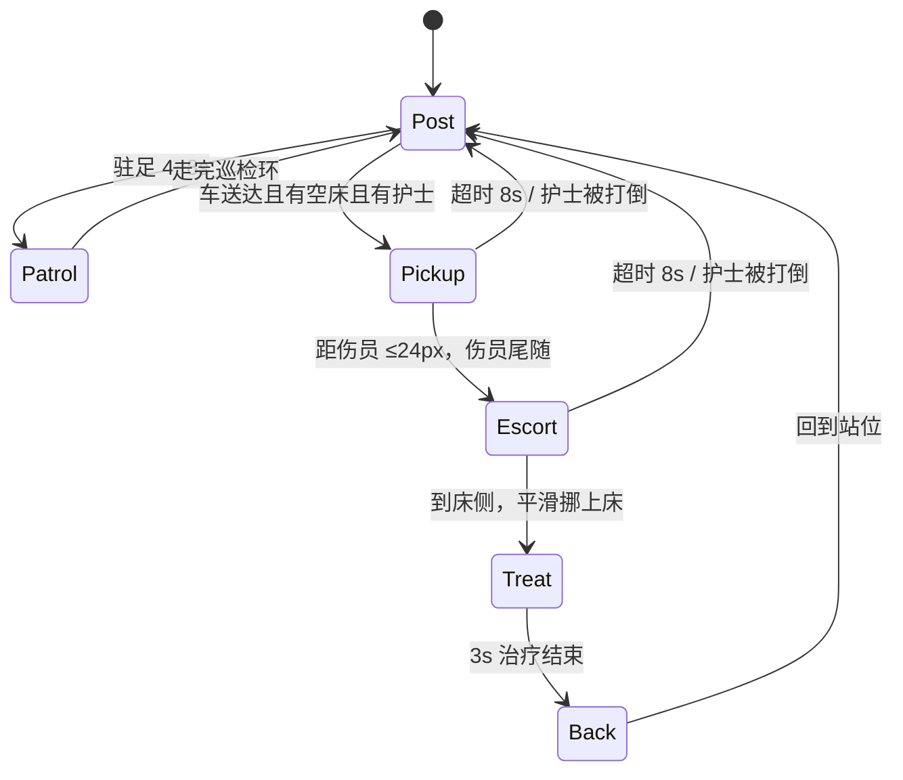

## 用户需求
- 护士不能只站在固定站位：平时在急救站内（柜台、病床、落点之间）巡游、驻足、挥手；救护车到站后走过去接伤员，把伤员带到病床，治疗时守在床边，结束后走回岗位。
- 消除两处「闪现」：①救护车落点→病床（约 100–180px 瞬移）；②治疗 3 秒结束后，NPC 瞬间回到被打倒的位置。
- NPC 康复后不再瞬移回原地，改为从急救站附近就地恢复巡逻，慢慢自己逛回岗位。

## 产品概述
救护车抵达护士站后不再「把伤员吸到床上就走」，而是停在落点等待；护士从柜台后绕过障碍走到伤员身边，把伤员拖行到床边、扶上床，治疗期间守在床侧，结束后走回岗位继续巡游。整条链路里伤员位置连续变化，无论旁观还是自己受伤，都看不到任何一帧瞬移，护士也始终在动。

## 核心功能
- 护士值守行为：站内巡检（柜台东侧通道→床区南侧通道→落点）往返走动，到点驻足、偶尔挥手；走路带行走姿态与朝向。
- 接车交接：救护车停在落点，护士走到伤员身边接手；无空闲护士或超时则回退到原有直接入床流程。
- 护送入床：伤员以躺姿尾随护士身后，到床侧后平滑挪上病床；两张床占满时在落点地面治疗。
- 守床与回岗：治疗 3 秒内护士站床侧（保留头顶爱心）；结束后先平滑下床到床尾，护士再走回站位。
- NPC 就地康复：治疗结束在床尾站起、就近恢复巡逻，不再写回倒地坐标。
- 本地视角连续：自己作为伤员被拖行、上床、下床时位置完全跟随服务端，不再「画面停在原处再跳一下」。
- 兜底不变：两名护士都昏迷、护士中途被打倒、床位被抢、车辆等待超时都会退回旧行为，救护链不卡死；6 秒排队就地包扎、15 秒工伤保护、擂台不派车保持原样。


## 技术栈
- 沿用现有 pnpm monorepo + TypeScript：`apps/game-server`（20Hz Tick 的 `sim` 层）、`apps/web`（PixiJS 像素渲染）、`packages/shared-types`（世界几何/协议）、Vitest。
- 不引入新框架、不新增协议状态、不新增落盘（维持 ADR-0081 的内存口径）。

## 实现方案
### 方案对比
| 选项 | 形态 | 收益 | 代价 | 结论 |
|---|---|---|---|---|
| A. clinic 内嵌护士值守状态机 + 固定航点 | `NurseDuty` 在 `sim/clinic.ts`，位移走现有 `resolveMotionInto`，交接复用 `Transporting` | 协议零改动；不把 `NpcAgent`/巡逻路点引进 clinic，守住 ADR-0106 边界；兜底直接回旧路径 | clinic 多约 150 行状态机 | **推荐** |
| B. 护士并入 `npc` 层复用 brain/escort | 护士进 roster，复用走停与寻路 | 少写一套移动逻辑 | 护士会变成可接押送单的 NPC，clinic 依赖 npc 层，违反 ADR-0106 | 否决 |
| C. 新增 `AMBULANCE_STATE.HandingOver` | 协议加第五态 | 车辆等待交接语义最清晰 | 要同步改 encode/decode 值域校验与客户端全部分支 | 本次不做 |

### 关键决策
1. **交接不新增协议状态**：复用 `Transporting`，`Ambulance` 增加内部字段 `handover`（护士 id）/`handoverAt`。车停 `CLINIC_DROP` 期间继续 `attachPatient`，`CARRYING` 照常亮；护士接手后车才切 `Returning`。数组包与客户端分支完全不变。
2. **接人零跳变**：护士走到伤员东侧 22px（`CLINIC_DROP` 的伤员在车尾 `car.x+26`），转身朝病床后伤员正好落在「身后 22px」，第一帧无需纠正坐标。
3. **上床不硬吸附**：`SeatRegistry.occupy` 增加可选 `snap`（默认 `true`，其他调用方不变）；clinic 用 `snap=false` 占座后用 300–500ms 逐 Tick 位移挪到床锚点并更新 `grid`。
4. **下床同样走过渡**：真人在 300ms 内从床心平移到床尾 `bed.y + bed.h + 18`（约 42px）；`seatId=0` 地面治疗不位移。
5. **NPC 归位删坐标回写**：`advanceBeds` 的 NPC 先按真人口径写床尾坐标 + `grid.update`，再调恢复端口；`NpcRestorePort` 收紧为 `restore(playerId, now)`，`director.restore` 不再接收 `spot`，就地清状态、落 `Idle`，600ms 后从当前位置继续巡逻；`npcReturn` 整张 Map 删除。
6. **护士康复走回去**：不再 `resetNurse` 瞬移；duty 切 `back` 走回站位，仅卡死超时瞬移兜底。
7. **客户端三件事**：红十字/爱心跟随实时坐标（`EntityView.root.position` 作锚点）；治疗爱心挂到正在被治疗的伤员头顶；`session.ts` 增加 `patientLocked`，Incapacitated/Treating 期间本地坐标与 `escortLocked` 同权直接吃服务端。

### 状态机


## 实现要点
- **航点几何**（`PLAYER_RADIUS = 9`）：
  - 柜台东沿 5184 与 1 号床尾实心 5206 之间 22px，是从柜台后方南下的唯一通道 → 走廊点取 `x = CLINIC_RECT.x + 135`（≈5195）。
  - 床底 3766 以南的 `y ≈ CLINIC_RECT.y + 120~130`（≈3780–3790）是东西向通道，落点与两个车位都在其上。
  - 床侧站位 `(bed.x + bed.w/2, bed.y + bed.h + 20)` = (5178,3786)/(5266,3786)；床心到床侧的直线不穿两端 10px 实心条。
  - 柜台西侧 12px、1 号床尾与 2 号床头之间 12px，**均不可作航点**。
- **每 Tick 开销**：护士 ≤2 人，按航点索引推进 O(1)，复用模块级 `MOTION` 槽位不分配；仅位移 > 0.5px 才 `applyState` + `markDirtyIfChanged` + `grid.update`。伤员拖行每 Tick 一次 `grid.update`（与现有 `attachPatient` 同量级）。
- **广播**：座位变更只在 `occupy`/`stand` 时发；车辆坐标沿用 `broadcastCars` 去重；护理状态包只在状态切换时发。禁止每 Tick 广播座位或护理状态。
- **兜底清单（缺一不可）**：双护士昏迷/都在忙 → `admit` 走旧路径；接人或护送 8 秒未完成 → 直接 `admit`；车在落点等待超时 → 直接 `admit`；护士被打倒 → 伤员原地掉落并 `waiting.push` 重新入队；床位被抢 → `seatId=0` 地面治疗。任一兜底都不得让实体永久停在躺姿。
- **时间口径**：全部用 Tick 传入的 `now`；护士值守、交接、tween 只存内存，不写 `world-state.json`。
- **回归风险**：护士被打倒后必须清 duty（否则伤愈后带旧 `patientId` 回岗）；`advanceNurses` 的即时回位与新状态机不可同时写坐标；`occupy(snap=false)` 后须自行保证 `grid` 与 `dirty` 更新；`ClinicView.overlay` 在角色层之上，车停落点时可能与护士贴图重叠。

## 目录结构
```
niuma/
├── packages/shared-types/src/world/
│   └── clinic.ts                       # [MODIFY] 新增 CLINIC_NURSE_LANE / CLINIC_NURSE_BED_SIDE / CLINIC_NURSE_PICKUP 等由 CLINIC_RECT 派生的航点常量
├── apps/game-server/src/
│   ├── sim/clinic.ts                   # [MODIFY] 核心：NurseDuty 状态机、Ambulance.handover 交接、上床/下床 tween、去 npcReturn、护士被打倒释放伤员并重新入队；新增 HANDOVER_TIMEOUT_MS / NURSE_SPEED / STEP_MS
│   ├── sim/seats.ts                    # [MODIFY] occupy(..., snap = true)：snap=false 只占座与落姿态，坐标由调用方补过渡
│   ├── sim/clinic.test.ts              # [MODIFY] 更新归位断言；新增逐 Tick 位移上限与四类兜底用例
│   ├── npc/director.ts                 # [MODIFY] restore(playerId, now)：不写坐标，就地清状态并续巡逻/押送/盯梢
│   ├── npc/director.test.ts            # [MODIFY] 归位断言改为「坐标不跳、就地续巡逻」
│   └── server.ts                       # [MODIFY] setNpcRecovery 注入改新签名
├── apps/web/lib/game/
│   ├── clinic-view.ts                  # [MODIFY] 红十字/爱心跟随实时锚点；爱心挂治疗中伤员；零分配跟随
│   ├── renderer.ts                     # [MODIFY] 每帧收集护士与 treating 实体坐标喂给 ClinicView
│   └── session.ts                      # [MODIFY] 新增 patientLocked，伤员期间位置全交服务端
├── apps/web/data/release-notes.json    # [MODIFY] 追加一条面向玩家的版本工报
└── docs/adr/0107-nurse-duty-and-handover.md  # [NEW] 护士值守与伤员交接；取代 0084/0090/0106 的相关口径
```

## 关键结构
```ts
type NursePhase = 'post' | 'patrol' | 'pickup' | 'escort' | 'treat' | 'back';

interface NurseDuty {
  phase: NursePhase;
  path: ReadonlyArray<{ x: number; y: number }>;
  index: number;
  /** 正在接送的伤员；0 表示空闲 */
  patientId: number;
  /** 目标床位；0 表示落点地面治疗 */
  seatId: number;
  phaseAt: number;
  pauseUntil: number;
}

/** 康复端口：坐标已由 clinic 写好，npc 层只负责就地续巡逻 */
export interface NpcRestorePort {
  restore(playerId: number, now: number): boolean;
}
```

## 验证与回滚
- `pnpm --filter @niuma/game-server test`、`pnpm --filter @niuma/web test`、`pnpm -r typecheck`。
- 核心用例：整条链路逐 Tick 记录伤员坐标，断言单 Tick 位移 < 60px（倒地→上车→落点→接人→上床→治疗→下床→NPC 续巡逻）。
- 行为用例：护士 8 秒内到达落点并到床侧；双护士昏迷走旧路径；护士被打断后伤员重新入队且最终治愈；床位被抢时落点地面治疗。
- 回滚：删除 `NurseDuty`/`handover`/`patientLocked`，`NpcRestorePort` 恢复 `spot` 参数；协议与存储零影响。


## Agent Extensions
### Skill
- **principal-software-architect**
  - Purpose: 评审 `NpcRestorePort` 语义收紧、交接状态归属 clinic 与 ADR 取舍是否守住既有边界。
  - Expected outcome: 一条新 ADR（0107，取代 0084/0090/0106 相关口径）、选项对比与回滚路径。
- **pixel-venue-polish**
  - Purpose: 复核护士、红十字、爱心在诊所场景的像素层级、跟随与循环微动效。
  - Expected outcome: 护士走远无残留贴图、爱心层叠正确、动效符合全站像素规范。
- **tdd**
  - Purpose: 先写「逐 Tick 位移上限」与兜底用例，再改实现。
  - Expected outcome: 用例先红后绿，覆盖接人、上床、下床、NPC 续巡逻与四类失败兜底。
