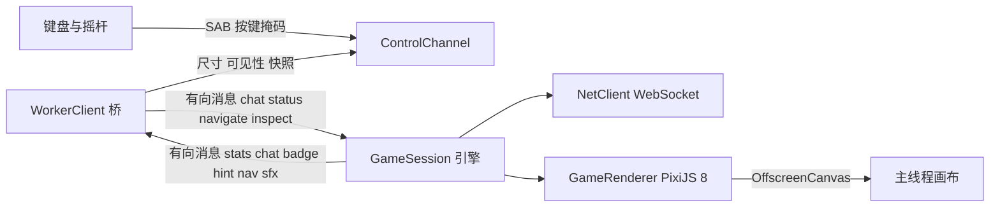

## 产品概述
《牛马 NIOMA》网页版游戏页的前端渲染架构升级：把游戏画面、ECS 状态与网络循环从浏览器主线程搬到独立线程，使 React 外壳、输入法与聊天打字不再与渲染争抢主线程。目标是在 120Hz/144Hz/ProMotion 屏幕上保持稳定顺滑，并在切后台、热更新与不支持的环境下有确定的降级行为。画面外观与交互行为保持不变。

## 核心功能
- 游戏主画面、帧循环、角色与地形渲染运行在独立线程，主线程不再参与任何绘制
- 主线程只负责外壳 UI、工牌状态输入、聊天弹窗、键盘全局监听与几何尺寸同步
- 主画布与 168px 小地图画布一并交由独立线程接管，主线程不再每 250ms 重绘地形
- 键盘按键以定长按键掩码跨线程传递，摇杆方向以定点数写入同一块共享内存；空闲键位变化不触发消息
- 聊天广播、工牌文本、姿态提示、导航状态、连接状态以单次有向消息传递，不进入渲染帧
- 窗口尺寸、可视视口、设备像素比变化实时同步给渲染线程，输入法弹起导致的舞台缩放不产生画面错位
- 页面切后台时停止画面刷新但保留网络连接，回到前台立即恢复，无需重新入场
- 不具备画布移交能力的环境自动回退到主线程运行同一套引擎，画面与交互保持一致
- 热重载与路由切换不残留后台线程、不叠加定时器、不泄漏显存

## 视觉与体验
没有任何视觉改版：工牌、聊天面板、动作盘、小地图、提示条的位置与样式保持现状。可感知的变化只有三处——持续移动时打字不再掉帧、高刷屏下镜头跟随更连续、从后台切回时画面立即续上而不是重连黑屏。


## 技术栈
- 不新增运行时依赖。PixiJS 8.22 已内置 `pixi.js/webworker` 入口并导出 `WebWorkerAdapter`（`node_modules/.pnpm/pixi.js@8.22.0/.../environment-webworker/WebWorkerAdapter.d.ts`），需在 Worker 启动时手动 `DOMAdapter.set()`（`environment/adapter.mjs` 默认是 `BrowserAdapter`，webworker 入口不会自动替换）。
- Next 15.5 + Turbopack 打包 Worker：`new Worker(new URL('...', import.meta.url), { type: 'module' })`。
- 跨线程高频通道：`SharedArrayBuffer` + `Atomics`（依赖 COOP/COEP 下的 `crossOriginIsolated`）；不可用时降级为定长 `ArrayBuffer` + `transfer`。
- 不触碰协议层：`packages/shared-types`、`apps/game-server` 零改动。测试沿用 `bun test lib`。

## 实施方案

### 核心策略
先剥端口，再换宿主。引擎（`GameSession` + `GameRenderer` + `Ecs` + `NetClient`）当前直接依赖 `window`、`document`、`localStorage`、`AudioContext`（证据：`session.ts:270-271,305-306,749-765,767-769`；`renderer.ts:80-81,539-567,593-597`；`input.ts:71-78`；`sfx.ts:39-56`）。把这些访问收敛成注入端口 `EngineEnv`，引擎就变成线程无关；Worker 与主线程只是两个 Host。分四步落地，每一步都可独立验收：

1. Phase 0（行为零变化）：注入 `EngineEnv`（search / dpr / fontsReady / onVisibility / onPageHide / writeSnapshot / emitSfx）；`GameRenderer.init` 从 `host: HTMLElement` 改为显式 `{ canvas, width, height, dpr, search }`；`InputController` 拆成纯 `InputMask`（位运算与方向解算）+ 主线程 `KeyboardSource`。此阶段结束后仍跑主线程。
2. Phase 1：控制通道与消息协议 + Worker 入口 + `WorkerClient`。
3. Phase 2：输入、点选、导航、聊天、工牌全部改走通道/消息；小地图画布移交。
4. Phase 3：回退 Host、能力探测、COOP/COEP、可见性挂起、HMR 清理、ADR 与 README。

### 关键决策与取舍
| 决策 | 选择 | 理由与代价 |
|---|---|---|
| WebSocket 归属 | Worker 内建连（需求指定） | sync 包直接用 `readSync` 写 TypedArray，少一跳二进制转包；代价是主线程要靠 `onStatus/onQueue` 消息镜像连接态，映射已有回调即可 |
| 回退实现 | 单一引擎 + 双 Host | 保留旧 `GameSession` 作回退会在两次发版后腐烂，且回退路径永远得不到验证；双 Host 让回退跑的就是同一条代码 |
| 高频通道 | SAB 定长块 + Atomics | 每帧 `postMessage` 会带来结构化克隆与短命对象；SAB 每帧只做 8 次整数读写。按键本身低频，但摇杆与尺寸抖动是高频，统一走同一块最省分支 |
| 120/144Hz 步进 | 沿用 delta-time 直通，不加固定步长累加器 | 现有 `stepLocal/stepRemote` 全部是 dt 驱动（`session.ts:1209-1232`），加累加器会改变手感并引入额外插值延迟；ECS 每帧 O(实体数) 且零分配，刷新率翻倍的成本可接受；`deltaMS` 上限维持 50ms |
| Worker 内文本 | 在 Worker 注册 FontFace | 把昵称渲染回主线程需要每帧回传屏幕坐标，等于把帧循环切一块搬回来；`self.fonts` 注册一次即可，缺失时允许度量降级 |
| 小地图 | 画布一并移交（已确认） | 主线程彻底无绘制；代价是多一块 OffscreenCanvas 的生命周期与 DPR 同步 |
| 切后台 | 停渲染保连接（已确认） | 回前台立即续上；Worker 内 `app.stop()/start()`，socket 与心跳不动 |

### 性能与可靠性
- Worker 帧循环每帧只做：读控制块 8 个槽位 → ECS 遍历 → Pixi 渲染，保持现有零分配约束（README 性能章节已声明"帧循环不产生对象"）。
- 主线程每帧成本归零：不再有 Pixi ticker、不再有 `MiniMap` 的 4Hz 全图重绘（`MiniMap.tsx:144-202`）、不再有 `InspectCard` 的 4Hz ECS 轮询（`InspectCard.tsx:50-70`）、不再有每 500ms 的 HUD 重渲染触发源之外的帧内工作。
- 消息面严格限频：stats 2Hz、badge 4Hz、落点快照 2s、聊天与状态事件驱动。
- 失败隔离：Worker 初始化异常时由主线程 Host 接管同一引擎，玩家只感受到 loading 延长一次。

## 架构设计



职责边界：
- 主线程：`GameViewport` 外壳、`Hud`/`ChatDock`/`StatusEditor`/`ActionBar`/`InspectCard`/`MiniMap` 外壳、`KeyboardSource`、`WorkerClient`（画布移交、快照落盘、音频、可见性、尺寸观察）。
- Worker：`GameSession` 全部状态机、`NetClient`、`Protocol` 编解码、`Ecs`、`GameRenderer`、小地图 4Hz 绘制、帧循环。
- 两侧共用的只有：`packages/shared-types` 编解码、控制块布局常量、消息类型定义。

## 目录结构

```
apps/web/
├── workers/
│   ├── game.worker.ts          # [NEW] Worker 入口。先 DOMAdapter.set(WebWorkerAdapter)，再注册字体、绑定消息、启动引擎；只 import 无 DOM 的模块。
│   ├── font-bootstrap.ts       # [NEW] 用 new FontFace 注册 public/fonts 下的 JetBrainsMono-400/600，await self.fonts.ready；self.fonts 缺失时直接返回，允许度量降级。
├── lib/game/runtime/
│   ├── control-channel.ts      # [NEW] 控制块布局常量、SAB 实现（Int32Array + Atomics）与定长 ArrayBuffer 降级实现，统一 ControlChannel 接口；含 seq 回绕处理。
│   ├── worker-protocol.ts      # [NEW] 双向消息判别联合与 opcode 表：init/ready/chat/chatHistory/status/appearance/navigate/cancelNav/pick/inspect/retry/dispose/suspend/resume/stats/queue/rejected/hint/localState/nav/picked/badge/sfx。
│   ├── engine-env.ts           # [NEW] EngineEnv 端口定义 + WorkerEnv（写 SAB、发消息）与 MainEnv（直接 localStorage、AudioContext、document 事件）两套实现。
│   └── render-mode.ts          # [NEW] pickRenderMode()：OffscreenCanvas + transferControlToOffscreen + Worker 三者齐备才走 worker；支持 ?render=worker|main 覆盖与 ?gpu=webgl 透传。
├── lib/game/client/
│   ├── game-client.ts          # [NEW] GameClient 接口与 createGameClient() 工厂；start/stop/setMoveVector/perform/sendChat/requestHistory/setStatus/navigateTo/cancelNavigation/pick/subscribeBadge/retry。
│   ├── worker-client.ts        # [NEW] 主线程 Host：每会话新建 canvas 并 transfer、创建 Worker、ResizeObserver 与 visualViewport 同步、pagehide/visibilitychange 处理、2s 快照写 localStorage、sfx 消息播声、消息 token 防迟到包。
│   └── main-thread-client.ts   # [NEW] 回退 Host：动态 import 引擎后在主线程启动，端口实现换 MainEnv，对 UI 暴露同一接口。
├── lib/game/input/
│   ├── input-mask.ts           # [NEW] 键位位定义、ActionKey 到动作码映射、掩码到方向向量的归一化解算（含触屏定点叠加），纯函数可单测。
│   └── keyboard.ts             # [NEW] 主线程 keydown/keyup/blur 监听：保留 isComposing 与 keyCode 229 过滤、可编辑元素判定、长按 Set 语义、Enter 开聊天；把掩码/动作码写入通道，首次手势调用 sfx.unlock()。
├── lib/game/minimap-draw.ts    # [NEW] 从 MiniMap.tsx 抽出的纯绘制逻辑（ISLAND/WORLD_LAYOUT 到 OffscreenCanvasRenderingContext2D），供 Worker 4Hz 调用。
├── lib/game/session.ts         # [MODIFY] 去掉 'use client'、window/document/localStorage/AudioContext；构造注入 EngineEnv；start 改为接收 host 描述；tick 从通道读输入；新增 suspend/resume；persistNow 改为 env.writeSnapshot。
├── lib/game/renderer.ts        # [MODIFY] init 改为接收 canvas/size/dpr/search；删除 resizeTo、appendChild、document.fonts、window.location.search；新增 resize(w,h,dpr)；去掉 'use client'。
├── lib/game/input.ts           # [MODIFY] 仅保留 ActionKey 类型与纯向量解算（迁往 input/ 后由该文件转出），删除 window 监听与 detach。
├── lib/game/ecs.ts / snapshot.ts / atlas.ts   # [MODIFY] 去掉 'use client'；snapshot 导出 SnapshotPatch 类型供通道复用。
├── lib/game/pixel-scale.ts     # [MODIFY] 保留 readDpr() 给 preview.ts 使用，新增 normalizeDpr(raw) 供 Worker 注入值复用。
├── lib/net/client.ts           # [MODIFY] 去掉 'use client'；defaultUrl() 的同源推导改为由调用方传入 wsUrl，避免 Worker 内访问 window.location。
├── components/game/GameViewport.tsx  # [MODIFY] 用 createGameClient 替换 GameSession；把 location.search 与初始 profile/resume 交给 client；pick 改发消息；移除 getSession。
├── components/game/MiniMap.tsx       # [MODIFY] 只留外壳与 canvas ref，画布移交 client；region/nearby 改读 useGameUi，删除 4Hz setInterval 与两个 setState。
├── components/game/InspectCard.tsx   # [MODIFY] 改为 client.subscribeBadge(id, cb)，卸载时退订并发送 inspect:null，删除 4Hz 轮询。
├── lib/game-ui.ts                    # [MODIFY] 保持结构，仅补 badge 相关选择器；不做帧内写入。
├── next.config.ts                    # [MODIFY] 增加 headers()：Cross-Origin-Opener-Policy: same-origin、Cross-Origin-Embedder-Policy: require-corp。
├── lib/game/__tests__/control-channel.test.ts / input-mask.test.ts / worker-protocol.test.ts  # [NEW] 通道读写与回绕、掩码到方向、消息编解码往返。
docs/adr/0048-offscreen-canvas-worker-loop.md  # [NEW] 记录线程边界、通道布局、回退与回滚路径（现有最高为 0047）。
README.md                             # [MODIFY] 性能章节补线程边界表与 ?render / ?gpu 灰度开关。
```

## 关键代码结构

```ts
// lib/game/runtime/control-channel.ts
export interface ControlChannel {
  writeKeys(mask: number): void;
  readKeys(): number;
  writeTouch(x: number, y: number): void;
  readTouch(out: { x: number; y: number }): void;
  writeViewport(width: number, height: number, dpr: number): void;
  readViewport(out: { width: number; height: number; dpr: number }): void;
  /** 返回 0 表示本帧没有新动作；消费后序号前移 */
  takeAction(): number;
  writeSnapshot(patch: SnapshotPatch): void;
  /** 主线程每 2s 与 pagehide 调用；无新快照返回 false */
  readSnapshot(out: SnapshotPatch): boolean;
  setVisible(visible: boolean): void;
  isVisible(): boolean;
}

// lib/game/client/game-client.ts
export interface GameClient {
  start(host: HTMLElement, profile: SessionProfile, resume?: ResumeState): Promise<void>;
  attachMinimap(canvas: HTMLCanvasElement): void;
  stop(): void;
  setMoveVector(x: number, y: number): void;
  perform(action: ActionKey): void;
  sendChat(text: string): void;
  requestHistory(beforeMsgId: number): void;
  setStatus(status: string): void;
  navigateTo(id: NavTargetId): void;
  cancelNavigation(): void;
  pick(stageX: number, stageY: number): void;
  subscribeBadge(id: number, cb: (badge: PlayerBadge | null) => void): () => void;
  retry(): void;
}
```

## 实现注意事项

- `DOMAdapter.set(WebWorkerAdapter)` 必须在任何 `app.init` 之前执行；Web Worker 入口不能静态 import 任何带 `'use client'` 的模块或 React。
- Worker 创建路径放在 `worker-client.ts` 内，`new URL('../../workers/game.worker.ts', import.meta.url)`；若 Turbopack 打包失败，保留 `?render=main` 作为可用输出并把结论写入 ADR，不阻塞其余改造。
- transfer 是一次性的：每次会话由 Host 新建 `canvas` 并 append 到 host，`stop()` 时移除；StrictMode 双挂载靠 effect cleanup + 新画布解决，绝不复用已移交的画布。
- COOP/COEP 只在 `next.config.ts` 设置，nginx 走上游透传。不要同时在 nginx `server` 块 `add_header`，否则响应出现重复头会让浏览器判定非法、`crossOriginIsolated` 变 false；注意各静态资源 location 自带 `add_header` 时本来就不继承 server 级头，这也支持把配置集中到 Next 一侧。
- `atlas.ts` 的 `Assets.load` 在 Worker 内依赖 `createImageBitmap`；若某浏览器失败，补 `fetch + createImageBitmap` 兜底，不改 manifest 与图集生成流程。
- 落点快照由 Worker 写进 SAB，主线程 2s 定时与 pagehide 时读并调用现有 `saveSnapshot`；`localStorage` 与 `park` 分区逻辑保持原样。
- 音频留在主线程：Worker 只发 `sfx(species)`；首次 keydown/pointerdown 先 `sfx.unlock()` 解锁 AudioContext，避免消息到达时上下文仍 suspended。
- 可见性：hidden 时 `app.stop()`、停小地图定时器、`Atomics.store` 可见位；visible 时 `app.start()` 并把上一帧时间戳重置，避免累计出一次 50ms 大跳。
- HMR：`useEffect` 清理里 `worker.terminate()`、`ResizeObserver.disconnect()`、移除 `pagehide/visibilitychange` 监听；消息处理带会话 token，丢弃上个 Worker 的迟到包。
- `readDpr()` 保持现状供 `lib/game/preview.ts` 使用，本次不迁移创作者预览台（`preview.ts`、`components/creator/*`）。
- 不做无关重构：`session.ts` 的 ECS/插值/寻路逻辑一行不改，只替换 IO 边界；`packages/shared-types` 与游戏服不动。

## 现状基线（证据）

```text
BASELINE | apps/web/lib/game/session.ts | expected: 应用层编排（网络+ECS+渲染调度），不直接持有平台 API | observed: 直接 window/pagehide、document/visibilitychange、localStorage、renderer 宿主 DOM，tick 内直调 Pixi ticker | fit: partial | violations: [X-DEP-IO] | suggestion: 注入 EngineEnv 与 Host，tick 逻辑不动
BASELINE | apps/web/lib/game/renderer.ts | expected: 渲染实现，只依赖传入的画布与尺寸 | observed: 自建 Application、resizeTo: host、appendChild、document.fonts、window.location.search | fit: partial | violations: [X-DEP-DOM] | suggestion: init 接收 canvas/size/dpr/search，新增 resize
BASELINE | apps/web/lib/game/input.ts | expected: 输入语义与 DOM 事件分离 | observed: 类内直接 addEventListener，方向解算与事件耦合在同一类型 | fit: drift | violations: [X-SRP] | suggestion: 拆纯 InputMask 与主线程 KeyboardSource
BASELINE | apps/web/components/game/MiniMap.tsx | expected: 展示组件，只消费数据 | observed: 4Hz setInterval 在主线程重绘全图地形并读 ECS 快照 | fit: drift | violations: [X-SRP] | suggestion: 画布移交 Worker，组件只读 store
BASELINE | apps/web/lib/game-ui.ts | expected: 低频 UI 投影，不进帧循环 | observed: 每 500ms 整体 setStats 触发 HUD 子树重渲染，但帧内无写入 | fit: align | suggestion: 保持，仅补 badge 选择器
```

## 验收与回滚
- `pnpm --filter @niuma/web typecheck`、`bun test lib` 全绿；新增三个纯逻辑测试文件覆盖通道、掩码、协议。
- DevTools Performance 在 CPU 6x 降速下录「持续移动 + 输入法连续打字」：主线程无超过 8ms 的长任务；Worker 帧间隔在 120Hz 下稳定。
- `?render=main` 与默认 Worker 模式画面逐项比对：角色、遮挡、飘雪、柔光、气泡、小地图一致。
- 切后台 10s 回前台：不重连、不丢坐标、无第二个 Worker；连续保存 20 次 HMR 后 `chrome://workers` 只剩一个实例。
- 回滚：`?render=main` 可即时降级；30 天内删除 `workers/` 与 `lib/game/client/worker-client.ts` 即回到 Phase 0 形态，`EngineEnv` 端口保留不产生行为差异。


## Agent Extensions

### SubAgent
- **code-explorer**
  - Purpose: 在 Phase 0 前穷举 `lib/game`、`lib/net`、`components/game` 中所有 `window` / `document` / `localStorage` / `AudioContext` / `devicePixelRatio` 调用点，避免端口化时漏改导致 Worker 内抛错。
  - Expected outcome: 输出一份「文件:行 → 目标端口」的清单，作为 Phase 0 的改动清单与验收对照表。

### Skill
- **principal-software-architect**
  - Purpose: 按 ADR 模板固化线程边界、控制块布局、回退与 30 天回滚路径，并对「Worker 内建连」「单实现双 Host」「SAB vs postMessage」给出权衡留档。
  - Expected outcome: `docs/adr/0048-offscreen-canvas-worker-loop.md`，包含决策、备选方案、不可逆点与失效场景。
- **verification-before-completion**
  - Purpose: 收尾阶段先跑 typecheck、bun test 与手工性能录制，再声明完成，避免"看起来改完了"的假完成。
  - Expected outcome: 一份带命令输出与指标数字的验收记录（主线程长任务、帧间隔、Worker 数量）。
