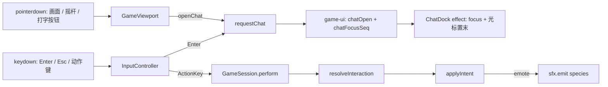

## 产品概述
《牛马》是一座 2D 像素多人在线办公园区。玩家用键盘移动，用动作键坐 / 躺 / 叫唤 / 挥手 / 跳跃，用 Enter 打开园区频道聊天。本次不新增玩法，只修顺 `/play` 的键盘与聊天操作链路。

## 核心功能
- C 叫唤补音效：站定、坐着、躺着与行走中按 C 都必须发声（牛哞 / 马嘶）；按 ADR-0023 只补声音，不改动画与视觉。
- 回车聚焦：游戏画面内按 Enter 或小键盘 Enter，打开聊天并聚焦输入框，光标置于末尾；面板已展开但输入框失焦时，同样能重新聚焦。
- 发送后收起：发送成功后收起面板、释放焦点，WASD 立即恢复移动；再按 Enter 重新打开。
- Esc 收起：聊天输入框内按 Esc 收起面板并释放焦点。
- 点击画面收起：点击游戏画面空白处（非 HUD、非输入框）收起聊天；手机端按下左侧摇杆开始移动时同样收起。
- 输入法保护：中文输入法组合选词期间，Enter / C / Z / X / 空格不触发游戏动作，也不误开聊天。
- 移动复位：通过按钮打开聊天时清空仍按住的移动键，避免输入法弹起后角色继续滑行。

## 视觉与交互效果
沿用现有墨色面板、薄荷绿焦点边框、等宽小字与琥珀色提示，不新增视觉语言。唯一新增可见元素是「不文明用词已自动打码」提示条：聊天收起后仍短暂保留，约 4 秒后自动消失，避免提示被一起关掉。


## Tech Stack
- 前端：Next.js 15 App Router + React 19 + TypeScript 5.7 + Tailwind CSS v4 + Zustand 5（全部沿用）
- 渲染：PixiJS 8（不改渲染管线、不改 ECS 数组布局）
- 音频：Web Audio 实时合成，复用 `apps/web/lib/game/sfx.ts` 已有的 `sfx.emit(species)`
- 测试：bun test（`apps/web/lib/game/__tests__/`）
- 无新增依赖，无协议与服务端改动，无持久化改动

## Implementation Approach
1. **输入层单点判定**：所有键盘语义仍集中在 `apps/web/lib/game/input.ts`。新增组合态早退（`isComposing`，兼容 `keyCode === 229`）、可编辑元素判定（INPUT / TEXTAREA / SELECT / contentEditable）、Enter 改用 `event.key` 以覆盖 NumpadEnter，并在打开聊天前清空按下集合。
2. **显式聚焦信号**：`game-ui.ts` 增加 `chatFocusSeq` 自增序号与 `requestChat()`。`ChatDock` 的聚焦 effect 依赖 `[open, chatFocusSeq]`，聚焦后把光标移到末尾。这是本次核心修复：面板已展开时 `chatOpen` 仍是 `true`，只改布尔值不会触发 effect。
3. **统一的收起语义**：`submit()` 成功后一律 `blur()` + 关闭（桌面与手机一致）；Esc 同样关闭并失焦；打码提示移到面板底部、收起态仍可见。点击舞台空白与摇杆按下都收起面板。
4. **叫唤音效落在会话层**：`GameSession.start` 保存 `profile.appearance.species`；把 `applyIntent` 里的 `emote` 与 `wave` 拆成两个 case，`emote` 先 `sfx.emit` 再按 `intent.animated` 决定是否播叠加动画，从而满足「行走中只出声不动画」。
5. **移动键复位**：`GameSession.clearMovement()` 转调已有的 `InputController.clear()`，由 `GameViewport` 的 `openChat` 在打开面板前调用。

关键取舍：
- 用 store 里的序号而不是 ref / 自定义事件：ref 变化不触发 effect，事件总线会引入第二条通信通道；序号只增加一个 number 字段，改动最小且幂等。
- 点击收起挂在 host div 而不是 document：HUD 容器本身是 `pointer-events-none`，空白处会自动穿透到 host div；监听 document 需要额外做目标过滤，容易误伤 HUD 控件。代价是手机端摇杆热区需要单独调用一次。
- `event.key` 覆盖小键盘 Enter：代价是必须同时处理组合态，已用 `isComposing` 早退解决。
- 音效放在 `applyIntent` 而不是按钮组件：键盘与触屏共用同一条派发路径，不会出现两套逻辑。代价是 `GameSession` 多保存一个 `species` 字段。
- 不为输入层引入 jsdom 依赖：键盘逻辑绑定 window，本次以 typecheck、既有 bun 测试与手工清单验证，避免为小改动扩大依赖面。

性能与可靠性：
- keydown / pointerdown 处理器均为 O(1)，不产生每帧分配；`pressed` 仍是既有 Set。
- 舞台点击用 `useGameUi.getState()` 做一次性读取，不订阅 `chatOpen`，不会让整个视口组件因聊天开关重渲染。
- 聚焦 effect 只在 `open` 或序号变化时执行；`sfx.emit` 仅在按键时创建节点，`ended` 后主动 disconnect，90ms 节流防止叠音。
- 不触碰 60fps 帧循环、网络包与 `overlayTrackFor` 选帧逻辑；`wave` 分支行为保持原样，`Motion.moving[eid] = 0` 保持原样。

## Implementation Notes
- `sfx.emit` 必须留在按键 / 指针手势的同步调用栈内，不能放进定时器或 `requestAnimationFrame`，否则 AudioContext 首次创建会被自动播放策略挂起。
- 打开聊天时先 `blur()` 再 `setChatOpen(false)`，顺序更稳；输入框卸载本身也会把焦点交还 body。
- `notice` 不要删除：把它从表单底部移到面板最底部，`open` 与收起态都能渲染；编辑草稿时清空，并提供 4 秒自动清除，避免琥珀色提示条常驻。
- 深链分支构造 `Profile` 时缺 `status` 字段属于既有类型缺口，只有改到该行时才顺手补 `status: ''`，不要扩大范围。
- `input.ts` 的 `BLOCKED`、Ctrl / Cmd / Alt 忽略、`event.repeat` 抑制等既有规则全部保留。
- 文档同步：README 第 93 行按键说明补上「Enter 打开聊天、Esc 收起、点击画面收起」。
- 验证命令：`pnpm --filter @niuma/web typecheck`、`pnpm --filter @niuma/web test`。

## Architecture Design
单向数据流，不新增分层：



- **输入层**：`input.ts` 只负责「这次按键算不算游戏输入、对应哪个动作或聊天」。
- **状态层**：`game-ui.ts` 是聊天开关与聚焦请求的唯一来源，React 组件不互相传 ref。
- **会话层**：`session.ts` 只执行意图（改 Motion、发包、播音），裁决仍由纯函数 `actions.ts` 负责。
- **视图层**：`GameViewport` 负责舞台指针事件与 HUD 编排，`ChatDock` 负责面板内的焦点与提交。

## Directory Structure
本次全部为既有文件的定点修改，不新建模块：

```
apps/web/
├── lib/
│   ├── game-ui.ts                 # [MODIFY] 新增 chatFocusSeq 与 requestChat()；INITIAL 补默认值，reset 一并复位
│   └── game/
│       ├── input.ts               # [MODIFY] 组合态早退、可编辑元素判定、Enter 用 event.key 覆盖 NumpadEnter、
│       │                          #          打开聊天前清空 pressed
│       └── session.ts             # [MODIFY] 保存 species、拆分 emote/wave、叫唤调用 sfx.emit、
│                                  #          新增 clearMovement()
├── components/game/
│   ├── ChatDock.tsx               # [MODIFY] 按 open + chatFocusSeq 聚焦并置光标末尾；发送后统一 blur + 收起；
│   │                              #          Esc 收起；打码提示移到面板底部并 4 秒自动清除
│   ├── GameViewport.tsx           # [MODIFY] openChat 统一入口（清移动键 + requestChat）；host div 指针按下收起聊天；
│   │                              #          移除不再使用的 setChatOpen 选择器
│   └── TouchControls.tsx          # [MODIFY] Joystick 新增可选 onEngage，按下时收起聊天；打字按钮改走 openChat
README.md                          # [MODIFY] 按键说明补 Enter / Esc / 点击画面收起
```

## Key Code Structures
```ts
// apps/web/lib/game-ui.ts
interface GameUiState {
  chatOpen: boolean;
  /** 每次打开或重新聚焦聊天自增；面板已展开但失焦时，只改 chatOpen 不会触发聚焦 */
  chatFocusSeq: number;
  requestChat: () => void;
}
```

```ts
// apps/web/lib/game/session.ts —— applyIntent
case 'emote':
  sfx.emit(this.species);          // 行走中也发声（ADR-0023 §3）
  if (!intent.animated) return;    // 行走中图集没有张嘴帧，只出声不动画
  this.startOverlay(eid, 'emote');
  Motion.moving[eid] = 0;
  return;
```


## Agent Extensions
### Skill
- **impeccable**
  - Purpose: 按用户规则，在改完 `ChatDock` 与 `GameViewport` 的交互后执行 `/impeccable polish`，检查焦点流、键盘可达性、提示条配色与响应式是否回归。
  - Expected outcome: 无严重可访问性或视觉问题，提示条沿用既有 ink / mint / amber 体系，不引入新的设计语言。
- **verification-before-completion**
  - Purpose: 收尾时强制执行 typecheck、bun 测试与手工操作清单，并给出命令输出作为完成证据。
  - Expected outcome: `typecheck` 与 `test` 全部通过，手工清单逐项确认通过后再声明完成。
