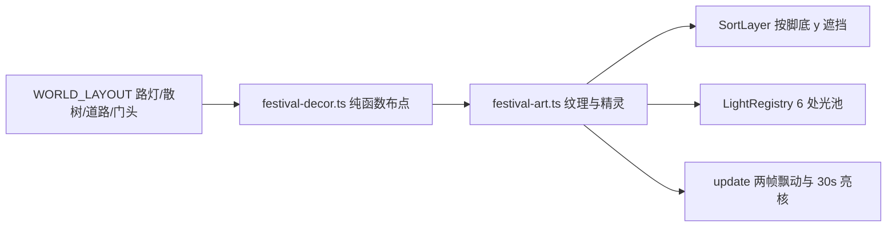

## Product Overview
在现有像素风园区上新增一层**全年常驻**的节日装饰：以灯笼、三角彩旗为主，分布在中央广场四向路口、四条主路、林荫道树梢与四角院落门口。装饰纯视觉、不参与碰撞、不影响玩法；夜间仅少数重点灯笼投出暖红光池，其余以自发光像素呈现。整体朱红配宫灯金，与现有国风亭台、宫灯、牌匾同一套色彩语言。

## Core Features
- **跨路彩旗串**：挂在广场八盏路灯与四条主路入口灯柱之间，形成四向门廊，红金为主、薄荷与奶油点缀。
- **门楣装饰**：四角院落门口各挂一条短彩旗与成对灯笼，与现有一盏宫灯、牌匾对齐。
- **林荫道灯笼**：沿主路两侧散树选择性悬挂小灯笼，疏密有致，不铺满整片树林。
- **夜间层次**：6 处重点灯笼接入真实光池，其余灯笼亮核随昼夜轻微提亮。
- **自适应清晰**：整数纹素布点、1:1 烘焙、nearest 采样，缩放、DPR 变化与竖屏下不糊边、不抖动。
- **灰度开关**：`?festival=0` 关闭整层，`?festival=1` 强制开启，便于线上验收与回滚。


## 技术栈
- 渲染：PixiJS 8 + 现有 `bake()`、`SortLayer`、`LightRegistry`，不改 Next.js/React 外壳。
- 语言：TypeScript strict；纯函数布点模块可在 `bun:test` 中直接断言。
- 范围：仅 `apps/web` 渲染层，**不改 game-server、不改协议、不改 shared-types、不新增碰撞**，因此无需双端发版。
- 持久化：无新增。装饰由本地代码常量与 `WORLD_LAYOUT` 派生。

## 实现策略
1. **纯函数布点**：新增 `festival-decor.ts`，从 `WORLD_LAYOUT.props`（路灯）、`WORLD_LAYOUT.looseTrees`（林荫道散树）、`WORLD_LAYOUT.paths`（中心线与半宽）、`DOOR_PLAQUES` / `DOOR_LANTERN_POSTS`（门头）派生锚点，禁止第二份手写坐标，禁止 `Math.random()`（用 `Math.imul` 位置哈希），保证同一次构建每次进服位置一致。
2. **锚点类型**：
   - `plaza-bunting`：广场八盏路灯按关于广场中心对称的成对关系生成 4 条跨路彩旗（北、南、东、西）。
   - `road-bunting`：四条主路外侧入口灯柱两两成对，生成 4 条跨路彩旗；与拱门、牌坊保持 120px 以上净距。
   - `gate-bunting`：三处 `DOOR_PLAQUES` 与卫生间门头（由 `DOOR_LANTERN_POSTS` 反推中心）各生成一条短彩旗，挂点与现有宫灯同高。
   - `tree-lantern`：散树到主路中心线的距离落在 `halfWidth + 24` 至 `halfWidth + 80` 之间时入选，按序号取模与位置哈希择一悬挂，每棵两盏小灯笼，树冠下三分之一处。
3. **渲染**：新增 `festival-art.ts` 的 `FestivalArt`，构造期烘焙约 8–12 张纹理（彩旗 3 种长度 × 2 帧、灯笼串、门楣件、树梢小灯笼），精灵锚点全部 `Math.round` 到整纹素，按脚底 y 交给 `DepthSink.add()`，与树冠、角色共用遮挡。
4. **动效**：彩旗两帧交替（600–900ms，相位由位置哈希错开），树梢灯笼 1 纹素横向轻摆；只切换 `texture` 或写整数 `x/y`，帧循环零分配、零 `generateTexture`。
5. **夜间**：`festivalLights()` 只输出 6 盏 `LightSpec`（广场四向彩旗中心各 1 + 南北入口各 1），复用 `LANTERN_LIGHT` 的半径 48 / `0xff5a3c` / `0.72` / `flicker 0.12`；其余灯笼每 30s 用 `lightToneAt()` 采样一次，把亮核 alpha 从 0.85 抬到 1，不新增光池。
6. **开关**：`readFestivalEnabled(search)` 解析 `?festival=0|off|false` 与 `?festival=1|on|true`，非法值回落为开启；关闭时不构造 `FestivalArt`、不烘焙纹理，运行时零开销。
7. **自适应清晰**：纹理 `resolution: 1`、`scaleMode: 'nearest'`；装饰不单独缩放，统一继承世界容器由 `pixelMetrics` 算出的整数 `cssScale`；关键线条最小 2px，避免低倍率下断线。竖屏沿用 `worldCssPerTexel` 的降档逻辑，不做任何按设备改尺寸的分支。

## 架构设计


## 性能与可靠性
- 烘焙 ≤ 12 张纹理，单张 ≤ 320×24；精灵约 60–90 个，集中在中庭与主路，无需额外裁剪；若后续超 160 个再复用 `cull` 模式。
- `update()` 只做整数位置写入与纹理引用切换，不新建对象、不排序、不查表。
- 光源总量：现有外景 + 亭子 4 + 宫灯 6 + 供案 2 + 室内预留 8 + 节日 6，仍 ≤ `MAX_LIGHTS = 64`；同步更新 `ritual.test.ts` 预算断言，避免静默丢弃。
- 无日志新增；坐标非法时布点函数直接跳过该锚点，不抛异常打断渲染。

## Implementation Notes
- 复用 `lighting/lanterns.ts` 的 `paintLantern()`：新增 `paintLanternRun(g, x, hangTop, count, spacing)` 供灯笼串使用，保持「灯笼只画一次」。
- 彩旗弧线用离线整数下垂表（0、2、4、5、4、2、0）逐列绘制，不用 `Math.sin`，避免跨引擎末位差异。
- 锚点需通过 `isOnLand` 与 `isWaterAt`；落在 `WORLD_LAYOUT.solids` 内的锚点剔除，门楣件只挂在门线上方，不挡门洞。
- 卫生间隔间门头装饰沿用现有门柱挂点，不新增世界常量，避免「看得到装饰、走不过去」的漂移。
- 回滚：删除 `festival-art.ts` / `festival-decor.ts` 与 renderer 三处接线即可；`?festival=0` 可先于代码回滚止血。
- README 增加「节日装饰」小节，写明开关、光源预算与验收清单；新增 `docs/adr/0063-festival-decor.md`。

## 目录结构
```
apps/web/lib/game/
├── festival-decor.ts                 # [NEW] 纯函数布点：跨路彩旗、门楣件、树梢灯笼与 6 处光位；
│                                     #       从 WORLD_LAYOUT 派生，含 readFestivalEnabled 与位置哈希；
│                                     #       输出只含整数坐标，跳过失效锚点。
├── festival-art.ts                   # [NEW] FestivalArt：构造期烘焙彩旗/灯笼纹理，按脚底 y 入 SortLayer；
│                                     #       lights 提供 6 盏 LightSpec；update 做两帧飘动与 30s 亮核；destroy 释放纹理。
├── lighting/lanterns.ts              # [MODIFY] 追加 paintLanternRun，复用 paintLantern 画灯笼串，保持画法单一来源。
├── renderer.ts                       # [MODIFY] 新增 festival 字段；buildLayers 内按开关构造并 attach；
│                                     #       init 中注册 festival.lights；update 调用；destroy 释放。
└── __tests__/
    ├── festival-decor.test.ts        # [NEW] 布点确定性、陆地/水面、碰撞规避、间距、光源数量与开关解析。
    └── ritual.test.ts                # [MODIFY] 光源预算断言加入 6 盏节日灯，仍 ≤ 64。

docs/adr/0063-festival-decor.md       # [NEW] 记录常驻装饰、数据派生布点、两帧彩旗、少量光池与灰度开关。
README.md                             # [MODIFY] 新增「节日装饰」小节与验收/回滚说明。
apps/web/data/release-notes.json      # [MODIFY] 追加一条面向玩家的版本记录，跑 changelog:check。
```

## 关键接口
```ts
export type FestivalAnchorKind = 'plaza-bunting' | 'road-bunting' | 'gate-bunting' | 'tree-lantern';

export interface FestivalAnchor {
  kind: FestivalAnchorKind;
  x: number;
  y: number;
  /** 彩旗终点；灯笼类为 undefined */
  toX?: number;
  toY?: number;
  /** 进 y 排序层的脚底 y */
  depthY: number;
  variant: 0 | 1 | 2;
  /** 是否接入真实光池 */
  lit: boolean;
}

export function readFestivalEnabled(search: string): boolean;
export function festivalDecorPlan(): readonly FestivalAnchor[];
export function festivalLights(plan: readonly FestivalAnchor[]): LightSpec[];

export class FestivalArt {
  readonly lights: LightSpec[];
  attach(depth: DepthSink, renderer: Application['renderer']): void;
  update(nowMs: number): void;
  destroy(): void;
}
```

## 验证
- 单测：同输入两次布点深比较一致；所有锚点在陆地上且不在水中；不落进 solids；跨路彩旗长度在 96–320；灯笼只出现在主路旁散树；`festivalLights` 长度恰为 6。
- `pnpm typecheck`、`pnpm test`、`pnpm changelog:check`。
- 手工：`?festival=0` 整层消失；DPR 100%/125%/150%/200% 与 `?zoom=` 各档无糊边；横竖屏切换不抖；入夜后 6 处光池与其余灯笼亮核层次正确；确认装饰可穿过、不改变任何可行走区域。


## 场景视觉设计
在园区现有 pastel 像素画风上叠加一层「像素国风节庆」：朱红灯笼与宫灯金彩旗作为唯一高饱和色，绿色草地、土色道路与暖灰石砖继续做底，避免整屏变红。

- **广场**：八盏路灯之间挂四条跨路彩旗，中央各垂一盏大灯笼，形成四向门廊；彩旗下垂成缓弧，与圆庭对称。
- **主路**：四个入口灯柱之间重复同一节奏，间距更疏，保证玩家从任一方向进园第一眼就能看到节庆门廊。
- **门头**：四角院落门口挂短彩旗与成对灯笼，位置与现有宫灯、牌匾对齐，不压门洞、不挡招牌字。
- **林荫道**：只在靠近主路的散树上挂两盏小灯笼，隔几棵一挂，读成「有人刚刚布置过」，而不是整片灯会。
- **动效**：彩旗两帧轻摆、树梢灯笼 1 纹素横移，节奏错开；夜间 6 处暖红光池落下，其余灯笼亮核提亮，冷暖与路灯形成层次。
- **自适应**：装饰跟随世界整数倍率缩放，边缘保持 1px 深靛描边与硬边色块，任何 DPR 与窗口尺寸下都保持像素块清晰。
