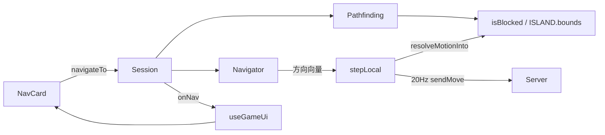

## 产品概述
把园区导览从「只看方向」升级为「点一下就走过去」：玩家在导览卡里选择工作区、卫生间、休息室或会议室，角色沿可行路线绕过墙体、穿过门洞，停在室内空地上。本次只做导览卡入口，不做点击地面或小地图寻路。

## 核心功能
- 导览卡四行变为可点击项，行尾常显「去这里」；点击即开始自动寻路。
- 目标仅限现有 4 个设施，到达点位于房间内可站立空地，不落在会议桌、工位桌、床铺或马桶隔断上。
- 寻路复用现有碰撞数据：绕墙、穿门洞；水面可涉但代价更高，优先走桥与道路。
- 导航中该行高亮并显示「取消」；点击其他设施可直接切换目标。
- 到达后自动停下并提示「已到达工作区」；找不到路或被挡住时给出明确提示，不静默卡住。
- 手动键盘或摇杆、坐下、躺下、跳跃、互动、打开聊天、断线重连都会立即取消自动寻路，控制权始终归玩家。
- 触摸端收起后的胶囊优先显示「前往 工作区」，点击可重新展开并取消。
- 不改变移动速度、相机、网络协议与服务端行为；视觉沿用现有像素 HUD，只增加行内交互态与轻微颜色过渡，不产生布局跳动。


## 技术栈
- 现有 Next.js 15 + React 19 + TypeScript + Tailwind CSS 4 + zustand；Pixi 渲染层不改。
- 寻路为纯 TypeScript，复用 `@niuma/shared-types` 的 `isBlocked`、`isWaterAt`、`ISLAND.bounds`，不新增依赖。
- 测试沿用现状：web 用 `bun:test`，shared-types 用 `vitest`。

## 实现策略
1. **目标数据**：`NavTarget` 增加 `arrive`（室内可站立落点）。落点在 `campus.ts` 以「房间原点 + 偏移」定义，`layout.ts` 的 `NAV_SOURCES` 合并；`x/y` 仍是房间中心，方位与步行秒数语义不变。四个落点分别取会议室桌东侧、卫生间门内、休息室中庭、工作区西门内，最终坐标由单测校验 `isBlocked === false` 且在房间矩形内。
2. **网格 A***：新增 `apps/web/lib/game/pathfinding.ts`。16px 网格覆盖 `ISLAND.bounds`（约 238×264 格，缓存约 62KB），惰性可通行缓存 `Uint8Array`（0 未算 / 1 陆地 / 2 水面 / 3 阻挡），只对 A* 实际访问到的格子调用 `isBlocked`，避免首次点击全岛预计算。
   - 8 向；对角必须两个正交邻格均可通行，禁止切角；octile 启发；水面移动代价 3，优先桥与道路；二叉堆 + stamp 数组复用；扩展上限 24000，超限返回 null。
   - 起点吸到最近可走格，终点使用 `arrive` 精确点；输出世界坐标点列。典型查询只展开数千格，预期 10ms 内完成。
3. **Navigator 状态机**：新增 `apps/web/lib/game/navigator.ts`，持有路点、目标、卡死计时。`steer(x, y, out)` 向复用输出槽写入方向，10px 内切下一个路点，12px 内到终点返回 `arrived`；`observe(dtMs, x, y)` 以「到当前路点距离是否持续缩短」判定卡死，连续 700ms 无进展返回 `stuck`。帧循环零分配。
4. **Session 接入**：`GameSession` 增加 `navigateTo(id)` 与 `cancelNavigation()`。`stepLocal` 优先手动输入（非零即取消导航），否则读取 Navigator 方向，仍走 `resolveMotionInto` 与 `MOVE_SPEED`，20Hz `sendMove` 完全不变。`perform`、`clearMovement`、`clearWorld`、断线、被拒、`stop` 均取消导航。新增 `onNav` 回调，只传 `{ id, name }`。
5. **HUD 接线**：`useGameUi` 增加 `navTarget` 与 `setNavTarget`；`GameViewport` 把 `onNav` 写入 store，并向 `NavCard` 传 `onNavigate` / `onCancelNavigation`。`NavCard` 每行改为独立 `<button>`（不嵌套），右侧「去这里」/「取消」，`aria-pressed`，触控最小热区 36px；胶囊优先显示导航目标。
6. **边界控制**：不新增协议、不写 localStorage、不打印坐标；服务端仍按原限速校验位置，自动寻路只改变方向，不产生瞬移。回滚只需移除 NavCard 入口与 session 调用，寻路模块可整体闲置。

## 架构设计
依赖方向由外向内：HUD → store → session 编排 → Navigator 策略 → Pathfinding 算法 → shared-types 碰撞唯一真相。服务端不参与寻路，客户端预测链路保持原样。



## 目录结构
```
packages/shared-types/src/
├── world/
│   ├── campus.ts                  # [MODIFY] 新增四个室内到达点常量，紧邻房间矩形定义
│   └── layout.ts                  # [MODIFY] NavTarget 增加 arrive；NAV_SOURCES 合并落点
└── __tests__/
    └── nav-arrival.test.ts        # [NEW] 断言四落点在对应房间内且 isBlocked=false

apps/web/
├── lib/
│   ├── game/
│   │   ├── pathfinding.ts         # [NEW] 16px 网格 A*、惰性可通行缓存、水面代价、禁止切角
│   │   ├── navigator.ts           # [NEW] 路点推进、到达判定、卡死检测、方向输出槽
│   │   ├── session.ts             # [MODIFY] navigateTo/cancelNavigation、stepLocal 输入优先级、onNav 回调、取消矩阵
│   │   └── __tests__/
│   │       ├── pathfinding.test.ts # [NEW] 四目标可达、路径无碰撞、门洞通行、不可达返回 null
│   │       └── navigator.test.ts   # [NEW] 到达、切路点、卡死、切换目标
│   └── game-ui.ts                 # [MODIFY] navTarget 状态、setNavTarget、INITIAL 重置
└── components/game/
    ├── GameViewport.tsx           # [MODIFY] onNav 接线；向 NavCard 传导航/取消回调
    └── NavCard.tsx                # [MODIFY] 行改按钮、「去这里/取消」、前往中高亮、胶囊优先导航目标

docs/adr/
└── 0040-park-auto-navigation.md   # [NEW] 记录客户端网格 A*、到达点、取消矩阵与回滚方式
```

## 关键结构
```ts
export interface NavTarget {
  readonly id: NavTargetId;
  readonly name: string;
  readonly x: number;
  readonly y: number;
  readonly arrive: { readonly x: number; readonly y: number };
}

export interface PathPoint { x: number; y: number }

export function findPath(
  fromX: number,
  fromY: number,
  toX: number,
  toY: number,
): PathPoint[] | null;

export interface Navigator {
  readonly active: boolean;
  readonly target: NavTarget | null;
  start(path: readonly PathPoint[], target: NavTarget): void;
  cancel(): void;
  steer(x: number, y: number, out: { x: number; y: number }): 'move' | 'arrived';
  observe(dtMs: number, x: number, y: number): 'ok' | 'stuck';
}
```

## 实现要点
- 不允许把房间中心当终点：四个中心分别是会议桌、马桶隔断、沙发床铺、工位桌，必须走 `arrive`。
- A* 只在点击时执行一次；绝不在 React render 或 500ms 统计里为四行各跑一次寻路。
- 不修改 `input.vector()` 的复用槽位；导航方向写入独立的 `navVector`。
- 门洞宽 60px、玩家半径 9px、网格 16px。若任一房间在测试中不可达，先把网格降到 12px 并复测，不要手写门口航点绕过问题。
- 取消必须幂等：`cancelNavigation()` 在 `nav.active === false` 时直接返回，避免触摸摇杆每帧触发 store 更新。
- 到达/失败提示复用 `showHint`，不引入新的 Toast 系统；不打印坐标或路径长度。
- 保持 `sendMove` 20Hz 与 `MOVE_SPEED` 不变，服务端限速逻辑不受影响。
- UI 行按钮不得嵌套 button；保留 `min-h-9`，焦点态用现有 mint 色；`aria-label` 包含设施名与动作。
- 步行秒数仍按直线距离计算，保留 `≈` 语义；不在 HUD 渲染中跑寻路。
- 验证命令：`pnpm --filter @niuma/shared-types test`、`pnpm --filter @niuma/web test`、两个包的 `typecheck`；手工从北门依次点击四个设施，确认穿门、到达、切换、取消与手动接管。


## Agent Extensions
### Skill
- **test-driven-development**
  - Purpose: 先写失败测试，再实现网格 A* 与 Navigator，覆盖四目标可达、路径无碰撞、门洞通行、不可达返回 null、卡死检测。
  - Expected outcome: 测试先红后绿，`pnpm --filter @niuma/web test` 与 shared-types 测试全部通过。
- **impeccable**
  - Purpose: 检查 NavCard 行按钮的交互态、焦点可见性、触控热区与现有像素 HUD 的一致性，避免布局跳动与视觉噪音。
  - Expected outcome: 键盘与触屏均可操作，无 primary findings，视觉与现有 ink/mint 体系一致。
