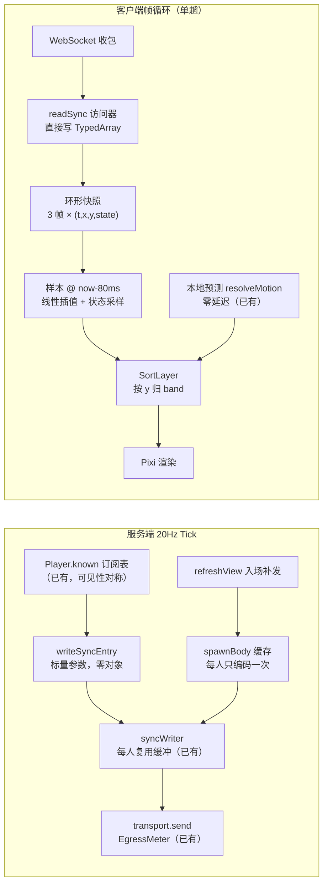

## User Requirements

现有 2D 像素多人在线园区在多人同时在线时会出现画面掉帧、他人走动一顿一顿、新玩家集中入场时整帧卡死的情况。本次优化要在**不改变玩法、不改变观感风格、不改变既有美术与地图**的前提下，把三处体感问题压平：

- 目标规模：默认容量 60 人同时在线时稳定顺滑；200 人压力测试时不出现掉帧与百毫秒级长帧。
- 覆盖维度：联机同步（进出视野、新玩家入场）、画面（同屏人数增加时的帧时间）、走位（自己与他人移动的手感）。
- 不引入新的美术资源、不改变角色外观与动画帧、不改变交互按键。

## Product Overview

一座永不下班的像素办公园区。优化后，人越多越能体现差别：走进广场时四周几十个同事同时走动依然稳定，别人从树后绕出来不会突然闪现，自己按方向键的响应不受同屏人数影响；服务器在新玩家集中涌入时不再整帧停顿，排队与准入提示照常工作。

## Core Features

- **联机同步稳态**：服务端每个同步周期不再产生大量临时数据，长时间运行不出现因垃圾回收引起的周期性顿挫；新玩家入场时不再为同一个人重复打包同一份资料，集中入场不再拖长单帧。
- **进出视野稳定**：视野边缘的实体进出不再引起可见的卡顿；远端实体的状态更新与位置更新在同一时刻生效，不出现"先迈步后位移"的错位。
- **画面抗人数增长**：屏幕外的角色不再参与绘制与深度排序；同屏深度排序只重排发生变化的局部，而不是每次把所有树、围栏、桌椅和角色整体重排一遍。
- **走位连续**：他人移动改为带固定小缓冲的连续插值，网络抖动不再表现为"停一下再窜一下"；自己的移动仍然零延迟预测，贴墙滑行与门洞通行手感不变。
- **可回退**：新增一个地址栏开关，可一键退回旧的排序方式，用于线上观感回归定位。
- **可验证**：给出优化前后的压力测试对比（单帧耗时 p50/p95/最大值、单客户端下行流量），并把结论写进项目文档。


## 技术栈选择

完全沿用现有栈，不引入任何新依赖：

- Monorepo：pnpm 10 + Turborepo 2 + TypeScript 5 strict
- 服务端：Bun `Bun.serve` WebSocket（内部 uWebSockets），20Hz 固定 Tick，运行时零分配为既定准则
- 客户端：Next.js 15 App Router + React 19 + PixiJS 8（WebGPU 优先，回落 WebGL2）+ bitecs 0.4（SoA TypedArray）+ Zustand 5
- 契约层：`packages/shared-types`，双端唯一协议与地形碰撞来源
- 测试：`bun test`（服务端与渲染纯模块）+ vitest（协议）+ 自带 `pnpm bench` 机器人压测

**关键约束（已与需求方确认）**：不改二进制协议。同步包仍是 7 字节条目、移动包仍是 8 字节，旧客户端不受影响，无需双端同时发版。

## 实施策略

按「先消除分配、再减少遍历、最后重构排序」三段推进，每一段都可独立验证与回滚。

### 决策一：服务端同步条目改标量签名，而不是引入对象池

`writeSyncEntry(writer, entity: EntitySnapshot)`（`packages/shared-types/src/protocol.ts:220`）在 `apps/game-server/src/sim/tick.ts:43,49` 每条目构造一个对象字面量。200 人全同屏时是 200 脏 × 200 订阅 = 40 000 对象/Tick × 20Hz ≈ 80 万对象/秒。

对象池能消除分配，但需要归还生命周期，且 `EntitySnapshot` 只承载 4 个标量——直接改成 `writeSyncEntry(writer, id, x, y, state)` 更彻底：零对象、零状态、零泄漏面。`encodeSync`（:224-229）内部同步改成同参调用，线上字节完全不变。

**权衡**：签名变更会破坏调用方，但全仓只有 3 处（`tick.ts` 两处 + `encodeSync` 一处），且 `writeSyncEntry` 目前无独立测试引用，爆炸半径可控。

### 决策二：入场补发缓存「名字 + 外观」编码结果，而不是缓存整包

`apps/game-server/src/sim/view.ts:64-74` 在遍历 `nearScratch` 时对新玩家重复调用 `spawnPacketOf(player)`，N 个已在场者就编码 N 次；`encodeSpawn`（`protocol.ts:246-260`）每次要分配 `textEncoder.encode(name)` + `encodeAppearance`（含 `new Uint8Array(32)`、`new DataView`、11 次 `sanitizeAppearance`）+ `new ByteWriter` + `finish()` 的视图，约 5 个缓冲区。200 人同秒涌入 ≈ 4 万次编码，这正是 README 记录的 `max ≈ 158ms` 长帧的根因（`refreshView` 在 `server.ts:118` 的 WebSocket 回调里同步执行）。

做法：
- `Player` 增加 `spawnBody: Uint8Array`，内容是 `[nameLen u8][nameBytes][appearance 32B]`，构造时算一次。
- 新增 `encodeSpawnInto(writer, id, x, y, state, body)`，只写 5 字节变长头再 `raw(body)`，坐标与 state 每次现写，保证入场位置准确。
- `refreshView` 把自身包在循环外算一次；`other` 的包走 `encodeSpawnInto` 到一个**每接收者复用**的临时 writer，发送后立刻覆写（Bun 的 `socket.send` 同步拷贝，与现有 `syncWriter` 同一假设）。
- 昵称与外观变更时把 `spawnBody` 置空重建（`server.ts:202-211` 的外观广播路径、`Player.reset()`）。

**为什么不是缓存整包**：整包含坐标与 state，缓存后入场位置会过期；客户端虽然下一 Tick 就收到 sync 校正，但会在画面边缘闪一下。

**权衡**：多维护一份 40 字节左右的 byte 缓存，换来入场编码从 O(N) 次降到 O(1) 次。

### 决策三：客户端远端插值改为固定渲染延迟 + 环形快照，而不是继续调参

现状（`apps/web/lib/game/session.ts:584-619`）是「一包一插、插完就停」：`handleSync` 每次把 `prev ← current`、`currentTime ← now`，`tick` 里 `progress = (now - currentTime) / timeDiff` 在 0..1 做线性插值，超过 1 退化成指数逼近。因为 `timeDiff` 就是两包间隔（约 50ms），角色只在 50ms 内追到目标，然后就停在原地等下一包。网络抖动直接映射成画面上的停顿与窜动。另外 `MOVEMENT_CONFIG` 的 `>320px` 分支只走 30% 距离（`SMOOTH_CORRECTION_FACTOR`），等于人为制造持续追赶。

改为标准做法：
- 每个远端实体维护 3 帧环形快照，每帧存 `(接收时刻, x, y, state)`。
- 渲染时刻取 `now - INTERP_DELAY_MS`，`INTERP_DELAY_MS = 80`（≥ 2 个 Tick 间隔 + 抖动余量，写成带单位注释的常量）。在环里找到夹住该时刻的两帧做线性插值；超过最新帧则钳到最新帧（**不外推**，外推会把抖动放大成过冲）。
- 关键收益：`state` 与位置来自同一个采样点，姿态切换不再比位移早到 80ms，消除"原地踏步再迈出去"的错位。
- 本地玩家完全不走这条路径，仍是 `resolveMotion` 确定性预测，零额外延迟。
- 删除 `MOVEMENT_CONFIG` 的三层位移分支与 `SmoothCorrection` 逻辑，代码净减少而非增加。

**权衡**：旁观者看到的他人约晚 80ms（1.6 个 Tick）。对"看别人在园区里走"几乎无感，对"两人并肩同走"会有轻微错位。这是平滑与延迟的固有取舍，选平滑是因为当前痛点正是抖动；常量集中定义，后续可按实测抖动调。

### 决策四：y 排序改 y-band 分桶容器，而不是降低排序频率

`renderer.ts:360` 开启 `sorted.sortableChildren = true`，`renderer.ts:465` 每帧给每个角色写 `root.zIndex = sy`。该容器装着树干 + 树冠 + 底座阴影（`terrain.ts:641-659, 741-742, 769-770`）、栅栏分段（`terrain.ts:780-792`）、桌椅工位与广场道具（`props.ts:390-391, 403-404, 427-428`）以及全部角色，量级 1500–2500 个子节点。角色走动时 `sy` 每帧都变（165px/s ÷ 60fps ≈ 2.75px/帧），于是每帧 `sortDirty` → 全量重排，还会打乱批处理顺序。

量化 `zIndex`（比如每 4 纹素一档）行不通：4px 一档仍约每 1.5 帧触发一次，收益接近于零。

采用 y-band 分桶：
- 新增 `SortLayer`，按纵向切成高度 `BAND_HEIGHT = 256` 纹素的多个普通 `Container`，按顺序挂到 `sorted` 下；每个 band 内部 `sortableChildren = true`。
- 静态物体（树、围栏、工位、道具）在构造期按自己的 y 一次性归 band，之后永不移动。
- 角色进入/离开 band 时才 `removeChild`/`addChild`（165px/s ÷ 256 texel ≈ 不到 1 次/秒），其余时间只写 band 内 `zIndex`。

**正确性依据**（重要，决定了不需要让整个物体落在单个 band 内）：band k 内所有物体的 y 严格小于 band k+1 内所有物体的 y，而 Pixi 按父容器顺序渲染，所以「band 顺序 = y 顺序」恒成立；遮挡语义是「脚底 y 大的压 y 小的」，因此无论树冠向上伸出多高，跨 band 的遮挡关系依旧正确。band 高度只影响性能，不影响正确性。

**权衡**：改动面覆盖 `renderer.ts` / `terrain.ts` / `props.ts` 三处（因为 `build(sorted)` 的容器注入点要换成 `layer.add(y, child)`），是全计划风险最高的一项。因此沿用仓库既有灰度惯例，加 `?bands=0` 回退到单容器，方便线上观感回归定位。

### 决策五：帧循环单趟化，把「应用网络状态」也移到渲染时刻

现状每帧对全实体走 4 趟：`expireOverlays`（`session.ts:519`）、远端插值（:584）、渲染同步（:621 遍历 `names`）、`tickBubbles` 内部再 3 趟（`renderer.ts:490-520`）。且 `this.ecs.entities()`（bitecs `query`）被调用两次。

合并为一趟 `for (const eid of this.ecs.entities())`：
- `Ecs` 增加 `netOf: Int32Array(CAPACITY)` 反查表，`spawn` 时写入，消掉每实体每帧的 `this.ecs.get(netId)` Map 查询（现在 3 次/帧/实体）。
- `performance.now()` 提到循环外（现在 `session.ts:588` 每实体每帧调一次，200 实体 × 60fps ≈ 12 000 次/秒）。
- 采样远端快照 → 写 `Position` → 按采样到的 `state` 做变化检测写 `Motion`（姿势变了才重置 `since`）→ 一次性喂给 renderer。
- 叠加动作到期判定用采样时刻，不再依赖另一趟遍历。

**权衡**：单趟意味着「位置、姿态、渲染同步」耦合在一个循环体内，可读性下降。通过把循环体拆成若干具名私有方法（`stepLocal` / `stepRemote` / `commitView`）保持可读，而不是写成一个巨型函数。

### 决策六：离屏角色真正停止工作

`renderer.ts:458-466` 的 `updateEntity` 无条件 `setPosition` + 写 `zIndex`，实体也从未登记进 `terrain.cullables` / `props.cullables`，Pixi 也未启用 CullerPlugin。相机视口半宽约 430 texel + `CULL_PAD_X = 64` ≈ 494，而 `VIEW_RADIUS = 1000`（`apps/game-server/src/constants.ts:17`，README 写的 900 已过期），近一半已知实体在屏外仍参与排序与批处理。

做法：`EntityView` 内部缓存 `visible` 状态，只在翻转时改 `root.renderable` / `labels.renderable`；不可见时跳过 `setPosition` 与 `zIndex` 写入（保留最后位置，回屏时先算好再显示，避免闪现）。判定用的 bounds 与 `setPose` 裁剪共用同一个来源，消除现在两套阈值（256px vs `CULL_PAD_X`）的不一致。

### 决策七：指标采样改直方图，语义不变

`metrics.ts:63-68` 的 `Array.from(this.samples.subarray(0, this.filled)).sort(...)` 每 500ms 在 tick 定时器内分配 1200 元素数组并全排序，`/health` 一次调 3 个 percentile 就是 3 次。改为定长直方图（0.05ms 分桶到 64ms，溢出单桶）：`push` O(1) 零分配，`percentile` O(桶数) ≈ 1280 次比较。「Tick p95 参与准入水位判定」的精度要求（`GAME_TICK_BUDGET_MS = 25`）完全满足。

### 复杂度与预期收益

| 项 | 现状 | 优化后 |
|---|---|---|
| 服务端同步条目对象 | 80 万/秒（200 人全同屏） | 0 |
| 197 人入场编码次数 | ≈ 4 万次 | ≤ 200 次 |
| 单帧最长 Tick | ≈ 158ms（200 同秒涌入） | 目标 < 30ms |
| 客户端 sync 解析对象 | ≈ 4000/秒 | 0 |
| 每帧全实体遍历 | 4 趟 | 1 趟 |
| 单次深度排序规模 | 1500–2500 节点，每帧 | 单 band ≈ 150 节点，仅变动 band |
| 屏外角色的位置/排序写入 | 每帧无条件 | 跳过 |

## 架构设计

改动不新增架构层，只在现有两条链路上收紧：



数据所有权不变：服务端仍是唯一真相，客户端仍只做确定性的本地预测与视觉插值；`packages/shared-types` 仍是唯一契约。

## 目录结构

```
packages/shared-types/
├── src/protocol.ts                                   # [MODIFY] writeSyncEntry 改标量签名 (id,x,y,state)；
│                                                     #   encodeSync 同步调整；新增 encodeSpawnInto(writer,id,x,y,state,body)；
│                                                     #   ByteReader 增加 reset(data) 复用入口与 readSync(data, visit)
│                                                     #   访问器（逐条回调，不建数组、不建对象）；字节布局一律不变
├── src/world/collision.ts                            # [MODIFY] 新增 resolveMotionInto(out, x0,y0,x1,y1) 复用输出；
│                                                     #   resolveMotion 保留为薄包装，避免破坏现有调用与测试
└── src/__tests__/protocol.test.ts                    # [MODIFY] 补 writeSyncEntry 标量签名、encodeSpawnInto 与
                                                      #   readSync 的往返断言；保留 :225-233 的 payload mismatch 用例

apps/game-server/src/
├── sim/world.ts                                      # [MODIFY] Player 增加 spawnBody: Uint8Array（名字+外观编码体）
│                                                     #   与 markSpawnDirty()；reset() 中失效，create() 时构建
├── sim/view.ts                                       # [MODIFY] refreshView 循环外算自身包；对方包走
│                                                     #   encodeSpawnInto + 复用 writer；send 后立刻覆写
├── sim/tick.ts                                       # [MODIFY] 两处 writeSyncEntry 改标量参数，去掉对象字面量
├── sim/movement.ts                                   # [MODIFY] released 改模块级复用数组（调用方立即消费，
│                                                     #   server.ts:168 即广播，语义安全）；resolveMotion → Into 变体
├── server.ts                                         # [MODIFY] 移动包解码复用 ByteReader/DataView；
│                                                     #   外观广播后 player.markSpawnDirty()
└── metrics.ts                                        # [MODIFY] RingSampler 改直方图，push O(1) 零分配，
                                                      #   percentile 语义与精度不变
apps/game-server/src/metrics.test.ts                  # [MODIFY] 补直方图分位数精度用例（p50/p95/边界值）

apps/web/lib/
├── net/client.ts                                     # [MODIFY] S2C_SYNC_ENTITIES 改用 readSync 访问器，把
│                                                     #   (id,x,y,state) 直接交给 session；sendMove 复用 writer
├── game/ecs.ts                                       # [MODIFY] 新增 netOf: Int32Array 反查表，spawn 写入；
│                                                     #   Snapshot 由 prev/current 两帧改为 3 帧环形
│                                                     #   (time/x/y/state 各 CAPACITY*3)；删除冗余字段
├── game/interp.ts                                    # [NEW] 纯模块：pushRemoteSnapshot / sampleRemote /
│                                                     #   INTERP_DELAY_MS=80 / SNAPSHOT_DEPTH=3。不触碰 Pixi，
│                                                     #   不写全局状态，供单测直接验证
├── game/session.ts                                   # [MODIFY] tick 重写为单趟：采样 → 写 Position → 状态变化
│                                                     #   检测 → 一次喂 renderer；performance.now 提到循环外；
│                                                     #   Math.hypot 改平方比较；删除 MOVEMENT_CONFIG 三层分支；
│                                                     #   移动发送改 while 上限 2 次，低帧率不漏发
├── game/sort-layer.ts                                # [NEW] y-band 分层容器：add(y, child) / update(child, y) /
│                                                     #   remove(child)；single 模式退化为单容器 + zIndex
├── game/renderer.ts                                  # [MODIFY] 用 SortLayer 替换裸 sorted 容器；updateEntity 加
│                                                     #   可见性早退与 renderable 翻转；tickBubbles 零分配
│                                                     #   （无活跃气泡早退，预分配数组）；syncMetrics 只在
│                                                     #   dpr/screen 变化时重算；新增 ?bands=0 回退开关
├── game/terrain.ts                                   # [MODIFY] build(sorted) → build(layer: SortLayer)，
│                                                     #   5 处 zIndex + addChild 改 layer.add(y, sprite)
├── game/props.ts                                     # [MODIFY] 同上，3 处 zIndex + addChild 改 layer.add(y, sprite)
├── game/input.ts                                     # [MODIFY] vector() 返回复用对象，消除每帧分配
├── game/__tests__/interp.test.ts                     # [NEW] 覆盖：两帧间插值、超出最新帧钳位、抖动序列
│                                                     #   下输出单调、空环与单帧退化、state 采样取自左帧
└── game/__tests__/sort-layer.test.ts                 # [NEW] 覆盖：band 归位、跨 band 顺序等价 y 顺序、
                                                      #   角色换 band 后父容器正确、single 模式等价旧行为

docs/adr/
├── 0023-render-sort-bands.md                         # [NEW] 记录 y-band 决策：为什么量化 zIndex 不行、
│                                                     #   band 顺序等价 y 顺序的正确性论证、256 纹素取值依据、
│                                                     #   ?bands=0 回滚路径
└── 0024-remote-interpolation-delay.md                # [NEW] 记录 80ms 固定延迟的取舍：为什么不外推、
                                                      #   为什么 state 要与位置同时采样、可调常量在哪

README.md                                             # [MODIFY] 更新「性能」章节：替换过期的 VIEW_RADIUS=900
                                                      #   描述、补优化后压测数据、补两个新开关
```

## 关键代码结构

```ts
// packages/shared-types/src/protocol.ts —— 字节布局不变，只去掉中间对象
export function writeSyncEntry(w: ByteWriter, id: number, x: number, y: number, state: number): void;
/** 逐条回调式读取同步包，返回值是条目数；调用方直接写 TypedArray，不产生数组与对象 */
export function readSync(
  data: Uint8Array,
  visit: (id: number, x: number, y: number, state: number) => void,
): number;
/** body = [nameLen u8][nameBytes][appearance 32B]；坐标/状态每次现写 */
export function encodeSpawnInto(
  w: ByteWriter, id: number, x: number, y: number, state: number, body: Uint8Array,
): void;
```

```ts
// apps/web/lib/game/sort-layer.ts —— 深度排序的唯一入口
export class SortLayer {
  readonly container: Container;
  constructor(bandHeight?: number, single?: boolean);
  /** 构造期用：按物体自己的 y 一次性归 band */
  add(y: number, child: Container): void;
  /** 帧循环用：同 band 只写 zIndex；跨 band 才换父容器 */
  update(child: Container, y: number): void;
  remove(child: Container): void;
  get bandCount(): number; // 供 ?perf 或调试观测
}
```

## 实施要点

**性能与分配**
- 运行期零对象是既有准则（README「性能」章节逐条列出）。新增代码凡进入 Tick 或帧循环的，必须只用 TypedArray、标量参数与预分配数组；不允许数组字面量、对象字面量、闭包、`Array.from`、`sort`。
- `renderer.tickBubbles` 目前每帧必建数组并排序，即使一个气泡都没有。改为维护活跃气泡计数 + 预分配数组，`count === 0` 时直接跳过排序。
- `syncMetrics`（`renderer.ts:604`）每帧 `pixelMetrics()` 新建对象后与旧值比较丢弃。改为缓存上次 `screen.width/height` 与 dpr，只在变化时重算。
- `terrain.cull` / `props.cull` 每帧遍历全部 cullables（约 1500 次）。本次不改成空间索引（收益小、改动大），但保证遍历内零分配。

**正确性与回滚**
- `writeSyncEntry` 与 `encodeSpawnInto` 不改变任何字节布局，服务端与旧客户端仍可互通；上线后先确认下行字节数与改造前一致（`/health` 的 `egressKbps` 与 `pnpm bench` 的每客户端流量）。
- `SortLayer` 的 `?bands=0` 回退必须走同一条 `add/update/remove` 接口，只把内部容器数固定为 1、`zIndex` 取原始 y，保证回退路径也被日常代码覆盖，而不是留一段会腐烂的分支。
- 插值缓冲只在远端实体上生效；本地玩家的 `resolveMotion` 预测路径不动，避免把网络延迟引进操作手感。
- 外观广播（`server.ts:202-211`）与昵称写入后必须调用 `markSpawnDirty()`，否则新入场者会看到过期的帽子与配色。

**日志**
- 沿用现有 `console.log` 前缀风格（`[game]` / `[queue]`），不新增日志框架；不为性能优化新增逐帧日志。压测对比数据通过 `pnpm bench` 的标准输出与 `/health` 获取，不写入日志文件。

**爆炸半径**
- 不改地图、不改美术资源、不改动画帧布局、不改准入与排队逻辑、不改 `Sprite.tint` 分层染色。
- `resolveMotion` 保留原签名（薄包装）以兼容 `movement.test.ts` 与客户端现有调用，只把服务端与帧循环换成 `Into` 变体。
- `Player.reset()` 必须清理 `spawnBody`，否则对象池复用会带出上一个玩家的名字与外观。

## 验证方案

1. `pnpm typecheck`：四个包全量 0 错误。
2. `pnpm test`：协议往返、payload mismatch、移动限速、座位释放、AOI、`interp` 与 `sort-layer` 纯模块用例全绿。
3. 服务端压测（改造前后同参数各跑一次，记录 p50 / p95 / max / 每客户端下行）：
   - 常态：`BENCH_BOTS=60 BENCH_MS=12000 pnpm bench`
   - 稀疏 200：`GAME_SPAWN_RADIUS=3000 BENCH_BOTS=200 BENCH_MS=12000 pnpm bench`
   - 全同屏最坏：`GAME_SPAWN_RADIUS=240 BENCH_BOTS=200 BENCH_MS=12000 pnpm bench`，重点看 `max` 是否从 158ms 量级降到 30ms 以内
   - 准入：`BENCH_BOTS=120 BENCH_QUEUE_PROBE=1 BENCH_MS=20000 pnpm bench`，确认排队与放行不受影响
4. 观感回归（两个浏览器窗口同进园区，手工走一遍）：走到树后 / 树前、穿过围栏门洞、贴海岸滑行、坐工位与起身、跳与挥手、气泡连发、小地图。
5. 性能剖面：Chrome DevTools Performance 录制 30s，对比优化前后主线程帧时间与 `sorted` 子节点数；确认 `?bands=0` 能回到接近改造前的排序行为。


## Agent Extensions

### Skill
- **principal-software-architect**
  - Purpose: 为 y-band 排序与 80ms 插值延迟两个不可逆的观感决策做权衡审查，并按技能内的 ADR 结构产出 `docs/adr/0023-render-sort-bands.md` 与 `docs/adr/0024-remote-interpolation-delay.md`
  - Expected outcome: 两份 ADR 明确写出被否决的备选方案（量化 zIndex、外推插值）、正确性依据、可调常量位置与 30 天回滚路径

- **verification-before-completion**
  - Purpose: 在给出「优化完成」结论前，强制跑通 typecheck / test / 三组压测并核对实际输出，避免用推测代替证据
  - Expected outcome: 一份前后对比表（p50 / p95 / max / KB/s），每个数字都能追溯到具体命令的输出
